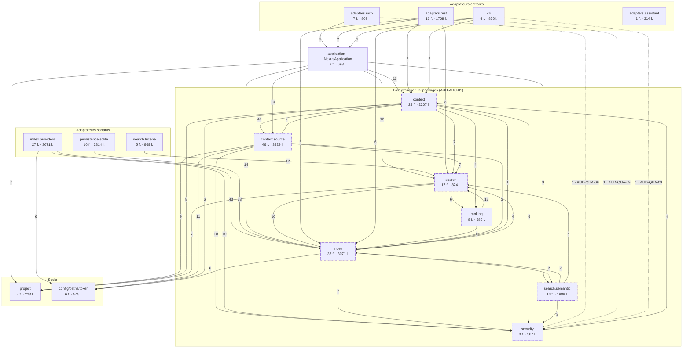

# Architecture observée — audit du 17 octobre 2026

Découpage **réellement observé**, reconstruit à partir des `import com.nexus.*` des 243 fichiers de production (script Tarjan sur le graphe des packages), comparé à [`docs/architecture.md`](../../architecture.md) et à ADR-0004.

## Ce que dit le code

4 modules Maven : core (219 fichiers, 32 packages, CLI incluse, tous les adaptateurs sortants SQLite/Lucene/JGit/JDT/SCIP/MINOS/Ollama), rest-quarkus, mcp-java, assistant-clients (sans dépendance au core). Adaptateurs entrants REST/MCP/CLI → NexusApplication (composition root explicite) → services ; project et persistence.sqlite hors cycles, Lucene et SQLite confinés à leurs packages. Mais le cœur métier forme un seul bloc cyclique de 12 packages (index, search, ranking, context, context.source, security…) : la séparation « par capacité » d'ADR-0004 n'est pas tenue au niveau des dépendances et rien ne la vérifie.

## Diagramme

Une flèche A → B signifie « A importe B » ; le poids est le nombre d'imports. Arêtes de poids ≥ 6 et toutes celles internes au bloc cyclique. Les arêtes pointillées vers `security` sont les appels directs des adaptateurs aux politiques de sortie (AUD-QUA-09).



## Volumes par famille

| Famille | Couche | Fichiers | Lignes |
|---|---|---:|---:|
| `context.source` | domaine + adaptateurs sources (JGit, YAML, fichiers) | 46 | 3929 |
| `index.providers` | adaptateurs sortants (JavaParser, JDT LS, SCIP, MINOS) | 27 | 3671 |
| `index` | domaine/service (indexation) + ports | 36 | 3071 |
| `persistence.sqlite` | adaptateur sortant (SQLite) | 16 | 2814 |
| `context` | domaine/service (contexte) | 23 | 2207 |
| `search.semantic` | service + ports + adaptateurs (Lucene KNN, Ollama) | 14 | 1988 |
| `adapters.rest` | adaptateur entrant | 16 | 1709 |
| `security` | transverse (sécurité/I-O sûres/politiques de sortie) | 8 | 967 |
| `adapters.mcp` | adaptateur entrant | 7 | 869 |
| `search.lucene` | adaptateur sortant (Lucene) | 5 | 869 |
| `cli` | adaptateur entrant (dans core) | 4 | 856 |
| `search` | domaine/service (recherche) + ports | 17 | 824 |
| `application` | application / composition root | 2 | 698 |
| `ranking` | domaine (ranking) | 8 | 586 |
| `config/paths/token` | transverse (config, chemins, tokens) | 6 | 545 |
| `adapters.assistant` | adaptateur (génération config clients) | 1 | 314 |
| `project` | domaine (projets) | 7 | 223 |

## Cycles

Composante fortement connexe (niveau package, préfixe `com.nexus` omis) :

```text
context, context.source, context.source.git, context.source.skill, index, index.scan, ranking, ranking.graph, search, search.semantic, search.semantic.ollama, security
```

Cycles bilatéraux (imports A→B / B→A) : context↔context.source 17/1, context↔context.source.git 7/4, context↔context.source.skill 17/2, context↔security 6/4, index↔index.scan 2/5, index↔search 4/10, index↔search.semantic 2/6, ranking↔search 7/5, ranking.graph↔search 6/1, search.semantic↔search.semantic.ollama 2/2.

## Ce qui tient

- Le cœur ne dépend d'aucun framework ; Lucene, SQLite, JGit et JavaParser restent dans leurs packages (`AUD-ARC-15`).
- Les adaptateurs REST et MCP sont minces et passent par `NexusApplication` ; `assistant-clients` ne dépend pas du cœur (`AUD-ARC-16`).
- Composition root explicite ; `project` n'a aucune dépendance sortante ; `persistence.sqlite` est hors cycle (`AUD-ARC-17`).
- Pas de god object : le plus gros fichier fait 532 lignes (`AUD-ARC-18`).

## Écarts avec le découpage annoncé

- ADR-0004:36 exige une séparation logique par capacité ; au niveau des dépendances, sept familles du cœur n'en forment qu'une (`AUD-ARC-01` à `AUD-ARC-06`).
- Rien ne protège les frontières : ni test d'architecture, ni `module-info`, 160 types publics sur 219 (`AUD-ARC-07`).
- La politique de sortie publique est appliquée par chaque adaptateur au lieu de la façade (`AUD-QUA-09`).
- La configuration est lue par `System.getenv` dans 12 classes du cœur (`AUD-ARC-12`).

## Ce que le diagramme ne montre pas

Un défaut interne à une boîte ne se voit pas sur un graphe de packages, et c'est là que se trouve l'essentiel des constats : la redaction par liste fermée (`AUD-SEC-01`), l'absence d'index SQLite sur `symbol_relations(file_id)` (`AUD-PRF-01`), la fédération qui recalcule tout par projet (`AUD-PRF-02`, `AUD-PRF-04`, `AUD-PRF-07`).

## Angles morts

- Graphe construit uniquement sur les instructions `import com.nexus.*` (+ résolution des imports de types imbriqués) : les références qualifiées en ligne (ex. com.nexus.security.PublicDiagnosticPolicy dans CliRenderer, com.nexus.project.ProjectReadiness dans SearchService) ne sont pas comptées comme arêtes ; vérification manuelle : elles ne créent pas de nouveau cycle (security et project déjà concernés) mais les poids sont sous-estimés.
- Dépendances entre classes d'un même package non analysées (granularité package).
- Aucun build ni jdeps exécuté (pas d'accès réseau Maven) : dépendances réflexives/ServiceLoader et classes générées non vues.
- Code de test non intégré au graphe (sauf la vérification ponctuelle des imports persistence.sqlite dans les adaptateurs).
- Adéquation fonctionnelle des verrous (importMinos sans LockSlot) non testée dynamiquement : constat AUD-ARC-10 limité à la divergence structurelle.
- Contenu détaillé des 55 ADR non relu un par un ; seuls ADR-0004 et les sections architecture.md/arc42 05 et 11 ont été confrontés au code.
