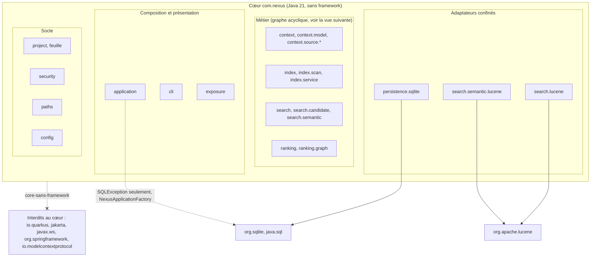
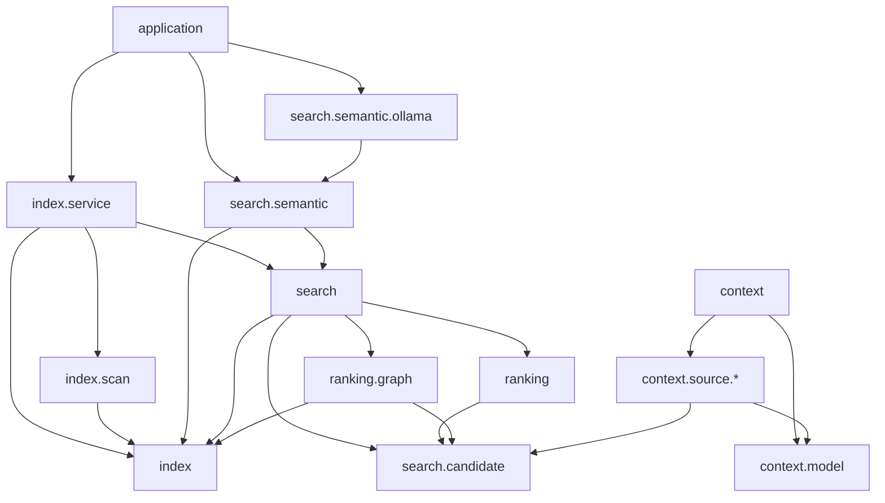
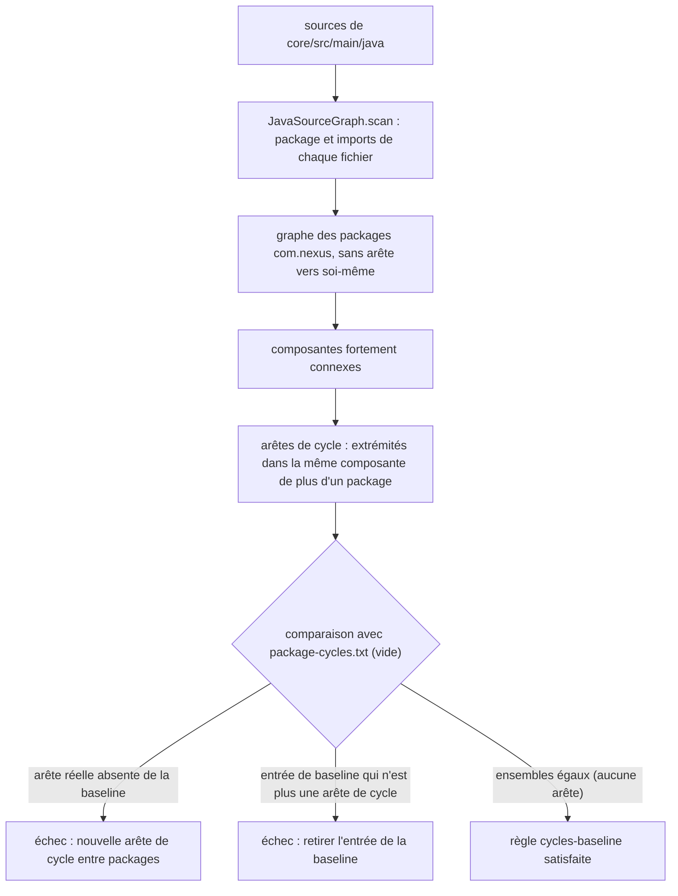

# Architecture d'implémentation — NEXUS 0.2.0

Ce chapitre décrit l'organisation concrète du code versionné après NXA3 + NXA4 et les remédiations d'audit du 7 septembre 2026. `develop` reçoit l'intégration qualifiée ; `main` reste la branche de release.

## Repository

```text
nexus-context-engine/
├── pom.xml
├── core/
│   ├── pom.xml
│   └── src/
│       ├── main/java/com/nexus/
│       ├── main/resources/db/migration/
│       ├── test/java/com/nexus/
│       └── test/resources/
├── adapters/rest-quarkus/
├── adapters/mcp-java/
├── adapters/assistant-clients/
├── distribution/
├── packaging/
├── scripts/
├── .github/workflows/
└── docs/
```

Le module `core` possède physiquement son layout Maven standard. Aucun `src/` applicatif n'existe à la racine et `core/pom.xml` ne redirige plus `sourceDirectory`, `testSourceDirectory`, resources ou test-resources vers le parent. Les artefacts publics et la distribution restent publiés sous les emplacements historiques de `target/` pour compatibilité.

Le parent gouverne Java 21, BOM/plugins, JaCoCo, SBOM et dépendances communes. Les versions de Quarkus et du SDK MCP sont celles des propriétés `quarkus.platform.version` et `mcp.sdk.version` du `pom.xml`.

## Composition root

`NexusApplication` compose les ports communs :

```text
NexusPaths
  ↓
SqliteDatabase
  ├─ SqliteProjectRepository
  └─ SqliteIndexRepository
  ↓
ProjectRegistry
ProjectIndexingService
SearchService
FederatedSearchService
DefaultContextBuilder
FederatedContextService
```

CLI, REST et MCP délèguent à cette façade.

### Configuration résolue en composition root

`NexusApplicationFactory` est la seule classe de `core/src/main` qui lit l'environnement du processus ([ARCH-0086](../architecture/adr/ARCH-0086-resoudre-la-configuration-et-nexus-home-dans-la-composition-root.md), complète [ARCH-0076](../architecture/adr/ARCH-0076-garder-un-coeur-java-sans-framework-acyclique-et-verifie.md)). Elle résout les variables `NEXUS_*` du cœur en un record `NexusConfiguration` depuis une `Map<String, String>` (l'environnement en production, une table en test), puis passe à chaque composant sa part par constructeur :

| Part | Résolue par | Injectée dans |
|---|---|---|
| taille maximale d'un fichier, bornes du scan | `ProjectFileLimits.maxFileSize(Map)`, `ProjectScanLimits.from(Map)` | `ProjectScanner`, partagé par l'indexation, JDT LS et MINOS |
| bornes de matérialisation et de découverte du contexte | `ContextMaterializationLimits.from(Map)`, `ContextDiscoveryLimits.from(Map)` | `ContextFragmentFactory`, `DefaultContextBuilder`, `FederatedContextService` |
| bornes SCIP | `ScipIndexLimits.from(Map)` | `ScipCodeIndexImporter` |
| indexations concurrentes | `ProjectIndexLockManager.maxConcurrentIndexing(Map)` | `ProjectIndexLockManager.fileBacked(paths, limite)` |
| timeout des providers | `ProjectIndexingService.providerTimeout(Map)` | `ProjectIndexingService` |
| JDT LS (opt-in, racines approuvées comprises) | `JdtLanguageServerCodeIntelligenceProvider.configuration(paths, Map)` | provider JDT, puis `BoundedJdtProcessBuilder` |

Deux parts valent pour tout le processus et sont installées par la composition root avant l'ouverture du stockage : la borne de taille des lectures `SafeFileIO` sans borne explicite (`ProjectFileLimits.configure`) et les postures `NEXUS_REQUIRE_STRICT_PATH_IO` / `NEXUS_REQUIRE_PRIVATE_STORAGE` (`SecurityPolicy.configure`, propriété JVM prioritaire). Les points d'entrée obtiennent `NEXUS_HOME` par `NexusConfiguration.pathsFromEnvironment()` ; l'adaptateur REST installe aussi les postures avant `NexusRestExposureGuard`. La configuration sémantique reste un paramètre explicite des fabriques de `NexusApplication`. Noms de variables, bornes, valeurs par défaut et messages d'erreur sont ceux des classes de limites. La règle `getenv-composition-root` du test d'architecture interdit tout autre `System.getenv` dans le cœur.

## Indexation et persistance

`ProjectIndexingService` orchestre mutex JVM + `FileLock`, scan borné, fingerprint canonique, analyses, SQLite, index dérivés, revalidation puis `READY`. Les lectures de la façade prennent le verrou partagé du projet pendant toute leur exécution afin de ne pas traverser un rebuild.

Une erreur de provider/importer ou une mutation canonique détectée pendant l'opération fait passer le projet à `FAILED` avant propagation de l'échec. Un provider explicitement demandé ne produit pas un succès dégradé silencieux.

V004 invalide les anciens index contenant des plages invalides ; V005 reconstruit `symbols` avec les `CHECK` :

```text
start_line >= 1
end_line >= start_line
```

Les migrations sont forward-only et enregistrées avec `script_sha256`.

## Stockage NEXUS

`PrivateStoragePolicy.ensurePrivateStorage(paths)` (package `com.nexus.security` ; `NexusPaths` ne fait que résoudre les chemins) précède l'ouverture/migration de SQLite :

```text
home / indexes / locks  -> 0700 sur POSIX
nexus.db                -> 0600 sur POSIX
```

Les chemins persistants durcis concernés sont refusés lorsqu'ils sont symboliques. Sur Windows/filesystems sans vue POSIX, les ACL natives sont conservées et inspectées sur chaque chemin sensible.

Par défaut, un principal inattendu disposant de droits sensibles déclenche un diagnostic sans réécriture destructive. `NEXUS_REQUIRE_PRIVATE_STORAGE=true` active le mode strict : ACL sensible inattendue, échec d'inspection ou absence simultanée de vues POSIX/ACL ⇒ `IOException` fail-closed.

## Frontière filesystem

`ProjectPathGuard` est la frontière partagée pour les lectures projet durcies. SCIP, instructions/références, skills locaux/registry et customisations concernées refusent traversal, symlink final et symlink d'ancêtre.

`SafeFileIO` utilise `SecureDirectoryStream` lorsqu'il est exposé par le provider. Le fallback portable capture, avant ouverture, le chemin réel, le type et le `fileKey` de chaque composant ; après ouverture `NOFOLLOW_LINKS`, les mêmes informations sont revalidées et le channel est fermé si une substitution visible est détectée. Cette stratégie réduit fortement la fenêtre TOCTOU sans prétendre sandboxer un filesystem local hostile capable d'un échange/rétablissement extrêmement rapide ou de sémantiques de montage particulières.

Le scanner ajoute des exclusions sensibles (`.aws`, `.ssh`, `.gnupg`, `.kube`, credentials/keystores, etc.).

La découverte native utilise un `ContextDiscoveryBudget` commun à `DefaultContextBuilder` :

- entrées visitées ;
- candidats ;
- octets cumulés ;
- deadline.

Les limites sont consommées avant le travail coûteux lorsque possible et un dépassement échoue fermé.

## Code Intelligence

### JavaParser

Le parcours AST cible directement `TypeDeclaration`, méthodes, constructeurs et imports nécessaires ; il ne parcourt plus arbitrairement tous les `Node` pour retrouver les types.

### SCIP

SCIP reste opportuniste et confiné. Les vérifications de bounds protobuf utilisent une formulation résistante aux overflows (`length > data.length - position`) avant lecture. Les plafonds transport sont non extensibles : 256 MiB pour l'index et 16 MiB par message maximum.

### Politique commune de métadonnées

`CodeIntelligenceMetadataPolicy` borne les champs en octets UTF-8 puis refuse un snapshot au-delà de :

```text
100 000 symboles
250 000 relations
64 MiB de métadonnées UTF-8 cumulées
```

La validation intervient avant les maps de canonicalisation/déduplication secondaires.

### JDT LS

`JdtJsonRpcFrameReader` borne :

```text
MAX_MESSAGE_BYTES      16 MiB
MAX_HEADER_BYTES       64 KiB
MAX_HEADER_LINE_BYTES  8 KiB
MAX_PENDING_MESSAGES   256
```

La file entrante est bornée ; saturation/framing invalide détruit la session fail-closed.

Avant `Process.start()`, la racine canonique exacte du projet doit figurer dans `NEXUS_JDTLS_TRUSTED_PROJECT_ROOTS`. Une racine parente ne donne pas confiance implicitement à ses descendants et la variable de confiance n'est pas transmise au subprocess.

`ExternalTaskRunner` borne les intégrations externes à **8 workers réellement actifs**. La capacité n'est rendue qu'à la fin réelle du worker, même si l'appelant a déjà reçu un timeout. Le circuit-breaker linéarise validation+démarrage contre l'ouverture liée au timeout.

La composition de production courante n'exécute pas de provider Java tiers arbitraire : JDT LS est déjà un subprocess et SCIP un import local. Une isolation processus générique supplémentaire n'est donc pas introduite sans provider réel démontrant un comportement non coopératif.

## Recherche

`LuceneSearchIndex` utilise cinq champs de recherche et borne l'analyse à **128 termes uniques** avant expansion par `MultiFieldQueryParser`, afin de rester sous le budget par défaut de clauses Lucene.

Les recherches symboles/usages et les projections de graphe sont ciblées/bornées côté repository.

La comparaison ABBA `runtime-flags-qualification.yml` a mesuré le contrat de production face à `--add-modules=jdk.incubator.vector`. Le gain global observé n'était pas suffisamment robuste et le p95 graphe régressait légèrement ; le Vector API reste donc absent des launchers de production jusqu'à nouvelle mesure probante.

## Fédération

`FederatedScopePolicy` limite la portée à **100 projets uniques**. Les surfaces valident la cardinalité canonique avant `requireReadyProject` ou résolution équivalente.

Une portée valide est ensuite transmise à `FederatedSearchService`/`FederatedContextService` sous budget de travail et budget final.

Les limites REST fédérées réutilisent `ResultLimitPolicy` et `ContextBudgetPolicy` ; elles ne possèdent pas une limite parallèle plus permissive.

## Contexte et secrets

`ContextRequest` refuse une map `constraints` non vide tant que la fonctionnalité n'est pas implémentée.

`SensitiveContentRedactor` est appliqué :

- aux contenus avant embeddings sémantiques ;
- aux fragments de contexte retournés au client.

Les blocs privés multilignes conservent leurs séparateurs de lignes après redaction afin de ne pas déplacer les ranges source.

Le profil sémantique est `content-v5`, ce qui rend un index historique incompatible et force sa reconstruction.

## Ollama

`OllamaEndpointResolver` valide le transport avant adaptation runtime :

- HTTP loopback autorisé ;
- HTTPS distant autorisé ;
- HTTP distant refusé par défaut ;
- HTTP distant possible uniquement avec `NEXUS_ALLOW_INSECURE_REMOTE_OLLAMA=true` ;
- URI avec userinfo/credentials refusée ;
- en Docker, un loopback validé peut être adapté vers `host.docker.internal`.

`OllamaEmbeddingProvider` borne la réponse `/api/embed` avant matérialisation JSON et valide dimension/valeurs finies.

`.github/workflows/semantic-search-qualification.yml` apporte la preuve réelle (corpus réduit sur PR, corpus complet sur `develop` après fusion, manuelle et mensuelle ; BE-0084) : téléchargement Ollama 0.33.3 depuis la release officielle, vérification SHA-256 repository-pinned, endpoint loopback, modèle `qwen3-embedding:0.6b`, `RealSemanticSearchBenchmarkTest`, floors de qualité/non-régression et artefacts de preuve.

## Git local

`LocalGitContextSourceProvider` borne commits récents, chemins, historique, co-changements et patches cibles. Les arbres de commits sont parcourus incrémentalement sous budget avant collecte. Le patch working-tree est écrit dans `BoundedOutput`, sink à capacité fixe, avant conversion/troncature à 6 000 caractères.

## REST

`NexusRestExposureGuard` et `NexusRestTransportPolicy` valident une exposition API non-loopback : token généré par CSPRNG et conforme au gate structurel, roots autorisées et transport effectif.

Le gate de token rejette les valeurs trop courtes ou à diversité de caractères manifestement insuffisante, mais ne prétend pas mesurer l'entropie cryptographique d'une chaîne statique.

Quarkus possède deux listeners distincts :

```text
application  127.0.0.1:8080
management   127.0.0.1:9000
```

Health/metrics `/q/*` sont servis par le management listener uniquement. Le reverse proxy métier ne doit pas le publier.

## MCP

Le module utilise le SDK MCP (propriété `mcp.sdk.version` du `pom.xml`) en STDIO. `stdout` reste réservé au framing JSON-RPC. NEXUS conserve STDIO comme transport local supporté.

## Supply-chain

NEXUS CI vérifie les ancres Maven/JDT LS, l'ancre Ollama de qualification et les contrats documentaires avant le reactor. CodeQL qualifie l'exact head. OSV scanne delta PR + SBOM reactor. SonarCloud fournit le Quality Gate externe de PR.

Docker Distribution construit une image unique, exécute smokes/Trivy/SBOM puis exporte l'image exacte si la release la demande. `release.yml` ne rebuild pas cette image : il vérifie archive/ID et publie les tags immuables sous preflight GHCR fail-closed/resumable.

## Gouvernance

Le ruleset GitHub actif `Protect main & develop` satisfait NXA3-14 / #130 pour `develop` : pull request obligatoire, suppression/non-fast-forward interdits et checks permanents requis.

NEXUS est actuellement maintenu par **une seule personne**. Le modèle solo n'exige ni seconde approbation humaine ni resynchronisation stricte avec la base juste avant merge ; ces absences ne sont pas des hardenings ouverts. La qualification repose sur le SHA candidat et les gates automatisés applicables. Voir [`branch-governance.md`](branch-governance.md).

## Séparation des capacités internes (septembre 2026)

Les contrats publics restent portés par leurs façades. Les nouveaux collaborateurs
sont internes au package et utilisent la composition, sans framework ni registre global.

| Façade | Responsabilités déléguées |
|---|---|
| `NexusApplication` | `NexusApplicationFactory` compose les ports ; la façade conserve les gates publics et la fermeture des ressources. |
| `JdtLanguageServerCodeIntelligenceProvider` | `JdtProcessLauncher` démarre via le constructeur de processus sécurisé ; `JdtStdioSession` porte la session JSON-RPC bornée ; `JdtWorkspaceMessages` et `JdtDocumentMessages` construisent les messages ; `JdtSymbolMapper`, `JdtLocationMapper` et `JdtRelationCollector` convertissent les faits. |
| `SqliteIndexRepository` | `SqliteFileQueries`, `SqliteSymbolSearch`, `SqliteRelationQueries`, `SqliteGraphQueries`, `SqliteFileWriter`, `SqliteProviderWriter` partagent la même `SqliteDatabase`. `SqliteIndexRows` porte le mapping JDBC et `SqliteIndexSql` les primitives communes. Aucune connexion ni transaction n’est déplacée hors de son ancienne portée. |
| `ScipCodeIndexImporter` | `ScipWireInput`, `ScipProtoReader`, `ScipDocumentParser`, `ScipParseBudget` et `ScipPayload` lisent le flux borné ; `ScipSnapshotMapper` accumule un snapshot par import avec vérification des chemins, plages et cardinalités. Aucun outil externe n’est exécuté par cet importeur. |
| `MinosCodeIndexImporter` | `MinosPayloadReader`, `MinosDocumentParser`, `MinosFactMapper`, `MinosPathPolicy` séparent transport, contrat JSON, conversion et identité des chemins. |
| `ProjectIndexingService` | `IndexDocumentPublisher` analyse les fichiers revalidés et publie les lots lexicaux/sémantiques ; `ExternalCodeIntelligenceRefresher` gère imports/providers via `ExternalTaskRunner`. La façade conserve verrous, delta canonique et transitions d’état. |
| `DefaultContextBuilder` | `NativeContextPipeline`, `TaskContextMaterializer`, `ContextBudgetAllocator`, `ContextBuildMetadata` exposent les étapes ; les résultats intermédiaires immuables sont regroupés dans `ContextPipelineState`. L’ordre, les budgets partagés et les scores sont préservés. |
| `LocalGitContextSourceProvider` | `GitWorkingTreeContext` produit le diff borné ; `GitContextFragments` rend les fragments d’historique et co-changements. |
| `NexusMcpTools` | `McpToolArguments`, `McpToolSchemas`, `McpProjectResolver` isolent validation, schémas et résolution via la façade ; la réponse vient de `PublicOutputProjection`. |
| `CliRenderer` | Sérialise les structures de `PublicOutputProjection` (clé `command` en tête) et conserve la présentation terminal et sa sanitation. |

Les frontières ports/adaptateurs et les décisions architecturales existantes ne
changent pas : les adapters appellent toujours `NexusApplication`, SQLite reste
canonique et Lucene reconstructible. Ce découpage ne remplace aucun ADR accepté.

## Frontières vérifiées du cœur

`core/src/test/java/com/nexus/architecture/CoreArchitectureTest.java` ([ARCH-0076](../architecture/adr/ARCH-0076-garder-un-coeur-java-sans-framework-acyclique-et-verifie.md)) lit les sources de `core/src/main/java` sans dépendance de test supplémentaire : déclarations `package` et `import` (dont `import static` et les jokers), plus les noms pleinement qualifiés des préfixes surveillés ; commentaires, chaînes et blocs de texte sont ignorés. Il s'exécute dans la suite par défaut du module `core`.

| Règle | Contrainte |
|---|---|
| `core-sans-framework` | aucun type `io.quarkus`, `jakarta`, `javax.ws`, `org.springframework`, `io.modelcontextprotocol` |
| `lucene-confine` | `org.apache.lucene` seulement dans `com.nexus.search.lucene` et `com.nexus.search.semantic.lucene` |
| `sqlite-confine` | `org.sqlite` et `java.sql` seulement dans `com.nexus.persistence.sqlite`, plus la liste fermée `SQLITE_EXCEPTIONS` de `CoreArchitectureRules` (`java.sql.SQLException` dans `NexusApplicationFactory`, qui l'enveloppe en `PersistenceException`) |
| `project-feuille` | `com.nexus.project` n'importe aucun autre package `com.nexus` |
| `cycles-baseline` | les arêtes de cycle du graphe des packages sont égales à `core/src/test/resources/architecture/package-cycles.txt`, vide ([ARCH-0076](../architecture/adr/ARCH-0076-garder-un-coeur-java-sans-framework-acyclique-et-verifie.md)) : tout cycle échoue |
| `index-sans-search` | `com.nexus.index` et ses sous-packages, hors `com.nexus.index.service`, n'importent rien de `com.nexus.search` |
| `context-source-sans-context` | `com.nexus.context.source` et ses sous-packages n'importent aucun type du package `com.nexus.context` (`context.model` reste permis) |
| `ranking-sans-search` | `com.nexus.ranking` et `ranking.graph` n'importent aucun type du package `com.nexus.search` (`search.candidate` reste permis) |
| `search-semantic-sans-ollama` | `com.nexus.search.semantic` n'importe rien de `com.nexus.search.semantic.ollama` |
| `getenv-composition-root` | aucun `System.getenv` (simple, pleinement qualifié ou importé en statique) hors de `com.nexus.application.NexusApplicationFactory` ([ARCH-0086](../architecture/adr/ARCH-0086-resoudre-la-configuration-et-nexus-home-dans-la-composition-root.md)) |

Un message d'échec a la forme `[règle] classe -> nom importé`. La baseline de cycles liste une arête `source -> cible` par ligne, triée ; elle est vide : une arête de cycle nouvelle échoue, et une entrée qui ne forme plus de cycle échoue aussi. Lancement ciblé :

```bash
./mvnw -B -ntp -pl core test -Dtest='*Architecture*' -Dsurefire.failIfNoSpecifiedTests=false -Djacoco.skip=true
```

## OpenSpec core-package-boundaries

Spec : [`openspec/specs/core-package-boundaries/spec.md`](../../openspec/specs/core-package-boundaries/spec.md) ; matrice de traçabilité : [openspec-traceability.md](openspec-traceability.md). La section « Frontières vérifiées du cœur » ci-dessus décrit les règles ; celle-ci ajoute l'état réel de la baseline, les vues structurelles et les écarts. Le changement `sprint-07-casser-le-bloc-cyclique-du-coeur` ([ARCH-0076](../architecture/adr/ARCH-0076-garder-un-coeur-java-sans-framework-acyclique-et-verifie.md)) a cassé les cycles : le graphe est acyclique et la baseline vide. Sa spec n'est pas encore fusionnée dans `openspec/specs/`, qui garde l'exigence « Les cycles de packages ne peuvent que décroître ».

### Comportement existant vérifié

| Fait | Nature | Source |
|---|---|---|
| Le test d'architecture est `CoreArchitectureTest` ; il ne dépend pas d'ArchUnit mais d'un analyseur maison de sources (`JavaSourceGraph`), sans dépendance de test supplémentaire dans le module. | [Existant vérifié] | `core/src/test/java/com/nexus/architecture/CoreArchitectureTest.java:28-43`, `core/src/test/java/com/nexus/architecture/JavaSourceGraph.java:36`, `core/pom.xml` (aucune occurrence d'`archunit`) |
| Aucun tag, aucune condition d'activation sur le test ; la configuration Surefire du module ne fixe que le répertoire de travail (`..`), que le test suppose en lisant `core/src/main/java`. | [Existant vérifié] | `core/src/test/java/com/nexus/architecture/CoreArchitectureTest.java:30,41`, `core/pom.xml:62-66` |
| Dix règles nommées : `core-sans-framework`, `lucene-confine`, `sqlite-confine`, `project-feuille`, `cycles-baseline`, `index-sans-search`, `context-source-sans-context`, `ranking-sans-search`, `search-semantic-sans-ollama`, `getenv-composition-root`. Une violation est rendue `[règle] classe -> nom importé`. | [Existant vérifié] | `core/src/test/java/com/nexus/architecture/CoreArchitectureRules.java:18-27`, `CoreArchitectureTest#getenvOutsideTheCompositionRootFailsGetenvRule` |
| Le message d'échec est vérifié exactement pour chaque règle de confinement et de sens. | [Existant vérifié] | `CoreArchitectureTest#frameworkImportFailsCoreWithoutFramework`, `#luceneImportOutsideItsPackagesFailsLuceneConfined`, `#jdbcImportInContextFailsSqliteConfined`, `#upwardImportFromProjectFailsProjectLeaf`, `#searchImportFromIndexFailsIndexWithoutSearchButNotFromTheServicePackage`, `#contextImportFromASourceFailsContextSourceWithoutContext`, `#searchImportFromRankingFailsRankingWithoutSearchButNotTheCandidateModel`, `#ollamaImportFromThePortFailsSearchSemanticWithoutOllama` |
| Une référence pleinement qualifiée sans import compte pour les préfixes surveillés (framework, Lucene, SQLite/JDBC) ; commentaires, chaînes et blocs de texte sont ignorés. | [Existant vérifié] | `CoreArchitectureRules.java:34`, `CoreArchitectureTest#qualifiedLuceneNameWithoutImportFailsLuceneConfined`, `#parserReadsStaticWildcardAndQualifiedNamesAndIgnoresCommentsAndStrings` |
| La liste fermée de `sqlite-confine` compte une seule entrée `java.sql.SQLException` : `NexusApplicationFactory`, qui enveloppe l'échec d'ouverture du stockage en `PersistenceException` (cause conservée). `NexusApplication`, `NexusCli` et toute autre classe qui importe `java.sql` échouent. | [Existant vérifié] | `CoreArchitectureRules.java:49-54`, `CoreArchitectureTest#closedSqlExceptionListPassesSqliteConfinedButNothingElse` |
| La baseline de cycles ne contient plus aucune arête : son fichier ne porte que trois lignes de commentaire, et un test l'exige vide. Le graphe des packages est acyclique. | [Existant vérifié] | `core/src/test/resources/architecture/package-cycles.txt`, `CoreArchitectureTest#cycleBaselineIsEmpty` |
| Le graphe des packages n'est construit que depuis les `import` (les références pleinement qualifiées vers `com.nexus` n'y entrent pas) ; une arête de cycle est une arête dont les deux extrémités sont dans une même composante de plus d'un package. | [Existant vérifié] | `core/src/test/java/com/nexus/architecture/JavaSourceGraph.java:100-141` |
| La baseline doit être triée et sans doublon (test dédié). Une arête nouvelle et une entrée devenue fausse sont deux échecs distincts ; un cycle `ranking` ↔ `search` contre la baseline vide échoue en nommant les deux arêtes. | [Existant vérifié] | `CoreArchitectureTest#cycleBaselineIsSorted`, `#newCycleEdgeFailsTheBaselineAndNamesThePackages`, `#staleBaselineEntryFailsAndAsksForItsRemoval`, `#rankingImportingSearchFailsTheEmptyBaselineAndNamesBothPackages`, `CoreArchitectureRules.java:82-98` |
| `PublicContextPolicy` est dans `com.nexus.exposure` et aucun fichier de `com.nexus.security` n'importe `com.nexus.context` ; les imports `com.nexus` de `security` sont `config` et `paths`. | [Existant vérifié] | `core/src/main/java/com/nexus/exposure/PublicContextPolicy.java:1-14`, relevé des `import` de `core/src/main/java/com/nexus/security/` au HEAD |
| Le package `com.nexus.project` n'importe aucun autre package `com.nexus` au HEAD (relevé des imports). | [Existant vérifié] | relevé des `import` de `core/src/main/java/com/nexus/project/`, règle `CoreArchitectureRules.java:73-76` |
| L'orchestration de l'indexation (`ProjectIndexingService`, `IndexDocumentPublisher`, `IndexPublication`, `ExternalCodeIntelligenceRefresher`) est dans `com.nexus.index.service` ; `SearchDocument` est dans `com.nexus.index` et `ResultLimitPolicy` dans `com.nexus.config`. | [Existant vérifié] | `core/src/main/java/com/nexus/index/service/`, `core/src/main/java/com/nexus/index/SearchDocument.java`, `core/src/main/java/com/nexus/config/ResultLimitPolicy.java` |
| L'indexation sémantique est un port : `SemanticIndexing` (`enabled()`, `isCompatible`, `openSession`), implémenté par `SemanticIndexingService` ; `SemanticIndexing.disabled()` remplace `null`, et l'orchestration teste `enabled()`. | [Existant vérifié] | `core/src/main/java/com/nexus/index/SemanticIndexing.java:18-23`, `core/src/main/java/com/nexus/index/service/ProjectIndexingService.java:236`, `core/src/main/java/com/nexus/index/service/IndexDocumentPublisher.java:68`, `core/src/main/java/com/nexus/application/NexusApplicationFactory.java:154`, `core/src/test/java/com/nexus/index/SemanticIndexingDisabledTest.java` |
| Le modèle de contexte (`ContextFragment`, `ContextItem`, `ContextSelectionResult`) est dans `com.nexus.context.model` ; les candidats de recherche (`SearchCandidate`, `SearchSignals`, `CandidateType`, `CandidateEnricher`, `CandidateMerger`) sont dans `com.nexus.search.candidate`. | [Existant vérifié] | `core/src/main/java/com/nexus/context/model/`, `core/src/main/java/com/nexus/search/candidate/` |
| La lecture de l'environnement sémantique et la construction d'`OllamaEmbeddingProvider` sont dans `NexusApplicationFactory` ; `SemanticSearchConfiguration` ne garde que les valeurs, les noms de variables et les bornes. | [Existant vérifié] | `core/src/main/java/com/nexus/application/NexusApplicationFactory.java:242,247` |

### Vues

Vue organigramme de composants (non UML, lecture C4 simplifiée) — quels packages du cœur sont confinés par une règle et quelles bibliothèques leur sont interdites (existant) ?



Le groupement « Facade, Métier, Confinés, Socle » est une aide de lecture, pas une règle du test. Les flèches vers les bibliothèques, la feuille `project` et les quatre règles de sens sont imposées ; les autres dépendances entre packages ne sont contrôlées que par l'absence de cycle. Exigences : `core-package-boundaries › Le cœur ne dépend d'aucun framework applicatif`, `core-package-boundaries › Lucene est confiné à ses adaptateurs`, `core-package-boundaries › SQLite et JDBC sont confinés à la persistance`, `core-package-boundaries › Le package project est une feuille`, `core-package-boundaries › La politique de sortie ne dépend pas du package security`.

Vue organigramme (non UML) — quel est le sens de dépendance entre les packages du cœur après les déplacements, et lesquels sont des feuilles de modèle (existant, graphe acyclique) ?



Une flèche va du package dépendant vers le package dont il dépend. `index.service` est le seul package d'orchestration de l'indexation ; `index`, `search.candidate` et `context.model` ne dépendent d'aucun package orchestrateur. La vue ne montre que les arêtes que l'ADR nomme ; le graphe complet est vérifié par `cycles-baseline`. Exigences : `core-package-boundaries › Les cycles de packages ne peuvent que décroître`.

Vue organigramme (non UML) — comment le test `cycles-baseline` décide-t-il de l'échec (existant) ?



Les deux échecs peuvent survenir ensemble. Une baseline non triée ou avec doublon échoue par un test distinct (`cycleBaselineIsSorted`). Exigences : `core-package-boundaries › Les cycles de packages ne peuvent que décroître`, `core-package-boundaries › Le test d'architecture fait partie de la suite par défaut`.

### Écarts et limites

- [Écart] Le scénario « Nouveau cycle » demande que le test « nomme les packages du cycle ». Le message nomme l'arête (`com.nexus.b -> com.nexus.a`), pas le cycle complet (`CoreArchitectureTest#newCycleEdgeFailsTheBaselineAndNamesThePackages`).
- [Écart] Le scénario « Contrôle des imports » (aucun `import com.nexus.context` dans `security`) n'a aucune règle ni test : le relevé a été fait à la main au HEAD. La première moitié de l'exigence (politique d'exposition hors de `security`) n'a pas non plus de garde automatisée. `test non écrit`.
- [Écart] Le scénario « Build standard » (le test s'exécute et passe par `./mvnw -B -ntp -pl core test`) n'est pas démontré par un test : c'est le comportement de la suite par défaut, prouvé par le run CI du reactor (`NEXUS CI`, job « Linux reactor Maven build », `./mvnw -B clean install`, `.github/workflows/ci.yml:105-108`). Rien n'a été exécuté pour cette documentation.
- [Écart] Le design du sprint 7 range `ResultLimitPolicy` et `SearchDocument` dans un même package feuille. Impossible : `SearchDocument` dépend de `CodeSymbol` et `FileCategory` (`index`), que `index` ne peut pas importer en retour. `SearchDocument` est donc dans `index` et `ResultLimitPolicy` dans `config`.
- [Écart] Le design du sprint 7 laissait le package du port sémantique « à fixer » ; le port `SemanticIndexing` est dans `index`, avec `SearchDocument` qu'il manipule.
- [Écart] La baseline n'a pas été supprimée : le fichier reste, vide, et la règle `cycles-baseline` l'applique ; la spec du changement dit « sans baseline de cycles tolérés ». Ajouter une ligne contredit [ARCH-0076](../architecture/adr/ARCH-0076-garder-un-coeur-java-sans-framework-acyclique-et-verifie.md) et se voit dans le diff.
- Limite : seuls les `import` alimentent le graphe des packages. Une dépendance `com.nexus.*` écrite en nom pleinement qualifié sans import échappe aux règles `project-feuille`, `cycles-baseline` et aux quatre règles de sens ; la détection des noms qualifiés ne vaut que pour les préfixes framework, Lucene et SQLite/JDBC (`JavaSourceGraph.java:100-114`, `CoreArchitectureRules.java:34`).
- Limite : la baseline est une égalité d'ensembles, pas un plafond. Ajouter une arête dans une composante qui contient déjà ses deux extrémités échoue aussi.
- Limite : les règles de sens couvrent quatre sens ; les autres dépendances hors cycles (par exemple `exposure` vers `context`) ne sont pas contrôlées.

### Propositions et questions ouvertes

- [Question] Faut-il une règle automatisée pour la dernière exigence (`security` sans `context`, politique d'exposition hors de `security`) ?
- [Question] Faut-il supprimer le fichier de baseline et la règle `cycles-baseline` au profit d'une règle d'acyclicité sans baseline, comme l'énonce la spec du sprint 7 ?
- [Proposition] Faire détecter par l'analyseur les noms `com.nexus.*` pleinement qualifiés pour que `project-feuille`, `cycles-baseline` et les règles de sens ne dépendent plus de l'usage d'un import.

## OpenSpec user-facing-error-language

Spec : [`openspec/specs/user-facing-error-language/spec.md`](../../openspec/specs/user-facing-error-language/spec.md) ; matrice de traçabilité : [openspec-traceability.md](openspec-traceability.md).

Un message d'exception atteignable depuis la CLI, REST, MCP, un fichier fourni ou une variable `NEXUS_*` est en français ; les préconditions internes suivent la langue du fichier. La frontière est écrite dans `.claude/rules/java-core.md`.

### Comportement existant vérifié (user-facing-error-language)

| Étiquette | Fait | Source |
|---|---|---|
| [Existant vérifié] | Une requête fédérée vide, un budget nul ou inférieur au scope et un scope vide sont refusés en français par la façade. | `core/src/test/java/com/nexus/application/FederatedContextServiceUserMessageTest.java#blankFederatedQueryIsRejectedInFrenchThroughTheFacade` |
| [Existant vérifié] | Une dimension Ollama hors de 1 à 1024 est refusée en français, par la composition comme par le provider. | `core/src/test/java/com/nexus/application/OllamaEmbeddingProviderUserMessageTest.java#outOfRangeConfiguredDimensionsAreRejectedInFrenchByTheComposition` |
| [Existant vérifié] | Un chemin fourni invalide et un budget de sélection non positif sont refusés en français. | `core/src/test/java/com/nexus/paths/RepositoryPathTest.java#reportsAnInvalidProviderPathInFrench`, `core/src/test/java/com/nexus/context/BudgetedContextSelectorBudgetMessageTest.java#nonPositiveBudgetIsRejectedInFrench` |

### Écarts et limites (user-facing-error-language)

- Aucun contrat ne lit la règle de `.claude/rules/java-core.md` ; les tests ci-dessus vérifient les messages, pas la règle.
