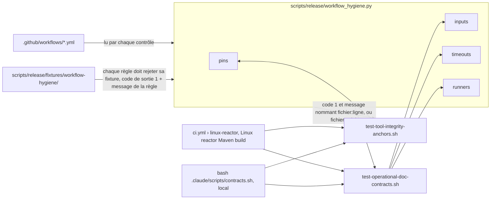
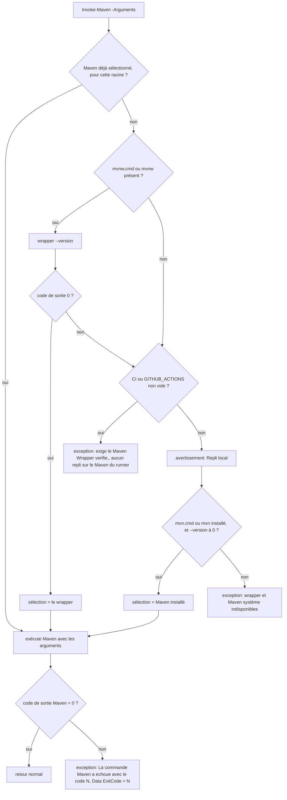

# CI, couverture et supply-chain

Ce document décrit le contrat courant de qualification et de publication de NEXUS 0.2.0 après les campagnes **NXA3 + NXA4 + NXA7**. Le code et les workflows versionnés restent l'autorité exécutable.

## Branches et exact-head

`develop` est la branche d'intégration. `main` est la branche de release. Une promotion vers `main` n'est autorisée qu'après qualification du **HEAD exact** candidat.

NEXUS CI et CodeQL checkoutent explicitement `github.event.pull_request.head.sha` sur pull request. CodeQL vérifie ensuite que `git rev-parse HEAD` correspond au SHA attendu.

Le ruleset GitHub actif `Protect main & develop` protège effectivement `develop` et `main`, exige le passage par pull request, interdit suppression/non-fast-forward et impose les checks permanents approuvés. NXA3-14 / #130 est satisfait.

NEXUS est actuellement maintenu par **un seul mainteneur**. La politique de merge repose donc sur la PR, le SHA candidat et les gates automatisés ; elle n'exige ni seconde approbation humaine ni resynchronisation stricte de la branche avec sa base juste avant merge. Les audits ne doivent pas traiter ces absences comme des hardenings tant que le modèle de maintenance n'est pas explicitement modifié.

Les workflows versionnés conservent en plus une défense en profondeur sur les pushes directs `develop` : NEXUS CI, CodeQL et OSV écoutent directement la branche ; les gates Docker, benchmarks et Windows sont réutilisés par des callers dédiés avec leurs filtres de chemins.

## NEXUS CI

`.github/workflows/ci.yml` qualifie `develop` et `main` :

- Windows : Java 21.0.12 épinglé (Temurin `21.0.12+101.0.LTS`, version livrée), tests des hooks Claude Code et du contrat token REST, puis qualification locale `scripts/validate-phase-6.ps1` ; en CI (`CI` ou `GITHUB_ACTIONS` définie), ce script échoue si le Maven Wrapper vérifié échoue, sans repli sur le Maven du runner ;
- Linux : Java 21, **Maven 3.10.0**, reactor complet, tests, distribution, JaCoCo, SBOM et notices ;
- vérification explicite des ancres d'intégrité Maven/JDT LS et des autres outils de qualification versionnés ;
- vérification des contrats documentaires machine-vérifiables **avant** le reactor.

Le profil Maven `ci-strict-specified-tests` s'active automatiquement lorsque `CI=true`. Il force alors `surefire.failIfNoSpecifiedTests=true` : toute commande CI ciblée avec `-Dtest=...` échoue si le sélecteur ne correspond à aucun test. Hors CI, la valeur reste `false` afin de préserver les scripts développeur historiques qui sélectionnent un test `core` depuis le reactor multi-module.

JaCoCo est un gate du lifecycle `verify`, pas seulement un rapport : chaque bundle de code doit conserver les seuils de lignes et de branches versionnés dans les POM. Les seuils sont placés sous la baseline courante afin de bloquer les régressions significatives sans transformer l'ajout du gate en hausse artificielle immédiate de couverture.

Le gate documentaire contrôle notamment :

- listener management `127.0.0.1:9000` séparé du listener API ;
- politique Ollama distante et opt-in HTTP ;
- redaction de secrets + profil `content-v7` ;
- JDT LS : confiance racine exacte + framing 16 MiB / 64 KiB / 8 KiB / 256 messages ;
- maximum 8 tâches externes actives et circuit-breaker linéarisé ;
- métadonnées Code Intelligence bornées avant canonicalisation ;
- Lucene : 128 termes analysés uniques ;
- stockage POSIX : 0700/0600 et mode ACL fail-closed optionnel ;
- revalidation filesystem du fallback `SafeFileIO` ;
- `constraints` non supportées rejetées ;
- installateur JDT LS vérifié contre l'ancre repository-pinned ;
- qualification sémantique réelle exact-head disponible avec runtime Ollama épinglé ;
- non-adoption mesurée du Vector API dans les launchers de production ;
- politique de maintenance solo documentée.

## Hygiène des workflows

`scripts/release/workflow_hygiene.py` vérifie les workflows de `.github/workflows/` ; chaque contrôle rejette aussi une fixture négative de `scripts/release/fixtures/workflow-hygiene/`.

- **Épinglage** (`test-tool-integrity-anchors.sh`) : chaque `uses:` externe est épinglé par SHA complet suivi de `# vX.Y.Z` ; un même SHA porte le même commentaire partout ; une action n'a qu'une version majeure dans l'ensemble des workflows. La concordance avec les tags amont n'est pas vérifiée en CI : elle se vérifie à la main lors d'une montée, par `git ls-remote --tags` (skill `nexus-dependency-bump`). Les workflows réutilisables OSV sont épinglés sur le SHA de **commit** d'un tag publié, jamais sur le SHA de l'objet tag.
- **Inputs** (`test-operational-doc-contracts.sh`) : aucune expression `${{ inputs.` dans un bloc `run:` ; la valeur passe par une variable d'environnement de l'étape (`REQUESTED: ${{ inputs.profile }}`), puis la validation `ci|full` s'applique à la variable.
- **Durée** (`test-operational-doc-contracts.sh`) : tout job qui déclare `runs-on:` déclare `timeout-minutes`. Un job qui appelle un workflow réutilisable (`uses:`) n'accepte pas `timeout-minutes` : il est borné par les jobs du workflow appelé, eux-mêmes soumis à ce contrôle, ou, pour un workflow externe comme OSV, par ce workflow et la borne de 6 h de GitHub.
- **Images de runner** (`test-operational-doc-contracts.sh`) : les jobs de benchmark et de qualification de performance (`scale-benchmark.yml`, `lucene-lifecycle-benchmark.yml`, `scanner-corpus-benchmark.yml`, `git-context-cache-qualification.yml`, job `scale-comparison` de `runtime-flags-qualification.yml`, jobs `minos-replay` et `index-baselines` de `measurement-tools.yml`, job `semantic-diagnostics` de `semantic-search-qualification.yml`) tournent sur `ubuntu-24.04` et `windows-2025`, pour que leurs budgets comparent des mesures prises sur la même image. Les autres jobs restent sur `ubuntu-latest` et `windows-latest`. Le retrait d'une image épinglée par GitHub fait échouer le benchmark ; la montée d'image est alors explicite.
- **Cache Maven** : `setup-java` `cache: maven` n'est activé sur aucun job. Mesure du 2026-10-30 sur `linux-reactor` (`ubuntu-latest`) : sans cache, l'étape `Run Maven reactor` dure 80, 102 et 114 s sur trois runs de PR ; avec cache, 102 s au premier run (cache absent, puis 5 s de sauvegarde) et 90 s au second (≈ 270 Mo restaurés en 2 s). L'écart reste dans la variance d'un run à l'autre : le cache n'apporte pas de gain mesurable et ajouterait une surface d'empoisonnement. Les jobs de release et de qualification d'artefacts publiés restent de toute façon construits sans cache.

## Scripts de validation

Les seuls points d'entrée de validation sont `scripts/validate-phase-6.ps1` (qualification Windows complète, appelée par le job `Windows gate`) et `scripts/self-smoke.ps1` (self-smoke du JAR, exigé avant toute PR). Les runners d'itération `validate-iteration-*.ps1` sont archivés, non maintenus, dans `scripts/archive/`.

Les scripts actifs de `scripts/` importent `scripts/lib/NexusScript.psm1`, seul endroit qui définit `Invoke-Maven`, `Resolve-AbsolutePath` et `Invoke-NexusJson`. `Invoke-Maven` appelle le Maven Wrapper vérifié (`mvnw.cmd` ou `mvnw`) ; en CI (`CI` ou `GITHUB_ACTIONS` définie), un wrapper absent ou en échec lève une exception, sans repli ; hors CI, le repli sur le Maven installé est averti. Un code de sortie Maven non nul lève une exception qui porte ce code. `scripts/tests/Test-NexusScript.ps1` couvre ces cas sur des wrappers factices et tourne dans le job `Windows gate` ; le contrat `test-operational-doc-contracts.sh` échoue si un script actif hors `scripts/lib/` et `scripts/archive/` appelle Maven directement ou redéfinit ces fonctions.

## Windows Installer

`.github/workflows/windows-installer.yml` est un gate exact-head de packaging et de comportement Windows. Ses filtres PR couvrent les sources qui peuvent modifier le payload distribué :

- `core/src/**` ;
- `adapters/**` ;
- POM, wrapper Maven et configuration `.mvn/**` ;
- scripts/distribution/packaging Windows.

Une modification Java ordinaire ne peut donc plus contourner le smoke du ZIP self-contained et de l'installateur Windows avant intégration dans `develop`.

Signature Authenticode (`AUD-DEP-21`, `AUD-SEC-06`, `AUD-DEP-03`) :

- les assets Windows d'une release ne sont pas signés Authenticode (pas de certificat de signature de code payant, [SEC-0068](../architecture/adr/SEC-0068-publier-les-releases-depuis-un-environnement-protege-avec-des-assets-attestes.md)) : `release.yml` appelle `windows-installer.yml` avec `require_authenticode: false` et sans aucun secret ; leur provenance est l'attestation GitHub vérifiée par le job `publish` ;
- `secrets: inherit` est refusé dans `.github/workflows/` ; un workflow réutilisable ne reçoit, par leur nom, que les secrets qu'il déclare ;
- `windows-installer.yml` garde une signature optionnelle pour une qualification manuelle (`workflow_dispatch` avec `require_authenticode: true`) : le job entre alors dans l'environnement `release`, et seules les étapes « Build self-contained Windows distribution » et « Build production installer » reçoivent les secrets PFX, jamais sur `pull_request` ; l'installeur de smoke n'est jamais signé ;
- `build-windows-distribution.ps1` et `build-windows-installer.ps1` retirent ces variables de l'environnement du processus avant Maven, jpackage, le smoke CLI et Inno Setup, puis les passent en paramètres à `sign-windows-artifact.ps1` ;
- `sign-windows-artifact.ps1` décode le PFX dans un répertoire propre à l'appel sous `RUNNER_TEMP` et l'efface dans un bloc `finally` ; aucun chemin n'est publié dans `GITHUB_ENV`, et l'étape `always()` de nettoyage reste en défense en profondeur.

Le contrat `scripts/release/test-final-audit-contracts.sh` (bloc « Sprint 9 : secrets-signature ») vérifie ces règles.

NXA7 a également durci le bootstrap `mvnw.cmd` après qu'un runner Windows a reçu un HTTP 403 via `Invoke-WebRequest` sur Maven Central. Le wrapper :

1. conserve Maven **3.10.0** comme version de bootstrap ;
2. préfère `curl.exe` avec suivi des redirections et retries ;
3. bascule vers Windows PowerShell avec un User-Agent explicite si `curl.exe` est absent ou échoue ;
4. refuse toujours l'archive si son SHA-512 ne correspond pas à l'ancre versionnée dans `config/tool-integrity.properties` ;
5. conserve cette archive vérifiée comme ancre locale ;
6. compare l'arbre Maven extrait, fichier par fichier, à l'archive vérifiée **avant chaque réutilisation** ;
7. reconstruit automatiquement l'arbre extrait si une mutation ou un fichier inattendu est détecté.

La résilience réseau ne modifie donc pas la racine de confiance du bootstrap et une compromission du cache extrait n'est plus silencieusement réutilisée.

## CodeQL, OSV et SonarCloud

- CodeQL : Java/Kotlin `security-extended`, `build-mode: manual` (compilation des sources et des tests par `./mvnw` sur Java 21.0.12 épinglé), contrat exact-head ;
- OSV : delta PR + scan bloquant du SBOM CycloneDX agrégé ;
- workflows réutilisables OSV épinglés sur `v2.7.0` (SHA de commit), qui échouent fermé lorsqu'un scan est incomplet ;
- SonarQube Cloud : GitHub App en Automatic Analysis, avec Quality Gate externe sur les changements de PR.

Un check externe n'apparaît pas nécessairement dans la liste des workflows GitHub Actions ; la qualification finale d'une PR doit donc regarder les **check-runs du commit**, pas seulement les workflow runs.

## Benchmarks

`scale-benchmark.yml` couvre :

- SQLite ;
- graphe ;
- fédération ;
- découverte native filesystem sous `ContextDiscoveryLimits`.

Le benchmark natif crée un corpus hermétique de 1 000 skills et vérifie frontière exacte, compteurs, déterminisme et durée. Voir [`native-context-discovery-limits.md`](native-context-discovery-limits.md).

`scanner-corpus-benchmark.yml` qualifie séparément le comportement/performance du scanner sur son corpus dédié. Les tests du reactor couvrent en plus l'explosion de répertoires vides et le batching mémoire des index dérivés ; voir [`indexing-corpus-limits.md`](indexing-corpus-limits.md).

La borne Lucene de 128 termes est couverte par un test de non-régression du reactor plutôt que par une baisse de seuil benchmark.

### Qualification sémantique réelle

`.github/workflows/semantic-search-qualification.yml` n'est pas exécuté sur chaque PR. Ses déclencheurs et ses corpus suivent [BE-0084](../architecture/adr/BE-0084-garder-la-recherche-semantique-optionnelle-et-qualifiee-hors-release.md) :

- sur une PR vers `develop`/`main`, lorsque le workflow, l'ancre d'intégrité ou le code/test sémantique concerné change : corpus réduit `pr` ;
- sur un `push` vers `develop` qui touche ces mêmes chemins, donc après fusion : corpus complet `full`, groupé par SHA : un push ultérieur ne l'annule pas et un run en cours n'est jamais annulé ;
- manuellement, corpus au choix (`full` par défaut) ;
- selon une planification mensuelle, sur `main` : corpus `full`.

La release n'exige pas cette qualification ; voir [`semantic-search.md`](semantic-search.md#qualification-réelle-et-release).

Le workflow :

1. résout `NEXUS_HEAD_SHA` vers le **HEAD exact de la PR** ou le SHA exact du run hors PR, checkout ce SHA puis vérifie `git rev-parse HEAD` ;
2. télécharge Ollama **0.33.3** depuis sa release officielle, par l'action locale `.github/actions/ollama-embedding-runtime` (étapes 2 à 5) ;
3. vérifie l'archive Linux amd64 contre le SHA-256 versionné dans `config/tool-integrity.properties` ;
4. démarre Ollama uniquement sur `127.0.0.1:11434` ;
5. pull `qwen3-embedding:0.6b` et vérifie que son ID de manifest attendu commence par **`ac6da0dfba84`** ;
6. exécute `RealSemanticSearchBenchmarkTest` sur le snapshot NEXUS exact, avec le corpus `SEMANTIC_CORPUS`, et exige que le rapport référence `NEXUS_HEAD_SHA` et ce corpus ;
7. exige un index sémantique non vide et des floors de recall/hit/MRR, ainsi qu'une absence de régression supérieure à 0,10 face au baseline ;
8. résume le débit d'embeddings (CPU du runner, requêtes, tokens, secondes, tokens/s) dans `throughput.json` et dans le résumé du job ;
9. conserve versions, logs et rapport JSON comme artefacts pendant 90 jours.

Le job dispose d'un budget de **45 minutes** pour le corpus `pr` et d'un budget de **180 minutes** pour le corpus `full`. Ces budgets sont dérivés des mesures et non d'un confort arbitraire ; voir [`semantic-search.md`](semantic-search.md#budget-de-temps-de-la-qualification-réelle).

Sur `workflow_dispatch` avec `diagnostics` à `true`, le job `semantic-diagnostics` lance en plus, sur le même runtime, `SemanticSearchBenchmarkTest` (corpus synthétique de 8 documents) et `RealSemanticRetrievalDiagnosticTest` (snapshot NEXUS complet, un rapport par poids RRF), sans seuil : ce sont des outils de mesure dont les rapports JSON sont conservés 90 jours. Le job dispose d'un budget de **240 minutes** : le diagnostic a duré 2 h 58 le 2026-10-30 (run 41122508294), dont l'indexation sémantique du snapshot complet.

Ce gate est une sentinelle de qualité réelle et un gate ciblé des changements sémantiques, pas une dépendance nécessaire au fonctionnement lexical ni un téléchargement imposé aux PR sans rapport avec cette surface.

### Tests de mesure opt-in

Un test de `src/test` désactivé par défaut par une propriété système a un lanceur automatisé (contrat `test-final-audit-contracts.sh`) :

| Test | Lanceur | Déclencheurs | Prérequis installé par le job |
|---|---|---|---|
| `MinosRealIntegrationTest` | job `minos-replay` de `measurement-tools.yml`, via `scripts/validate-minos-integration.ps1`, qui prépare son bac à sable sous `target/m13-replay` à la racine du dépôt, répertoire de travail des tests de `core` | PR qui touche le workflow, le script ou un des trois tests ; `workflow_dispatch` ; chaque lundi | distribution MINOS 1.2.0 Windows x64 vérifiée contre `config/tool-integrity.properties`, Java 24, fixture `fixtures/typescript/typescript-modules` du dépôt MINOS au commit du tag `v1.2.0` |
| `LargeScaleSearchBaselineTest` | job `index-baselines` de `measurement-tools.yml` | idem | snapshot `git archive` du commit testé |
| `SmallDeltaIndexingBaselineTest` | job `index-baselines` de `measurement-tools.yml` | idem | snapshot `git archive` du commit testé |
| `SemanticSearchBenchmarkTest` | job `semantic-diagnostics` de `semantic-search-qualification.yml` | `workflow_dispatch` avec `diagnostics` | runtime Ollama de la qualification réelle |
| `RealSemanticRetrievalDiagnosticTest` | job `semantic-diagnostics` de `semantic-search-qualification.yml` | `workflow_dispatch` avec `diagnostics` | runtime Ollama de la qualification réelle |

En CI, les baselines mesurent le snapshot NEXUS lui-même : elles vérifient que l'outil de mesure fonctionne et produisent un rapport de référence, sans seuil. La mesure sur un portefeuille de dépôts externes reste locale, par les scripts `scripts/measure-iteration-16-*.ps1` et `scripts/measure-iteration-17-*.ps1` (voir [`large-scale-baseline-runbook.md`](large-scale-baseline-runbook.md)). Ces scripts restent actifs et importent `scripts/lib/NexusScript.psm1` ; seuls les runners `validate-iteration-*.ps1` sont archivés.

### Vector API

`runtime-flags-qualification.yml` conserve la comparaison ABBA same-runner entre le contrat de production et `--add-modules=jdk.incubator.vector`. La mesure historique a montré un léger gain global mais une légère régression du p95 graphe ; le module incubateur reste donc **non adopté par défaut**. Le contrat final d'audit interdit son ajout silencieux dans les launchers de production sans nouvelle décision mesurée.

## Docker Distribution : construire une fois

`.github/workflows/docker-distribution.yml` ne publie rien dans GHCR. Il construit l'image une seule fois et exécute sur cette image les smokes CLI/MCP/REST, Trivy, SBOM et gates de vulnérabilités.

Les images de base builder/runtime sont épinglées par digest. Les Dockerfiles n'exécutent **aucun `apt-get`** après ces bases :

- le builder utilise le wrapper repository-pinned `./mvnw`, donc Maven **3.10.0** après vérification de l'ancre SHA-512 versionnée et de l'arbre extrait ;
- le runtime n'installe pas `curl`/`wget` uniquement pour le healthcheck ;
- `/usr/local/bin/nexus-healthcheck` utilise le support TCP de Bash contre le listener management local.

Le contenu OS de ces couches dépend donc des digests de base, et non de l'état courant d'un miroir APT au moment de la build.

Le smoke REST respecte la séparation NXA4 :

- health sondé **dans le conteneur** par `/usr/local/bin/nexus-healthcheck` sur `127.0.0.1:9000/q/health/live` ;
- endpoint métier vérifié séparément via le port applicatif publié ;
- le port management n'est pas exposé à l'hôte uniquement pour satisfaire la CI.

Le template Compose réutilise le même probe embarqué : il ne tente plus de lire `/q/health/live` sur le listener applicatif.

Avant les smokes, le workflow vérifie sur l'image construite que l'UID `10001` ne peut écrire ni les JAR ni les scripts d'entrée, que `/opt/nexus/LICENSE` et `/opt/nexus/THIRD_PARTY_NOTICES.txt` sont présents, que les labels `org.opencontainers.image.{source,licenses,revision,version}` portent le SHA testé et la version du `pom.xml` (passés par `--build-arg`), et que l'image déclare son `HEALTHCHECK`. Le smoke REST attend l'état `healthy` de cette sonde sans Compose. Le smoke de l'image de repli reconstruit `Dockerfile.runtime` depuis un staging qui contient aussi un `docker/.env` et un répertoire de données ; une sonde de contexte vérifie que `Dockerfile.runtime.dockerignore` les laisse hors du contexte. Le détail utilisateur (immuabilité, fichiers d'ignore, durcissement Compose) est dans [docs/user/docker-installation.md](../user/docker-installation.md).

Pour une release, Docker Distribution exporte ensuite l'image qualifiée avec son SHA-256 d'archive, son ID Docker et le SHA Git. Le job de publication vérifie ce handoff et **ne reconstruit jamais l'image**.

## Publication GHCR

`.github/workflows/release.yml` est déclenché par un tag `vX.Y.Z` (ou `vX.Y.Z-rc.N` pour une pré-version) sur le HEAD exact de `main`.

Le préflight GHCR :

- autorise un tag réellement absent ;
- échoue sur auth/réseau/timeout/serveur ou réponse ambiguë ;
- autorise une reprise idempotente si le tag existant correspond à l'image qualifiée ;
- échoue définitivement si un tag immuable contient un autre contenu ;
- exige que tags version et SHA convergent sur le même digest.

Les attestations de provenance et SBOM portent sur le digest publié. `latest` n'est déplacé qu'après succès des références immuables.

## Ancres d'intégrité

`config/tool-integrity.properties` contient les ancres indépendantes :

- Maven 3.10.0 : SHA-512 ;
- Eclipse JDT LS 1.60.0-202606262232 : SHA-256 ;
- Ollama 0.33.3 Linux amd64, utilisé uniquement par la qualification sémantique réelle et ses diagnostics : SHA-256 ;
- MINOS 1.2.0 Windows x64, utilisé uniquement par le replay `minos-replay` de `measurement-tools.yml` : SHA-256.

Sur Unix et Windows, les wrappers Maven conservent l'archive dont le checksum correspond à l'ancre versionnée. `scripts/release/ToolArchiveVerifier.java`, lancé en mode source Java avant Maven, exige ensuite que l'installation extraite soit une projection exacte de cette archive : contenu identique, aucun symlink et aucun fichier supplémentaire. Un écart reconstruit le cache extrait depuis l'archive vérifiée.

`scripts/install-jdtls.ps1` conserve l'archive JDT LS sous le cache NEXUS, la re-hashe contre **l'ancre versionnée dans le repository**, puis reconstruit un staging propre à chaque invocation avant de remplacer l'installation existante. Un simple dossier `plugins/` préexistant n'est donc plus une preuve d'intégrité.

`scripts/release/test-tool-integrity-anchors.sh` est exécuté par NEXUS CI. Il vérifie la présence/formulation des ancres et altère volontairement un cache extrait synthétique afin de confirmer que mutations et fichiers inattendus sont rejetés. Une montée de version doit modifier version + hash dans la même revue.

## SQLite

Les migrations sont forward-only et protégées par checksum `script_sha256`. Depuis V005, `symbols` impose :

```text
start_line >= 1
end_line >= start_line
```

V004 invalide les index historiques incompatibles avant V005. Les tests couvrent base fraîche, upgrade V004, conservation des données valides, idempotence et rejet d'INSERT SQL invalide.

## Outillage Maven épinglé et licences

Le `pluginManagement` du pom racine épingle par propriété chaque plugin du build, y compris ceux du cycle de vie que Maven lierait sinon à sa propre distribution : `maven.clean-plugin.version`, `maven.resources-plugin.version`, `maven.jar-plugin.version`, `maven.install-plugin.version`, `maven.deploy-plugin.version` et `maven.site-plugin.version` (le site n'est pas produit, mais `requirePluginVersions` contrôle aussi ce cycle). Dependabot suit ces propriétés comme les autres.

L'exécution `enforce-nexus-toolchain` de `maven-enforcer-plugin` applique :

- `requireJavaVersion` `[21,)` et `requireMavenVersion` `[3.10.0,)`, aligné sur le wrapper Maven 3.10.0 ;
- `requirePluginVersions` : un plugin sans version explicite, ou en `LATEST`/`RELEASE`/`SNAPSHOT`, fait échouer le build ;
- `requireUpperBoundDeps` : un transitif résolu sous la version qu'exige un autre chemin du graphe fait échouer le build en nommant la dépendance et ses chemins. Les exclusions (`org.jctools:jctools-core`, `org.jspecify:jspecify`, fixés par le BOM Quarkus) sont listées et justifiées dans le pom, à revoir à chaque montée de `quarkus.platform.version`. `jna` est géré avec `jna-platform` pour que le BOM Quarkus ne le ramène pas sous la version qu'exige `jna-platform`.

`requireUpperBoundDeps` est préféré à `dependencyConvergence`, trop bruyant avec les BOM Quarkus.

L'exécution `aggregate-third-party-notices` de `license-maven-plugin` produit `target/licenses/THIRD_PARTY_NOTICES.txt` pour les portées `compile` et `runtime`. `licenseMerges` regroupe les variantes de libellé sous un libellé unique (par exemple « The Apache Software License, Version 2.0 » et « Apache-2.0 » sous « Apache License, Version 2.0 »). `includedLicenses` est la liste blanche — Apache 2.0, BSD 2-Clause, BSD 3-Clause, MIT, MIT No Attribution, CC0 1.0, EPL 1.0, EPL 2.0, EDL 1.0 — et `failOnBlacklist=true` fait échouer le build si une dépendance livrée ne porte aucune licence de cette liste. Une dépendance multi-licence est acceptée lorsque l'une de ses licences y figure (cas de JNA, JavaParser et des API Jakarta sous EPL 2.0 ou GPL 2.0 avec exception Classpath). `failOnMissing=true` refuse une dépendance sans licence déclarée. Toute nouvelle licence exige une modification revue du pom.

## Dependabot

`.github/dependabot.yml` cible explicitement `develop` pour Maven, GitHub Actions et Docker. Une exception urgente vers `main` doit être explicite et qualifiée ; elle n'est jamais le chemin par défaut.

## Politique d'échec

Un résultat rouge ou ambigu n'est pas un PASS :

- tests/JaCoCo : corriger code ou test ;
- CodeQL/OSV/Trivy/SonarCloud : traiter le finding/gate ;
- contrat documentaire divergent : corriger doc ou source de vérité, jamais supprimer le contrôle sans justification ;
- artefact/hash/digest incohérent : échec ;
- registry ambiguë : échec ;
- benchmark hors budget : analyser le run exact-head ;
- qualification sémantique réelle sous les floors ou manifest modèle divergent : analyser modèle/runtime/ranking avant de modifier les seuils ;
- tag immuable divergent : échec définitif, jamais d'écrasement automatique.

## OpenSpec build-reproducibility

Spec : [`openspec/specs/build-reproducibility/spec.md`](../../openspec/specs/build-reproducibility/spec.md) ; matrice de traçabilité : [openspec-traceability.md](openspec-traceability.md).

Cette section porte la conception et l'existant vérifié des quatre exigences de reproductibilité du build et d'épinglage de son outillage. La description courante de l'outillage reste celle de la section « Outillage Maven épinglé et licences » ci-dessus ; la procédure de release (mise à jour de l'horodatage, comparaison des empreintes) est dans [release-and-recovery.md](release-and-recovery.md#horodatage-reproductible).

### Conception (build-reproducibility)

- **Build reproductible.** Le pom racine fixe `project.build.outputTimestamp` (`pom.xml:36`) ; sa valeur est mise à jour avec la version à chaque release. La vérification compare les SHA-256 du JAR CLI et du ZIP de distribution entre deux `./mvnw -B -ntp clean verify -DskipTests` successifs : le ZIP est assemblé en phase `verify`, un `clean package` ne le produit pas. Hors périmètre : l'image Docker et l'installeur Inno Setup, dont les outils tiers écrivent des horodatages.
- **Outillage épinglé.** `pluginManagement` épingle `maven-clean-plugin`, `maven-resources-plugin`, `maven-jar-plugin`, `maven-install-plugin`, `maven-deploy-plugin` et `maven-site-plugin` par propriétés, suivies par Dependabot. L'exécution `enforce-nexus-toolchain` de `maven-enforcer-plugin` ajoute `requirePluginVersions` (`pom.xml:315`) et `requireUpperBoundDeps` (`pom.xml:321`) et fixe `requireMavenVersion` à `[3.10.0,)` (`pom.xml:310-313`), aligné sur le wrapper.
- **Bornes supérieures.** `requireUpperBoundDeps` est préféré à `dependencyConvergence`, trop bruyant avec les BOM Quarkus. Les deux exclusions (`org.jctools:jctools-core`, `org.jspecify:jspecify`) sont listées et justifiées dans le pom, à revoir à chaque montée de `quarkus.platform.version`. `jna` est géré à `5.19.1` (`pom.xml:50`) pour que le BOM Quarkus ne le ramène pas sous la version qu'exige `jna-platform`.

### Comportement existant vérifié (build-reproducibility)

**[Existant vérifié]** Le contrat `scripts/release/test-final-audit-contracts.sh:401-468` (bloc « Sprint 9 : maven-build ») lit `pom.xml` et exige : un `project.build.outputTimestamp` ISO-8601 UTC, les six plugins épinglés par propriété en version stable, `requireMavenVersion` à `[3.10.0,)`, `requirePluginVersions` et `requireUpperBoundDeps` présents. La procédure de release documente la mise à jour de l'horodatage (`scripts/release/test-final-audit-contracts.sh:469-470`) et la skill `nexus-dependency-bump` l'échec `requireUpperBoundDeps` (`:471-472`).

**[Existant vérifié]** Le build `./mvnw -B -ntp clean install` passe avec ces règles. Deux `./mvnw -B -ntp clean verify -DskipTests` successifs ont donné les mêmes SHA-256 pour le JAR CLI, le ZIP de distribution, le JAR principal, les JAR des adaptateurs et `bom.json` (mesure manuelle, sans relevé conservé).

### Écarts et limites (build-reproducibility)

- Le scénario de la spec écrit `clean package` ; le ZIP n'existe qu'après `clean verify`. La procédure de release utilise `verify`.
- Aucun contrat ni job de CI ne lance deux builds pour comparer les empreintes : la comparaison reste une étape de la procédure de release.
- Le build rouge sur un plugin sans version, sur une borne supérieure violée ou sur un Maven antérieur à 3.10.0 n'est pas exercé : les contrats vérifient la configuration de l'enforcer, pas l'échec qu'elle produit.

## OpenSpec ci-workflow-tooling

Spec : [`openspec/specs/ci-workflow-tooling/spec.md`](../../openspec/specs/ci-workflow-tooling/spec.md) ; matrice de traçabilité : [openspec-traceability.md](openspec-traceability.md).

Cette section relie les quatre exigences d'hygiène des workflows aux contrôles qui les portent. Les contrôles de la section « Hygiène des workflows » ci-dessus restent la description courante ; ici sont ajoutés les emplacements exacts, ce qui est testé et ce qui ne l'est pas.

### Comportement existant vérifié (ci-workflow-tooling)

**[Existant vérifié]** Les quatre contrôles sont des sous-commandes de `scripts/release/workflow_hygiene.py` (`pins`, `inputs`, `timeouts`, `runners`, table `CHECKS` à `scripts/release/workflow_hygiene.py:224`). Le script lit les workflows ligne à ligne, sans bibliothèque YAML (`scripts/release/workflow_hygiene.py:14-17`).

| Exigence | Contrôle | Source |
|---|---|---|
| Les inputs ne sont jamais interpolés dans du shell | `inputs` : refuse toute expression `${{ … inputs … }}` (y compris `github.event.inputs`) sur une ligne d'un bloc `run:`, valeur en ligne ou bloc `\|` / `>` | `scripts/release/workflow_hygiene.py:29`, `:114-144` |
| Le commentaire de version d'une action concorde avec son SHA | `pins` : SHA de 40 hexadécimaux, commentaire de forme version, un commentaire par SHA, une version majeure par action | `scripts/release/workflow_hygiene.py:26-27`, `:61-111` |
| Chaque job non réutilisable est borné dans le temps | `timeouts` : tout job avec `runs-on:` et sans `uses:` doit déclarer `timeout-minutes` | `scripts/release/workflow_hygiene.py:147-184` |
| Les benchmarks tournent sur des images de runner épinglées | `runners` : pour une liste fixe de jobs, chaque `runs-on:`, `os:` ou `- os:` littéral doit correspondre à `ubuntu-NN.NN`, `windows-NNNN` ou `macos-N` | `scripts/release/workflow_hygiene.py:34-43`, `:187-221` |

**[Existant vérifié]** Où chaque contrôle est lancé, avec sa fixture négative (le contrat n'accepte la fixture que si le code de sortie est 1 et que le message de la règle apparaît) :

- `pins` : `scripts/release/test-tool-integrity-anchors.sh:116`, fixtures aux lignes `:119-135` (`pins-comment-mismatch`, `pins-version-two-shas`, `pins-two-majors`, `pins-not-a-version`, `pins-tag-reference`) ;
- `inputs`, `timeouts`, `runners` : `scripts/release/test-operational-doc-contracts.sh:564-566`, fixtures aux lignes `:568-583` (trois fixtures `inputs-*`, `timeout-missing`, `runners/scale-benchmark`) ;
- en CI : étapes du job `Linux reactor Maven build`, `.github/workflows/ci.yml:81-85` (ancres et `pins`) et `:87-91` (`inputs`, `timeouts`, `runners`) ; en local : `bash .claude/scripts/contracts.sh` (`.claude/scripts/contracts.sh:30-34`) ou directement `python scripts/release/workflow_hygiene.py <contrôle> .github/workflows`. Au HEAD de cette rédaction, les quatre contrôles passent (exécutés en local).

**[Existant vérifié]** État des workflows pour les scénarios :

- profil de benchmark : `REQUESTED: ${{ inputs.profile }}` en `env:` dans `scale-benchmark.yml:120`, `lucene-lifecycle-benchmark.yml:88`, `scanner-corpus-benchmark.yml:63`, puis refus si la valeur n'est ni `ci` ni `full` (`scale-benchmark.yml:125-128`, `lucene-lifecycle-benchmark.yml:93-96`, `scanner-corpus-benchmark.yml:68-71`) avant l'écriture de `value=` dans `GITHUB_OUTPUT` (`scale-benchmark.yml:129`, `lucene-lifecycle-benchmark.yml:97`, `scanner-corpus-benchmark.yml:72`) ; tous sous `.github/workflows/` ;
- épinglage : `actions/checkout` n'a qu'une version (`# v7.0.1`) dans `.github/workflows/` ; les deux workflows réutilisables OSV sont épinglés sur `b1d267aea5211fa648d9d442fa64b90dbdcbdd36 # v2.7.0` (`osv-scanner.yml:30`, `osv-scanner.yml:82`). Relevé du 2026-11-04 par `git ls-remote https://github.com/google/osv-scanner-action 'refs/tags/v2.7.0*'` : le tag annoté `v2.7.0` pointe l'objet `6ad84ce1ef2d4124ba333b221894c133c4a970ea`, et `v2.7.0^{}` (le commit) est `b1d267aea5211fa648d9d442fa64b90dbdcbdd36` ; l'épinglage est donc sur le SHA de commit, pas sur l'objet tag. Cette concordance n'est vérifiée ni par le contrat ni par la CI (`scripts/release/test-tool-integrity-anchors.sh:111-113`, section « Hygiène des workflows » ci-dessus) ;
- bornes de durée des quatre gates : `windows-gate` et `linux-reactor` à 45 minutes (`.github/workflows/ci.yml:26`, `:67`), `analyze` à 30 (`.github/workflows/codeql.yml:30`), `validate-release` à 10 (`.github/workflows/release.yml:19`) ; les jobs `uses:` de `release.yml` (par exemple `nexus-ci`, `.github/workflows/release.yml:49-52`) n'en déclarent pas et passent le contrôle (`scripts/release/workflow_hygiene.py:180-181`) ;
- images de runner : `scale-benchmark.yml:39` (`ubuntu-24.04`), `lucene-lifecycle-benchmark.yml:65` et `:67`, `git-context-cache-qualification.yml:59` et `:61` (`ubuntu-24.04`, `windows-2025`).

### Vues (ci-workflow-tooling)

#### Vue organigramme — Quel script lance quel contrôle d'hygiène, en CI et en local ? (existant)



Le schéma répond à « où est vérifiée chaque règle », car `pins` vit dans le script des ancres d'intégrité et les trois autres dans le script des contrats opérationnels. La concordance d'un SHA avec le tag amont n'apparaît nulle part : elle est manuelle (`git ls-remote`).

Exigences : `ci-workflow-tooling › Les inputs ne sont jamais interpolés dans du shell`, `ci-workflow-tooling › Le commentaire de version d'une action concorde avec son SHA`, `ci-workflow-tooling › Chaque job non réutilisable est borné dans le temps`, `ci-workflow-tooling › Les benchmarks tournent sur des images de runner épinglées`.

### Écarts et limites (ci-workflow-tooling)

- **[Écart]** Périmètre « qualification de performance ». L'exigence cible les jobs de benchmark et de qualification de performance. Le job `real-ollama` de `semantic-search-qualification.yml` est une qualification dont les budgets (45 et 180 minutes) dépendent du débit CPU du runner (voir `semantic-search.md`, « Budget de temps de la qualification réelle »), mais il tourne sur `ubuntu-latest` (`.github/workflows/semantic-search-qualification.yml:61`) et n'est pas dans la liste du contrôle, qui ne contient que `semantic-diagnostics` pour ce workflow (`scripts/release/workflow_hygiene.py:41`). Le texte de la section « Hygiène des workflows » ci-dessus (images de runner) dit explicitement que les autres jobs restent sur `-latest`. Le périmètre de la spec n'est pas défini par une liste.
- **[Écart]** Forme du commentaire de version. L'exigence écrit `# vX.Y.Z` ; le contrôle accepte `vN`, `vN.N` et `vN.N.N` (`scripts/release/workflow_hygiene.py:27`).
- **Limite** Le contrôle `runners` est un dictionnaire fixe de workflows et de jobs (`scripts/release/workflow_hygiene.py:34-42`) : un nouveau job de benchmark sur `-latest` n'est pas vu tant qu'il n'y est pas ajouté. Il accepte aussi toute image `ubuntu-NN.NN`, `windows-NNNN` ou `macos-N` (`:43`), pas seulement `ubuntu-24.04` et `windows-2025`.
- **Limite** Un job écrit en flow mapping n'est pas vu par `timeouts`, et une valeur de `runs-on` suivie d'un commentaire est rejetée par `runners` (`scripts/release/workflow_hygiene.py:14-17`).
- **Limite** Les boucles de fixtures vérifient le code de sortie 1 et un fragment du message (`scripts/release/test-tool-integrity-anchors.sh:131`, `scripts/release/test-operational-doc-contracts.sh:579`) ; elles n'assertent ni le nom du fichier ou de la ligne, ni le nom du job. Le message produit les contient (`scripts/release/workflow_hygiene.py:75-77`, `:101`, `:140`, `:183`, `:217`).
- **Limite** Le contrôle `inputs` ne regarde que `inputs` : `${{ steps.profile.outputs.value }}` dans un bloc `run:` (`scale-benchmark.yml:140`, `scanner-corpus-benchmark.yml:81`, `lucene-lifecycle-benchmark.yml:108`) n'est pas signalé ; la valeur a été validée à l'étape précédente. Dans `git-context-cache-qualification.yml`, `BENCHMARK_PROFILE` (`:66`) est transmis entre guillemets (`:95`) mais n'est pas validé par une étape shell ; seul le rapport l'est après coup (`:124`, `:169`). L'action locale `.github/actions/ollama-embedding-runtime/action.yml` passe ses inputs par `env:` (`:27-28`, `:52-54`) mais n'est pas dans le périmètre des contrôles, qui lisent `.github/workflows/`.
- **Limite** Aucun test n'envoie une valeur hostile à un workflow : le scénario « Valeur hostile » repose sur l'absence d'interpolation (contrôle `inputs`) et sur la lecture de l'étape de validation, pas sur un run.

### Propositions et questions ouvertes (ci-workflow-tooling)

- **[Question]** Le job `real-ollama` (`semantic-search-qualification.yml`) est-il une « qualification de performance » au sens de l'exigence sur les images de runner ? Si oui, il faut l'ajouter à `PINNED_RUNNER_JOBS` ; si non, la spec devrait nommer le périmètre.
- **[Proposition]** Resserrer `VERSION_COMMENT` à `vX.Y.Z` (trois composantes) ou reformuler l'exigence en `vN[.N[.N]]`.
- **[Proposition]** Faire asserter par les boucles de fixtures le nom du fichier et, pour `timeouts` et `runners`, celui du job, afin de couvrir « en nommant le fichier et la ligne » et « en nommant le workflow et le job ».
- **[Proposition]** Remplacer le dictionnaire `PINNED_RUNNER_JOBS` par une détection (par exemple une marque dans le job) pour qu'un nouveau benchmark ne puisse pas y échapper.
- **[Question]** Une valeur dérivée d'un input (`steps.<id>.outputs.value`) utilisée dans un bloc `run:` doit-elle aussi être refusée ?

## OpenSpec license-compliance

Spec : [`openspec/specs/license-compliance/spec.md`](../../openspec/specs/license-compliance/spec.md) ; matrice de traçabilité : [openspec-traceability.md](openspec-traceability.md).

Cette section porte la conception et l'existant vérifié du contrôle des licences des dépendances livrées. La description courante (liste blanche, multi-licences) reste celle de la section « Outillage Maven épinglé et licences » ci-dessus.

### Conception (license-compliance)

- **Liste blanche.** L'exécution `aggregate-third-party-notices` de `license-maven-plugin` reçoit `includedLicenses` (`pom.xml:360-370`) et `failOnBlacklist=true` (`pom.xml:359`). La liste regroupe les licences permissives et faiblement réciproques compatibles avec la licence propriétaire du produit, établies à partir des notices du build. Toute nouvelle licence exige une modification revue du pom.
- **Libellés normalisés.** `licenseMerges` (`pom.xml:372-384`) regroupe les variantes d'une même licence sous un libellé unique, placé en premier de chaque entrée ; chaque entrée de la liste blanche est le libellé normalisé d'un `licenseMerge`.
- **Licence manquante.** `failOnMissing=true` (`pom.xml:355`) refuse une dépendance sans licence déclarée.

### Comportement existant vérifié (license-compliance)

**[Existant vérifié]** Le contrat `scripts/release/test-final-audit-contracts.sh:401-468` (bloc « Sprint 9 : maven-build ») exige `failOnBlacklist=true`, une liste `includedLicenses` non vide, des `licenseMerges`, et que chaque licence de la liste soit le libellé normalisé d'un merge. `scripts/release/test-final-audit-contracts.sh:473-474` exige que `ci-and-supply-chain.md` documente `failOnBlacklist=true`.

**[Existant vérifié]** `./mvnw -B -ntp clean install` passe avec la liste blanche ; `target/licenses/THIRD_PARTY_NOTICES.txt` ne diffère de l'état antérieur que par la normalisation des libellés et par `jna` 5.19.1 au lieu de 5.8.0.

### Écarts et limites (license-compliance)

- Aucun test ne fait échouer le build sur une licence hors liste ou sur une dépendance sans licence : les contrats lisent la configuration du pom, pas le comportement du plugin.
- Aucun contrat ne vérifie `failOnMissing` ; sa présence est lue dans `pom.xml:355`.

## OpenSpec powershell-script-tooling

Spec : [`openspec/specs/powershell-script-tooling/spec.md`](../../openspec/specs/powershell-script-tooling/spec.md) ; matrice de traçabilité : [openspec-traceability.md](openspec-traceability.md).

### Comportement existant vérifié (powershell-script-tooling)

**[Existant vérifié]** Module partagé `scripts/lib/NexusScript.psm1` : `Invoke-Maven` (`scripts/lib/NexusScript.psm1:73`), `Resolve-AbsolutePath` (`:105`), `Invoke-NexusJson` (`:117`), seuls exports (`:161`). Les scripts actifs qui appellent Maven ou ces fonctions l'importent par `Import-Module (Join-Path $PSScriptRoot "lib/NexusScript.psm1") -Force` : `compare-jdt.ps1:10`, `compare-scip.ps1:10`, `measure-iteration-16-baseline.ps1:14`, `measure-iteration-16-portfolio.ps1:10`, `measure-iteration-16-small-delta.ps1:13`, `measure-iteration-17-real-semantic-diagnostic.ps1:15`, `measure-iteration-17-real-semantic.ps1:15`, `measure-iteration-17-semantic.ps1:13`, `measure-scale-regression.ps1:11`, `self-smoke.ps1:10`, `validate-minos-integration.ps1:17`, `validate-phase-6.ps1:6` (tous sous `scripts/`) et `scripts/release/build-windows-distribution.ps1:17`.

**[Existant vérifié]** Contrat local, dans `scripts/release/test-operational-doc-contracts.sh` : motif des fonctions partagées (`:477-480`), motifs d'appel direct de Maven (`:481-488`), détection par ligne (`:491-501`), parcours de tous les `*.ps1` et `*.psm1` de `scripts/` hors `scripts/lib/` et `scripts/archive/` (`:504-521`), auto-test sur neuf fixtures qui doivent être détectées (`:522-534`) et trois qui ne doivent pas l'être (`:535-541`), présence de l'export et du message « exige le Maven Wrapper verifie » dans le module (`:542-546`), appel de `Test-NexusScript.ps1` par `ci.yml` (`:547`).

**[Existant vérifié]** Comportement de `Invoke-Maven` : le wrapper est `mvnw.cmd` sous Windows et `mvnw` ailleurs (`scripts/lib/NexusScript.psm1:13-20`) ; le wrapper est testé par `--version` (`:33`) ; en cas d'échec, `CI` ou `GITHUB_ACTIONS` non vide (`:9-11`) lève une exception sans repli (`:54-56`) ; hors CI un avertissement « Repli local » précède la recherche de `mvn.cmd` puis `mvn` (`:57-68`) ; la sélection est mémorisée par racine (`:90-92`) ; un code Maven non nul lève une exception dont `Data['ExitCode']` porte le code (`:95-102`).

**[Existant vérifié]** Tests de `scripts/tests/Test-NexusScript.ps1`, sur des wrappers factices (aucun Maven réel) : wrapper présent (`:83-88`), wrapper en échec avec `CI` défini et un `mvn` factice dans le `PATH` (`:90-113`), code retour 3 propagé (`:115-135`), repli averti hors CI (`:137-154`), `Resolve-AbsolutePath` (`:156-163`). Ils tournent dans `Windows gate` sous PowerShell 7 puis Windows PowerShell 5.1 (`.github/workflows/ci.yml:48-54`) ; la version PowerShell 7 a été exécutée en local à cette rédaction (tous PASS).

**[Existant vérifié]** Scripts d'itération : `validate-iteration-9`, `10`, `11`, `12`, `13`, `14`, `16` et `17` sont sous `scripts/archive/` ; aucun `validate-iteration-15.ps1` n'existe, et le contrat l'ignore (`scripts/release/test-operational-doc-contracts.sh:548-552`). `scripts/archive/README.md` les déclare non maintenus (contrat `:553`). La phrase « Les seuls points d'entrée de validation sont `scripts/validate-phase-6.ps1` … » est épinglée (`:554`) et présente à `docs/developer/ci-and-supply-chain.md:59`.

**[Existant vérifié]** `0.1.0-SNAPSHOT` n'apparaît pas dans les scripts actifs (recherche du 2026-11-04 sur `scripts/` hors `scripts/archive/`) ; il reste dans `scripts/archive/validate-iteration-12.ps1:10` et `scripts/archive/validate-iteration-13.ps1:10-11`. Aucun contrat ne cherche cette chaîne.

### Vues (powershell-script-tooling)

#### Vue organigramme — Quel Maven Invoke-Maven sélectionne-t-il, et quand échoue-t-il ? (existant)



Le schéma répond à « dans quels cas un script actif échoue sans Maven vérifié », car l'exigence ne cite que la branche CI. Parmi les trois sorties en exception, `ERRCI` et `ERRMVN` ont un cas de test dédié ; `ERRNO` n'en a pas, et le repli n'est testé que dans le cas où un `mvn` factice existe.

Exigences : `powershell-script-tooling › Maven est appelé par le wrapper vérifié`.

### Écarts et limites (powershell-script-tooling)

- **[Écart]** Code de retour. Le scénario « Code retour Maven propagé » dit que le script appelant échoue « avec ce code ». `Invoke-Maven` lève une exception qui porte le code dans `Data['ExitCode']` (`scripts/lib/NexusScript.psm1:97-102`) et le test vérifie ce code (`scripts/tests/Test-NexusScript.ps1:129-131`). Aucun script de `scripts/` ne lit `Data['ExitCode']` (recherche du 2026-11-04) : l'exception remonte avec `$ErrorActionPreference = "Stop"` (par exemple `scripts/validate-phase-6.ps1:4`, appel à `:113`). Un script PowerShell qui laisse échapper une exception se termine avec le code 1 (vérifié sur un script minimal en PowerShell 7, pas sur ces scripts) : il échoue, mais le code de sortie n'est pas celui de Maven.
- **[Écart]** Variable `GITHUB_ACTIONS`. Le scénario « Wrapper indisponible en CI » pose `GITHUB_ACTIONS` ; le test pose `CI` (`scripts/tests/Test-NexusScript.ps1:56-59`, appelé à `:96`). La branche `GITHUB_ACTIONS` seule (`scripts/lib/NexusScript.psm1:10`) n'est pas testée isolément ; sur un runner GitHub, les deux variables sont définies.
- **[Écart]** `0.1.0-SNAPSHOT` : l'exigence « Aucune référence vers un artefact inexistant » n'a aucun contrat ; l'absence constatée est une recherche manuelle.
- **Limite** Le contrat interdit de redéfinir et d'appeler Maven en direct, mais n'impose pas qu'un script importe le module (aucune vérification d'`Import-Module` dans `scripts/release/test-operational-doc-contracts.sh`) ; `Invoke-NexusJson` n'a aucun test dans `scripts/tests/Test-NexusScript.ps1`.
- **Limite** L'auto-test du contrat vérifie que les fixtures sont détectées (`scripts/release/test-operational-doc-contracts.sh:533-534`), pas que le message nomme le script ; le message le fait (`:498`, `:500`, `:521`). Le scénario « Script d'itération obsolète » est vérifié par l'absence à la racine (`:548-552`) ; la présence sous `scripts/archive/` n'est pas assertée.
- **Limite** Hors CI, le repli sur un Maven installé non ancré est permis et seulement averti (`scripts/lib/NexusScript.psm1:57-68`) ; l'exigence ne l'interdit que « en CI ».

### Propositions et questions ouvertes (powershell-script-tooling)

- **[Question]** « Le script appelant échoue avec ce code » : faut-il propager le code Maven comme code de sortie du processus (lecture de `Data['ExitCode']` par les scripts), ou reformuler le scénario en « le script appelant échoue » ?
- **[Proposition]** Ajouter à `Test-NexusScript.ps1` un cas avec seule `GITHUB_ACTIONS` définie.
- **[Proposition]** Ajouter au contrat `test-operational-doc-contracts.sh` une recherche de `0.1.0-SNAPSHOT` dans les scripts actifs, et une vérification de l'import du module par tout script qui appelle `Invoke-Maven`, `Resolve-AbsolutePath` ou `Invoke-NexusJson`.
- **[Proposition]** Couvrir `Invoke-NexusJson` (code de sortie non nul, sortie vide) dans `Test-NexusScript.ps1`.
- **[Question]** Le repli local hors CI sur un Maven installé non ancré est-il compatible avec l'intention « Maven est appelé par le wrapper vérifié » ? La spec ne l'interdit pas.

## OpenSpec operational-documentation-contracts

Spec : [`openspec/specs/operational-documentation-contracts/spec.md`](../../openspec/specs/operational-documentation-contracts/spec.md) ; matrice de traçabilité : [openspec-traceability.md](openspec-traceability.md).

Cette section décrit ce que `scripts/release/test-operational-doc-contracts.sh` impose à la documentation courante et à l'instruction primaire des agents. Le script tourne dans `bash .claude/scripts/contracts.sh` et dans la CI.

### Comportement existant vérifié (operational-documentation-contracts)

| Étiquette | Fait | Source |
|---|---|---|
| [Existant vérifié] | `docs/developer/search-ranking.md` décrit le voisinage graphe comme une projection bornée ; le contrat refuse « ProjectGraph cache », « ProjectGraphBuilder » et « Graphe dérivé par génération ». | `scripts/release/test-operational-doc-contracts.sh:366` |
| [Existant vérifié] | `docs/developer/current-limitations.md` ne présente pas le moteur FTS5 trigram livré par V008 comme une évolution à venir. | `scripts/release/test-operational-doc-contracts.sh:878` |
| [Existant vérifié] | `AGENTS.md` prescrit `./mvnw clean install` et ne contient aucune commande `mvn` hors wrapper. | `scripts/release/test-operational-doc-contracts.sh:887` |
| [Existant vérifié] | L'étape 9 du self-smoke vérifie que le contexte construit sur le dépôt retient le `AGENTS.md` natif. | `scripts/self-smoke.ps1:165` |
| [Existant vérifié] | La documentation courante nomme `quarkus.platform.version` et `mcp.sdk.version` du `pom.xml` ; le contrat lit ces propriétés, refuse leur valeur et tout littéral `Quarkus x.y.z` ou `SDK MCP x.y.z` dans les documents contrôlés. | `scripts/release/test-operational-doc-contracts.sh:28-48`, `scripts/release/test-operational-doc-contracts.sh:133-170` |
| [Existant vérifié] | `docs/user/docker-installation.md` attribue les tags GHCR `<version>` et `latest` à `.github/workflows/release.yml` : le dernier workflow cité avant la liste des tags doit être celui-ci, et aucune phrase n'attribue une publication à `docker-distribution.yml`. Le même bloc refuse `docker push`, `ghcr.io`, `docker login`, `imagetools create` et `--push` dans `docker-distribution.yml` et `develop-push-docker-distribution.yml`, et réserve la permission `packages: write` à `release.yml` parmi `.github/workflows/` et `.github/actions/`. | `scripts/release/test-operational-doc-contracts.sh:831-875` |

### Écarts et limites (operational-documentation-contracts)

- Aucun contrôle permanent ne vérifie l'absence d'un type `ProjectGraph` dans le code : la recherche `git grep` a été exécutée à la livraison du sprint 11.

## OpenSpec container-image-hardening

Spec : [`openspec/specs/container-image-hardening/spec.md`](../../openspec/specs/container-image-hardening/spec.md) ; matrice de traçabilité : [openspec-traceability.md](openspec-traceability.md).

Cette section décrit les propriétés de l'image Docker et de son exécution par le compose officiel ; la section « Docker Distribution : construire une fois » plus haut décrit le workflow qui les qualifie.

### Comportement existant vérifié (container-image-hardening)

| Étiquette | Fait | Source |
|---|---|---|
| [Existant vérifié] | Root possède `/opt/nexus` et les scripts de `/usr/local/bin` ; l'UID 10001 ne possède que `/data/nexus` et `/workspace`. Le contrat refuse un `COPY --chown` vers ces deux chemins et vérifie qu'il rejette sa fixture négative. | `scripts/release/test-operational-doc-contracts.sh:715-743` |
| [Existant vérifié] | Le build depuis les sources lit le `.dockerignore` racine (liste d'exclusion) ; le build runtime lit `packaging/docker/Dockerfile.runtime.dockerignore` (liste d'autorisation), livré avec le payload Windows et le staging de repli. | `scripts/release/test-operational-doc-contracts.sh:745-770` |
| [Existant vérifié] | L'image porte `LICENSE`, `THIRD_PARTY_NOTICES.txt`, les labels OCI `source`, `licenses`, `revision`, `version` et un `HEALTHCHECK` ; le compose déclare `read_only`, `tmpfs: /tmp:exec`, `cap_drop: [ALL]` et `no-new-privileges`. | `scripts/release/test-operational-doc-contracts.sh:772-790` |
| [Existant vérifié] | Le workflow `Docker distribution` vérifie l'immuabilité, les notices et les labels, attend l'état `healthy` sans compose, teste le compose durci et sonde le contexte de repli. | `.github/workflows/docker-distribution.yml:127-160`, `.github/workflows/docker-distribution.yml:261-321`, `.github/workflows/docker-distribution.yml:323-398` |
| [Existant vérifié] | L'image construite sur le poste porte sa version : le compose généré passe `NEXUS_IMAGE_VERSION` et `NEXUS_IMAGE_REVISION` en `build.args`, lus dans le `.env` que l'installateur écrit (version de l'installeur, commit empaqueté s'il est connu) ; le repli `docker build` de `nexus-docker-up.cmd` passe les mêmes arguments. Sans révision, `Dockerfile.runtime` pose `org.opencontainers.image.revision=unknown` : l'image de base UBI porte son propre label `revision`, qu'un label vide ou absent laisserait apparaître. `build-windows-installer.ps1` n'écrit la révision que pour un arbre de travail non modifié dont HEAD est le commit construit. | `packaging/docker/docker-compose.yml.template:6-13`, `packaging/windows/nexus-installer.iss.template:1299-1304`, `packaging/windows/nexus-installer.iss.template:1333-1335`, `scripts/release/build-windows-installer.ps1:124-147`, `packaging/docker/Dockerfile.runtime:6-15` |
| [Existant vérifié] | Le workflow `Docker distribution` vérifie le label `version` de l'image de repli et la valeur `unknown` du label `revision` sans révision ; `scripts/release/test-docker-runtime.ps1` refuse une image dont le label `version` diffère du `pom.xml` ou dont le label `revision` est vide ; `scripts/release/test-windows-installer.ps1` vérifie les arguments du compose, du `.env` et du repli. | `.github/workflows/docker-distribution.yml:366-376`, `scripts/release/test-docker-runtime.ps1:44-55`, `scripts/release/test-windows-installer.ps1:178-184` |

### Écarts et limites (container-image-hardening)

- Le tmpfs `/tmp` est monté `exec` : SQLite et JNA chargent depuis `/tmp` les bibliothèques natives qu'ils extraient.
- L'absence de `/workspace/.git` dans l'étape `build` n'est vérifiée que par le contrat sur `.dockerignore` ; aucun job ne construit cette étape seule.
- La construction par `docker compose build` d'une installation Docker réelle n'est exécutée par aucun workflow : la CI construit `Dockerfile.runtime` avec les mêmes arguments, et le smoke de l'installateur reste en mode natif.
