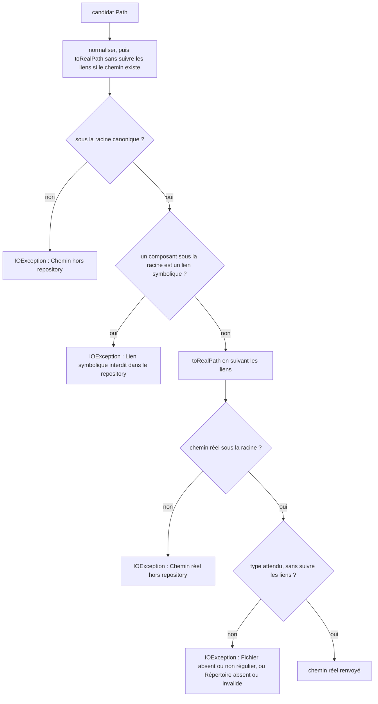
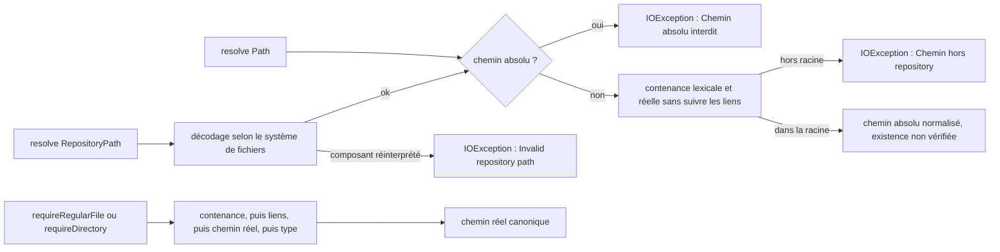

# Support filesystem et qualification

Cette page définit la frontière de support filesystem de NEXUS. Elle complète [SEC-0082](../architecture/adr/SEC-0082-borner-le-support-filesystem-et-la-traversee-des-chemins.md) et doit être lue comme un contrat de support, pas comme une détection runtime automatique.

## Matrice de support

| Environnement | Statut | Preuve attendue |
|---|---|---|
| Linux, filesystem local du runner qualifié | **supporté** | `Filesystem Semantics Qualification / linux` vert sur le HEAD exact |
| Windows, filesystem local du runner qualifié | **supporté** | `Filesystem Semantics Qualification / windows` vert sur le HEAD exact |
| Filesystem local utilisateur avec sémantique standard de l'OS | **supporté sous les garanties de l'OS hôte** | même contrat fonctionnel que la qualification Linux/Windows |
| SMB/CIFS | **non supporté globalement ; fixture SMB 3.1.1 loopback qualifié** | `SMB Filesystem Qualification` prouve uniquement le scénario Windows mono-hôte documenté ci-dessous |
| NFS | **non supporté** | qualification dédiée requise avant toute revendication de support |
| volume distribué / synchronisé / virtuel à sémantique spéciale | **non supporté par défaut** | qualification dédiée par technologie/configuration |
| WSL/DrvFS ou montage équivalent | **non qualifié** | qualification dédiée requise |
| filesystem activement hostile sous contrôle d'un acteur local privilégié | **hors modèle de garantie** | nécessite des primitives de sandbox plus fortes que les garanties Java portables actuelles |

`Non supporté` ne signifie pas qu'un montage échouera nécessairement. Cela signifie que NEXUS ne promet pas la cohérence de `FileLock`, de metadata ou de confinement au-delà des garanties effectivement qualifiées.

## Ce que la qualification locale vérifie

Le workflow `Filesystem Semantics Qualification` exécute les mêmes scénarios sur Linux et Windows :

1. acquisition d'un lock projet dans la JVM du test ;
2. tentative concurrente dans une **seconde JVM** : elle doit échouer comme `busy` ;
3. libération puis acquisition réussie dans la JVM enfant ;
4. nouvelle acquisition après terminaison du processus enfant ;
5. refus d'un répertoire de locks symbolique ;
6. refus d'un fichier de lock symbolique sans modification de sa cible ;
7. refus d'un symlink final par `SafeFileIO` au moment de l'ouverture ;
8. refus d'une traversée lexicale hors racine ;
9. refus d'un symlink d'ancêtre sous la racine projet ;
10. simulation déterministe d'une mutation validation→ouverture où le fichier final devient un symlink : la lecture doit échouer fermée.

Les rapports Surefire et les informations du filesystem du runner sont conservés 90 jours comme artifacts de qualification.

## Qualification SMB sélectionnée

Le workflow `SMB Filesystem Qualification` crée un **vrai partage SMB Windows** avec `New-SmbShare`, puis exécute la qualification via un chemin UNC distinct du chemin local sous-jacent.

La configuration qualifiée au 3 septembre 2026 est volontairement étroite :

- Windows Server 2025 GitHub-hosted ;
- client et serveur SMB sur le **même runner** ;
- SMB **3.1.1** ;
- signature SMB active ;
- partage `FileSystemDirectory`, non clusterisé et non `ContinuouslyAvailable` ;
- stockage sous-jacent NTFS du runner ;
- Java Temurin 21 ;
- 2 tests, 0 failure, 0 error, 0 skip.

Les deux scénarios obligatoires sont :

1. round-trip Java lecture/écriture/déplacement via le chemin UNC ;
2. `ProjectIndexLockManager` avec une JVM propriétaire et une **seconde JVM distincte** : le lock concurrent doit être refusé, puis être réacquis après libération.

Cette preuve démontre que les primitives utilisées par NEXUS fonctionnent sur **ce fixture SMB loopback précis**. Elle ne constitue pas une revendication de support SMB général et ne couvre notamment pas :

- deux clients/machines distincts ;
- un NAS ou une implémentation serveur différente ;
- terminaison forcée du client détenteur du lock ;
- coupure réseau et reconnexion ;
- cohérence metadata/cache entre clients ;
- stockage SQLite complet sur partage réseau ;
- index Lucene sur partage réseau ;
- SMB clustering / Continuous Availability ;
- NFS.

Les informations `Get-SmbShare`, `Get-SmbConnection`, `Get-SmbClientConfiguration`, `Get-SmbServerConfiguration` et les rapports Surefire sont conservés 90 jours comme preuve.

## Limites explicitement acceptées

### Ancêtres/hard-links mutés activement

`ProjectPathGuard` vérifie la racine et les composants du chemin, puis `SafeFileIO` réouvre le fichier final avec `NOFOLLOW_LINKS`. Cela réduit la fenêtre TOCTOU mais ne constitue pas une sandbox absolue contre un acteur capable de remplacer agressivement des ancêtres, hard-links ou points de montage entre les étapes.

NEXUS ne revendique donc pas de protection contre un administrateur local ou un adversaire filesystem privilégié.

### Filesystems réseau

La sémantique `java.nio.channels.FileLock` dépend du filesystem et de sa configuration. Une qualification locale réussie ne prouve rien sur SMB/NFS, et la qualification SMB loopback ci-dessus ne prouve pas les sémantiques multi-clients ou de panne réseau.

Avant d'étendre le support à un filesystem réseau, la qualification doit au minimum couvrir :

- deux processus distincts sur deux clients lorsque le protocole le permet ;
- acquisition concurrente du même lock ;
- libération après arrêt normal et après terminaison forcée ;
- visibilité/cohérence des créations, remplacements et suppressions ;
- symlinks/reparse points si le protocole les expose ;
- comportement après coupure réseau/reconnexion ;
- comportement du stockage SQLite et des index Lucene dérivés ;
- version/configuration serveur et options de montage documentées.

Une preuve réalisée sur une configuration SMB/NFS ne doit pas être extrapolée automatiquement à une autre implémentation ou option de montage.

## Lecture des résultats CI

La qualification doit être attachée au HEAD exact de la PR ou du commit concerné. Un ancien run vert n'est pas une preuve pour un nouveau HEAD.

Pour un changement touchant `NexusPaths`, `ProjectIndexLockManager`, `ProjectPathGuard`, `SafeFileIO`, leurs tests ou la présente documentation, la matrice Linux/Windows doit être relancée automatiquement. Les changements touchant la qualification SMB relancent également `SMB Filesystem Qualification`.

## Références

- [SEC-0082](../architecture/adr/SEC-0082-borner-le-support-filesystem-et-la-traversee-des-chemins.md) — frontière de support filesystem, traversée stricte et compatibilité.
- Issue #52 — qualification hostile/network filesystem semantics.
- `ProjectIndexLockManagerTest` — lock JVM + inter-processus.
- `FilesystemSemanticsQualificationTest` — confinement et mutation de chemin.
- `SmbFilesystemQualificationTest` — preuve SMB 3.1.1 loopback sélectionnée.
- `SafeFileIOTest` — ouverture `NOFOLLOW_LINKS` et lecture bornée.

## Contrat de hardening du 9 septembre 2026

Voir [SEC-0082](../architecture/adr/SEC-0082-borner-le-support-filesystem-et-la-traversee-des-chemins.md)
pour la distinction entre traversée strict et compatibility. Le fallback sans
`SecureDirectoryStream` est best-effort : la revalidation ne détecte pas un ABA
restauré. `NEXUS_REQUIRE_STRICT_PATH_IO=true` le refuse avant ouverture du fichier.
REST HTTPS distant et REST loopback hardened exigent ce flag ainsi que
`NEXUS_REQUIRE_PRIVATE_STORAGE=true`. Le mode Docker `loopback-forward` reste local
selon sa déclaration opérateur. Windows/UNC local conserve la compatibilité.
`READY` atteste la génération indexée revalidée, sans snapshot atomique du
filesystem vivant. Les mutations détectées restent refusées.

Les contextes REST/MCP/CLI projettent les chemins en repository-relative et
filtrent les diagnostics/métadonnées internes à la frontière de sortie. Les
requêtes client sont conservées séparément. La redaction des skills précède
estimation et sélection ; les compteurs décrivent le contenu effectivement fourni.

## Identité repository et upgrade V007

Le contrat unique `RepositoryPath` encode les composants filesystem sans remplacer
les backslashes POSIX. `a\b.java` et `a/b.java` sont deux identités distinctes sur
POSIX. La résolution sur un autre filesystem refuse les composants qui y seraient
réinterprétés. V007 invalide les anciens index et impose une reconstruction ; le
fingerprint `nexus-repository-path-v2` invalide également les dérivés sémantiques
restés désactivés pendant l'upgrade. Voir [ADR-0049](../architecture/adr/DATA-0049-identite-repository-par-composants-et-diagnostics-publics.md).

## OpenSpec project-path-confinement

Spec : [`openspec/specs/project-path-confinement/spec.md`](../../openspec/specs/project-path-confinement/spec.md) ; matrice de traçabilité : [openspec-traceability.md](openspec-traceability.md). Les limites acceptées de la section précédente (acteur qui remplace des ancêtres entre deux étapes) restent valables : le confinement décrit ici est une vérification, pas une sandbox.

### Comportement existant vérifié

| Méthode de `ProjectPathGuard` | Comportement observé | Source |
|---|---|---|
| Constructeur | Canonicalise la racine par `toRealPath`, refuse une racine qui n'est pas un répertoire. Une racine fournie par un lien symbolique est acceptée : sa cible canonique devient la frontière de confiance. | `core/src/main/java/com/nexus/security/ProjectPathGuard.java:11-31`, test `ProjectPathGuardTest#acceptsARootGivenThroughASymbolicLinkAndTrustsItsTarget`, `#rejectsARootThatIsARegularFile` |
| `resolve(Path)` | Refuse tout chemin absolu (même situé sous la racine), puis exige que le chemin normalisé reste sous la racine. Ne vérifie ni l'existence ni les liens symboliques. | `ProjectPathGuard.java:39-45`, tests `#rejectsAnAbsolutePath`, `#rejectsAnAbsolutePathEvenInsideTheRoot`, `#rejectsADotDotTraversal`, `#rejectsATraversalHiddenBehindAnInsideSegment`, `#resolvesAPathThatDoesNotExistYet` |
| `resolve(RepositoryPath)` | Décode l'identité NEXUS avec le système de fichiers de la racine ; un composant que ce système réinterpréterait (antislash sous Windows) devient `IOException("Invalid repository path")`. | `ProjectPathGuard.java:47-54`, tests `#resolvesASlashSeparatedRepositoryPathOnEveryPlatform`, `#handlesABackslashComponentAccordingToTheTargetFileSystem` |
| `requireRegularFile` | Ordre : chemin contenu dans la racine, aucun composant lien symbolique sous la racine, chemin réel sous la racine, fichier régulier sans suivre les liens. | `ProjectPathGuard.java:56-71` |
| `requireDirectory` | Même ordre, avec répertoire sans suivre les liens ; la racine elle-même est acceptée. | `ProjectPathGuard.java:73-88`, test `#acceptsTheRootItselfAsADirectory` |
| `containsSymbolicLink` | Parcourt chaque composant sous la racine et renvoie `true` au premier lien ; un chemin hors racine lève `IOException`. | `ProjectPathGuard.java:90-101`, tests `#reportsAFinalSymbolicLink`, `#reportsAnIntermediateSymbolicLinkToAFileOutsideTheProject`, `#rejectsALinkQueryOutsideTheRoot` |
| `repositoryPath` | Chemin relatif à la racine, normalisé et encodé avec `/` ; `""` pour la racine ; `[INTERNAL_PATH]` pour un chemin hors racine. | `ProjectPathGuard.java:103-110`, tests `#encodesANestedRepositoryPathWithForwardSlashes`, `#encodesTheRootAsTheEmptyRepositoryPath`, `#masksAPathOutsideTheRoot` |
| Contrôle de contenance (`requireContained`) | Normalise et tente `toRealPath(NOFOLLOW_LINKS)` pour aligner les noms courts 8.3 de Windows sur la racine canonique ; un chemin qui n'existe pas encore reste tel quel. Hors racine : `IOException("Chemin hors repository : …")`. | `ProjectPathGuard.java:112-127` |
| Création de liens dans les tests | `SymbolicLinks.createOrSkip` interrompt le test (`Assumptions.abort`) si le lien est impossible, sauf si le support est exigé : variable `CI` définie à une valeur autre que `false` ou `0`, ou propriété `nexus.test.symlinks.required=true`. Dans ce cas le test échoue. Un chemin de lien déjà occupé échoue toujours. | `core/src/test/java/com/nexus/testsupport/SymbolicLinks.java:36-58,73-83`, tests `SymbolicLinksTest#supportIsRequiredWhenCiIsDefined`, `#unavailableLinkFailsWhenSupportIsRequired`, `#unavailableLinkAbortsWhenSupportIsOptional` |
| Exécution de `ProjectPathGuardTest` en CI | La classe fait partie du reactor `clean install` : Linux par `./mvnw -B clean install`, Windows par `scripts/validate-phase-6.ps1`. La qualification `filesystem-semantics-qualification.yml` est déclenchée par un changement de `ProjectPathGuard` mais ne lance que `ProjectIndexLockManagerTest`, `SafeFileIOTest` et `FilesystemSemanticsQualificationTest`. | `.github/workflows/ci.yml:56-63,105-108`, `scripts/validate-phase-6.ps1:112-113`, `.github/workflows/filesystem-semantics-qualification.yml:12,28,104,113` |

### Vues

Vue organigramme (non UML) — dans quel ordre `requireRegularFile` et `requireDirectory` refusent-ils un chemin, et à quel endroit le lien symbolique est-il détecté (existant) ?

Le lien symbolique, final ou intermédiaire, est refusé à l'étape D, avant la résolution réelle ; l'étape G est une défense qui ne se déclenche que si un composant mène hors de la racine sans être un lien symbolique au sens de `Files.isSymbolicLink` (voir Questions). Exigences : `project-path-confinement › Les chemins hors du projet sont refusés`, `project-path-confinement › Les liens symboliques sont refusés à toute position`, `project-path-confinement › Le type attendu est vérifié`.

Vue organigramme (non UML) — comment `resolve` (chemin relatif d'entrée) se distingue-t-il de `requireRegularFile` et `requireDirectory` (existant) ?

Un chemin absolu situé sous la racine est refusé par `resolve(Path)` mais accepté par `requireRegularFile`, `requireDirectory` et `containsSymbolicLink`, qui reçoivent des chemins déjà résolus. Exigences : `project-path-confinement › Les chemins hors du projet sont refusés`.

### Écarts et limites

- [Écart] L'exigence « Les chemins hors du projet sont refusés » dit que `ProjectPathGuard` refuse « un chemin absolu ». Le refus d'un chemin absolu n'existe que dans `resolve(Path)` (`ProjectPathGuard.java:41-43`) ; `requireRegularFile`, `requireDirectory` et `containsSymbolicLink` acceptent un chemin absolu contenu dans la racine (tests `ProjectPathGuardTest#returnsTheCanonicalRegularFile`, `#returnsTheCanonicalDirectory`). Le scénario « Chemin absolu » ne vise que la résolution.
- [Écart] La même exigence cite « une cible dont la résolution réelle est hors de la racine ». Le code la contrôle (`ProjectPathGuard.java:64-66,81-83`), mais aucun test lu n'atteint cette branche : les cibles hors racine des tests sont soit refusées lexicalement, soit des liens symboliques refusés avant la résolution réelle. Aucun scénario n'existe pour ce cas (`test non écrit`).
- [Écart] Le scénario « Couverture directe » est une recherche à faire à la main : aucun contrôle automatisé n'échoue si une méthode publique est ajoutée sans test direct. Les six méthodes sont appelées dans `ProjectPathGuardTest` au HEAD (relevé par lecture).
- [Écart] La qualification dédiée `filesystem-semantics-qualification.yml` se déclenche sur `ProjectPathGuard.java` (`:12,28`) mais n'exécute pas `ProjectPathGuardTest` (liste `-Dtest` limitée à trois classes) ; la page existante demande de relancer « la matrice Linux/Windows » pour un changement de `ProjectPathGuard`. `ProjectPathGuardTest` ne passe que par le reactor complet.
- Limite : sur un poste sans droit de création de lien symbolique (cas fréquent sous Windows sans mode développeur), les scénarios « Symlink final », « Symlink intermédiaire » et « Signalement d'un symlink final » sont interrompus (`TestAbortedException`), pas échoués. Seule la variable `CI` (ou la propriété `nexus.test.symlinks.required`) les rend obligatoires.
- Limite : le scénario « Runner sans symlinks en CI » est prouvé sur la primitive `SymbolicLinks` avec un créateur de lien simulé (`SymbolicLinksTest#unavailableLinkFailsWhenSupportIsRequired`), pas sur un vrai runner sans liens symboliques.
- Limite : le comportement face aux jonctions Windows, aux points de montage et aux liens physiques n'est testé par aucun test de `ProjectPathGuardTest` ; la page existante n'en promet pas la détection.

### Propositions et questions ouvertes

- [Question] Un composant qui sort de la racine sans être un lien symbolique pour `Files.isSymbolicLink` (jonction Windows, point de montage) est-il bien arrêté par le contrôle du chemin réel (`ProjectPathGuard.java:64,81`) ? Hypothèse non vérifiée, aucun test.
- [Question] L'exigence « refuse un chemin absolu » doit-elle viser aussi `requireRegularFile`, `requireDirectory` et `containsSymbolicLink`, ou seulement `resolve` ? Le texte actuel est plus large que le comportement.
- [Proposition] Un test de la branche « chemin réel hors racine » (jonction ou point de montage sur Windows, système de fichiers qui le permet sur Linux) fermerait le deuxième écart.
- [Proposition] Ajouter `ProjectPathGuardTest` à la liste `-Dtest` de `filesystem-semantics-qualification.yml`, ou corriger la phrase de la page existante, aligne la qualification sur son déclencheur.
