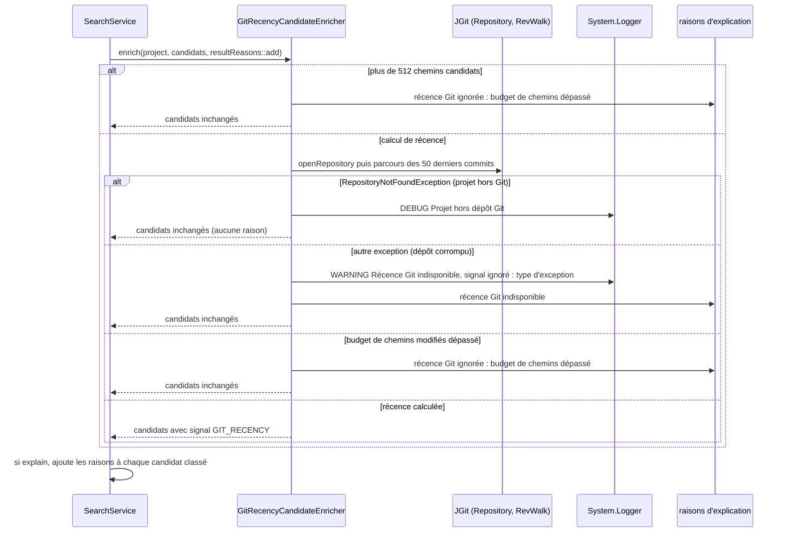
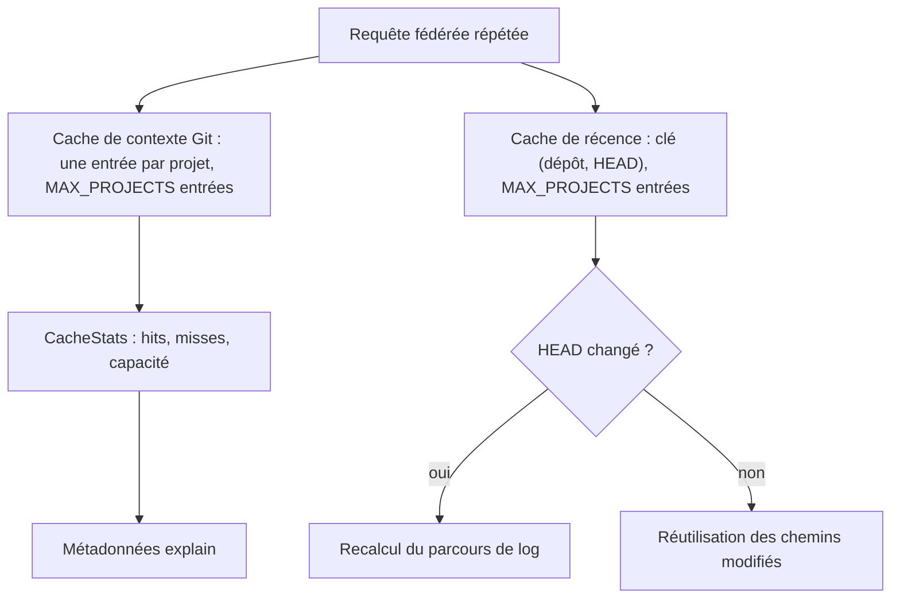

# Contexte Git local

NEXUS utilise Git local comme signal de pertinence et source de contexte **read-only, sans réseau et bornée**.

## Principes

Le provider n'effectue ni fetch, pull, push, checkout ni création de commit. Il travaille uniquement sur le repository local déjà présent et sur les chemins cibles remontés par la recherche.

## Bornes structurelles

`LocalGitContextSourceProvider` impose notamment :

```text
commits récents                 50
chemins cibles d'historique      5
commits par chemin               5
co-changements                   8
chemins modifiés / commit     2000
chemins modifiés cumulés     10000
patch rendu / zone            6000 caractères
```

Le provider consomme aussi le `ContextDiscoveryBudget` partagé avec les autres sources natives.

## Cache des runtimes longue durée

REST et MCP utilisent `NexusApplication.createLongLived(...)`. Cette composition enveloppe le provider Git local dans `PersistentGitContextSourceProvider`, un cache **mémoire uniquement** limité en LRU à `FederatedScopePolicy.MAX_PROJECTS` résultats (une entrée par projet d'un scope fédéré maximal, [BE-0070](../architecture/adr/BE-0070-integrer-le-contexte-git-local-borne-mis-en-cache-et-confine.md)). Ses compteurs (`capacity`, `entries`, `hits`, `misses`, `evictions`) sont exposés sous la clé `gitContextCache` des métadonnées `explain` des contextes mono-projet et fédérés.

La CLI et les usages one-shot continuent d'utiliser `NexusApplication.create(...)` et `LocalGitContextSourceProvider` sans cache persistant entre requêtes.

Avant chaque hit, le cache recalcule un fingerprint borné :

```text
worktree réel
HEAD exact
status des chemins cibles
SHA-256 du diff staged ciblé
SHA-256 du diff unstaged ciblé
```

Toute variation provoque un miss puis un recalcul via `LocalGitContextSourceProvider`. Cela couvre notamment commit/rebase, index, working tree, rename et isolation des worktrees liés.

La validation du fingerprint consomme elle aussi le `ContextDiscoveryBudget` via des visites et checkpoints ; le cache n'introduit donc aucun chemin de découverte hors budget. Un résultat `repositoryAvailable=false` n'est jamais conservé afin de retenter automatiquement une indisponibilité transitoire.

Aucun fichier de cache, schéma SQLite, watcher filesystem ou thread de maintenance n'est ajouté. Voir [BE-0070](../architecture/adr/BE-0070-integrer-le-contexte-git-local-borne-mis-en-cache-et-confine.md).

`GitRecencyCandidateEnricher` mémorise de même, par répertoire Git et HEAD, les chemins modifiés des 50 derniers commits (au plus 1 024 chemins par commit et 4 096 cumulés, capacité `MAX_PROJECTS`), puis applique le filtre de candidats : tant que HEAD ne change pas, le journal des commits n'est pas relu, et un nouveau HEAD remplace l'entrée du dépôt. Au-delà des bornes de chemins, l'historique n'est pas mémorisé et le parcours filtré par les chemins candidats s'applique, avec le même résultat.

## Diff local avant allocation

Les patches working-tree sont filtrés aux chemins cibles puis écrits dans `BoundedOutput`, un `OutputStream` à capacité fixe. Le sink cesse de retenir des octets après sa capacité ; NEXUS ne rend donc pas d'abord le patch entier dans un `ByteArrayOutputStream` extensible avant de le tronquer.

Après conversion UTF-8, le texte reste limité à 6 000 caractères et reçoit :

```text
... [diff Git tronqué par NEXUS]
```

si la sortie a dépassé l'une des bornes.

## Fragments

Le provider peut créer :

```text
.nexus/git/recent-commits.md
.nexus/git/file-history.md
.nexus/git/working-tree-diff.md
.nexus/git/co-changes.md
```

Un fichier non ciblé n'est pas injecté dans le patch/statut. Dans un monorepo, les chemins hors racine du projet NEXUS sont exclus du contexte projet.

## Budget final

Le contexte Git n'est activé que lorsque le budget global le permet et reçoit un sous-budget final. Ce sous-budget de tokens est distinct du budget de **travail de découverte**, qui reste obligatoire avant sélection.

## Découverte du dépôt

`GitRepositoryLocator` est la seule fabrique qui ouvre le dépôt pour `LocalGitContextSourceProvider`, `PersistentGitContextSourceProvider` et `GitRecencyCandidateEnricher` ([BE-0070](../architecture/adr/BE-0070-integrer-le-contexte-git-local-borne-mis-en-cache-et-confine.md)). Elle remonte depuis la racine réelle du projet jusqu'au premier répertoire qui contient une entrée `.git`, puis :

- retient sans condition un dépôt dont le `.git` est à la racine du projet ;
- retient un dépôt trouvé dans un répertoire parent (monorepo) seulement si son entrée `.git` et, pour un fichier gitlink, le répertoire Git désigné appartiennent à l'utilisateur courant, à l'image de `safe.directory` de Git ;
- écarte le dépôt parent si son propriétaire est un autre compte ou n'est pas déterminable, avant toute lecture de sa configuration.

Un `.git` invalide arrête la remontée : aucun dépôt plus haut n'est cherché. L'utilisateur courant est reconnu par son nom de compte et par le propriétaire attribué à un fichier qu'il crée ; sous Windows, un processus élevé attribue ses fichiers au groupe Administrateurs.

Un dépôt parent écarté ne produit ni commit, ni diff, ni signal de récence. Les diagnostics, sans chemin ni nom de compte, sont :

```text
gitDiagnostics      contexte Git ignoré : dépôt Git parent n'appartenant pas à l'utilisateur courant
récence (explain)   récence Git ignorée : dépôt Git parent n'appartenant pas à l'utilisateur courant
```

Le cache des runtimes longue durée ne conserve pas ce résultat (`repositoryAvailable=false`).

## Preuves

`LocalGitContextSourceProviderTest` couvre :

- commits/historique/co-changements ciblés ;
- monorepo et exclusion hors projet ;
- dégradation hors Git ;
- dépôt parent d'un autre compte écarté avec diagnostic sans chemin ;
- diff massif réellement tronqué ;
- sink fixe qui ne retient jamais plus d'octets que sa capacité.

`PersistentGitContextSourceProviderTest` couvre :

- hit sur état Git stable ;
- invalidation working tree, index et HEAD ;
- éviction LRU et capacité stricte ;
- absence de cache pour un repository indisponible ;
- aucun usage d'un dépôt parent d'un autre compte par le runtime longue durée.

`GitRepositoryLocatorTest` couvre la règle de découverte : dépôt à la racine sans contrôle de propriétaire, dépôt parent de l'utilisateur, dépôt parent d'un autre compte écarté avant lecture de sa configuration, propriétaire non déterminable simulé par injection, gitlink et cible contrôlés, arrêt au premier `.git`, diagnostic public sans chemin, et résolution réelle du propriétaire sous Windows et Linux.

`GitContextCacheQualificationBenchmarkTest` couvre Linux et Windows sur plusieurs repositories ainsi que HEAD/index/working-tree/rename/rebase/worktrees liés. Les benchmarks et tests exact-head restent l'autorité de qualification.

## OpenSpec git-recency-diagnostics

Spec : [`openspec/specs/git-recency-diagnostics/spec.md`](../../openspec/specs/git-recency-diagnostics/spec.md) ; matrice de traçabilité : [openspec-traceability.md](openspec-traceability.md).

Cette section décrit le signal de récence Git des candidats de recherche (`GitRecencyCandidateEnricher`), distinct du provider de contexte `LocalGitContextSourceProvider` décrit plus haut.

### Comportement existant vérifié

| Étiquette | Fait | Source |
|---|---|---|
| [Existant vérifié] | Le signal est fail-open : toute exception autre que `RepositoryNotFoundException` renvoie les candidats inchangés, émet un enregistrement `System.Logger` de niveau `WARNING` `Récence Git indisponible, signal ignoré : {0}` où `{0}` est `exception.getClass().getName()`, et ajoute la raison d'explication `récence Git indisponible`. Aucune exception n'est attachée à l'enregistrement. | `core/src/main/java/com/nexus/context/source/git/GitRecencyCandidateEnricher.java:45`, `:91-99` |
| [Existant vérifié] | Un projet hors Git (`RepositoryNotFoundException`, y compris l'absence de répertoire `.git` trouvé) renvoie les candidats inchangés avec un enregistrement `DEBUG` seulement, sans raison d'explication. | `GitRecencyCandidateEnricher.java:87-90`, `:180-186` |
| [Existant vérifié] | Au-delà de 512 chemins candidats, ou si les commits modifient plus de 1 024 chemins chacun ou 4 096 cumulés (sur les 50 derniers commits), les candidats sont renvoyés inchangés avec la raison `récence Git ignorée : budget de chemins dépassé`. Ce comportement n'est pas dans la spec. | `GitRecencyCandidateEnricher.java:46`, `:50-53`, `:79-82`, `:100-103`, `:140-143` |
| [Existant vérifié] | `SearchService` fournit à chaque enrichisseur un collecteur de raisons ; il ne les ajoute aux `reasons` des candidats classés que lorsque `explain` est vrai, une seule fois par raison. | `core/src/main/java/com/nexus/search/SearchService.java:57-67`, `:70-74` |
| [Existant vérifié] | Les `reasons` d'un candidat classé alimentent celles des fragments de contexte. | `core/src/main/java/com/nexus/context/ContextFragmentFactory.java:218`, `:243`, `:258` |
| [Existant vérifié] | Le message journalisé ne contient que le nom de classe de l'exception : le chemin du dépôt et le contenu des fichiers n'y figurent donc pas, même si le message de l'exception les cite. | `GitRecencyCandidateEnricher.java:92-96` |

### Vues

Vue UML séquence — Que devient un incident de récence Git, qui l'absorbe et qui en est informé ? (existant)



L'incident n'atteint jamais l'appelant : l'exception est absorbée, tracée sans chemin et signalée dans l'explication quand elle est demandée. Les cas « hors Git » et « budget » ne produisent pas de `WARNING`.

Exigences : `git-recency-diagnostics › Un incident de récence Git est journalisé`, `git-recency-diagnostics › La trace ne divulgue ni chemin ni contenu`, `git-recency-diagnostics › L'explication signale la récence indisponible`.

### Écarts et limites

- [Écart] 1 — Le texte de l'exigence « La trace ne divulgue ni chemin ni contenu » est tenu par construction (seul le nom de classe est journalisé, `GitRecencyCandidateEnricher.java:95-96`). Le test `GitRecencyCandidateEnricherTest#jgitIncidentKeepsCandidatesLogsOneWarningWithoutPathAndExplainsTheMissingSignal` vérifie l'absence de chemin dans le message, mais l'exception JGit qu'il provoque (référence de branche vers un commit absent) n'est pas prouvée citer le chemin du dépôt : le scénario « Message d'exception avec chemin » est donc partiellement couvert.
- [Écart] 2 — Le scénario « Explication après incident » n'est pas testé de bout en bout : `GitRecencyCandidateEnricherTest` vérifie l'émission de la raison par l'enrichisseur réel et `SearchServiceExplanationReasonTest` vérifie le transfert avec un enrichisseur factice ; aucun test ne chaîne l'enrichisseur réel, `SearchService` et l'explication de contexte.
- [Écart] 3 — La spec ne mentionne pas la raison `récence Git ignorée : budget de chemins dépassé`, les bornes 512 / 1 024 / 4 096 ni le niveau `DEBUG` du cas hors Git. Ces comportements sont des faits existants non exigés.
- Limite : les bornes de changement (1 024 par commit, 4 096 cumulés) n'ont pas de test dans `GitRecencyCandidateEnricherTest` ; seule la borne de 512 chemins candidats est testée à N et N+1 (`computesRecencyWithoutBudgetReasonAtExactlyTheCandidatePathBudget`, `failsOpenWhenCandidatePathBudgetIsExceeded`).
- Limite : le test d'incident dépend d'un état de dépôt corrompu fabriqué dans le test ; il n'a pas été exécuté ici.

### Propositions et questions ouvertes

- [Proposition] Ajouter à la spec un scénario « Budget de chemins dépassé » (candidats inchangés, raison `récence Git ignorée : budget de chemins dépassé`, aucun `WARNING`) si ce comportement doit devenir contractuel ; les bornes 1 024 et 4 096 resteraient alors à tester.
- [Proposition] Ajouter un test d'intégration qui fait échouer la récence Git sur un dépôt réel et vérifie la raison dans une explication de contexte demandée par `NexusApplication`.
- Questions : aucune.

## OpenSpec git-context-cache

Spec : [`openspec/specs/git-context-cache/spec.md`](../../openspec/specs/git-context-cache/spec.md) ; matrice de traçabilité : [openspec-traceability.md](openspec-traceability.md).

Cette section décrit les deux caches Git des runtimes longue durée : le cache de contexte (`PersistentGitContextSourceProvider`) et le cache de récence (`GitRecencyCandidateEnricher`).

### Comportement existant vérifié

| Étiquette | Fait | Source |
|---|---|---|
| [Existant vérifié] | La capacité par défaut du cache de contexte Git est `FederatedScopePolicy.MAX_PROJECTS`, soit une entrée par projet d'un scope fédéré maximal. | `core/src/main/java/com/nexus/context/source/git/PersistentGitContextSourceProvider.java` (`DEFAULT_CAPACITY`), `core/src/test/java/com/nexus/context/source/git/PersistentGitContextSourceProviderTest#defaultCapacityCoversTheMaximalFederatedScope` |
| [Existant vérifié] | Deux passages cycliques sur 20 projets inchangés servent chaque projet du cache au second passage. | `core/src/test/java/com/nexus/context/source/git/PersistentGitContextSourceProviderTest#servesEveryProjectOfACyclicTwentyProjectScopeFromTheCacheOnTheSecondPass` |
| [Existant vérifié] | Les compteurs et la capacité du cache sont exposés, et l'`explain` d'un contexte fédéré porte les derniers compteurs. | `core/src/test/java/com/nexus/context/source/git/PersistentGitContextSourceProviderTest#cacheStatisticsExposeCountersAndCapacity`, `core/src/test/java/com/nexus/context/FederatedContextServiceTest#federatedExplainCarriesTheLatestGitCacheCountersOnly` |
| [Existant vérifié] | Le cache de récence est indexé par dépôt et HEAD, borné à `FederatedScopePolicy.MAX_PROJECTS` entrées et à `MAX_CUMULATIVE_CHANGED_PATHS` chemins ; un nouveau HEAD recalcule, et un historique au-delà de la borne garde le parcours filtré. | `core/src/main/java/com/nexus/context/source/git/GitRecencyCandidateEnricher.java`, `core/src/test/java/com/nexus/context/source/git/GitRecencyCandidateEnricherTest#reusesRecentChangedPathsWhileHeadIsUnchangedAndRecomputesAfterANewCommit`, `#keepsTheFilteredWalkWhenTheHistoryExceedsTheCacheBound`, `#evictsTheOldestRepositoryWhenTheRecencyCacheIsFull` |
| [Existant vérifié] | Le workflow `git-context-cache-qualification.yml` couvre un scope de plus de 16 projets ; il est vert sur `develop` après la fusion du sprint 6. | `.github/workflows/git-context-cache-qualification.yml`, `core/src/test/java/com/nexus/benchmark/GitContextCacheQualificationBenchmarkTest.java` |

### Vues

Vue organigramme de composants (non UML, lecture C4 simplifiée) — Quels caches Git une requête répétée réutilise-t-elle, et par quelle clé ? (existant)



Exigences : `git-context-cache › Le cache de contexte Git couvre le scope fédéré maximal`, `git-context-cache › Les statistiques du cache Git sont exposées`, `git-context-cache › La récence des commits est mise en cache par HEAD`.

### Écarts et limites

- Limite : les tests de cache ne mesurent pas l'ouverture du journal de commits ; ils vérifient la réutilisation et le recalcul par le résultat.

### Propositions et questions ouvertes

- Questions : aucune.

## OpenSpec git-context-discovery

Spec : [`openspec/specs/git-context-discovery/spec.md`](../../openspec/specs/git-context-discovery/spec.md) ; matrice de traçabilité : [openspec-traceability.md](openspec-traceability.md).

Cette section décrit quel dépôt Git alimente le contexte d'un projet ; la règle est détaillée dans [Découverte du dépôt](#découverte-du-dépôt).

### Comportement existant vérifié

| Étiquette | Fait | Source |
|---|---|---|
| [Existant vérifié] | `GitRepositoryLocator` est la seule fabrique de dépôt de `LocalGitContextSourceProvider`, `PersistentGitContextSourceProvider` et `GitRecencyCandidateEnricher`. | `core/src/main/java/com/nexus/context/source/git/GitRepositoryLocator.java` |
| [Existant vérifié] | Un dépôt à la racine du projet est retenu sans contrôle du propriétaire ; la remontée s'arrête au premier `.git`. | `core/src/test/java/com/nexus/context/source/git/GitRepositoryLocatorTest#retainsTheProjectRootRepositoryWithoutOwnershipCheck`, `#stopsAtTheFirstGitEntryInsteadOfSearchingHigher` |
| [Existant vérifié] | Un dépôt parent n'est retenu que si son `.git`, la cible d'un gitlink et le répertoire ouvert appartiennent à l'utilisateur courant ; sinon il est écarté avant lecture de sa configuration. | `core/src/test/java/com/nexus/context/source/git/GitRepositoryLocatorTest#retainsAParentRepositoryOwnedByTheCurrentUser`, `#checksBothTheGitLinkAndItsTargetForAParentRepository`, `#rejectsAParentRepositoryOfAnotherAccountBeforeReadingItsConfiguration`, `#rejectsAParentRepositoryWhoseOwnerChangesBetweenTheCheckAndTheOpening` |
| [Existant vérifié] | Le diagnostic d'un dépôt écarté ne contient ni chemin absolu ni nom de compte. | `core/src/test/java/com/nexus/context/source/git/GitRepositoryLocatorTest#theRejectionDiagnosticIsPublicStableAndHasNoAbsolutePathNorAccountName` |

### Vues

Vue organigramme — Quel dépôt Git alimente le contexte d'un projet ? (existant)

```mermaid
flowchart TD
    racine["Racine du projet enregistré"] --> propreEntrée .git à la racine ?
    propre -- "oui" --> retenu["Dépôt retenu : contexte Git produit"]
    propre -- "non" --> parentEntrée .git dans un répertoire parent ?
    parent -- "non" --> aucun["Aucun contexte Git"]
    parent -- "oui" --> proprioRépertoire Git appartenant à l'utilisateur courant ?
    proprio -- "oui" --> retenu
    proprio -- "non ou propriétaire non déterminable" --> ecarte["Contexte Git ignoré : diagnostic public sans chemin absolu"]
```

Notation : organigramme, pas UML.

Exigences : `git-context-discovery › La découverte Git est plafonnée à la racine du projet`, `git-context-discovery › Un dépôt écarté produit un diagnostic public`, `git-context-discovery › Les trois usages de Git appliquent la même règle`.

### Écarts et limites

- Limite : le cas d'un dépôt parent appartenant à un autre compte est simulé par injection du résolveur de propriétaire ; le résolveur réel n'est vérifié que pour l'utilisateur courant.
- Limite : le diagnostic est vérifié sur `GitContextResult.diagnostics`, sans test de bout en bout `explain` via REST ou MCP.

### Propositions et questions ouvertes

- Questions : aucune.
