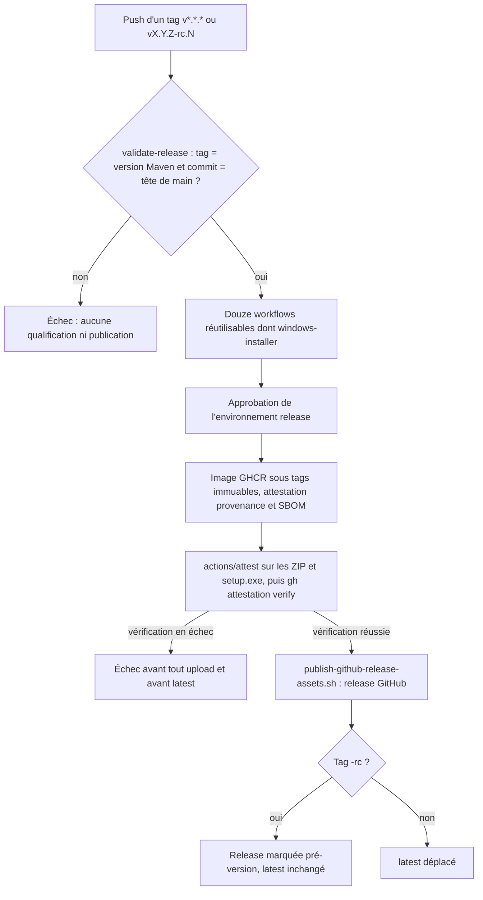

# Publication de release immuable

Ce document décrit le contrat NXA3 courant : **construire une fois, qualifier cette image exacte, puis publier cette même image sans rebuild**.

## Signal de release

`.github/workflows/release.yml` est le seul workflow autorisé à publier dans GHCR. Il est déclenché par un tag Git :

```text
v<major>.<minor>.<patch>
v<major>.<minor>.<patch>-rc.<n>
```

Avant toute publication, le workflow vérifie (`scripts/release/validate-release-tag.sh`) :

- tag `vX.Y.Z` (version finale) ou `vX.Y.Z-rc.N` avec `N >= 1` sans zéro initial (pré-version) ;
- égalité avec la version racine de `pom.xml` ;
- commit taggé égal au HEAD courant de `main` ;
- succès des gates release sur ce commit exact.

## Build unique et handoff intègre

`.github/workflows/docker-distribution.yml` construit l'image une seule fois puis exécute sur cette même image :

1. smokes CLI, MCP et REST ;
2. qualification Docker/Compose ;
3. Trivy ;
4. SBOM CycloneDX ;
5. gate HIGH/CRITICAL corrigibles.

Lorsqu'il est appelé par la release avec `export_qualified_image: true`, le workflow exporte ensuite l'**image exacte déjà qualifiée** avec :

- archive `docker save` ;
- SHA-256 de l'archive ;
- ID de configuration Docker ;
- SHA Git qualifié.

Le job de publication télécharge cet artefact, vérifie le hash et l'ID après `docker load`, puis publie cette image. `release.yml` ne contient aucun second `docker build`.

## Tags GHCR

Pour une version `0.2.0` sur le commit `<sha>` :

```text
ghcr.io/fturleque/nexus-context-engine:0.2.0
ghcr.io/fturleque/nexus-context-engine:sha-<sha>
ghcr.io/fturleque/nexus-context-engine:latest
```

Les tags version et SHA sont immuables. `latest` est volontairement mutable et ne désigne qu'une version finale : pour un tag `vX.Y.Z-rc.N`, la release GitHub est créée en pré-version (`--prerelease --latest=false`), les tags version et SHA sont publiés et `latest` reste inchangé.

## Préflight fail-closed et reprise idempotente

`scripts/release/ghcr-immutable-preflight.sh` distingue explicitement :

- manifeste réellement absent : création permise ;
- erreur d'authentification, réseau, timeout, serveur ou réponse ambiguë : échec ;
- tag existant qui correspond à l'image qualifiée : **reprise idempotente** permise ;
- tag existant qui correspond à un autre contenu : conflit d'immutabilité, échec définitif.

Si les tags version et SHA existent tous deux, ils doivent résoudre le même digest. Une exécution interrompue après la création d'un seul tag peut donc reprendre sans écraser un tag historique : le contenu existant est validé, puis seul le tag manquant est créé à partir de la référence immuable déjà vérifiée.

## Digest et attestations

Après publication :

- les tags version et SHA sont relus ;
- ils doivent désigner le même digest ;
- le digest doit correspondre à l'image qualifiée ;
- les attestations de provenance et de SBOM portent sur ce digest ;
- `latest` n'est déplacé qu'après ces vérifications.

Le digest publié est l'identité de référence du conteneur. Le triplet de traçabilité est :

```text
Git tag vX.Y.Z
Git commit SHA
GHCR digest sha256:...
```

## Vérification consommateur

Chaque asset Windows publié (ZIP portable `nexus-context-engine-<version>-windows-x64.zip` et installeur `NEXUS-<version>-windows-x64-setup.exe`) porte une attestation de provenance SLSA produite par `actions/attest` dans le job `publish` de `release.yml`. Le job vérifie chaque attestation par `gh attestation verify` avant tout upload d'asset et avant le déplacement de `latest` : une vérification en échec arrête la publication.

Après téléchargement depuis la release GitHub, un consommateur vérifie l'asset avec la GitHub CLI :

```text
gh attestation verify <asset> --repo FTurleque/nexus-context-engine
```

Pour exiger en plus que l'attestation provienne du workflow `Release` :

```text
gh attestation verify NEXUS-<version>-windows-x64-setup.exe \
  --repo FTurleque/nexus-context-engine \
  --signer-workflow FTurleque/nexus-context-engine/.github/workflows/release.yml
```

L'image se vérifie de la même façon par son digest :

```text
gh attestation verify oci://ghcr.io/fturleque/nexus-context-engine@sha256:<digest> --repo FTurleque/nexus-context-engine
```

Le fichier `.sha256` co-localisé contrôle seulement l'intégrité du téléchargement ; l'attestation établit la provenance (dépôt, workflow, commit et tag). Une vérification en échec signifie que l'asset ne doit pas être installé.

## Échec partiel

La publication est fail-closed. Un retry ne masque jamais une divergence :

- même contenu déjà publié ⇒ reprise autorisée ;
- contenu différent sous un tag immuable ⇒ arrêt ;
- registry ambigu ou indisponible ⇒ arrêt.

Pour corriger une release dont le contenu doit changer, créer une nouvelle version SemVer. Ne jamais déplacer un ancien tag version ou SHA.

## Rollback

Un rollback de consommation pointe vers un tag SemVer historique ou, de préférence, vers son digest GHCR. Les tags immuables ne sont jamais déplacés pour simuler un rollback.

## Politique de publication cible (SEC-0068, proposée)

[SEC-0068](../architecture/adr/SEC-0068-publier-les-releases-depuis-un-environnement-protege-avec-des-assets-attestes.md), au statut `Proposed`, complète [GEN-0031](../architecture/adr/GEN-0031-packager-la-cli-dans-un-jar-autonome.md) et fixe les conditions de publication que porte la spec OpenSpec `release-pipeline` (section « OpenSpec release-pipeline » ci-dessous). Les workflows et scripts du dépôt portent les règles qui les concernent ; les réglages GitHub (environnement `release`, ruleset de tags) sont appliqués par le mainteneur et vérifiables en lecture. L'état constaté avant le changement est relevé dans le contexte de l'ADR.

- Aucun workflow ne transmet `secrets: inherit` ; un workflow réutilisable ne reçoit, par leur nom, que les secrets qu'il déclare. `release.yml` ne transmet aucun secret au job Windows.
- Le job `publish` déclare `environment: release` : reviewer requis, déploiement limité aux tags `v*`. Aucune écriture dans GHCR ni dans les releases avant l'approbation ; une release demande une approbation.
- Le ZIP et le `setup.exe` Windows ne sont pas signés Authenticode : SmartScreen affiche « éditeur inconnu » à l'installation. Leur provenance se vérifie par `gh attestation verify` (section « Vérification consommateur »).
- L'environnement et le ruleset de tags existent avant qu'un workflow référence `release` : GitHub crée sans protection un environnement absent au premier job qui le nomme. Aucun tag `v*` n'est poussé tant que la lecture `gh api` ci-dessous ne montre pas le reviewer requis et le ruleset actif.
- Un ruleset de tags actif cible `refs/tags/v*` et réserve leur création, leur mise à jour et leur suppression au mainteneur.
- Chaque ZIP et chaque `setup.exe` publiés reçoivent une attestation de provenance (`actions/attest` en `subject-path`, même version épinglée que pour l'image), vérifiée par `gh attestation verify` avant tout upload et avant le déplacement de `latest`.
- Le tag de release est `vX.Y.Z` ou `vX.Y.Z-rc.N`, égal à la version Maven et posé sur la tête de `main`. Une pré-version publie une release marquée pré-version, sous des tags d'image version et SHA immuables, et ne déplace jamais `latest`.
- La première exécution de la chaîne est une répétition sur `X.Y.Z-rc.1`, prouvée par un relevé daté sous `docs/project/history/` (run, `gh attestation verify` sur l'image et les assets).

Les réglages GitHub (environnement, ruleset de tags) se vérifient en lecture :

```bash
gh api repos/FTurleque/nexus-context-engine/environments --jq '.environments[] | {name, protection_rules}'
gh api repos/FTurleque/nexus-context-engine/rulesets --jq '.[] | {name, target, enforcement}'
```

Voir aussi [`ci-and-supply-chain.md`](ci-and-supply-chain.md) et [`release-and-recovery.md`](release-and-recovery.md).

## OpenSpec release-pipeline

Spec : [`openspec/specs/release-pipeline/spec.md`](../../openspec/specs/release-pipeline/spec.md) ; matrice de traçabilité : [openspec-traceability.md](openspec-traceability.md) ; décision : [SEC-0068](../architecture/adr/SEC-0068-publier-les-releases-depuis-un-environnement-protege-avec-des-assets-attestes.md).

Cette section porte la conception et l'existant vérifié des six exigences de la chaîne de publication déclenchée par tag. La description courante reste celle des sections ci-dessus, en particulier « Vérification consommateur » et « Politique de publication cible (SEC-0068, proposée) » ; ici sont ajoutés les emplacements exacts, la conception et ce qui est prouvé ou non. La répétition de release est relevée dans [Répétition de release 0.2.0-rc.2](../project/history/release-rehearsal-0.2.0-rc.2-2026-11-08.md).

### Conception (release-pipeline)

- **Aucun héritage de secrets.** `release.yml` appelle `windows-installer.yml` avec `require_authenticode: false` et sans secret (`.github/workflows/release.yml:64`). Les assets Windows de release ne sont pas signés Authenticode, le projet n'ayant pas de certificat de signature de code payant ; leur provenance est l'attestation. Un contrat refuse `secrets: inherit` dans `.github/workflows/`.
- **Matériel de signature confiné.** Aucun secret n'est référencé au niveau du job `windows-installer`. Seules les étapes « Build self-contained Windows distribution » (`.github/workflows/windows-installer.yml:87-91`) et « Build production installer » (`.github/workflows/windows-installer.yml:112-115`) reçoivent les deux secrets PFX, hors `pull_request`. `scripts/release/sign-windows-artifact.ps1` décode le PFX dans un répertoire propre à l'appel et l'efface dans un bloc `finally` (`scripts/release/sign-windows-artifact.ps1:102-105`) ; aucun chemin n'est publié dans `GITHUB_ENV`. Sur `pull_request`, le build produit des artefacts non signés.
- **Environnement protégé.** Le job `publish` déclare `environment: release` (`.github/workflows/release.yml:169`). Le job Windows n'entre dans cet environnement que s'il est appelé avec `require_authenticode: true`, par `name: ${{ inputs.require_authenticode && 'release' || '' }}` (`.github/workflows/windows-installer.yml:54-55`) ; `release.yml` ne le fait pas. L'environnement exige un reviewer, limite le déploiement aux tags `v*` et ne porte aucun secret ; un ruleset de tags `refs/tags/v*` restreint création, mise à jour et suppression au mainteneur. Ces réglages GitHub sont appliqués par le mainteneur et lus par `gh api`.
- **Attestation de tous les assets.** Avant l'upload, `actions/attest` (même SHA épinglé que pour l'image) atteste par `subject-path` le ZIP (`.github/workflows/release.yml:389-392`) et le `setup.exe` (`.github/workflows/release.yml:394-397`) ; l'étape « Verify Windows asset attestations before upload » (`.github/workflows/release.yml:399-424`) exécute `gh attestation verify` sur chacun, avec `--signer-workflow` et `--source-ref`, et échoue sinon.
- **Version lue dans le pom.** `ci.yml` lit la version dans `pom.xml` et l'exporte en `NEXUS_VERSION` (`.github/workflows/ci.yml:79-91`) ; `scripts/validate-phase-6.ps1` la lit par `[xml]` (`scripts/validate-phase-6.ps1:95`, `:105`).
- **Pré-versions.** `scripts/release/validate-release-tag.sh` accepte `vX.Y.Z` et `vX.Y.Z-rc.N` (`N` entier non nul sans zéro de tête), toujours égal à la version Maven et à la tête de `main` (`scripts/release/validate-release-tag.sh:11`). Pour un tag `-rc`, `scripts/release/publish-github-release-assets.sh` crée la release en `--prerelease --latest=false` (`scripts/release/publish-github-release-assets.sh:68`) et refuse une release existante dont l'état pré-version contredit le tag (code 78) ; l'étape `latest` de `release.yml` laisse `latest` inchangé (`.github/workflows/release.yml:452-467`). Les tags d'image version et SHA restent immuables.

### Vues (release-pipeline)

#### Vue organigramme — Dans quel ordre la chaîne de release valide, approuve, atteste puis publie-t-elle ? (existant)



Notation : organigramme, pas UML. Exigences portées : « La publication s'exécute dans l'environnement protégé », « Chaque asset publié porte une attestation de provenance », « Un tag de pré-version publie une pré-version ».

### Comportement existant vérifié (release-pipeline)

**[Existant vérifié]** Les contrats `scripts/release/test-final-audit-contracts.sh:291-358` (bloc « Sprint 9 : secrets-signature »), `:360-399` (bloc « Sprint 9 : attest-prerelease »), `:482-511` (bloc « Sprint 9 : version-from-pom ») et `:513-530` (bloc « Sprint 9 : adr-publication ») verrouillent respectivement : `secrets: inherit` refusé et confinement des secrets de signature ; SHA unique de `actions/attest`, les deux `subject-path`, vérification bloquante et ordre attestation, vérification, upload, `latest` ; absence de version littérale dans `ci.yml` et `validate-phase-6.ps1` ; ADR de publication référencé.

**[Existant vérifié]** Les tests `scripts/release/test-release-tag-policy.sh` (cas valides `rc.1` et `rc.12`, cas invalides `rc.0`, `rc.01`, version Maven ou SHA divergents, `-SNAPSHOT`) et `scripts/release/test-publish-github-release-assets.sh` (création en pré-version, reprise idempotente, refus en code 78 d'un état pré-version contradictoire) couvrent la politique de tag et la publication des assets.

**[Existant vérifié]** Le relevé daté de la répétition `0.2.0-rc.2` consigne : run `release.yml` réussi après approbation de l'environnement `release`, release marquée pré-version, `gh attestation verify` réussi sur l'image, le ZIP et le `setup.exe` avec le workflow `release.yml` pour signataire, `latest` inchangé, et la lecture `gh api` de l'environnement et du ruleset de tags.

### Écarts et limites (release-pipeline)

- Les assets Windows de release ne sont pas signés Authenticode : SmartScreen affiche « éditeur inconnu » à l'installation. La vérification par `gh attestation verify` et par le `.sha256` est documentée dans la section « Vérification consommateur ».
- Aucun run signé de `windows-installer.yml` (`workflow_dispatch` avec `require_authenticode: true`) n'a été exécuté, faute de certificat : le confinement des secrets de la signature est prouvé par contrat, pas par run.
- Aucun test n'exécute l'échec réel d'une vérification d'attestation avant l'upload ; le contrat verrouille l'ordre des étapes et l'absence de `if` ou de `continue-on-error`.
- Les réglages GitHub (environnement `release`, ruleset de tags) ne sont relus par aucun contrat : seul le relevé daté les consigne.
- Un environnement absent est créé sans protection par le premier job qui le référence : l'environnement et le ruleset précèdent tout tag `v*`.
- La pré-version publie dans le namespace GHCR réel, sous des tags distincts et immuables, jamais `latest`.
- `build-windows-distribution.ps1` et `build-windows-installer.ps1` sont aussi modifiés par le changement `sprint-10-conteneur-et-gouvernance` (inclusion de `Dockerfile.runtime.dockerignore` dans le payload) ; l'ordre de fusion n'est pas décidé ici.
