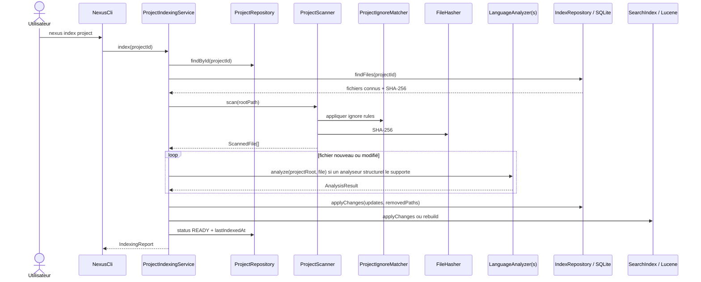
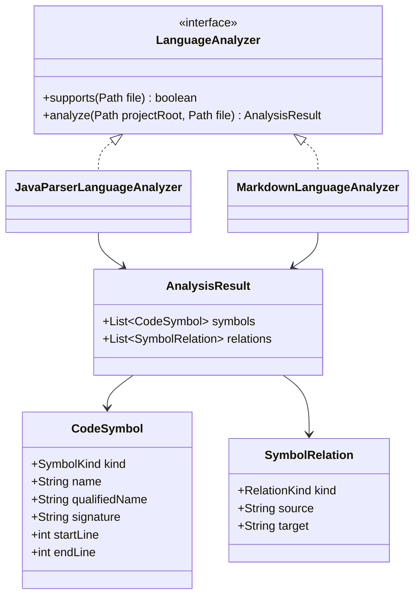
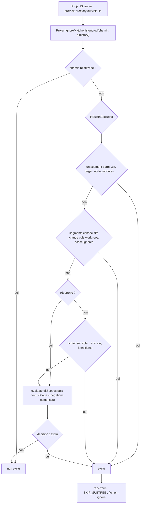

# Pipeline d'indexation locale

Ce chapitre décrit le pipeline d'indexation actuellement implémenté et validé.

## 1. Objectif

Transformer un repository local multi-langage en deux représentations complémentaires :

```text
SQLite
→ source de vérité structurelle

Lucene
→ index de recherche dérivé et reconstructible
```

L'indexation reste locale, incrémentale, idempotente et capable de propager les suppressions.

## 2. Séquence complète



## 3. Enregistrement d'un projet

La commande :

```powershell
mvn -q exec:java "-Dexec.args=project add N:\workspace-dev\my-project my-project"
```

passe par `ProjectRegistry`.

Le projet possède un UUID métier durable :

```text
ProjectDescriptor
├── id : UUID
├── name
├── rootPath
├── sourceType
├── languages
├── technologies
├── lastIndexedAt
└── indexStatus
```

La racine réelle du projet est canonisée avec `toRealPath()` afin d'éviter d'enregistrer deux fois le même repository via des chemins équivalents.

## 4. `NEXUS_HOME`

`NexusPaths` centralise les données locales.

La variable :

```powershell
$env:NEXUS_HOME = "N:\nexus-data"
```

permet de déplacer le stockage.

Le self-smoke utilise :

```text
target/nexus-self-smoke-home
```

pour isoler les données de validation.

Conceptuellement :

```text
NEXUS_HOME/
├── base SQLite
└── index Lucene par UUID projet
```

Toujours utiliser `NexusPaths` pour résoudre ces emplacements.

## 5. Scan du filesystem

`ProjectScanner.scan(Path projectRoot)` :

1. construit un `ProjectPathGuard` sur la racine réelle ;
2. initialise `ProjectIgnoreMatcher` ;
3. parcourt l'arbre avec `Files.walkFileTree` sans suivre les liens symboliques ;
4. applique les règles d'exclusion avant matérialisation ;
5. ne conserve que les langages texte déclarés par `SourceLanguage` ;
6. applique les limites globales de nombre d'entrées, volume total et taille par fichier ;
7. calcule SHA-256 sur les fichiers retenus ;
8. classe chaque fichier dans une `FileCategory` ;
9. trie le résultat par chemin repository canonique.

Les langages texte actuellement reconnus sont :

```text
JAVA        .java
MARKDOWN    .md
KOTLIN      .kt .kts
TYPESCRIPT  .ts .tsx
JAVASCRIPT  .js .jsx .mjs .cjs
PYTHON      .py
SQL         .sql
```

La présence d'un langage dans `SourceLanguage` garantit le scan, l'indexation lexicale et la construction de contexte à partir du contenu. Elle ne garantit pas une analyse structurelle embarquée pour ce langage.

Chaque `ScannedFile` contient notamment :

```text
absolutePath
relativePath
language
sizeBytes
contentHash
modifiedAt
estimatedTokens
category
```

### Catégories

`FileCategory` définit actuellement :

```text
SOURCE
TEST
RESOURCE
DOCUMENTATION
INSTRUCTION
AGENT_PROFILE
SKILL
OTHER
```

Le scanner reconnaît notamment les tests usuels Java/Kotlin/Python/JavaScript/TypeScript, les fichiers Markdown de documentation, les instructions IA (`AGENTS.md`, `CLAUDE.md`, `GEMINI.md`, instructions Copilot), les profils agents et les répertoires de skills.

## 6. Règles d'exclusion et sécurité filesystem

`ProjectIgnoreMatcher` réutilise JGit pour la sémantique des patterns.

Sources :

- `.gitignore` ;
- `.nexusignore` ;
- règles imbriquées avec leur scope ;
- exclusions intégrées de sécurité, contenus générés et worktrees d'outils.

Les exclusions intégrées s'appliquent avant les fichiers d'ignore et sans configuration :

- répertoires d'un segment, à toute profondeur et sans tenir compte de la casse : `.git`, `.idea`, `.gradle`, `.nexus`, `.aws`, `.ssh`, `.gnupg`, `.kube`, `.secrets`, `target`, `build`, `out`, `node_modules`, `dist`, `coverage` ;
- suites de segments consécutifs, à toute profondeur et sans tenir compte de la casse : `.claude/worktrees` (worktrees Git de Claude Code, copies complètes du dépôt), décidée par [BE-0058](../architecture/adr/BE-0058-exclure-les-worktrees-claude-code-du-scan-par-defaut.md). Le reste de `.claude/` (skills, agents, règles) reste indexé, de même que `docs/worktrees/` ou `.claude/worktrees-notes.md` ;
- fichiers sensibles : `.env`, `.env.*`, fichiers d'identifiants (`.npmrc`, `.netrc`, `credentials.json`…) et clés privées (`.pem`, `.key`, `.p12`…).

La négation est supportée dans les fichiers d'ignore :

```gitignore
*.generated.java
!important.generated.java
```

Elle ne réintègre jamais un chemin d'une exclusion intégrée : `!.claude/worktrees/` dans un `.nexusignore` reste sans effet.

Les liens symboliques et entrées non régulières sont refusés pour les fichiers indexables. Les chemins retenus sont revalidés par `ProjectPathGuard` avant hash et lecture.

## 7. Détection incrémentale par SHA-256

Pour chaque chemin fonctionnel `(projectId, relativePath)` :

```text
nouveau hash == ancien hash
→ inchangé
→ pas de nouvelle analyse structurelle

nouveau hash != ancien hash
→ modifié
→ nouvelle analyse

chemin ancien absent du scan
→ supprimé
→ suppression SQLite + Lucene
```

Le self-smoke valide qu'une seconde indexation sans modification retourne :

```text
0 modifié
0 supprimé
```

Un projet en cours d'indexation passe par `INDEXING`. Une défaillance positionne le projet en `FAILED`; un état non `READY` impose ensuite une reconstruction cohérente avant que recherche et contexte ne soient servis.

## 8. Analyse structurelle embarquée

Le contrat commun reste :

```java
public interface LanguageAnalyzer {
    boolean supports(Path file);
    AnalysisResult analyze(Path projectRoot, Path file) throws IOException;
}
```

Les analyseurs embarqués actuellement composés par `NexusApplication` sont :

- `JavaParserLanguageAnalyzer` pour Java ;
- `MarkdownLanguageAnalyzer` pour Markdown.

JavaParser est configuré explicitement au niveau Java 21. Les autres langages reconnus par `SourceLanguage` restent indexés lexicalement et peuvent recevoir une intelligence structurelle externe, notamment via SCIP. L'analyse Java profonde par JDT Language Server est un provider optionnel distinct et n'est activée que par configuration explicite.

### UML du modèle d'analyse



## OpenSpec project-indexing-exclusions

Spec : [`openspec/specs/project-indexing-exclusions/spec.md`](../../openspec/specs/project-indexing-exclusions/spec.md) ; matrice de traçabilité : [openspec-traceability.md](openspec-traceability.md).

### Comportement existant vérifié

| Étiquette | Fait | Source |
|---|---|---|
| [Existant vérifié] | `isIgnored` calcule le chemin relatif à la racine du projet et évalue d'abord les exclusions intégrées ; les règles `.gitignore` puis `.nexusignore` ne sont évaluées que si aucune exclusion intégrée ne s'applique. | `core/src/main/java/com/nexus/index/scan/ProjectIgnoreMatcher.java:142-159` |
| [Existant vérifié] | La suite de segments consécutifs `.claude`, `worktrees` est exclue à toute profondeur, sans tenir compte de la casse, pour un fichier comme pour un répertoire. | `ProjectIgnoreMatcher.java:62-63`, `:244-253`, `:265-286` |
| [Existant vérifié] | Le scanner élague un répertoire exclu (`SKIP_SUBTREE`) avant de lire ses fichiers d'ignore et ignore un fichier exclu avant de l'analyser. | `core/src/main/java/com/nexus/index/scan/ProjectScanner.java:95-103`, `:108-111` |
| [Existant vérifié] | Les mêmes exclusions intégrées s'appliquent à la découverte native d'instructions et de skills, qui réutilisent `ProjectIgnoreMatcher`. | `core/src/main/java/com/nexus/context/source/instruction/InstructionDiscoverySupport.java:38`, `:49`, `:59` ; `core/src/main/java/com/nexus/context/source/skill/LocalAgentSkillsProvider.java:42`, `:92`, `:103` |
| [Existant vérifié] | Une négation d'un fichier d'ignore ne réintègre pas le chemin : l'évaluation des règles n'est atteinte qu'après le retour `true` des exclusions intégrées. | `ProjectIgnoreMatcher.java:153-158` ; `ProjectScannerTest#ignoreNegationCannotReincludeClaudeWorktrees` |
| [Existant vérifié] | Le chemin est mesuré relativement à la racine du projet : un projet dont la racine est elle-même un worktree `.claude/worktrees/x` voit ses fichiers indexés (déduction de `relativize`, sans test). | `ProjectIgnoreMatcher.java:148` |
| [Existant vérifié] | Les autres exclusions intégrées (répertoires d'un segment, noms de fichiers sensibles, suffixes de clés) sont décrites en [§ Règles d'exclusion](#6-règles-dexclusion-et-sécurité-filesystem) ; la spec ne couvre que `.claude/worktrees`. | `ProjectIgnoreMatcher.java:39-87` |

### Vues

Vue Organigramme — Dans quel ordre le scan décide-t-il d'exclure un chemin, et pourquoi une négation ne le réintègre-t-elle pas ? (existant)



L'exclusion intégrée `.claude/worktrees` est testée avant toute lecture des règles d'ignore : une négation `!.claude/worktrees/` dans `.gitignore` ou `.nexusignore` n'est jamais consultée pour ce chemin. Un voisin proche (`.claude/skills/…`, `docs/worktrees/…`, `.claude/worktrees-notes.md`, `worktrees/.claude/…`, `.claude/autre/worktrees/…`) ne forme pas la suite `.claude` puis `worktrees` consécutifs et passe aux règles habituelles.

Exigences : `project-indexing-exclusions › Les worktrees Claude Code sont exclus du scan`, `project-indexing-exclusions › L'exclusion ne touche pas le reste de .claude`, `project-indexing-exclusions › L'exclusion intégrée n'est pas réversible par les fichiers d'ignore`.

### Écarts et limites

- [Écart] 1 — La casse n'est pas dans la spec : le code et `ProjectIgnoreMatcherBuiltInExclusionTest#excludesClaudeWorktreesAtAnyDepthIgnoringCase` excluent aussi `.Claude/WorkTrees/…`. Comportement existant non exigé.
- [Écart] 2 — Le scénario « Worktree à la racine du projet » parle de « résultats » ; `ProjectScannerTest#excludesClaudeWorktreesWithoutAnyIgnoreRule` vérifie la liste scannée, pas les résultats d'une recherche après indexation.
- [Écart] 3 — L'exigence dit « le scan » ; le code applique la même règle à la découverte native d'instructions et de skills (voir ci-dessus) sans que la spec ni un test la couvre.
- Limite : « Skills et instructions voisins » est vérifié au niveau du scan (`.claude/skills/exemple/SKILL.md` est dans la liste scannée), pas au niveau de la découverte native de skills.
- Limite : ni la spec ni un test ne couvrent un projet dont la racine est déjà un worktree (déduit seulement du code, `ProjectIgnoreMatcher.java:148`).

### Propositions et questions ouvertes

- [Proposition] Ajouter un scénario « Casse du nom » (`.Claude/WorkTrees/demo/README.md` exclu) si l'insensibilité à la casse doit devenir contractuelle ; le test existe déjà.
- [Proposition] Ajouter une exigence sur la découverte native (instructions, skills) si l'exclusion y est voulue, avec un test dédié.
- [Question] Les exclusions intégrées autres que `.claude/worktrees` (`.git`, `node_modules`, fichiers sensibles…) doivent-elles recevoir leur propre exigence OpenSpec ? Le Purpose parle de contenu « généré, sensible ou dupliqué » alors que les trois exigences ne visent que `.claude/worktrees`.
