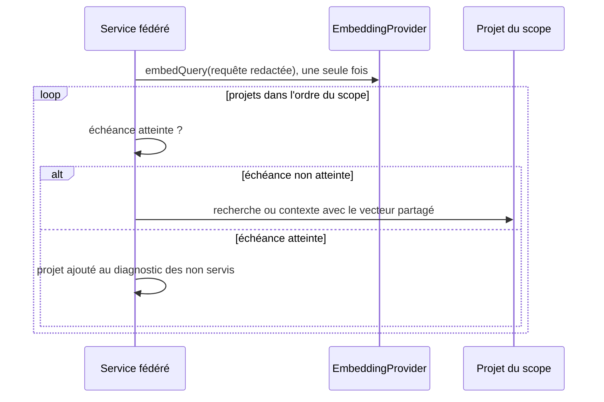
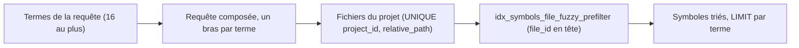

# Recherche multi-repository et passage à l'échelle

Les documents `iteration-*` conservent les baselines historiques. Ce fichier décrit le contrat courant après NXA3 + NXA4.

## Portée fédérée

Toutes les surfaces partagent une limite maximale de **100 projets uniques**.

```text
sélecteurs
  ↓
normalisation / déduplication stable
  ↓
FederatedScopePolicy <= 100 uniques
  ↓
résolution + READY
  ↓
SearchService / ContextBuilder par projet
```

La cardinalité est appliquée avant les lookups/readiness afin qu'un scope surdimensionné échoue sans résoudre 101 projets.

## Recherche fédérée

Pour une portée valide :

```text
SearchService(A, localOverfetch)
SearchService(B, localOverfetch)
...
  ↓
tri global déterministe
  ↓
diversification (projectId,path)
  ↓
top-K global
```

Le pool local est borné et la limite publique des résultats est commune à CLI/REST/MCP via `ResultLimitPolicy`.

## Requêtes Lucene à forte cardinalité

`LuceneSearchIndex` analyse les termes uniques de la requête puis s'arrête à :

```text
MAX_ANALYZED_QUERY_TERMS = 128
```

La limite opérationnelle est donc de **128 termes analysés uniques** avant expansion multi-champs. Le `MultiFieldQueryParser` développe ensuite ces termes sur cinq champs ; cette borne conserve une marge sous la limite Lucene par défaut de 1 024 clauses imbriquées, en incluant la coordination externe.

Un test de non-régression utilise une requête de 1 500 termes et vérifie qu'elle ne déclenche pas `TooManyClauses`.

## SQLite et symboles

Les connexions utilisent `temp_store=MEMORY` pour éviter le coût des temporaires
sur disque pendant les insertions avec triggers. Le journal canonique et la
durabilité restent inchangés. La mémoire temporaire native dépend du travail SQL
et n'est pas comptée par le gate de heap Java ; voir [réglages des connexions SQLite](sqlite-write-contention.md#réglages-des-connexions-et-lots-décriture).

Chaque connexion fixe aussi `cache_size` à 64 MiB : les index qui commencent par
`file_id` (V005, V012, V015) reçoivent des clés hors ordre pendant une indexation de
nombreux fichiers et dépassent le cache par défaut de 2 MiB au-delà de quelques
centaines de milliers de lignes. SQLite alloue ces pages à l'usage, hors heap Java ;
voir [réglages des connexions SQLite](sqlite-write-contention.md#réglages-des-connexions-et-lots-décriture).

Les recherches symbole/relation filtrent côté repository avant matérialisation. La recherche de symboles est scopée au projet ciblé (AUD-PRF-09) :

- le préfiltre approché part des fichiers du projet (`UNIQUE (project_id, relative_path)`) puis sonde `idx_symbols_file_fuzzy_prefilter` (V015, première colonne `file_id`) : son plan ne contient aucun parcours de la table ou d'un index des symboles et ne change pas quand la base passe de 25 à 100 projets (`SqliteSymbolSearchScopingTest`) ;
- les termes d'une requête (jusqu'à 8, plus la requête entière) sont interrogés en lot par `IndexRepository.searchSymbols(projectId, queries, limit)` : au plus une requête SQL par famille (plein texte trigram, préfiltre approché, LIKE des termes de moins de trois points de code) quel que soit le nombre de termes. La requête est composée (`UNION ALL`) : chaque terme porte son propre `LIMIT`, donc SQLite s'arrête tôt par terme, et le préfiltre approché choisit par terme, d'après un comptage plafonné à 10 000, le parcours de l'index scopé ou le parcours ordonné de `idx_symbols_qualified_name`. Une fenêtre `ROW_NUMBER` sur tous les candidats a été écartée : à 100 000 symboles dans un projet, elle portait le p95 de la recherche exacte de 40 à 532 ms. Le résultat est identique aux requêtes par terme d'avant V015 ;
- l'index plein texte `symbol_search_fts` est contentless, sans colonne de projet : sa correspondance reste globale et le filtre de projet s'applique par les jointures sur la clé primaire. Une restriction par `rowid IN (symboles du projet)` a été mesurée le 2026-11-07 sur 60 projets et 240 000 symboles : 0,67 à 1,0 s contre 3 à 87 ms pour la correspondance globale, donc non retenue.

V005 impose également :

```text
start_line >= 1
end_line >= start_line
```

## Graphe

Les projections/voisinages sont bornés en nœuds/arêtes et le benchmark vérifie le coût à grande échelle. Les caches dérivés restent invalidés par la génération canonique.

## Contexte fédéré

`FederatedContextService` combine :

- budget final global ;
- budget de travail préparatoire ;
- provenance ;
- fair floor / round-robin / refill ;
- déduplication ;
- sources natives projet-locales.

Le budget de découverte natif de chaque construction est partagé entre instructions, skills, customisations et Git avant le budget final de tokens.

Les limites REST de résultats et de budget contexte fédérés sont alignées sur les politiques centrales ; le REST ne peut pas demander un plafond supérieur au cœur.

## Vecteur de requête unique et échéance globale

Une requête fédérée (recherche ou contexte) crée un `SearchQueryContext` pour toute la requête et le transmet aux stratégies de chaque projet. `SemanticSearchStrategy` y mémorise le vecteur de la requête **redactée** : le fournisseur d'embeddings reçoit au plus un appel `embedQuery`, quel que soit le nombre de projets, et zéro si aucun projet n'a d'index sémantique compatible. Une indisponibilité du fournisseur est mémorisée de la même façon : un seul appel est tenté et chaque projet porte le même diagnostic de dégradation. Le contexte n'est pas conservé entre requêtes.

Une échéance globale (`FederationDeadlinePolicy`, [BE-0081](../architecture/adr/BE-0081-federer-la-recherche-locale-par-projet-sous-echeance-globale.md)) est vérifiée avant chaque projet, dans l'ordre du scope, sans parallélisme :

| Paramètre | Valeur |
|---|---|
| `NEXUS_FEDERATION_DEADLINE_SECONDS` | entier de 1 à 600, défaut 60 ; toute autre valeur est refusée |
| Projet commencé | jamais interrompu |
| Délai d'embedding | `min(timeout du fournisseur, temps restant)`, au moins 1 ms |

Les projets non commencés à l'échéance ne sont pas servis et sont nommés, dans l'ordre du scope, par `unservedProjects` (identifiant et nom) : composante des réponses fédérées `FederatedSearch` et `FederatedContext` de la projection publique, donc identique en CLI (clé JSON et ligne « Projets non servis »), REST et MCP. La liste est vide, et les résultats identiques à ceux d'une exécution sans échéance, lorsque tous les projets sont traités à temps. En mode `explain`, le contexte fédéré ajoute une exclusion « projet non servi » par projet concerné. Les tests injectent une horloge (`InstantSource`) et n'affirment rien sur la durée réelle.

## Providers externes et scale

Les providers/importers externes utilisent `ExternalTaskRunner` avec timeout et maximum **8 workers réellement actifs**. Un provider qui ignore l'interruption conserve sa place de capacité jusqu'à sa terminaison réelle.

JDT LS borne en plus son framing à 16 MiB par message, 64 KiB de headers cumulés, 8 KiB par ligne et 256 messages en attente.

## Scale Benchmark courant

`.github/workflows/scale-benchmark.yml` qualifie :

- SQLite jusqu'aux tiers configurés ;
- portefeuille jusqu'à 100 projets ;
- graphe ;
- budget fédéré ;
- découverte native filesystem avec 1 000 skills.

Les rapports sont des preuves du SHA qui les a produits, pas des garanties intemporelles.

## Moteurs externes

Zoekt/OpenGrok/OpenSearch, FTS supplémentaire, vector DB, cache Git persistant ou lifecycle Lucene partagé ne sont introduits qu'après mesure reproductible démontrant un besoin réel.

## OpenSpec federated-search-bounds

Spec : [`openspec/specs/federated-search-bounds/spec.md`](../../openspec/specs/federated-search-bounds/spec.md) ; matrice de traçabilité : [openspec-traceability.md](openspec-traceability.md).

Cette section décrit les bornes de coût et de temps d'une requête fédérée (recherche et contexte) ; la section « Vecteur de requête unique et échéance globale » plus haut en donne le détail opérationnel.

### Comportement existant vérifié

| Étiquette | Fait | Source |
|---|---|---|
| [Existant vérifié] | Le vecteur de requête est calculé une seule fois par requête fédérée, sur la requête redactée, puis partagé par les `SemanticSearchStrategy` de chaque projet ; un échec n'est pas mémorisé au-delà de la requête. | `core/src/test/java/com/nexus/search/semantic/FederatedQueryVectorTest#federatedSearchEmbedsTheQueryOnceForThreeProjects`, `#federatedSearchTransmitsTheRedactedQueryToTheProvider`, `#sharedComputationRunsOnceAndFailuresAreNotMemoized` |
| [Existant vérifié] | Un fournisseur d'embeddings indisponible n'est appelé qu'une fois et dégrade chaque projet avec le même diagnostic. | `core/src/test/java/com/nexus/search/semantic/FederatedQueryVectorTest#unavailableProviderIsCalledOnceAndDegradesEveryProjectWithTheSameDiagnostic` |
| [Existant vérifié] | Le délai d'embedding est plafonné par le temps restant de l'échéance globale. | `core/src/test/java/com/nexus/search/semantic/FederatedQueryVectorTest#embeddingDelayIsCappedByTheRemainingGlobalDeadline` |
| [Existant vérifié] | L'échéance globale (`FederationDeadlinePolicy`, variable `NEXUS_FEDERATION_DEADLINE_SECONDS`, 60 s par défaut, bornée entre 1 s et 600 s) est vérifiée avant chaque projet, sans parallélisme ; les projets non commencés sont nommés dans l'ordre du scope. | `core/src/main/java/com/nexus/project/FederationDeadlinePolicy.java`, `core/src/test/java/com/nexus/context/FederatedContextServiceTest#stopsStartingProjectsAtTheGlobalDeadlineAndNamesUnservedProjectsInScopeOrder`, `core/src/test/java/com/nexus/search/FederatedSearchServicePolicyTest#stopsStartingProjectsAtTheGlobalDeadlineAndNamesUnservedProjectsInScopeOrder` |
| [Existant vérifié] | Sans échéance atteinte, aucun diagnostic de projet non servi n'est produit et les résultats sont ceux d'une exécution sans échéance. | `core/src/test/java/com/nexus/context/FederatedContextServiceTest#servesEveryProjectWithoutDiagnosticWhenTheDeadlineIsNotReached`, `core/src/test/java/com/nexus/search/FederatedSearchServicePolicyTest#servesEveryProjectWithoutDiagnosticAndSameHitsWhenTheDeadlineIsNotReached` |
| [Existant vérifié] | La projection publique et la CLI (JSON et texte) portent le même diagnostic de projets non servis, pour la recherche et pour le contexte. | `core/src/test/java/com/nexus/cli/FederatedUnservedProjectsDiagnosticTest#projectionNamesUnservedProjectsInScopeOrderForSearchAndContext`, `#cliJsonCarriesTheSameDiagnosticAsTheProjection`, `#cliTextNamesUnservedProjectsOnlyWhenThereAreSome` |

### Vues

Vue UML séquence — Dans quel ordre une requête fédérée calcule-t-elle le vecteur, vérifie-t-elle l'échéance et nomme-t-elle les projets non servis ? (existant)



Exigences : `federated-search-bounds › Le vecteur de requête est calculé une fois par requête fédérée`, `federated-search-bounds › La fédération respecte une échéance globale`, `federated-search-bounds › Les projets non servis sont nommés`.

### Écarts et limites

- [Écart] 1 — Le scénario « Parité des interfaces » est vérifié sur la projection publique et sur la CLI ; aucun test dédié ne sert la même requête interrompue par REST et par MCP, qui consomment la même projection.
- Limite : les tests d'échéance simulent l'horloge ; aucun test ne mesure une durée réelle.

### Propositions et questions ouvertes

- [Proposition] Ajouter un test de parité qui sert la même requête interrompue par REST et MCP et compare le diagnostic à celui de la CLI.
- Questions : aucune.

## OpenSpec symbol-search-scoping

Spec : [`openspec/specs/symbol-search-scoping/spec.md`](../../openspec/specs/symbol-search-scoping/spec.md) ; matrice de traçabilité : [openspec-traceability.md](openspec-traceability.md).

Cette section décrit le périmètre de travail de la recherche de symboles SQLite (`SqliteSymbolSearch`) ; la section « SQLite et symboles » plus haut en donne les mesures.

### Comportement existant vérifié

| Étiquette | Fait | Source |
|---|---|---|
| [Existant vérifié] | La migration `V015` remplace l'index de préfiltre fuzzy global par un index dont la première colonne est `file_id` : le projet fournit ses fichiers, puis chaque fichier est sondé dans l'index. | `core/src/main/resources/db/migration/V015__index_symbols_by_file_for_fuzzy_search.sql` |
| [Existant vérifié] | Le plan `EXPLAIN QUERY PLAN` du préfiltre approché utilise l'index scopé et ne contient aucun parcours complet des symboles sur une base de 25 et de 100 projets. | `core/src/test/java/com/nexus/persistence/sqlite/SqliteSymbolSearchScopingTest#fuzzyPrefilterPlanUsesTheFileScopedIndexWithoutAnyFullSymbolScanAt25And100Projects` |
| [Existant vérifié] | Les termes sont interrogés en lot par une requête composée dont chaque bras porte son `LIMIT` ; le nombre de requêtes SQL ne dépend pas du nombre de termes, et la borne de lot est `MAX_QUERIES_PER_BATCH` (16). | `core/src/test/java/com/nexus/persistence/sqlite/SqliteSymbolSearchScopingTest#numberOfSqlStatementsDoesNotGrowWithTheNumberOfTerms`, `#rejectsMoreQueriesThanTheBatchBoundAndAcceptsExactlyTheBound` |
| [Existant vérifié] | Les symboles rendus par le lot et leur ordre sont identiques à ceux des requêtes par terme d'avant `V015`. | `core/src/test/java/com/nexus/persistence/sqlite/SqliteSymbolSearchScopingTest#batchedResultsAreIdenticalToThePerTermQueriesOfBeforeV015` |

### Vues

Vue organigramme de composants (non UML, lecture C4 simplifiée) — Comment une requête de symboles restreint-elle son travail au projet ciblé ? (existant)



Exigences : `symbol-search-scoping › La recherche de symboles est scopée projet avant le tri`, `symbol-search-scoping › Les termes d'une requête sont interrogés en lot`.

### Écarts et limites

- Limite : la mesure de latence à 100 000 symboles relève du benchmark de scale (`docs/developer/scale-regression-benchmark.md`), pas de ces tests.

### Propositions et questions ouvertes

- Questions : aucune.

## OpenSpec query-path-performance

Spec : [`openspec/specs/query-path-performance/spec.md`](../../openspec/specs/query-path-performance/spec.md) ; matrice de traçabilité : [openspec-traceability.md](openspec-traceability.md).

Cette section décrit les coûts admis sur trois chemins de requête et d'import. Les sorties sont identiques à celles des implémentations de référence.

### Comportement existant vérifié (query-path-performance)

| Étiquette | Fait | Source |
|---|---|---|
| [Existant vérifié] | `BudgetedContextSelector.truncate` cherche le nombre de lignes conservées par dichotomie ; le résultat est identique à la boucle ligne à ligne de référence, y compris pour l'Unicode hors BMP et les fins de ligne CRLF et CR. | `core/src/test/java/com/nexus/context/BudgetedContextSelectorTruncationTest.java#dichotomyMatchesTheLinearReferenceOnUnicodeMultilineFragments` |
| [Existant vérifié] | Un fragment de 4 096 lignes demande au plus log2(n) + 2 estimations ; `TokenEstimator` documente l'exigence de croissance avec le préfixe. | `core/src/test/java/com/nexus/context/BudgetedContextSelectorTruncationTest.java#largeFragmentUsesALogarithmicNumberOfEstimations` |
| [Existant vérifié] | Le voisinage sortant de `SqliteGraphQueries` est paginé par la clé `(source_ref, target_ref)`, sans `OFFSET` ; la concaténation des pages égale le parcours complet ordonné. | `core/src/test/java/com/nexus/persistence/sqlite/SqliteGraphNeighborhoodProjectionTest.java#keysetPagesConcatenateToTheFullOrderedOutgoingScan` |
| [Existant vérifié] | `RepositoryPath.fromProvider` refuse une lettre de lecteur par comparaison de caractères ; `RepositoryGlobMatcher` garde au plus 256 motifs compilés dans un cache LRU. | `core/src/test/java/com/nexus/context/source/instruction/RepositoryGlobMatcherTest.java#cacheNeverExceedsItsBoundAndEvictsTheLeastRecentlyUsedGlob` |

### Écarts et limites (query-path-performance)

- L'index `(project_id, kind, source_ref)` ne contient pas `target_ref` : chaque page relit les entrées d'index des chemins demandés. BE-0087 fixe la condition de réexamen d'un index couvrant.
