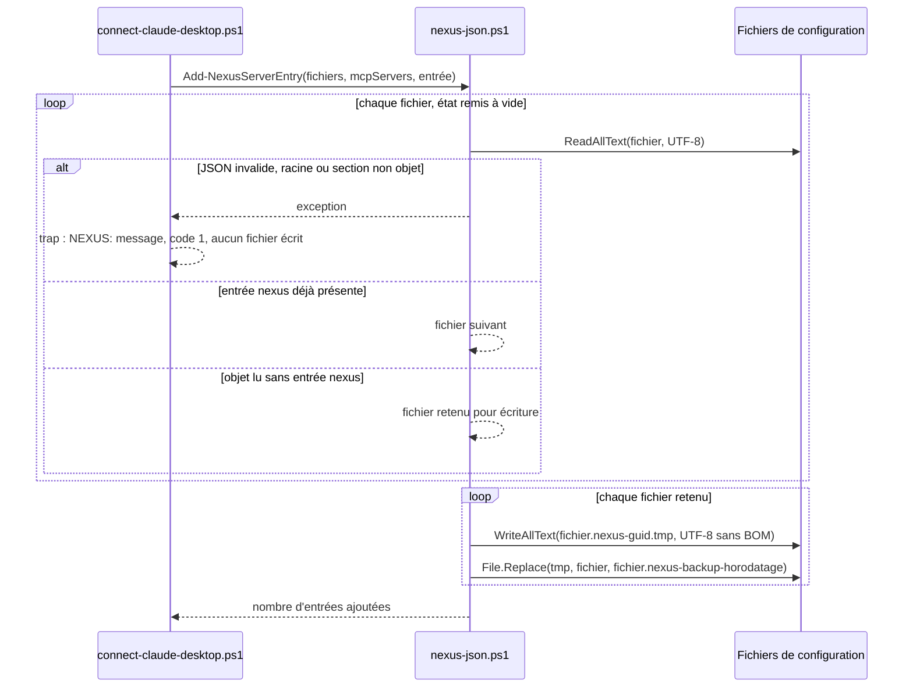
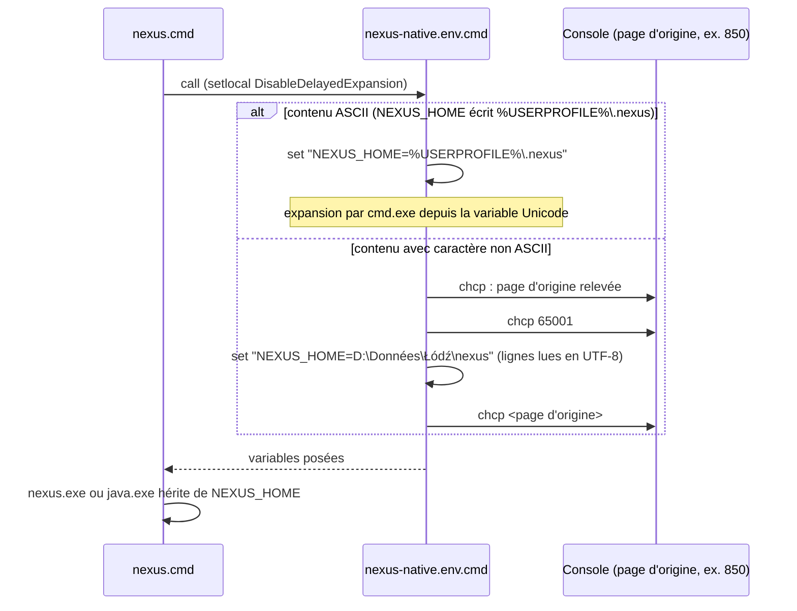

# Release, installation et recovery

Ce document décrit le contrat opérationnel courant de NEXUS Context Engine 0.2.0 après NXA3 + NXA4.

## Toolchain

- Java runtime : 21 ou supérieur ;
- bytecode/API : Java 21 (`maven.compiler.release=21`) ;
- wrapper : **Maven 3.10.0** avec SHA-512 versionné dans `config/tool-integrity.properties` ;
- Eclipse JDT LS optionnel : archive vérifiée contre le SHA-256 versionné dans le même fichier.

Les scripts d'installation échouent si l'ancre attendue manque ou ne correspond pas aux octets téléchargés. L'installateur JDT LS ne fait pas confiance à un checksum récupéré depuis le même origin que l'archive.

## Livrables

Le reactor produit notamment :

```text
target/nexus-context-engine-0.2.0-cli.jar
target/nexus-context-engine-0.2.0-cli.jar.sha256
target/distribution/nexus-context-engine-0.2.0.zip
target/distribution/nexus-context-engine-0.2.0.zip.sha256
target/licenses/THIRD_PARTY_NOTICES.txt
target/sbom/bom.json
```

La distribution Windows x64 self-contained produit également :

```text
target\dist\nexus-context-engine-0.2.0-windows-x64.zip
target\dist\nexus-context-engine-0.2.0-windows-x64.zip.sha256
target\dist\NEXUS-0.2.0-windows-x64-setup.exe
target\dist\NEXUS-0.2.0-windows-x64-setup.exe.sha256
```

## Contrat de release

`develop` est la branche d'intégration ; `main` est la branche de release. Une publication GHCR est déclenchée uniquement par un tag `vX.Y.Z` (ou `vX.Y.Z-rc.N` pour une pré-version) qui pointe sur le HEAD exact de `main` et dont la version correspond au `pom.xml`.

La release réutilise les gates exécutables : NEXUS CI, Windows Installer, Docker Distribution, Scale Benchmark, Scanner Corpus Benchmark, CodeQL et OSV-Scanner selon le contrat du workflow. SonarCloud reste un Quality Gate PR externe, pas un job de release.

L'image Docker est **construite une seule fois** dans Docker Distribution, qualifiée, exportée avec preuve d'intégrité puis chargée dans le job de publication. Le workflow de release ne reconstruit pas l'image.

Les tags version et SHA sont immuables. Le préflight GHCR est fail-closed sur toute erreur ambiguë et accepte une reprise idempotente uniquement si le contenu déjà publié correspond à l'image qualifiée. `latest` est le seul pointeur mutable.

Voir [`immutable-release-publishing.md`](immutable-release-publishing.md).

### Vérification des assets publiés

L'image, le ZIP Windows et le `setup.exe` portent chacun une attestation de provenance, vérifiée par le job `publish` avant l'upload des assets. Avant d'installer un asset téléchargé depuis une release :

```text
gh attestation verify <asset> --repo FTurleque/nexus-context-engine
```

Une vérification en échec signifie que l'asset ne doit pas être installé. Le détail (workflow signataire, image par digest) figure dans [`immutable-release-publishing.md`](immutable-release-publishing.md#vérification-consommateur).

### Horodatage reproductible

Le pom racine fixe `project.build.outputTimestamp` : les JAR (dont le JAR CLI ombré), le ZIP de distribution et le SBOM CycloneDX portent cet horodatage au lieu de l'heure du build. Deux `./mvnw -B -ntp clean verify -DskipTests` successifs sur le même commit produisent donc les mêmes SHA-256 pour `target/nexus-context-engine-<version>-cli.jar` et `target/distribution/nexus-context-engine-<version>.zip` (le ZIP est assemblé en phase `verify`).

À chaque release, dans le commit qui fixe la version des pom :

1. mettre `project.build.outputTimestamp` à la date UTC de ce commit, au format `AAAA-MM-JJT00:00:00Z` ;
2. lancer deux fois `./mvnw -B -ntp clean verify -DskipTests` et comparer `sha256sum target/nexus-context-engine-*-cli.jar target/distribution/*.zip` : une empreinte différente bloque la release.

L'image Docker et l'installeur Windows ne sont pas couverts (horodatages des outils tiers).

### Reprise d'une release échouée

Un tag `v*` poussé désigne son commit pour toujours. La politique de publication de SEC-0068 exige, avant toute release, le ruleset « Immutable version tags », qui interdit à tous, mainteneur compris, de mettre à jour ou de supprimer un tag `v*`, et le réglage « releases immuables », qui verrouille toute release publiée. Ces réglages GitHub se relisent par `gh api` ; leur état relevé figure dans [le relevé du 2026-11-11](../project/history/releases-immuables-et-tags-2026-11-11.md). La reprise d'un run `release.yml` en échec dépend donc de ce qui a déjà été publié et de ce que demande le correctif :

1. **Échec transitoire, commit inchangé, release GitHub non publiée** (runner, réseau, mesure de charge instable) : relancer les jobs échoués du même run, sur le même tag. Le préflight GHCR et la release en brouillon reprennent de façon idempotente ([Échec partiel](immutable-release-publishing.md#échec-partiel)). La relance d'un gate de charge ne vaut que pour le même commit ; le plafond absolu du gate borne ce qu'elle peut admettre.
2. **Correctif qui change le commit** : le tag en échec est conservé sans release et consigné dans un relevé daté de `docs/project/history/` (tag, run, cause). La version des pom passe à une nouvelle version, que `scripts/release/validate-release-tag.sh` exige égale au tag :
   - version finale `X.Y.Z` en échec : `X.Y.(Z+1)`, précédée de `X.Y.(Z+1)-rc.1` si le correctif touche la chaîne de release ;
   - pré-version `X.Y.Z-rc.N` en échec : `X.Y.Z-rc.(N+1)`.

   Le correctif suit le flux habituel (PR vers `develop`, promotion vers `main`) et le nouveau tag est posé sur la tête de `main`.
3. **Release GitHub déjà publiée** : elle ne se corrige pas ; une nouvelle version suit le point 2. Si `scripts/release/publish-github-release-assets.sh` sort en code 79 (release publiée non immuable), `latest` n'a pas bougé : activer les releases immuables, puis publier une nouvelle version.

Aucun tag `v*` n'est supprimé, déplacé ni recréé. Le détail des réglages GitHub et leurs commandes de lecture figurent dans [`immutable-release-publishing.md`](immutable-release-publishing.md#politique-de-publication-cible-sec-0068-proposée).

## SQLite : autorité, migrations et recovery

SQLite reste l'autorité canonique. Les migrations sont forward-only, enregistrées dans `schema_migrations` et protégées par `script_sha256`.

Les migrations de durcissement et de performance récentes sont :

- `V004__invalidate_invalid_symbol_ranges.sql` : invalide les index historiques contenant des plages que le domaine Java ne peut plus représenter et force un rebuild déterministe ;
- `V005__enforce_symbol_range_constraints.sql` : reconstruit `symbols` et impose :

```text
start_line >= 1
end_line >= start_line
```

- `V006__invalidate_unredacted_lexical_indexes.sql` : invalide une fois les projets existants et incrémente leur génération afin que la prochaine indexation effectue un rebuild complet. Ce rebuild supprime les anciens segments Lucene qui avaient tokenisé le contenu brut avant que la redaction des secrets ne soit appliquée au pipeline lexical.
- `V007__invalidate_legacy_repository_paths.sql` : invalide les index persistants qui utilisaient l'ancienne représentation ambiguë des chemins, incrémente la génération des projets et force un rebuild avec l'identité par composants. La migration ne tente pas de deviner si une ancienne valeur `a/b.java` désignait un chemin séparé ou un nom POSIX contenant un backslash.
- `V008__indexed_substring_search.sql` : construit les index dérivés FTS5/trigram `symbol_search_fts` et `relation_search_fts`, backfill les faits canoniques existants et installe des triggers `INSERT` / `UPDATE` / `DELETE` pour maintenir ces projections. Elle ajoute également `idx_symbols_fuzzy_prefilter` pour le préfiltrage fuzzy.

Une base V004 valide est migrée vers V005 en conservant ses données/index. V006 conserve également SQLite mais marque les projets `NOT_INDEXED` pour reconstruire les index dérivés avec la représentation redacted. V008 ne remplace pas les tables canoniques `symbols` et `symbol_relations` : ses tables FTS sont reconstructibles à partir d'elles. Un `INSERT` SQL direct invalide est rejeté. Réexécuter le migrateur sur une base déjà migrée est idempotent.

Si un index FTS V008 est physiquement corrompu, la procédure sûre consiste à restaurer SQLite depuis une sauvegarde cohérente ou à reconstruire l'état dérivé via une migration/recovery contrôlé ; ne jamais considérer les tables FTS comme l'autorité à sauvegarder indépendamment des tables canoniques.

### Permissions de `NEXUS_HOME`

Avant l'ouverture/migration SQLite, NEXUS crée/durcit le stockage persistant :

```text
NEXUS_HOME/          0700 sur POSIX
NEXUS_HOME/indexes/  0700 sur POSIX
NEXUS_HOME/locks/    0700 sur POSIX
NEXUS_HOME/nexus.db  0600 sur POSIX
```

Les chemins persistants durcis concernés sont refusés lorsqu'ils sont symboliques. Sur Windows ou filesystem sans vue POSIX, NEXUS conserve les ACL natives au lieu de les remplacer destructivement. Lorsqu'une vue ACL Windows est disponible, NEXUS inspecte `NEXUS_HOME` et émet un warning si des principaux inattendus disposent de permissions permettant de lire ou modifier les données persistantes.

Un backup/restauration doit conserver les protections adaptées au système cible. Ne pas déduire de `0700/0600` qu'une ACL Windows doit être remplacée par un équivalent artisanal.

### Recovery après échec d'indexation

- une lecture indexée exige un projet `READY` ;
- toute `IOException`/erreur runtime durant l'indexation marque le projet `FAILED` avant propagation ;
- un projet persistant non-READY est reconstruit lors de la prochaine indexation ;
- SQLite doit être conservé ; Lucene lexical/sémantique reste dérivé et reconstructible ;
- une mutation concurrente détectée pendant l'indexation provoque un échec fail-closed ;
- un timeout/failure d'un provider externe explicitement demandé n'est pas converti silencieusement en `READY` ;
- `index_generation` ne progresse pas pour un no-op effectif.

Avant une migration de production, sauvegarder SQLite service arrêté. Ne jamais restaurer uniquement un index Lucene en ignorant SQLite.

## Recovery sémantique / `content-v8`

Le profil de contenu sémantique courant est `content-v8`, lié à la politique de redaction `secret-redaction-v9`. Un index créé sous l'ancien profil est considéré incompatible et doit être reconstruit ; NEXUS ne réutilise pas silencieusement les vecteurs historiques.

La redaction de secrets réduit la fuite accidentelle de tokens/clés/mots de passe structurés, mais n'est pas une sauvegarde ni un scanner de secrets complet.

L'indisponibilité d'Ollama ou une corruption physique de l'index Lucene sémantique reste le watch item #54 pour des diagnostics/runbooks supplémentaires.

## Concurrence et providers externes

Une mutation d'index par projet est protégée par :

1. mutex JVM par `projectId` ;
2. `FileLock` OS sous `NEXUS_HOME/locks`.

La garantie cible un `NEXUS_HOME` sur filesystem local. Les mêmes garanties ne sont pas revendiquées sur filesystem réseau.

Les tâches providers/importers sont bornées en temps et à **8 workers réellement actifs maximum**. La capacité n'est rendue que lorsque le worker se termine effectivement. Un provider ignorant l'interruption peut donc vivre plus longtemps que l'appelant, mais il ne peut pas provoquer une croissance non bornée du nombre de workers NEXUS. Après timeout ou interruption, un circuit-breaker par nom de tâche bloque les nouvelles relances de cette intégration tant que ses workers timeoutés restent vivants. `ExternalTaskRunner.status()` expose le nombre de tâches actives et de workers timeoutés pour la supervision.

## Recovery Docker

`NEXUS_HOME` contient l'état persistant et doit être sauvegardé. Une image Docker est remplaçable.

Pour diagnostiquer une release :

- identifier le digest réellement exécuté ;
- vérifier les tags version/SHA et les attestations liées à ce digest ;
- utiliser les preuves Trivy/SBOM du run exact ;
- ne jamais considérer `latest` seul comme identité immuable.

## Sécurité REST et management

Listener applicatif par défaut : `127.0.0.1:8080`.

Health/metrics sont servis sur le listener management séparé `127.0.0.1:9000`. `/q/*` ne doit pas être disponible sur le listener applicatif ni publié par le reverse proxy métier.

Une écoute REST loopback exige un Bearer token robuste par défaut. L'ancien mode local sans authentification n'est disponible que par opt-out explicite `NEXUS_REST_TRUST_LOCAL=true`; `NEXUS_REST_HARDEN_LOCAL=true` reste prioritaire et impose token + allowlist. Une écoute API hors loopback exige transport réellement sécurisé, token robuste et allowlist de racines. `direct-https` doit correspondre à un listener TLS effectif ; `reverse-proxy-https` doit respecter la frontière proxy/backend. `loopback-forward` reste limité à une publication Docker hôte sur loopback.

Contourner les gardes REST ou exposer le listener management n'est jamais une procédure de recovery valide.

## Ollama

Un endpoint Ollama distant doit utiliser HTTPS par défaut. HTTP distant nécessite `NEXUS_ALLOW_INSECURE_REMOTE_OLLAMA=true`. Les credentials intégrés à `NEXUS_OLLAMA_BASE_URL` sont refusés.

## Qualification

Une version, un merge ou une release n'est qualifié que si les gates applicables ont terminé en succès sur le **HEAD exact** concerné. Un ancien run vert n'est pas une preuve pour un nouveau commit.

Voir aussi [`ci-and-supply-chain.md`](ci-and-supply-chain.md), [`branch-governance.md`](branch-governance.md), [`semantic-search.md`](semantic-search.md) et [`current-limitations.md`](current-limitations.md).
## Mise à niveau V010 — scalaires sensibles

V010 est une nouvelle migration ; V009 et ses empreintes restent inchangées.
Elle incrémente la génération de chaque projet, passe son état à `NOT_INDEXED`
et efface `last_indexed_at`. Les lectures publiques sont refusées jusqu’à la
prochaine indexation, qui reconstruit intégralement les dérivés lexicaux.
SQLite conserve les faits canoniques (fichiers, symboles et relations), pas le
contenu brut des documents. Les termes Lucene issus des anciens scalaires sont
supprimés par le rebuild. Cette invalidation ne constitue pas un effacement
forensique des anciens fichiers, sauvegardes ou blocs disque.

Le profil sémantique courant rend également incompatibles les vecteurs des
profils antérieurs, même si le corpus n’a pas changé et si la sémantique était désactivée
pendant la migration ou le rebuild lexical. Leur prochaine activation impose une
reconstruction ; les vecteurs incompatibles ne participent pas aux recherches.
Le mécanisme transactionnel et les empreintes de migrations garantissent que V010
n’incrémente pas à nouveau les générations lors d’une seconde ouverture.

## Mise à niveau V011 — formats de secrets

`V011__invalidate_secret_format_indexes.sql` accompagne la politique
`secret-redaction-v6` : 19 formats de secrets supplémentaires sont redigés et une
valeur sensible trop longue n’exclut que son fichier. Comme V010, elle
incrémente la génération de chaque projet, le passe à `NOT_INDEXED` et efface
`last_indexed_at` ; le registre et les faits canoniques sont conservés. La
prochaine indexation reconstruit les dérivés lexicaux, et le profil `content-v5`
impose la reconstruction des vecteurs sémantiques. Un index Lucene dont la version
de politique diffère de `secret-redaction-v6` est traité comme absent et reconstruit.
V001 à V010 et leurs empreintes restent inchangées.

## Mise à niveau V012 et V013 — index du chemin d'écriture SQLite

Ces deux migrations ne modifient que des index : aucun rebuild n'est imposé. Elles
ne changent ni les faits canoniques (fichiers, symboles, relations), ni la
génération, ni le statut d'indexation des projets, et les index Lucene et
sémantiques restent valides. V001 à V011 et leurs empreintes restent inchangées.

- `V012__index_symbol_relations_by_file.sql` crée
  `idx_symbol_relations_file_provider` sur `symbol_relations(file_id, source_provider)`.
  Il sert la suppression des relations d'un fichier par fournisseur et la
  vérification de la cascade de clé étrangère depuis `indexed_files`, qui
  parcouraient toute la table. La création de l'index sur une grande base prend un
  temps proportionnel au nombre de relations, au premier démarrage qui applique la
  migration.
- `V013__drop_redundant_prefix_indexes.sql` supprime par `DROP INDEX IF EXISTS`
  trois index qui sont des préfixes stricts d'autres index :
  `idx_symbol_relations_project`, `idx_indexed_files_project` et `idx_symbols_file`.
  Les requêtes qu'ils servaient restent servies par un index plus large, ce que
  `SqliteGraphQueryPlanTest` vérifie par `EXPLAIN QUERY PLAN`. Un index supprimé se
  recrée par une migration ultérieure si une requête nouvelle en a besoin.

`SchemaMigratorFileIndexUpgradeTest` migre une base peuplée et vérifie que les
données et le statut des projets sont conservés. Une seconde ouverture n'applique
plus aucune des deux migrations.

## Mise à niveau V014 — mise en attente des analyses d'indexation

`V014__index_staged_analyses.sql` crée trois tables transitoires,
`index_staged_files`, `index_staged_symbols` et `index_staged_relations`, où une
indexation met ses analyses en attente par lots avant de les publier (décision
DATA-0074, [indexing-pipeline.md](indexing-pipeline.md#9-coûts-mesurés-du-pipeline)).
Elle ne modifie ni les faits canoniques, ni la génération, ni le statut des
projets : aucun rebuild n'est imposé et les index Lucene et sémantiques restent
valides. V001 à V013 et leurs empreintes restent inchangées.

Ces tables sont vides hors indexation : la transaction de publication les vide, une
indexation qui échoue les vide à sa fermeture et toute nouvelle indexation d'un
projet écarte d'abord ce qu'une indexation interrompue (arrêt brutal du processus) y
aurait laissé. Elles ne contiennent donc rien à sauvegarder ni à restaurer ; une
base restaurée depuis une sauvegarde prise pendant une indexation reste cohérente,
le projet étant alors dans un état non `READY` qui impose un rebuild complet.

## Mise à niveau V015 — préfiltre approché des symboles scopé par fichier

`V015__index_symbols_by_file_for_fuzzy_search.sql` crée `idx_symbols_file_fuzzy_prefilter` sur
`symbols(file_id, SUBSTR(LOWER(name), 1, 1), LENGTH(name))` et supprime
`idx_symbols_fuzzy_prefilter` (V008), qui n'avait aucune colonne de projet et que plus aucune requête
n'utilise (AUD-PRF-09). La recherche de symboles part des fichiers du projet ciblé, puis sonde le
nouvel index : son coût ne dépend plus des autres projets de la base. La migration ne modifie ni les
faits canoniques, ni la génération, ni le statut des projets : aucun rebuild n'est imposé et les index
Lucene et sémantiques restent valides. V001 à V014 et leurs empreintes restent inchangées.
`SchemaMigratorFileIndexUpgradeTest` migre une base peuplée et vérifie les index, les données et le statut.

## Mise à niveau V016 — pagination indexée de la mise en attente

`V016__index_staged_files_by_project.sql` crée `idx_index_staged_files_project_id` sur
`index_staged_files(project_id, id)` (AUD-PRF-27). La transaction de publication d'une indexation lit
la mise en attente par pages de 128 fichiers ordonnées par `id` : l'index fournit l'intervalle et
l'ordre de chaque page, sans arbre temporaire de tri. La migration ne modifie ni les analyses en
attente, ni les faits canoniques, ni la génération, ni le statut des projets : aucun rebuild n'est
imposé et les index Lucene et sémantiques restent valides. V001 à V015 et leurs empreintes restent
inchangées. `SchemaMigratorFileIndexUpgradeTest` migre une base V015 qui contient des analyses en
attente et vérifie l'index, les données et le statut.

## Mise à niveau V017 — préfiltre approché global d'un projet dominant

`V017__index_symbols_for_dominant_project_fuzzy_search.sql` recrée `idx_symbols_fuzzy_prefilter` sur
`symbols(SUBSTR(LOWER(name), 1, 1), LENGTH(name))` à côté de `idx_symbols_file_fuzzy_prefilter`
(AUD-PRF-29). La recherche de symboles parcourt l'index global pour un projet qui possède au moins la
moitié des fichiers indexés de la base, et l'index scopé par fichier sinon (voir
[large-scale-search.md](large-scale-search.md#sqlite-et-symboles)). La migration ne modifie ni les
faits canoniques, ni la génération, ni le statut des projets : aucun rebuild n'est imposé et les index
Lucene et sémantiques restent valides. Sa création parcourt une fois la table `symbols` au premier
démarrage ; chaque écriture de symbole maintient ensuite un index de plus. V001 à V016 et leurs
empreintes restent inchangées. `SchemaMigratorFileIndexUpgradeTest` migre une base V016 peuplée et
vérifie les deux index, les données et le statut.

## Mise à niveau V018 — borne des jetons sk-

`V018__invalidate_sk_token_bound_indexes.sql` accompagne la politique
`secret-redaction-v7` : un jeton `sk-`, `sk-proj-` ou `sk-ant-` est masqué jusqu'à
255 caractères de corps, compté après le préfixe, et refusé dès 256. Sous
`secret-redaction-v6`, un jeton `sk-` de 256 à 260 caractères de corps (`sk-ant-` à
256) n'était ni masqué ni refusé : les dérivés existants peuvent le contenir en
clair. Comme V011, la migration incrémente la génération de chaque projet, le passe
à `NOT_INDEXED` et efface `last_indexed_at` ; le registre et les faits canoniques
sont conservés. La prochaine indexation reconstruit les dérivés lexicaux, et le
profil `content-v6` impose la reconstruction des vecteurs sémantiques. Un index
Lucene dont la version de politique diffère de `secret-redaction-v7` est traité
comme absent et reconstruit. Un fichier qui porte un jeton refusé est exclu des
index lexical et sémantique avec le diagnostic `INDEX_REDACTION_LIMIT`. V001 à V017
et leurs empreintes restent inchangées. `SchemaMigratorSkTokenBoundUpgradeTest`
migre une base V017 dont l'index Lucene contient un tel jeton et vérifie la
génération, le statut, le registre et la reconstruction.

Retour arrière : V018 ne change pas le schéma et un binaire antérieur ignore les
migrations qu'il ne connaît pas ; il ouvre donc la base et reconstruit ses dérivés
sous `secret-redaction-v6`, qui ne masque ni ne refuse un jeton `sk-` de 256 à 260
caractères de corps. Pour revenir en arrière sans rouvrir cette fenêtre, restaurer
la sauvegarde de `NEXUS_HOME` prise avant la mise à niveau.

## Mise à niveau V019 — voisinage et classe des jetons à préfixe

`V019__invalidate_token_context_bound_indexes.sql` accompagne la politique
`secret-redaction-v8` : le refus d'un jeton trop long lit le même texte que le
masquage, après remplacement des blocs de clé privée, et le corps des jetons
`xox?-`, `gh?_`, `sk_` et `rk_` est compté sur la même classe de caractères au
masquage et au refus. Sous `secret-redaction-v7`, un jeton `sk-`, `glpat-` ou
`xox?-` de plus de 255 caractères de corps collé à la ligne de fin d'un bloc de clé
privée, ou un jeton `xox?-`, `gh?_`, `sk_` ou `rk_` contenant un `_`, n'était ni
masqué ni refusé : les dérivés existants peuvent le contenir en clair. Comme V018,
la migration incrémente la génération de chaque projet, le passe à `NOT_INDEXED`
et efface `last_indexed_at` ; le registre et les faits canoniques sont conservés.
La prochaine indexation reconstruit les dérivés lexicaux, et le profil `content-v7`
impose la reconstruction des vecteurs sémantiques. Un fichier qui porte un jeton
refusé est exclu des index lexical et sémantique avec le diagnostic
`INDEX_REDACTION_LIMIT`. V001 à V018 et leurs empreintes restent inchangées.
`SchemaMigratorTokenContextBoundUpgradeTest` migre une base V018 dont l'index
Lucene contient ces deux formes de jeton et vérifie la génération, le statut, le
registre, le diagnostic et la reconstruction.

Retour arrière : V019 ne change pas le schéma ; un binaire antérieur ouvre la base
et reconstruit ses dérivés sous sa propre politique, qui laisse passer ces jetons.
Pour revenir en arrière sans rouvrir ces cas, restaurer la sauvegarde de
`NEXUS_HOME` prise avant la mise à niveau.

## Mise à niveau V020 — noms composés

`V020__invalidate_composite_name_indexes.sql` accompagne la politique
`secret-redaction-v9` : la valeur d'un élément XML ou d'une option dont le nom
composé se termine par une clé sensible (`<db-password>`, `<db_password>`,
`<my-token>`, `--api-key`, `--private-key`) est masquée, et une telle valeur XML
au-delà de 4 096 caractères fait refuser le fichier. Sous `secret-redaction-v8`,
ces valeurs n'étaient ni masquées ni refusées : les dérivés existants peuvent les
contenir en clair. Comme V019, la migration incrémente la génération de chaque
projet, le passe à `NOT_INDEXED` et efface `last_indexed_at` ; le registre et les
faits canoniques sont conservés. La prochaine indexation reconstruit les dérivés
lexicaux, et le profil `content-v8` impose la reconstruction des vecteurs
sémantiques. Un fichier qui porte une valeur refusée est exclu des index lexical
et sémantique avec le diagnostic `INDEX_REDACTION_LIMIT`. V001 à V019 et leurs
empreintes restent inchangées. `SchemaMigratorCompositeNameUpgradeTest` migre une
base V019 dont l'index Lucene contient ces valeurs et vérifie la génération, le
statut, le registre, le diagnostic et la reconstruction.

Retour arrière : V020 ne change pas le schéma ; un binaire antérieur ouvre la base
et reconstruit ses dérivés sous sa propre politique, qui laisse passer ces valeurs.
Pour revenir en arrière sans rouvrir ces cas, restaurer la sauvegarde de
`NEXUS_HOME` prise avant la mise à niveau.

## OpenSpec installer-client-configuration

Spec : [`openspec/specs/installer-client-configuration/spec.md`](../../openspec/specs/installer-client-configuration/spec.md) ; matrice de traçabilité : [openspec-traceability.md](openspec-traceability.md). Le comportement vu de l'utilisateur est décrit dans [Installation Windows](../user/windows-installation.md) (« Écran 4 — Configuration runtime », « Écran 9 — Clients IA » et « Désinstallation »).

### Comportement existant vérifié (installer-client-configuration)

| Étiquette | Fait | Source |
|---|---|---|
| [Existant vérifié] | Les scripts de connexion et de déconnexion sont du texte PowerShell assemblé par l'installateur, écrit dans `{app}\integrations\` par `SavePowerShellScript` en UTF-8 avec BOM, et exécuté par `{sys}\WindowsPowerShell\v1.0\powershell.exe` (Windows PowerShell 5.1). Sans BOM, 5.1 lirait le script dans la page ANSI, où `SaveStringToFile` convertit U+FF07 ou U+02BC en apostrophe ASCII. | `packaging/windows/nexus-installer.iss.template:1497-1505`, `:1615`, `:1766`, `:1841` |
| [Existant vérifié] | `nexus-json.ps1` est le seul lecteur et écrivain des fichiers JSON des clients : `Read-ClientJson` lit en UTF-8 et lève une exception si le contenu n'est pas un objet JSON, `Get-ClientSection` si la section `servers` ou `mcpServers` n'en est pas un ; `Save-CleanJson` écrit un fichier temporaire du même dossier puis appelle `[System.IO.File]::Replace`, qui garde l'original sous `<fichier>.nexus-backup-<yyyyMMddHHmmss>` (suffixe `-N` si ce nom existe), et remet l'original en place si le remplacement échoue après l'avoir renommé. | `packaging/windows/nexus-installer.iss.template:1551-1614` |
| [Existant vérifié] | `Add-NexusServerEntry` lit et contrôle tous les fichiers avant d'en écrire un. `Remove-NexusServerEntry` continue après un fichier illisible et lève une exception à la fin. | `packaging/windows/nexus-installer.iss.template:1587-1614` |
| [Existant vérifié] | Les quatre scripts JSON (`connect-copilot-jetbrains.ps1`, `connect-claude-desktop.ps1`, `disconnect-copilot-jetbrains.ps1`, `disconnect-claude-desktop.ps1`) commencent par `$ErrorActionPreference = 'Stop'` et un `trap` qui affiche `NEXUS: <message>` puis sort en 1 ; le message nomme le fichier, jamais son contenu. | `packaging/windows/nexus-installer.iss.template:1755-1766`, `:1828-1841`, `:1938-1952` |
| [Existant vérifié] | `PowerShellSingleQuote` double U+0027, U+2018, U+2019, U+201A et U+201B, que PowerShell traite tous comme délimiteurs de chaîne simple. | `packaging/windows/nexus-installer.iss.template:391` |
| [Existant vérifié] | La désinstallation conserve le drapeau `CopilotJetBrainsManaged` ou `ClaudeDesktopManaged` et journalise le code quand le script de déconnexion échoue : une désinstallation ultérieure réessaie. | `packaging/windows/nexus-installer.iss.template:2413-2426` |
| [Existant vérifié] | `config\nexus-native.env.cmd`, `docker\.env`, `integrations\codex-desktop.mcp.toml`, `integrations\copilot-jetbrains.mcp.json` et `integrations\generic-mcp.json` sont écrits par `SaveUtf8TextFile`, c'est-à-dire `SaveStringsToUTF8FileWithoutBOM` : UTF-8 sans BOM, suivi d'un saut de ligne final que `cmd.exe`, Compose, TOML et JSON ignorent. Un BOM ferait partie de la première clé du `.env` lue par Compose. | `packaging/windows/nexus-installer.iss.template:1319-1333`, `:1348`, `:1391`, `:1746-1748`, `:1780-1782`, `:1788-1790` |
| [Existant vérifié] | Dans `config\nexus-native.env.cmd`, `NEXUS_HOME` est écrit par `CmdEnvPathValue` : une valeur qui contient un caractère non ASCII et commence, sans tenir compte de la casse ASCII et à une frontière de dossier, par `LOCALAPPDATA` ou `USERPROFILE` (préfixe le plus long) devient `%LOCALAPPDATA%\…` ou `%USERPROFILE%\…`, que `cmd.exe` développe depuis l'environnement Unicode ; une valeur ASCII reste littérale ; le reste du chemin et les autres valeurs sont échappés par `CmdEnvEscape` (`%` doublé). Sous un profil accentué, le `NEXUS_HOME` par défaut s'écrit donc `set "NEXUS_HOME=%USERPROFILE%\.nexus"`, en ASCII. | `scripts/release/harden-windows-installer-source.ps1:35-84`, `:243-251` |
| [Existant vérifié] | Si les lignes `set` gardent un caractère non ASCII, `CmdUtf8Frame` les encadre : page de code courante relevée par `for /f "tokens=2 delims=:." %%P in ('chcp')`, `chcp 65001 >nul`, lignes `set`, puis `chcp <page d'origine> >nul`. Un contenu ASCII est écrit sans cadre. Les sorties de `chcp` vont vers `nul` : le canal JSON-RPC de `nexus-mcp.cmd` n'est pas pollué. | `scripts/release/harden-windows-installer-source.ps1:35-46`, `:86-102`, `scripts/release/harden-windows-rest-auth-source.ps1:15`, `:38` |
| [Existant vérifié] | L'assistant refuse un dossier d'installation dont le nom ne fait pas l'aller-retour `String` → `AnsiString` → `String` (page ANSI active) : `NextButtonClick` reste sur la page du dossier, `PrepareToInstall` arrête une réinstallation où cette page est sautée, avec un message qui nomme la limite du runtime Java embarqué. Le message passe par `SuppressibleMsgBox` : en installation silencieuse avec `/SUPPRESSMSGBOXES`, il est journalisé sans fenêtre et l'installation s'interrompt. | `packaging/windows/nexus-installer.iss.template:1066-1083`, `:1094-1099`, `:1308-1313` |
| [Existant vérifié] | L'installateur smoke coche Codex Desktop et le client générique : il écrit `codex-desktop.mcp.toml`, `connect-codex-desktop.ps1` et `generic-mcp.json`, sans connecter aucun client. | `packaging/windows/nexus-installer.iss.template:986-999`, `:2379` |

### Vue (installer-client-configuration)

#### Vue UML de séquence — Comment un script de connexion modifie-t-il les fichiers de configuration d'un client ? (existant)



Notation : UML de séquence. Exigences portées : « Les configurations des clients sont lues et écrites en UTF-8 », « Un fichier de configuration illisible n'est jamais réécrit », « Une sauvegarde précède toute réécriture d'une configuration existante ».

Codes de sortie des scripts JSON : `0` entrée ajoutée (connexion) ou entrée retirée de chaque fichier lisible (déconnexion), `10` client absent, `20` entrée déjà présente partout, `30` Claude Desktop ouvert, `1` fichier ou section illisible, ou remplacement impossible.

#### Vue UML de séquence — Comment un lanceur natif charge-t-il la configuration native ? (existant)



Notation : UML de séquence. Exigences portées : « Les lanceurs natifs reçoivent les valeurs de la configuration native telles qu'elles ont été saisies » et, pour l'écriture du fichier, « Les fichiers de configuration générés par l'installateur sont écrits en UTF-8 sans BOM ». La branche ASCII couvre les valeurs par défaut sous un profil accentué sans dépendre de `chcp` ; la branche `chcp` sert à une valeur saisie hors profil ou à un caractère non ASCII dans une autre variable (URL Ollama).

### Écarts et limites (installer-client-configuration)

- Un fichier déjà corrompu par une version antérieure de l'installateur n'est pas réparé.
- `chcp` exige une console. Un lanceur démarré avec une console cachée (`CREATE_NO_WINDOW`, mode mesuré) lit correctement une valeur littérale non ASCII ; un lanceur démarré sans aucune console (`DETACHED_PROCESS`) garde sa page de code et la lit mal (relevé local en page 850). Le mode de lancement de chaque client MCP n'est pas mesuré. Les valeurs littérales non ASCII de `config\nexus-native.env.cmd` sont donc réservées aux lanceurs qui disposent d'une console ; un `NEXUS_HOME` accentué sous le profil, écrit `%USERPROFILE%\…`, n'est pas concerné.
- Un `NEXUS_HOME` accentué sous le profil, écrit `%USERPROFILE%\…` ou `%LOCALAPPDATA%\…`, suppose la variable définie au lancement : un client qui remplace l'environnement de ses serveurs MCP sans la transmettre donne `\.nexus`, à la racine du lecteur courant. Une valeur ASCII reste littérale et n'en dépend pas.
- Le runtime Java embarqué ne démarre pas depuis un dossier d'installation qui contient un caractère absent de la page ANSI du poste (par exemple `Ł` en page 1252) : `nexus.exe` signale `could not find java.dll`, `java.exe -jar` `Unable to access jarfile` (relevé local, Temurin 21). L'assistant refuse donc un tel dossier ; un dossier limité aux caractères de la page ANSI (accents compris) fonctionne. Les données (`NEXUS_HOME`) ne sont pas concernées : NEXUS lit la variable en Unicode.
- Le message `Docker Desktop n'est pas prêt` de `nexus-docker-up.cmd` est écrit par `SaveStringToFile` dans la page ANSI et s'affiche altéré dans une console OEM ; le comportement du lanceur n'en dépend pas (`packaging/windows/nexus-installer.iss.template:1411`, `:1437`).
- Le `.env` Docker n'est pas écrit par l'installateur smoke (déploiement natif seul) : son encodage est vérifié par le contrat statique (aucun `SaveStringToFile` sur `.env`, `.toml`, `.json` ni `nexus-native.env.cmd`), pas par une lecture Compose.
- Les sauvegardes ne sont jamais supprimées ni relues par NEXUS ; elles contiennent ce que contenait le fichier, secrets d'autres serveurs MCP compris, et leur nettoyage revient à l'utilisateur.
- `File.Replace` remplace un lien symbolique par un fichier ordinaire et rompt un lien dur : une configuration tenue dans un dépôt de dotfiles par lien n'est plus suivie après la connexion.
- Un client ouvert peut réécrire son fichier entre la lecture et le remplacement ; Claude Desktop est attendu fermé (code 30), pas Copilot JetBrains. La version écrasée reste dans la sauvegarde.
- Le smoke `scripts/release/test-windows-installer.ps1` exécute `nexus-json.ps1`, les scripts de déconnexion installés et `connect-codex-desktop.ps1` ; les scripts de connexion JSON ne sont générés que pour un client détecté, ce que l'installateur smoke ne fait pas : le smoke appelle `Add-NexusServerEntry` comme eux, et des contrats textuels verrouillent leur forme. Le test d'échappement analyse la ligne générée en mémoire ; l'écriture UTF-8 avec BOM est vérifiée sur les scripts installés.
