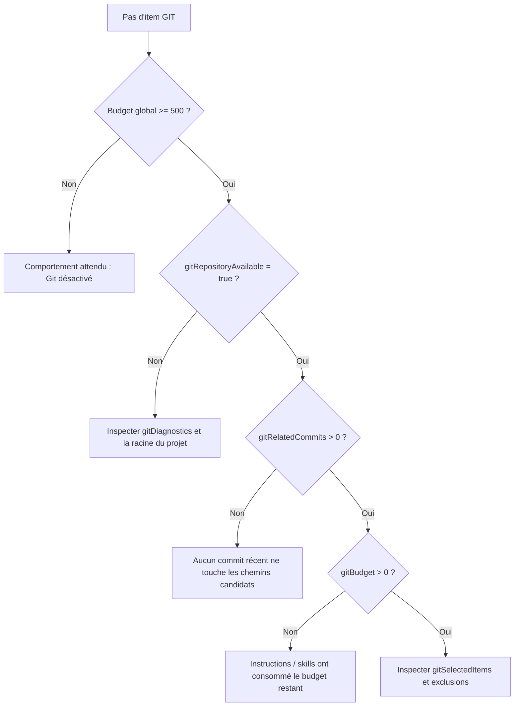
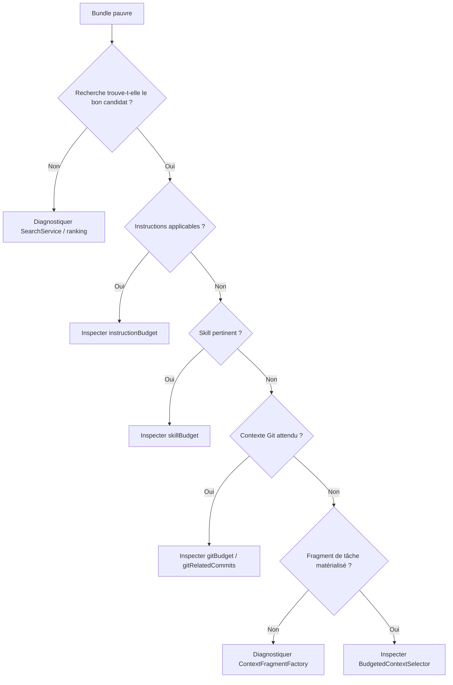
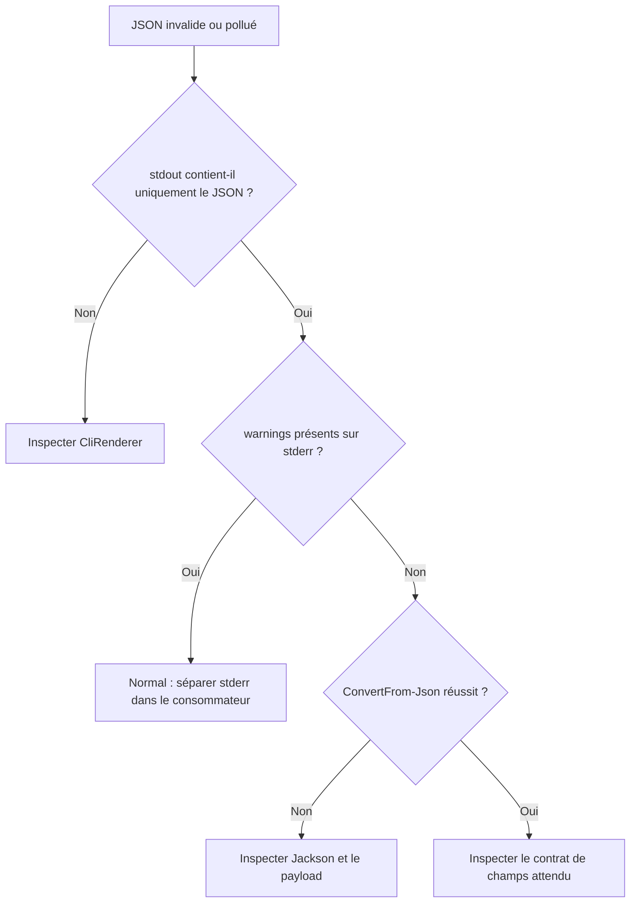
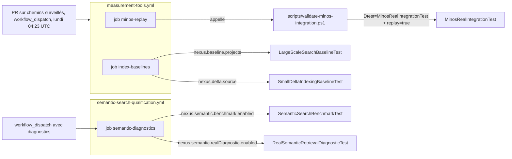

# Reproduire, tester et déboguer NEXUS

Ce chapitre permet de reconstruire les scénarios de développement depuis un poste Windows avec PowerShell et Maven.

## 1. Pré-requis

Le projet compile avec :

```text
Java --release 21
Maven
```

Un JDK plus récent peut être utilisé pour lancer Maven tant que le code compile avec la cible Java 21.

```powershell
java -version
mvn -version
```

## 2. Récupérer la dernière version

```powershell
cd N:\workspace-dev\nexus-context-engine
git pull --ff-only
```

## 3. Build complet

```powershell
mvn clean install
```

Ce build doit :

1. nettoyer `target` ;
2. copier les migrations SQL ;
3. compiler le code avec `release 21` ;
4. compiler les tests ;
5. exécuter JUnit ;
6. publier les métriques du corpus golden ;
7. générer le JAR bibliothèque ;
8. générer le JAR CLI autonome avec classifier `cli` ;
9. installer les artefacts Maven locaux.

Artefacts attendus, où `<version>` est la valeur de `<version>` dans `pom.xml` :

```text
target/nexus-context-engine-<version>.jar
target/nexus-context-engine-<version>-cli.jar
```

Le second est directement exécutable :

```powershell
java -jar .\target\nexus-context-engine-<version>-cli.jar --version
```

## 4. Avertissements connus non bloquants

### Maven / Guice

```text
sun.misc.Unsafe::staticFieldBase
```

Ce warning provient des bibliothèques utilisées par Maven/Guice, pas du code métier NEXUS.

### SQLite JDBC

```text
Use --enable-native-access=ALL-UNNAMED
```

Le driver SQLite charge une bibliothèque native. Le warning ne bloque pas actuellement le build.

### SLF4J

```text
No SLF4J providers were found
```

NEXUS n'a pas encore choisi de backend de logging. SLF4J utilise donc une implémentation NOP pour les dépendances concernées.

### Lucene Vector API

```text
Java vector incubator module is not readable
```

Le moteur lexical fonctionne sans le module vectoriel. Ce warning concerne une optimisation potentielle.

## 5. Lancer le self-smoke complet

```powershell
.\scripts\self-smoke.ps1 -KeepData
```

Le script utilise son propre `NEXUS_HOME` :

```text
target/nexus-self-smoke-home
```

L'Itération 7 étend le self-smoke à treize étapes sur le **JAR autonome** :

```text
1. construire le JAR CLI autonome
2. valider --version --json
3. enregistrer NEXUS avec project add --json
4. vérifier project list --json
5. première indexation complète --json
6. seconde indexation attendue avec 0 changement
7. inspect --json avec état READY
8. search --explain --json
9. contexte strict 180 tokens + instructions natives, Git désactivé
10. contexte multi-source code + documentation + instructions
11. activation progressive d'un Agent Skill
12. contexte Git local borné et explicable
13. sortie humaine sans --json
```

Les sorties JSON sont réellement parsées avec :

```powershell
ConvertFrom-Json
```

Le résultat attendu est :

```text
SELF-SMOKE SUCCESS
```

La section `=== METRICS ===` affiche notamment :

- indexation complète ;
- indexation incrémentale ;
- recherche ;
- contexte strict ;
- contexte multi-source ;
- contexte avec skill ;
- contexte Git ;
- commits Git inspectés et liés ;
- réduction du contexte candidat.

Avec `-KeepData`, les données SQLite/Lucene restent disponibles après le script.

## 6. Tester manuellement avec un NEXUS_HOME isolé

```powershell
$env:NEXUS_HOME = "$PWD\target\manual-nexus-home"
```

Pour repartir de zéro :

```powershell
Remove-Item -Recurse -Force $env:NEXUS_HOME -ErrorAction SilentlyContinue
```

## 7. Choisir le mode d'exécution CLI

Après `mvn clean install`, le mode recommandé est :

```powershell
.\scripts\nexus.ps1 --help
```

Le launcher exécute le dernier JAR `*-cli.jar` disponible dans `target`.

Le launcher CMD reste disponible :

```cmd
scripts\nexus.cmd --help
```

L'exécution Maven reste possible pendant le développement :

```powershell
mvn -q exec:java "-Dexec.args=--help"
```

mais elle n'est pas le chemin principal de validation.

## 8. Enregistrer un projet

```powershell
.\scripts\nexus.ps1 project add . nexus-manual
.\scripts\nexus.ps1 project list
```

Version JSON :

```powershell
.\scripts\nexus.ps1 project list --json
```

## 9. Indexer et vérifier l'idempotence

```powershell
.\scripts\nexus.ps1 index nexus-manual
.\scripts\nexus.ps1 inspect nexus-manual
.\scripts\nexus.ps1 index nexus-manual --json
```

Sans modification du repository, la seconde passe doit produire :

```text
report.changedFiles = 0
report.removedFiles = 0
```

Si ce n'est pas le cas :

1. identifier le chemin considéré comme changé ;
2. comparer son SHA-256 ;
3. vérifier si un outil modifie le fichier pendant le build ;
4. vérifier `.gitignore` / `.nexusignore` ;
5. ajouter un test de non-régression avant correction.

## 10. Forcer la reconstruction Lucene

```powershell
.\scripts\nexus.ps1 index nexus-manual --rebuild
```

Utiliser cette commande lorsque :

- l'index Lucene a été supprimé ;
- une évolution de schéma d'index l'exige ;
- une incohérence SQLite/Lucene est suspectée.

SQLite reste la source structurelle de référence.

## 11. Rechercher et inspecter le ranking

```powershell
.\scripts\nexus.ps1 search nexus-manual ProjectIndexingService --limit 5 --explain
```

À vérifier :

- le fichier attendu remonte ;
- le score est affiché ;
- les raisons sont cohérentes ;
- une deuxième exécution sans changement produit le même ordre ;
- la latence est affichée.

Dans un repository Git local, une raison supplémentaire peut apparaître :

```text
récence Git locale: 1.000 -> +0.050
```

Version JSON :

```powershell
$result = .\scripts\nexus.ps1 search nexus-manual ProjectIndexingService --limit 5 --explain --json |
    ConvertFrom-Json
$result.durationMs
$result.results[0].scoreComponents
$result.results[0].reasons
```

## 12. Comprendre le score de recherche

Le score par défaut est :

```text
score =
    lexical    × 0.40
  + exact      × 0.30
  + fuzzy      × 0.10
  + path       × 0.10
  + graph      × 0.10
  + gitRecency × 0.05
```

Le bonus Git est configurable dans `DeterministicContextRanker` entre `0.0` et `0.20`.

Avec :

```java
new DeterministicContextRanker(0.0d)
```

le signal Git ne contribue plus au score et le ranking historique est retrouvé.

Le mode `--explain` doit permettre de refaire le calcul à partir des composantes affichées.

## 13. Construire un contexte

```powershell
.\scripts\nexus.ps1 context nexus-manual ProjectIndexingService --budget 1200 --explain
```

Invariant :

```text
estimatedTokens <= tokenBudget
```

Le bundle peut contenir :

```text
INSTRUCTION
SKILL
GIT
SYMBOL
FILE
TEST
DOCUMENTATION
```

Les métadonnées et exclusions sont visibles avec `--explain`.

## 14. Tester un petit budget

```powershell
.\scripts\nexus.ps1 context nexus-manual ProjectIndexingService --budget 180 --explain --json
```

Pour un budget global inférieur à 500 tokens :

```text
gitEnabled = false
gitBudget = 0
```

Cette règle protège le code et les instructions essentielles lorsque le budget est très contraint.

## 15. Inspecter le contexte Git

```powershell
$gitContext = .\scripts\nexus.ps1 context nexus-manual `
    "DefaultContextBuilder git context budget recent changes" `
    --budget 1600 --explain --json |
    ConvertFrom-Json
```

Inspecter :

```powershell
$gitContext.items | Where-Object type -eq "GIT"
$gitContext.metadata.gitEnabled
$gitContext.metadata.gitRepositoryAvailable
$gitContext.metadata.gitCommitsInspected
$gitContext.metadata.gitRelatedCommits
$gitContext.metadata.gitCoChangeLinks
$gitContext.metadata.gitBudget
$gitContext.metadata.gitSelectedItems
$gitContext.metadata.gitSelectedTokens
$gitContext.metadata.gitDiagnostics
```

Chemins virtuels possibles :

```text
.nexus/git/recent-commits.md
.nexus/git/file-history.md
.nexus/git/working-tree-diff.md
.nexus/git/co-changes.md
```

Le contexte Git est local et en lecture seule. NEXUS ne doit jamais déclencher :

```text
fetch
pull
push
checkout
commit
```

## 16. Diagnostiquer un contexte Git absent



Dans un monorepo, vérifier que la racine du projet enregistrée dans NEXUS correspond bien au sous-projet attendu. NEXUS convertit les chemins entre la racine Git et la racine projet et exclut les co-changements situés hors du sous-projet.

## 17. Inspecter les Agent Skills

```powershell
$skillContext = .\scripts\nexus.ps1 context nexus-manual `
    "validate NEXUS context quality progressive disclosure" `
    --budget 1200 --explain --json |
    ConvertFrom-Json
```

Vérifier :

```text
skillsDiscovered
skillsMatched
skillsActivated
skillsSelected
skillResourcesDiscovered
skillsExecuted = false
```

Les scripts et ressources ne sont jamais exécutés automatiquement.

## 18. Vérifier les codes de sortie

Succès :

```powershell
.\scripts\nexus.ps1 --version
$LASTEXITCODE
# 0
```

Erreur d'utilisation :

```powershell
.\scripts\nexus.ps1 unknown-command --json
$LASTEXITCODE
# 2
```

Une erreur d'exécution inattendue utilise le code `1`.

## 19. Inspecter SQLite

Le fichier de base est résolu par `NexusPaths` sous `NEXUS_HOME`.

```sql
SELECT id, name, root_path, index_status
FROM projects;
```

```sql
SELECT relative_path, content_hash, category
FROM indexed_files
ORDER BY relative_path;
```

```sql
SELECT f.relative_path, s.kind, s.qualified_name, s.start_line, s.end_line
FROM symbols s
JOIN indexed_files f ON f.id = s.file_id
ORDER BY f.relative_path, s.start_line;
```

```sql
SELECT kind, source_ref, target_ref, source_provider
FROM symbol_relations
ORDER BY source_ref, target_ref;
```

Le contexte Git de l'Itération 7 n'est pas persisté dans SQLite : il est relu localement à la demande.

## 20. Comprendre un ContextBundle trop pauvre



Cette méthode évite de modifier le ranking lorsqu'en réalité le problème vient d'un sous-budget.

## 21. Diagnostiquer un problème JSON



Les warnings JVM ou bibliothèques peuvent apparaître sur `stderr`, mais ne doivent jamais être concaténés au document JSON de succès sur `stdout`.

## 22. Encodage PowerShell 5.1

Windows PowerShell 5.1 peut afficher certains accents provenant des processus Java/Maven sous une forme incorrecte :

```text
modifiÚs
rÚsultat
```

Le self-smoke capture `stdout` / `stderr` dans des fichiers séparés et utilise des assertions ASCII-safe.

Ce problème d'affichage ne signifie pas que les données SQLite, Lucene ou Git sont corrompues.

## 23. Ajouter un test de non-régression

Ordre recommandé :

1. reproduire le bug dans un test ;
2. vérifier que le test échoue ;
3. corriger la classe la plus locale possible ;
4. exécuter `mvn clean install` ;
5. exécuter le self-smoke ;
6. mettre à jour la documentation si le comportement observable change ;
7. créer un ADR si la correction modifie une décision structurante.

## 24. Nettoyer l'environnement de test

```powershell
Remove-Item -Recurse -Force .\target\nexus-self-smoke-home -ErrorAction SilentlyContinue
Remove-Item Env:NEXUS_HOME -ErrorAction SilentlyContinue
```

## 25. Matrice de diagnostic rapide

| Symptôme | Zone probable |
|---|---|
| fichier absent dès l'index | `ProjectScanner`, ignore rules |
| fichier toujours « modifié » | SHA-256 / contenu généré |
| symboles absents | `JavaParserLanguageAnalyzer` |
| SQLite correct, recherche absente | synchronisation / Lucene |
| fichier trouvé mais mal classé | signaux / `DeterministicContextRanker` |
| bonus Git inattendu | `GitRecencyCandidateEnricher` / poids `gitRecencyScore` |
| voisin pertinent absent | graphe d'imports |
| recherche correcte, contexte absent | `ContextFragmentFactory` |
| contenu dupliqué | `FragmentMerger` |
| skill pertinent absent | `SkillSelector` / `SkillContextSelector` |
| item Git absent | `LocalGitContextSourceProvider` / `gitBudget` / chemins cibles |
| fuite hors sous-projet Git | mapping racine Git ↔ racine projet |
| budget dépassé | `BudgetedContextSelector` / `TokenEstimator` |
| bundle non déterministe | tri ou collection non ordonnée |
| JSON mélangé à des warnings | séparation stdout/stderr de la CLI ou du wrapper |
| `*-cli.jar` introuvable | phase Maven package / Shade Plugin |
| JAR autonome démarre mais SQLite échoue | services `META-INF/services` ou packaging natif |

## OpenSpec test-suite-reliability

Spec : [`openspec/specs/test-suite-reliability/spec.md`](../../openspec/specs/test-suite-reliability/spec.md) ; matrice de traçabilité : [openspec-traceability.md](openspec-traceability.md).

Cette section complète la procédure de test ci-dessus par les propriétés de fiabilité de la suite par défaut de `core`. Le tableau des lanceurs de tests de mesure vit dans [ci-and-supply-chain.md](ci-and-supply-chain.md#tests-de-mesure-opt-in) ; la vue ci-dessous le recoupe avec les workflows.

### Comportement existant vérifié

**Durées dans la suite par défaut** (exigence `La suite par défaut n'impose pas de durée murale serrée`)

- **[Existant vérifié]** `ExternalTaskRunnerTest#returnsAtTimeoutEvenWhenTheTaskIgnoresInterruption` prouve que l'appelant n'attend pas le worker par l'état : `workerFinished.getCount()` vaut encore `1` après le timeout de 50 ms et `ExternalTaskRunner.status()` expose `timedOutTasks()` et `activeTasks()` (`core/src/test/java/com/nexus/index/ExternalTaskRunnerTest.java:29-52`). Le worker est borné par `WORKER_SAFETY_CAP` de 30 s (`:18`), annoncé en Javadoc comme borne de sûreté sur laquelle aucune assertion ne porte.
- **[Existant vérifié]** `ExternalTaskRunnerTest#opensCircuitBreakerUntilTimedOutWorkerActuallyStops` suit le même principe : état du circuit et attente conditionnelle `await` bornée à 10 s (`:56-78`, `:80-86`), sans comparaison de durée mesurée.
- **[Existant vérifié]** `ProjectIndexingServiceTimeoutTest#boundsCodeIndexImportersAndMarksTheProjectFailed` vérifie le message `timeout global de 50 ms`, l'importer encore bloqué (`importerFinished.getCount()` à `1`) et l'état `IndexStatus.FAILED` (`core/src/test/java/com/nexus/index/ProjectIndexingServiceTimeoutTest.java:39-83`).
- **[Existant vérifié]** `SqliteWriteContentionIntegrationTest` ne contient aucune assertion de durée murale (recherche de `assertTimeout`, `nanoTime`, `elapsed`, `Instant` sans résultat sur une comparaison de durée) ; les `Duration` y paramètrent seulement la politique de retry (`core/src/test/java/com/nexus/persistence/sqlite/SqliteWriteContentionIntegrationTest.java:203-258`).
- **[Existant vérifié]** Deux classes conservent un garde-fou `assertTimeoutPreemptively` contre un blocage infini, avec marge documentée en commentaire : `JdtLanguageServerCodeIntelligenceProviderTest` à 5 s pour un arrêt dédié de 1 s, soit cinq fois (`core/src/test/java/com/nexus/index/jdt/JdtLanguageServerCodeIntelligenceProviderTest.java:165` et `:189`) ; `SensitiveContentRedactorTest#malformedKeysAndOversizedValuesHaveBoundedLookahead` à 10 s pour une durée nominale d'environ 0,3 s à froid selon le commentaire du test (`core/src/test/java/com/nexus/security/SensitiveContentRedactorTest.java:55-59`). Cette valeur nominale est celle du commentaire ; elle n'a pas été remesurée.
- **[Existant vérifié]** Dans `core/src/test`, hors tests de mesure, la recherche de `assertTimeout`, `nanoTime` et `currentTimeMillis` ne relève comme autre comparaison de durée mesurée que celle de dans `OllamaEmbeddingProviderResponseLimitTest#deadlineCoversStalledBodyAndSameProviderRecovers` : timeout du provider de 800 ms, garde-fou `assertTimeoutPreemptively` de 4 s (cinq fois) et comparaison complémentaire `< 4000` ms (`core/src/test/java/com/nexus/search/semantic/ollama/OllamaEmbeddingProviderResponseLimitTest.java:33-62`).

**Port `IndexRepository`** (exigence `Le port IndexRepository ne porte pas de comportement non exécuté`)

- **[Existant vérifié]** `core/src/main/java/com/nexus/index/IndexRepository.java` (66 lignes) ne contient aucune méthode `default` : la recherche du mot-clé `default` y est vide. Le commit `239af54c` (« make every IndexRepository projection abstract ») a rendu abstraites les neuf méthodes `default` jadis en repli mémoire, `SqliteIndexRepository` les implémentant toutes, et a adapté le fake du test de projection du voisinage, `core/src/test/java/com/nexus/ranking/graph/GraphNeighborhoodProjectionTest.java` (`delegatesOnlyToBoundedNeighborhoodProjection`, `:23`).
- **[Existant vérifié]** Le rapport JaCoCo de `core` est produit par le reactor (`core/target/site/jacoco/jacoco.xml`, `.github/workflows/ci.yml:168`) mais les règles de `jacoco:check` de `core` sont au niveau `BUNDLE` et `PACKAGE` (`core/pom.xml:68-152` ; aucune règle `CLASS` ni mention d'`IndexRepository`).

**Tests opt-in** (exigence `Chaque test opt-in a un lanceur automatisé`)

- **[Existant vérifié]** Treize classes de `core/src/test` sont désactivées par défaut : trois par `Assumptions` (les trois premières lignes du tableau), dix par `@EnabledIfSystemProperty`. Chacune a un lanceur dans un workflow :

| Test | Désactivé tant que | Lanceur (workflow, job) |
|---|---|---|
| `MinosRealIntegrationTest` | `nexus.minos.integration.replay` n'est pas `true` (`core/src/test/java/com/nexus/index/minos/MinosRealIntegrationTest.java:45`) | `measurement-tools.yml`, job `minos-replay` → `scripts/validate-minos-integration.ps1` (`.github/workflows/measurement-tools.yml:98`), qui passe `-Dtest=MinosRealIntegrationTest` et `-Dnexus.minos.integration.replay=true` (`scripts/validate-minos-integration.ps1:141-143`) |
| `LargeScaleSearchBaselineTest` | aucun dépôt fourni par `nexus.baseline.projects` ou `nexus.baseline.input` (`core/src/test/java/com/nexus/search/LargeScaleSearchBaselineTest.java:49`) | `measurement-tools.yml`, job `index-baselines` (`:136`) |
| `SmallDeltaIndexingBaselineTest` | `nexus.delta.source` vide (`core/src/test/java/com/nexus/index/SmallDeltaIndexingBaselineTest.java:44`) | idem |
| `SemanticSearchBenchmarkTest` | `nexus.semantic.benchmark.enabled` (`core/src/test/java/com/nexus/search/semantic/SemanticSearchBenchmarkTest.java:33`) | `semantic-search-qualification.yml`, job `semantic-diagnostics`, `if: github.event_name == 'workflow_dispatch' && inputs.diagnostics` (job `:247`, condition `:251`, commande `:283`) |
| `RealSemanticRetrievalDiagnosticTest` | `nexus.semantic.realDiagnostic.enabled` (`core/src/test/java/com/nexus/search/semantic/RealSemanticRetrievalDiagnosticTest.java:30`) | idem |
| `RealSemanticSearchBenchmarkTest` | `nexus.semantic.realBenchmark.enabled` (`core/src/test/java/com/nexus/search/semantic/RealSemanticSearchBenchmarkTest.java:33`) | `semantic-search-qualification.yml`, job `real-ollama` (`:109-110`) |
| `ScaleRegressionBenchmarkTest`, `GraphScaleRegressionBenchmarkTest`, `FederatedContextBudgetScaleBenchmarkTest`, `NativeContextDiscoveryBudgetBenchmarkTest` | `nexus.scale.benchmark.enabled` (annotations dans `core/src/test/java/com/nexus/benchmark/`) | `scale-benchmark.yml` (`:137-139`, étape conditionnée par `steps.changes.outputs.measure == 'true'`, `:132`) et `runtime-flags-qualification.yml`, job `scale-comparison` (`:202-204`) |
| `LuceneLifecycleQualificationBenchmarkTest` | `nexus.scale.benchmark.enabled` | `lucene-lifecycle-benchmark.yml` (`:105-107`) |
| `ProjectScannerCorpusBudgetBenchmarkTest` | `nexus.scale.benchmark.enabled` | `scanner-corpus-benchmark.yml` (`:79-80`) |
| `GitContextCacheQualificationBenchmarkTest` | `nexus.git.cache.benchmark.enabled` | `git-context-cache-qualification.yml` (`:92-94`) |

- **[Existant vérifié]** `IndexingHeapPeakBenchmarkTest` porte la même propriété `nexus.scale.benchmark.enabled` mais n'a volontairement aucun workflow : c'est un relevé manuel du pic de heap d'un rebuild complet, décrit dans [indexing-pipeline.md](indexing-pipeline.md#reproduire-les-mesures). Il n'est pas compté parmi les treize classes ci-dessus.
- **[Existant vérifié]** Le contrat `scripts/release/test-final-audit-contracts.sh:215-231` épingle les cinq tests nommés par la spec (`MinosRealIntegrationTest`, `LargeScaleSearchBaselineTest`, `SmallDeltaIndexingBaselineTest`, `SemanticSearchBenchmarkTest`, `RealSemanticRetrievalDiagnosticTest`, lignes 219-223), exige qu'ils soient documentés dans `docs/developer/ci-and-supply-chain.md` et vérifie la ligne `-Dtest=MinosRealIntegrationTest` du script (`:230-231`). `RealSemanticSearchBenchmarkTest` est contrôlé à part (`:149` et `:165`). Le contrat ne parcourt pas `src/test` : un nouveau test opt-in ne serait pas détecté.

### Vues

Vue organigramme (non UML) — quel lanceur exécute les cinq tests opt-in nommés par la spec, et sous quelle condition (existant) :



Le diagramme répond à la question « un test opt-in nommé par la spec est-il lancé, et quand ? ». Les deux workflows se déclenchent sur des conditions différentes : `measurement-tools.yml` sur PR touchant ses chemins, à la demande et chaque lundi (bloc `on:` des lignes 6-20 du workflow) ; `semantic-diagnostics` uniquement à la demande avec l'entrée `diagnostics`. Exigences : `test-suite-reliability › Chaque test opt-in a un lanceur automatisé`.

### Écarts et limites

- **[Écart]** La tâche archivée 5.1 désigne `SqliteWriteContentionIntegrationTest:244` pour une assertion de durée à remplacer ; ce test ne contient plus aucune assertion de durée, ce qui satisfait l'exigence mais rend la ligne citée obsolète. Aucune exigence n'est modifiée.
- **[Limite]** Aucun test ne vérifie la propriété « aucune assertion de durée serrée » ; elle repose sur la revue (règle `.claude/rules/tests.md`) et sur le comportement observé du Windows gate. Le comportement sur un runner chargé n'a pas été exécuté ici.
- **[Limite]** Le scénario `Couverture du port` ne se vérifie aujourd'hui que par un état de fait : `IndexRepository` n'a plus de méthode `default`. Aucun test ne garde contre l'ajout futur d'une `default` non exécutée, et aucune étape CI ne contrôle la ligne `IndexRepository` du rapport JaCoCo.
- **[Limite]** Le contrat d'audit final épingle six tests opt-in sur treize ; les benchmarks de scale, le cycle de vie Lucene, le corpus du scanner, le cache Git et le benchmark sémantique réel sont lancés par leurs workflows sans contrôle automatique d'existence du lanceur.
- **[Limite]** Les workflows n'ont pas été exécutés pour cette documentation ; le tableau lit leurs commandes, pas leurs résultats.

### Propositions et questions ouvertes

- **[Proposition]** Ajouter un contrôle (script de contrat ou test) qui liste les classes de `src/test` portant `@EnabledIfSystemProperty` ou une `Assumptions` sur une propriété `nexus.*` et exige un lanceur dans `.github/workflows`, pour généraliser l'exigence aux treize classes actuelles et aux suivantes.
- **[Proposition]** Ajouter un test de non-régression de `IndexRepository` (réflexion : aucune méthode `default` sans test, ou aucune méthode `default`) pour fermer le scénario `Couverture du port`.
- **[Question]** L'exigence de durée vise-t-elle aussi les garde-fous `assertTimeoutPreemptively` et comparaisons de `OllamaEmbeddingProviderResponseLimitTest` (marge exactement égale à cinq fois) ? La spec ne nomme que cinq classes dans le scénario `Runner chargé`.

## OpenSpec test-filesystem-isolation

Spec : [`openspec/specs/test-filesystem-isolation/spec.md`](../../openspec/specs/test-filesystem-isolation/spec.md) ; matrice de traçabilité : [openspec-traceability.md](openspec-traceability.md).

Un test crée tous ses fichiers sous le `@TempDir` que JUnit nettoie, y compris la cible « hors projet » d'un test d'évasion : la racine du projet simulé est `temporaryDirectory.resolve("project")` et la cible externe un autre enfant du `@TempDir`.

### Comportement existant vérifié

- **[Existant vérifié]** `NativeProjectCustomizationDetectorTest` place la racine sous `temporaryDirectory.resolve("project")` (`core/src/test/java/com/nexus/context/source/NativeProjectCustomizationDetectorTest.java:29`) et les cibles externes sous `outside-agents` et `outside-settings.json` (`:34`, `:47`).
- **[Existant vérifié]** `AiSkillsRegistryProviderTest` suit le même schéma (`core/src/test/java/com/nexus/context/source/skill/AiSkillsRegistryProviderTest.java:31`, `:107`, `:130`).
- **[Existant vérifié]** `git grep -n "temporaryDirectory.resolveSibling" -- core/src/test` ne renvoie rien (2026-11-05).

### Écarts et limites

- **[Limite]** Aucun contrôle automatique n'empêche un nouveau test de créer un fichier à côté du `@TempDir` ; la propriété repose sur la revue et sur le `git grep` ci-dessus.
