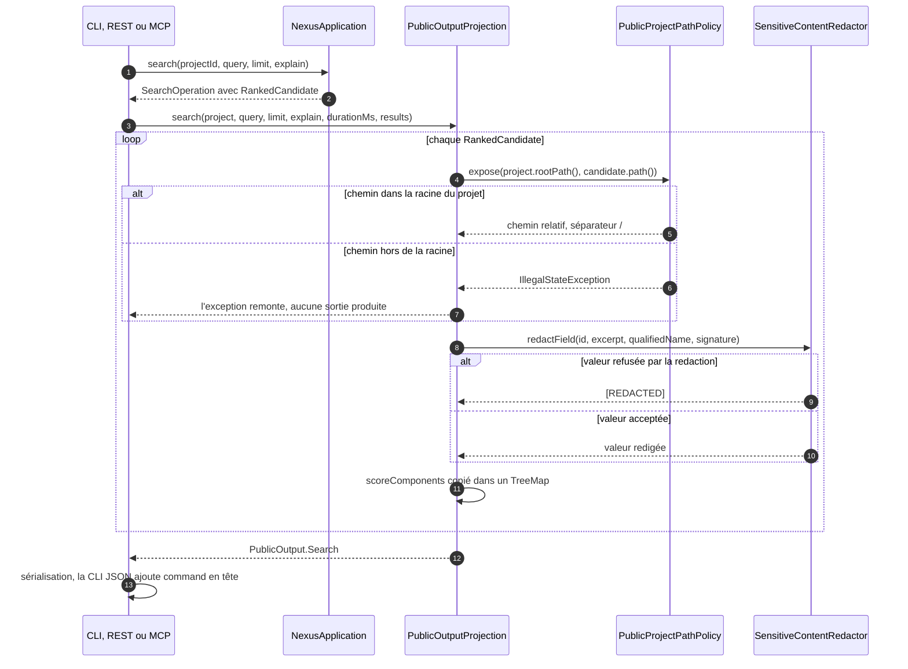
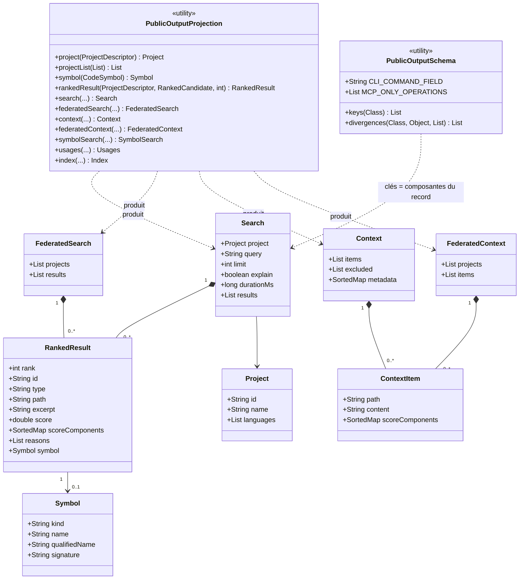
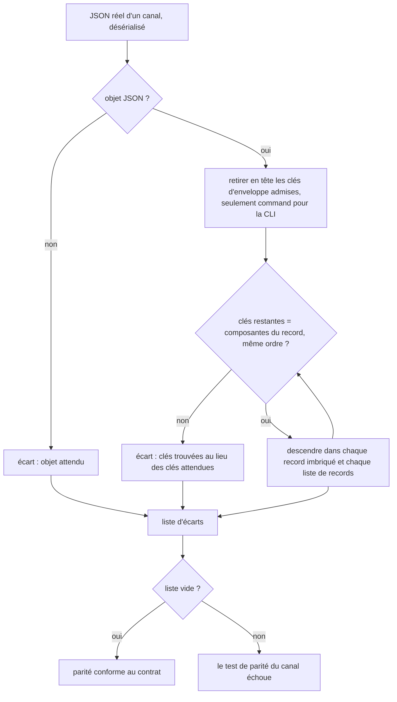

# Adaptateur REST NEXUS

L'adaptateur Quarkus expose `NexusApplication` sans introduire Quarkus dans le cœur.

## Stack

```text
module      adapters/rest-quarkus
Java        21
Quarkus     3.40.1.1
version     NEXUS 0.2.0
```

Build :

```powershell
.\mvnw.cmd clean install
```

Lancement :

```powershell
java -jar .\adapters\rest-quarkus\target\quarkus-app\quarkus-run.jar
```

Par défaut, l'API reste local-first sur `127.0.0.1:8080`.

## Architecture

```text
Client HTTP
  ↓
Resources REST / DTO / ApiMapper → PublicOutputProjection (cœur)
  ↓
NexusApiApplicationService
  ↓
NexusApplication
```

## Endpoints principaux

Listener applicatif :

```text
GET  /api/v1/projects
POST /api/v1/projects
GET  /api/v1/projects/{projectId}
POST /api/v1/projects/{projectId}/index
POST /api/v1/projects/{projectId}/search
POST /api/v1/projects/{projectId}/context
POST /api/v1/federated/search
POST /api/v1/federated/context
```

Listener de management séparé, lié par défaut à `127.0.0.1:9000` :

```text
GET  /q/health
GET  /q/health/ready
GET  /q/metrics
```

Les endpoints `/q/*` ne sont pas servis par le listener applicatif. Cette séparation évite de publier accidentellement les métriques/health lorsqu'un reverse proxy expose l'API métier.

Les lectures indexées exigent un projet `READY`.

## Contrat de sortie

Les réponses sont construites par la projection publique du cœur, `com.nexus.exposure.PublicOutputProjection` ([ARCH-0061](../architecture/adr/ARCH-0061-decider-le-contrat-de-sortie-publique-dans-la-projection-du-coeur.md)), commune à la CLI, REST et MCP : mêmes clés, dans le même ordre, sur les trois canaux. Chemins relatifs au projet, aucune clé `rootPath`, `rank`, `id` et `excerpt` redigé sur chaque résultat classé, `qualifiedName`, `signature`, `source` et `target` redigés, `scoreComponents` et `metadata` triés par clé, `languages` et `technologies` en listes triées ; la liste des projets est triée par nom sans tenir compte de la casse, puis par identifiant, et une portée fédérée garde l'ordre demandé. Les résultats fédérés imbriquent `project` et `result` (recherche) ou `project` et `item` (contexte). Les tests `*OutputParityTest` des trois modules comparent chaque canal au contrat de `PublicOutputSchema`.

REST n'ajoute aucune clé : les endpoints renvoient les records `PublicOutput` tels quels.

## Limites de requête

Les endpoints mono-projet et fédérés appliquent les mêmes politiques centrales :

- requête textuelle : limite UTF-8 définie par `QueryPolicy` ;
- résultats publics : maximum `ResultLimitPolicy.MAX_RESULT_LIMIT` ;
- budget contexte : maximum `ContextBudgetPolicy.MAX_CONTEXT_TOKEN_BUDGET` ;
- portée fédérée : maximum **100 projets uniques**.

Une valeur hors limite est rejetée en `400 bad_request` avant l'exécution de la recherche/construction de contexte.

Le champ `constraints` existe encore dans les DTO pour compatibilité de contrat, mais aucune sémantique de contrainte n'est actuellement implémentée. Une map non vide est donc **refusée explicitement en 400** ; elle n'est jamais ignorée silencieusement.

## Fédération

Les requêtes fédérées acceptent au maximum **100 projets uniques**. La cardinalité canonique est validée avant la résolution/readiness ; une requête contenant 101 UUID uniques échoue donc avec l'erreur de portée avant tout `PROJECT_NOT_FOUND` qui résulterait d'une résolution ultérieure.

Une portée valide est ensuite résolue, vérifiée `READY` et traitée par les services fédérés communs, sous une échéance globale : les projets non commencés à l'échéance sont nommés par la clé `unservedProjects` des réponses fédérées (voir [Vecteur de requête unique et échéance globale](large-scale-search.md#vecteur-de-requête-unique-et-échéance-globale)).

## Sécurité REST

### Loopback

Loopback est le défaut sûr. Le contrat distant ne s'applique pas à un listener strictement loopback.

### Exposition non-loopback

Elle exige simultanément :

- `NEXUS_REST_API_TOKEN` généré par un CSPRNG et conforme au gate structurel NEXUS ;
- `NEXUS_REST_ALLOWED_PROJECT_ROOTS` non vide ;
- un `NEXUS_REST_EXPOSURE_MODE` supporté ;
- un transport Quarkus effectif compatible avec ce mode.

Le gate de token exige au moins 32 octets et rejette les chaînes dont la diversité de caractères est manifestement insuffisante. Cette heuristique est uniquement un filtre structurel : elle **ne mesure pas l'entropie cryptographique** et ne peut pas prouver qu'une chaîne statique est imprévisible. Le secret doit donc être généré par une source cryptographiquement sûre, par exemple :

```bash
openssl rand -hex 32
```

Le listener de management doit rester non publié. Sa valeur par défaut NEXUS est `127.0.0.1:9000`.

### `direct-https`

Le démarrage échoue si :

- `quarkus.http.insecure-requests` n'est pas `disabled` ;
- aucun key material TLS serveur Quarkus effectif n'est configuré.

Une simple étiquette `direct-https` n'est pas une preuve de TLS.

### `reverse-proxy-https`

Le backend doit satisfaire les mêmes garanties TLS que `direct-https`, puis en plus :

- `quarkus.http.proxy.proxy-address-forwarding=true` ;
- `quarkus.http.proxy.trusted-proxies` explicite et non vide ;
- aucune plage de confiance globale telle que `0.0.0.0/0` ou `::/0`.

### `loopback-forward`

Réservé au runtime Docker avec publication hôte déclarée sur loopback.

## Sémantique / Ollama

L'adaptateur utilise la même `SemanticSearchConfiguration` que CLI/MCP. Sans `NEXUS_SEMANTIC_PROVIDER`, aucun provider d'embeddings n'est créé.

Un endpoint Ollama distant doit utiliser HTTPS. HTTP reste autorisé pour `localhost`, `127.0.0.0/8` et `::1`. Une configuration HTTP distante nécessite un opt-in administratif explicite :

```text
NEXUS_ALLOW_INSECURE_REMOTE_OLLAMA=true
```

Les credentials intégrés dans `NEXUS_OLLAMA_BASE_URL` sont refusés. Les contenus à forte probabilité de secret sont redigés avant l'appel au provider d'embeddings.

## Observabilité

Les métriques applicatives n'utilisent ni requête, ni contenu source, ni chemin projet comme label. Readiness distingue état service et états projets.

En tests, `quarkus.management.test-port=0` laisse le système choisir un port libre ; des tests dédiés vérifient à la fois l'absence de `/q/*` sur le listener applicatif et leur présence sur le listener de management.

## Qualification

Le reactor Maven, NEXUS CI et Docker Distribution qualifient l'adaptateur sur le SHA exact concerné. Le smoke Docker REST exerce le listener packagé ; les tests unitaires couvrent les combinaisons TLS/proxy acceptées et rejetées.

Voir [`ci-and-supply-chain.md`](ci-and-supply-chain.md) et [`../architecture.md`](../architecture/overview.md).

## Contrat de hardening du 9 septembre 2026

Voir [ADR-0048](../architecture/adr/SEC-0048-distinguer-traversee-stricte-et-compatibilite-filesystem.md)
pour la distinction entre traversée strict et compatibility. Le fallback sans
`SecureDirectoryStream` est best-effort : la revalidation ne détecte pas un ABA
restauré. `NEXUS_REQUIRE_STRICT_PATH_IO=true` le refuse avant ouverture du fichier.
REST HTTPS distant et REST loopback hardened exigent ce flag ainsi que
`NEXUS_REQUIRE_PRIVATE_STORAGE=true`. Le mode Docker `loopback-forward` reste local
selon sa déclaration opérateur. Windows/UNC local conserve la compatibilité.
`READY` atteste la génération indexée revalidée, sans snapshot atomique du
filesystem vivant. Les mutations détectées restent refusées.

Les contextes REST/MCP/CLI projettent les chemins en repository-relative et
filtrent les diagnostics/métadonnées internes à la frontière de sortie. Les
requêtes client sont conservées séparément. La redaction des skills précède
estimation et sélection ; les compteurs décrivent le contenu effectivement fourni.

## OpenSpec public-output-projection

Spec : [`openspec/specs/public-output-projection/spec.md`](../../openspec/specs/public-output-projection/spec.md) ; matrice de traçabilité : [openspec-traceability.md](openspec-traceability.md). Le contrat de sortie est décrit de la même façon dans [`mcp.md`](mcp.md) et [`cli.md`](cli.md) ; cette section porte la vue de la capacité pour les trois canaux.

### Comportement existant vérifié

| Fait | Nature | Source |
|---|---|---|
| Une seule classe construit les structures publiques (projets, symboles, résultats classés, recherche, recherche fédérée, contexte, contexte fédéré, usages, index) ; les adaptateurs les sérialisent sans les recomposer. | [Existant vérifié] | `core/src/main/java/com/nexus/exposure/PublicOutputProjection.java:35-201`, `core/src/main/java/com/nexus/exposure/PublicOutput.java:9-15` |
| Les trois canaux appellent cette projection : REST par `ApiMapper`, MCP par `NexusMcpTools`, CLI par `CliRenderer`. | [Existant vérifié] | `adapters/rest-quarkus/src/main/java/com/nexus/api/ApiMapper.java:19-50`, `adapters/mcp-java/src/main/java/com/nexus/mcp/NexusMcpTools.java:58,79,104,125,145,177,212`, `core/src/main/java/com/nexus/cli/CliRenderer.java:62,71,116,136,156,175` |
| L'ordre des clés JSON est l'ordre des composantes des records de `PublicOutput`. Le contrat de clés se lit sur ces records. | [Existant vérifié] | `core/src/main/java/com/nexus/exposure/PublicOutputSchema.java:14,30-32` |
| Deux divergences sont déclarées : la clé `command` ajoutée en tête des objets JSON de la CLI, et les outils MCP `find_symbol` et `find_usages`, sans équivalent CLI ni REST. | [Existant vérifié] | `core/src/main/java/com/nexus/exposure/PublicOutputSchema.java:21,24`, `core/src/main/java/com/nexus/cli/CliRenderer.java:302-306` |
| Les chemins passent par `PublicProjectPathPolicy.expose` pour les résultats classés, les symboles indexés et les éléments de contexte ; un chemin hors de la racine lève `IllegalStateException("Result path is outside the project root")`. | [Existant vérifié] | `core/src/main/java/com/nexus/exposure/PublicOutputProjection.java:82,167,206`, `core/src/main/java/com/nexus/security/PublicProjectPathPolicy.java:26-51`, `core/src/main/java/com/nexus/exposure/PublicContextPolicy.java:51-56` |
| Le record `Project` n'a pas de racine : aucune clé `rootPath` n'est exposée. | [Existant vérifié] | `core/src/main/java/com/nexus/exposure/PublicOutput.java:22-29`, `core/src/test/java/com/nexus/exposure/PublicOutputProjectionTest.java:58` |
| `scoreComponents` est copié dans un `TreeMap` par la projection et trié de nouveau par les constructeurs des records ; les `metadata` de contexte sont triées récursivement par clé. | [Existant vérifié] | `core/src/main/java/com/nexus/exposure/PublicOutputProjection.java:85,212,223-239`, `core/src/main/java/com/nexus/exposure/PublicOutput.java:59,106,194-196` |
| `qualifiedName` et `signature` (symbole) puis `source` et `target` (relation) passent par `SensitiveContentRedactor.redactField` ; `id` et `excerpt` d'un résultat classé aussi. | [Existant vérifié] | `core/src/main/java/com/nexus/exposure/PublicOutputProjection.java:69-70,80,83,181-182` |
| `redactField` renvoie `[REDACTED]` quand la redaction refuse la valeur (`OversizedSecretException`), sans faire échouer la réponse. | [Existant vérifié] | `core/src/main/java/com/nexus/security/SensitiveContentRedactor.java:122-131`, `core/src/test/java/com/nexus/exposure/PublicOutputProjectionTest.java#anOversizedExternalSignatureIsMaskedWithoutFailingTheResponse` |
| Le rendu humain de la CLI lit la signature de la structure déjà projetée, donc redigée. | [Existant vérifié] | `core/src/main/java/com/nexus/cli/CliRenderer.java:247-249`, `core/src/test/java/com/nexus/cli/CliRendererSymbolRedactionTest.java#externalSignaturesAreRedactedOnEveryCliOutput` |
| Le service REST renvoie les records `NexusApplication.*Operation` ; `ApiModels` ne contient que des DTO de requête et `ErrorResponse`. | [Existant vérifié] | `adapters/rest-quarkus/src/main/java/com/nexus/api/NexusApiApplicationService.java:57,75,86,101,120`, `adapters/rest-quarkus/src/main/java/com/nexus/api/ApiModels.java:13-43` |
| Une `IllegalStateException` autre que les deux conflits de cycle de vie devient un HTTP 500 `internal_state_error` côté REST. C'est ce que devient une `IllegalStateException` de la politique de chemins, par lecture du code (aucun test ne la déclenche de bout en bout). | [Existant vérifié] | `adapters/rest-quarkus/src/main/java/com/nexus/api/IllegalStateExceptionMapper.java:20-43` |

### Vues

Vue UML de séquence — comment une recherche devient-elle une sortie publique, et que deviennent un chemin hors racine ou un champ que la redaction refuse (existant) ?



La projection est le seul endroit où le chemin, la redaction et l'ordre des composantes sont décidés ; l'erreur d'un chemin hors racine remonte au canal, dont le traitement n'est pas spécifié (voir Écarts). Exigences : `public-output-projection › Les chemins publics sont relatifs au projet`, `public-output-projection › L'ordre des composantes de score est déterministe`, `public-output-projection › Les métadonnées de symbole sont redigées à la sortie`.

Vue UML de classes — quelles structures portent le contrat de clés et où sont déclarées les divergences entre canaux (existant) ?



Les records sont imbriqués dans `PublicOutput` ; l'alias court est utilisé ici pour la lisibilité, et seuls les attributs utiles au contrat sont listés. `FederatedSearchResult` et `FederatedContextItem` (un `project` et un `result` ou un `item`) sont omis du schéma. Exigences : `public-output-projection › Les trois canaux exposent les mêmes clés`, `public-output-projection › Le REST réutilise les records d'opération du cœur`.

Vue organigramme (non UML) — comment un test de parité décide-t-il qu'un canal diverge du contrat (existant) ?



Chaque canal est comparé à `PublicOutputSchema.divergences` par son propre test ; aucun test ne compare deux canaux entre eux (voir Écarts). Exigences : `public-output-projection › Les trois canaux exposent les mêmes clés`.

### Écarts et limites

- [Écart] Le scénario « Recherche sur un projet de fixture » décrit la même requête exécutée sur les trois canaux et comparée. Trois tests, un par module, comparent chacun un canal au contrat `PublicOutputSchema` sur une fixture identique ; l'identité des clés entre canaux est donc transitive, sans comparaison directe des valeurs (`core/src/test/java/com/nexus/cli/CliOutputParityTest.java`, `adapters/mcp-java/src/test/java/com/nexus/mcp/NexusMcpOutputParityTest.java`, `adapters/rest-quarkus/src/test/java/com/nexus/api/NexusRestOutputParityTest.java`).
- [Écart] Le scénario « Deux processus » (réponses identiques octet pour octet entre deux JVM, hors durée) n'a pas de test : les tests existants construisent les composantes dans deux ordres d'insertion au sein d'une seule JVM (`McpScoreComponentsOrderTest`, `RestScoreComponentsOrderTest`, `PublicOutputProjectionTest#scoreComponentsSerializeInKeyOrderWhateverTheInsertionOrder`). L'égalité octet pour octet de toute la réponse n'est pas vérifiée, et seul `scoreComponents` est comparé.
- [Écart] Le scénario « Élément de contexte » attend `path` = `src/main/java/App.java` sur les trois canaux. La valeur est vérifiée sur la projection (`PublicOutputProjectionTest#contextIsExposedWithRelativePathsSortedComponentsAndSortedMetadata`) et, pour la CLI, par l'absence de chemin absolu (`core/src/test/java/com/nexus/cli/NexusCliTest.java:144`) ; les tests REST et MCP ne comparent pas cette valeur.
- [Écart] Le scénario « Signature externe porteuse d'un secret » cite SCIP, MINOS et JDT et trois sorties (`find_symbol`, `search_code`, recherche REST). Le test MCP n'injecte que MINOS (`NexusMcpOutputParityTest#externalSymbolSignaturesAreRedactedBySymbolAndSearchTools`) ; le test REST appelle `ApiMapper.search` avec un symbole `scip` sans passer par HTTP (`NexusRestOutputParityTest#searchResponseRedactsExternalSymbolSignatures`) ; les trois fournisseurs ne sont couverts qu'au niveau de la projection (`PublicOutputProjectionTest#symbolMetadataFromExternalProducersIsRedacted`) et de la CLI (`CliRendererSymbolRedactionTest`).
- [Écart] Le scénario « Ajout d'un champ côté cœur » n'a pas de test. Le code est conforme au jour du relevé (aucun record d'opération dans `adapters/rest-quarkus/src/main`, hors `ApiModels`) ; la vérification archivée est une commande `git grep` ponctuelle (changement `2026-10-31-sprint-04-sortie-publique-et-redaction`, tâche 1.1), pas un test.
- [Écart] `docs/developer/rest-api.md` liste `POST /api/v1/projects/{projectId}/search` et `/context` mais pas les endpoints `/explain/search` et `/explain/context`, qui existent (`adapters/rest-quarkus/src/main/java/com/nexus/api/NexusResource.java:82,96`) et servent aux tests de parité. La liste existante n'est pas modifiée ici.
- [Écart] [ARCH-0061](../architecture/adr/ARCH-0061-decider-le-contrat-de-sortie-publique-dans-la-projection-du-coeur.md) porte le statut `Proposed` alors que la projection est livrée et que les pages `rest-api.md`, `mcp.md` et `cli.md` s'y réfèrent comme à une décision.
- Limite : la parité couvre, côté CLI, `search`, `search-federated`, `context`, `context-federated` et `index` ; les sorties JSON de `project add`, `minos-import`, `inspect`, `--help` et `--version` sont construites comme des maps ad hoc, avec ou sans morceaux projetés (`core/src/main/java/com/nexus/cli/CliRenderer.java:55,96,193,217,228`), et ne sont pas dans le test de parité.
- Limite : `Symbol.name` et `Symbol.sourceProvider` ne passent pas par `redactField` (`core/src/main/java/com/nexus/exposure/PublicOutputProjection.java:68,73`) ; la spec ne les liste pas. Le symbole d'un élément de contexte passe par `PublicDiagnosticPolicy.text`, avec repli `[REDACTED]` (`core/src/main/java/com/nexus/exposure/PublicContextPolicy.java:61-66`).
- Limite : le comportement des canaux face à un chemin hors racine n'est pas spécifié. Par lecture, REST renvoie HTTP 500 `internal_state_error` ; le comportement CLI et MCP n'a pas été relevé.

### Propositions et questions ouvertes

- [Proposition] Un test de parité unique indexant une fixture et comparant les valeurs de `path`, `id`, `excerpt` et `scoreComponents` des trois canaux rendrait le scénario « Recherche sur un projet de fixture » littéral.
- [Proposition] Un test qui lance deux JVM sur la même requête et compare les corps JSON, hors `durationMs`, fermerait le scénario « Deux processus ».
- [Proposition] Un contrôle automatisé (règle de `CoreArchitectureTest` étendue aux adaptateurs, ou test de réflexion) interdisant tout record d'opération dans le module REST fermerait le scénario « Ajout d'un champ côté cœur ».
- [Question] La redaction doit-elle aussi couvrir `Symbol.name` ? La spec ne liste que `signature`, `qualifiedName`, `source` et `target`.
- [Question] Quel doit être le comportement public des trois canaux quand la projection rencontre un chemin hors racine (erreur typée, résultat omis, code de sortie CLI) ?
