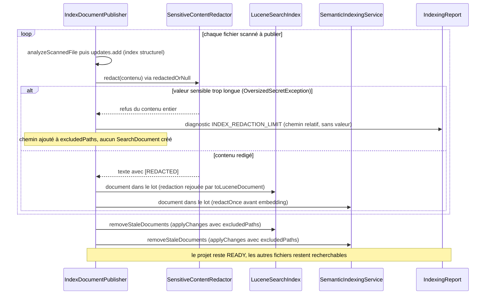
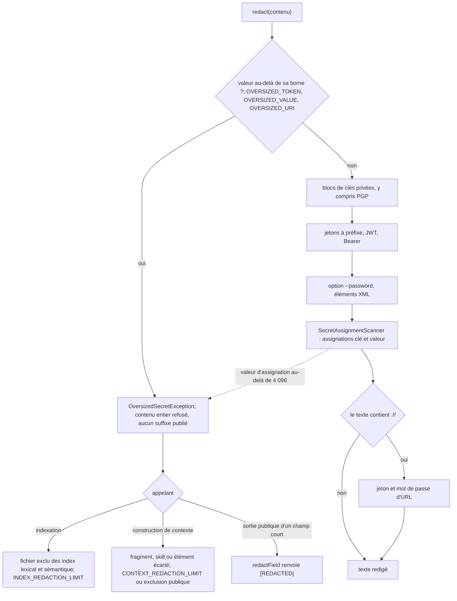
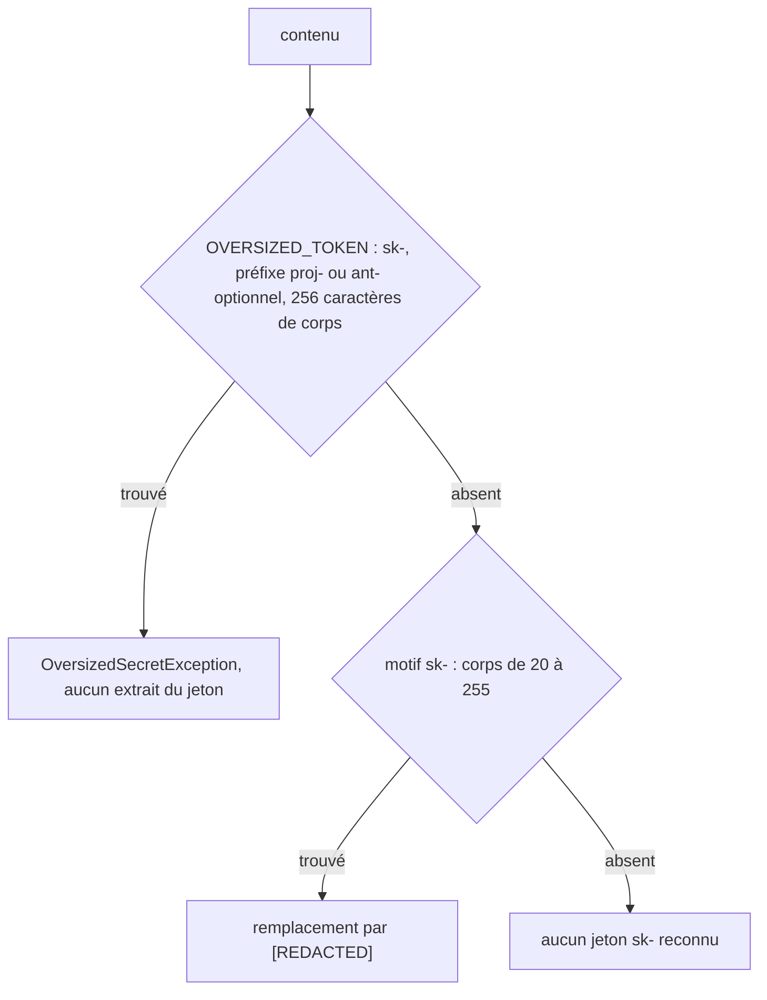
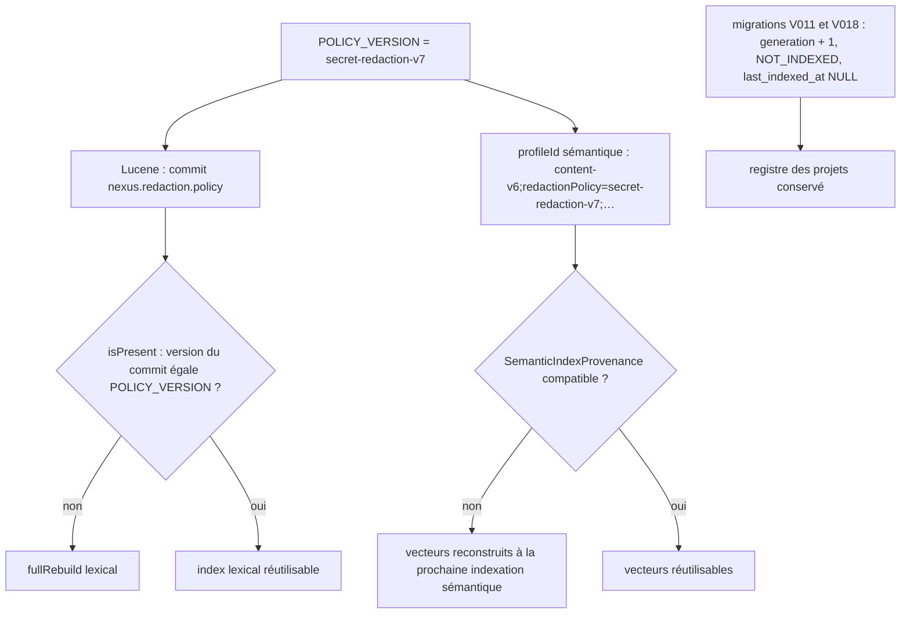

# Redaction des contenus sensibles

`SensitiveContentRedactor` (politique `secret-redaction-v7`) masque les clés
privées (y compris `PGP PRIVATE KEY BLOCK`), les jetons structurés, les JWT, les
credentials URI et les affectations sensibles :

| Forme | Exemples |
|---|---|
| Jetons à préfixe | `ghp_`, `github_pat_`, `AKIA`/`ASIA`, `sk-` (`sk-proj-`, `sk-ant-`), `sk_live_`/`rk_test_`, `xoxb-` et autres `xox?-`, `AIza`, `glpat-`, `npm_` |
| En-tête HTTP | `Bearer <jeton>`, quelle que soit la clé qui le porte |
| URL | `scheme://user:motdepasse@hôte`, `scheme://<jeton de 20 caractères ou plus>@hôte` |
| Ligne de commande | `--password <valeur>`, valeur citée ou non, et les options dont le dernier composant est `password`, `pwd`, `token`, `secret`, `api-key`, `access-token`… (`--db-password`, `-token`) |
| XML | `<password>…</password>` et les éléments `secret`, `token`, `api_key`, `client_secret`, `access_key`, `private_key`, y compris un nom pointé (`<db.password>`), des attributs ou un bloc CDATA, sur une ligne |
| Affectations | voir ci-dessous |

`SecretAssignmentScanner` traite les affectations sans parser JSON/YAML complet :
clé ASCII simple ou composite avec séparateurs `.`, `_`, `-`, éventuellement
citée, puis `:` ou `=`, avec au plus 32 espaces/tabulations autour du séparateur.
Les composants sensibles sont `api_key`, `access_token`, `auth_token`,
`client_secret`, `secret_access_key`, `access_key`, `private_key`, `secret_key`,
`password`, `passwd`, `pwd`, `secret`, `token`, `auth`, `credentials` et
`authorization` ; les séparateurs `_` ou `-` internes sont facultatifs
(`secretKey`, `accessKey`). Un composant est comparé à un segment entier de la
clé : `tokenizer`, `author`, `oauth`, `max_tokens` ou une sous-chaîne comme
`notasecretvalue` ne constituent pas une clé sensible.

Les valeurs simples/doubles citées sont masquées en conservant les quotes,
y compris les échappements et apostrophes YAML doublées. Les scalaires non cités
(incluant nombres, booléens, `null`, valeurs courtes et vides) deviennent
`[REDACTED]`. Les espaces internes, Unicode, `:` et `#` sans espace précédent
font partie du scalaire. Virgule, `}`, `]`, point-virgule et fin de ligne le
terminent ; un `#` initial ou précédé d’espace/tabulation introduit un commentaire.
Les formes ambiguës contenant une virgule ou un crochet dans une valeur doivent
être citées. Les structures imbriquées et scalaires YAML de bloc ne sont pas
interprétés comme des scalaires multilignes.

Une quote non fermée masque la valeur jusqu’à la fin de la ligne courante.
Le scanner ne traverse jamais une ligne pour chercher sa fermeture. LF, CRLF
et CR sont conservés à l’identique. La redaction est déterministe et idempotente.
Les noms composites sont parcourus linéairement, sans répétition regex récursive.
Une valeur dépassant 4 096 caractères (1 024 pour la partie utilisateur d’une
URL, 255 pour le corps d’un jeton à préfixe, compté après le préfixe `proj-` ou
`ant-` d’un jeton `sk-`) provoque un refus du contenu entier par `OversizedSecretException`, sans
suffixe secret ni valeur dans le message d’erreur. L’indexation exclut alors le
seul fichier concerné des index lexical et sémantique (diagnostic
`INDEX_REDACTION_LIMIT` dans le rapport) et le garde dans l’index structurel ; la
construction de contexte écarte le fragment, le skill ou l’élément concerné
(diagnostic `CONTEXT_REDACTION_LIMIT` ou exclusion publique). Le reste du projet
s’indexe et le contexte se construit avec les autres fragments.

Le test `SecretRedactionProbeTest` versionne la sonde de 35 cas de l’audit du
2026-10-17 : formats couverts, identifiants ordinaires laissés intacts, et les
deux formes hors périmètre (scalaire YAML de bloc, valeur placée sur la ligne
suivant sa clé), épinglées comme limite connue.

La protection s’applique avant indexation lexicale, embeddings, estimation et
sélection des fragments, puis à nouveau dans la projection publique
(`PublicOutputProjection`, `PublicContextPolicy`) aux frontières CLI/REST/MCP,
qui redige aussi `signature`, `qualifiedName`, `source` et `target` des symboles
et relations issus de SCIP, MINOS ou JDT. Les requêtes fournies par le client restent des données client et
ne sont pas assimilées aux diagnostics internes. Voir
[recovery V011](release-and-recovery.md#mise-à-niveau-v011--formats-de-secrets)
et [recovery V018](release-and-recovery.md#mise-à-niveau-v018--borne-des-jetons-sk-)
pour l’invalidation des dérivés construits sous une politique antérieure.

## OpenSpec secret-redaction

Spec : [`openspec/specs/secret-redaction/spec.md`](../../openspec/specs/secret-redaction/spec.md) ; matrice de traçabilité : [openspec-traceability.md](openspec-traceability.md).

### Comportement existant vérifié

Les sources sont relues au HEAD courant de la branche `docs/openspec-detailed-uml`.

| Étiquette | Fait | Source |
|---|---|---|
| [Existant vérifié] | `POLICY_VERSION` vaut `secret-redaction-v7`. | `core/src/main/java/com/nexus/security/SensitiveContentRedactor.java:19` |
| [Existant vérifié] | Borne générale d'une valeur : `MAX_SECRET_CHARS = 4096` (redactor et scanner d'assignations). Bornes plus étroites : 1 024 pour la partie utilisateur d'une URL, et un corps de jeton à préfixe borné à 255 caractères (`OVERSIZED_TOKEN`). Pour `sk-`, `sk-proj-` et `sk-ant-`, masquage et refus comptent le même corps, après le préfixe optionnel : 255 caractères sont masqués, 256 refusés. | `SensitiveContentRedactor.java:26-27`, `:44-49`, `:88-96` ; `SensitiveContentRedactorTest#masksSkTokenWhoseBodyHas255CharactersAfterItsPrefix`, `#refusesSkTokenWhoseBodyHas256CharactersWithoutPublishingAnyPartOfIt`, `#refusesSkTokensWhoseBodyHas256To260Characters` ; `SecretAssignmentScanner.java:8` |
| [Existant vérifié] | `redact` commence par refuser le contenu entier (`OversizedSecretException`) si une valeur dépasse sa borne, puis masque dans l'ordre : blocs de clés privées, jetons à préfixe, JWT, `Bearer`, option `--password`, éléments XML, assignations, puis (si le texte contient `://`) jeton et mot de passe d'URL. | `SensitiveContentRedactor.java:101-121` |
| [Existant vérifié] | À 4 096 caractères la valeur est masquée ; à 4 097 le contenu est refusé et le message de l'exception ne contient pas la valeur. | `SecretAssignmentScanner.java:116-137` ; `SensitiveContentRedactorTest#rejectsOversizedValuesWithoutPublishingAnySuffix` |
| [Existant vérifié] | `redactField` convertit un refus en `[REDACTED]` pour un champ court de sortie publique (signature, nom qualifié) au lieu de faire échouer la réponse. | `SensitiveContentRedactor.java:127-136` ; `PublicContextPolicy.java:55`, `:64` |
| [Existant vérifié] | À l'indexation, le fichier fautif est exclu des index lexical et sémantique, reçoit le diagnostic `INDEX_REDACTION_LIMIT` (chemin relatif et `valeur sensible dépassant la limite de redaction`, jamais la valeur) et reste analysé pour l'index structurel (la mise à jour SQLite est enregistrée avant la redaction). | `core/src/main/java/com/nexus/index/service/IndexDocumentPublisher.java:73-86`, `:111-117` |
| [Existant vérifié] | Un fichier indexé puis devenu non redigeable est retiré des index lexical et sémantique (`removeStaleDocuments`) ; en reconstruction complète, il n'est simplement pas réécrit. | `IndexDocumentPublisher.java:105`, `:120-131` ; `ProjectIndexingServiceTest#anOversizedSecretExcludesOnlyItsFileFromDerivedIndexes` (partie lexicale) |
| [Existant vérifié] | `LuceneSearchIndex` et `SemanticIndexingService` écartent aussi, document par document, un contenu refusé (`WARNING` sur `System.Logger`, chemin relatif). | `LuceneSearchIndex.java:264-272` ; `SemanticIndexingService.java:193-205` |
| [Existant vérifié] | Construction de contexte : le fragment refusé est écarté seul, par `BudgetedContextSelector` (exclusion `<chemin> exclu : …`), `ContextBundle`, `ContextBudgetAllocator`, `SkillContextSelector` et, à la matérialisation, `ContextFragmentFactory` (diagnostic `CONTEXT_REDACTION_LIMIT`). | `BudgetedContextSelector.java:45-50` ; `ContextBundle.java:22-28` ; `ContextBudgetAllocator.java:96-102` ; `SkillContextSelector.java:38-44` ; `ContextFragmentFactory.java:143-151` |
| [Existant vérifié] | Un index Lucene n'est « présent » que si la donnée de commit `nexus.redaction.policy` égale `POLICY_VERSION` ; sinon l'indexation force une reconstruction complète. | `LuceneSearchIndex.java:152-166`, `:170-174` ; `ProjectIndexingService.java:242-244` |
| [Existant vérifié] | Les migrations `V011` et `V018` incrémentent `generation` de tous les projets et les repassent en `NOT_INDEXED` (`last_indexed_at = NULL`) ; le registre `projects` est conservé. | `core/src/main/resources/db/migration/V011__invalidate_secret_format_indexes.sql:6-21` ; `V018__invalidate_sk_token_bound_indexes.sql:6-23` ; `SchemaMigratorSkTokenBoundUpgradeTest` |
| [Existant vérifié] | Le profil sémantique est `content-v` + `CONTENT_PROFILE_VERSION` (6) + `;redactionPolicy=` + `POLICY_VERSION` + bornes d'embedding ; un changement de `POLICY_VERSION` modifie donc le profil même sans toucher `CONTENT_PROFILE_VERSION`. | `SemanticIndexingService.java:27`, `:170-175` |
| [Existant vérifié] | `SemanticIndexingService.vectorize` redige chaque document une fois (`redactOnce`) puis part de ce texte pour l'embedding et l'extrait. | `SemanticIndexingService.java:140-141`, `:193-205` |

### Vues

Vue UML séquence — Que devient un fichier dont une valeur sensible dépasse la borne pendant l'indexation, et le reste du projet ? (existant)

Le fichier fautif n'entre ni dans le lot lexical ni dans le lot sémantique et son éventuelle ancienne version en est retirée ; les autres fichiers sont indexés normalement. Il reste dans l'index structurel. Les index lexical et sémantique rejouent la redaction sur un texte déjà redigé : c'est la seconde barrière volontaire décrite dans [semantic-search.md](semantic-search.md).

Exigences : `secret-redaction › Une valeur sensible trop longue n'exclut que son fichier`, `secret-redaction › Chaque document est redigé une fois avant l'embedding`.

Vue Organigramme — Dans quel ordre `redact` refuse-t-il ou masque-t-il, et que font les appelants d'un refus ? (existant)

Le refus du contenu entier évite de publier le suffixe d'un secret trop long ; chaque appelant le transforme en exclusion locale plutôt qu'en échec global. Le test de bornes `SensitiveContentRedactorTest#boundedFormsAreRedactedAtTheBoundAndRefusedJustAbove` épingle N et N+1 pour `Bearer`, `--password`, `<password>` et la partie utilisateur d'une URL.

Exigences : `secret-redaction › Une valeur sensible trop longue n'exclut que son fichier`, `secret-redaction › Les formats de secrets courants sont redigés`, `secret-redaction › Les bornes étroites de redaction refusent le contenu`.

Vue Organigramme — Un jeton de la famille `sk-` est-il masqué ou refusé ? (existant)

Les deux motifs comptent le corps après le même préfixe optionnel, consommé de façon possessive : la borne de refus vaut la borne de masquage plus un, et aucune longueur de corps ne laisse un jeton reconnu en clair. `SensitiveContentRedactorTest` épingle 255 (masqué) et 256 (refusé) pour `sk-`, `sk-proj-` et `sk-ant-`, puis chaque longueur de 256 à 260 pour `sk-` ; `SecretRedactionProbeTest#skTokenFormatIsRedactedAtItsBoundAndRefusedAboveIt` garde le format de la sonde à sa borne.

Exigences : `secret-redaction › Un jeton sk- est masqué ou refusé à toute longueur de corps`.

Vue Organigramme — Comment un changement de politique invalide-t-il les index dérivés ? (existant)

Trois mécanismes se complètent : la dernière migration d'invalidation (`V018`) invalide les projets déjà enregistrés, la donnée de commit Lucene invalide un index d'une autre politique, et le profil sémantique rend incompatible un index d'un autre profil. Aucun test n'exerce le second mécanisme (écart 1).

Exigences : `secret-redaction › Un changement de politique invalide les index dérivés`.

### Écarts et limites

- [Écart] 1 — Index lexical d'une ancienne politique : le code invalide et reconstruit (`LuceneSearchIndex.java:163-165`, `ProjectIndexingService.java:242-244`) mais aucun test ne fait varier la donnée de commit `nexus.redaction.policy` (recherche dans `core/src/test` et `adapters` : aucune occurrence). Scénario sans preuve.
- [Écart] 2 — « redigé une seule fois ». Vrai à l'intérieur de `SemanticIndexingService` (`:197`), mais sur le chemin d'indexation le texte a déjà été redigé par `IndexDocumentPublisher` (`:111-115`) et l'est encore par `LuceneSearchIndex` (`:275`). Aucun test ne compte les appels à `redact` ; la tâche archivée 8.1 prouvait ce point par une commande (`git grep -c`), pas par un test.
- [Écart] 3 — Profil `content-vN`. L'exigence demande d'incrémenter le profil sémantique à chaque changement de politique ; le profil inclut déjà `redactionPolicy=<POLICY_VERSION>` (`SemanticIndexingService.java:170-175`), donc il change de toute façon. L'incrément manuel de `CONTENT_PROFILE_VERSION` (règle de `.claude/rules/search-and-redaction.md`) n'est vérifié par aucun test ; seuls les contrats de documentation épinglent `secret-redaction-v7` et `content-v6` (`scripts/release/test-operational-doc-contracts.sh:240-253`).
- [Écart] 4 — Le motif « chaque modification de redaction s'accompagne d'une migration » est une règle de processus : aucun test ne détecte une évolution de `SensitiveContentRedactor` sans nouvelle migration (preuve manquante).
- Limites vérifiées : les 19 formats de la spec sont les 19 cas `auditFormat` de la sonde de 35 cas ; `SecretRedactionProbeTest#probeHasThirtyFiveCasesIncludingTheNineteenAuditFormats` affirme 35, 19 et 2 limites connues. Les valeurs `secret-redaction-v5` et `secret-redaction-v6` (scénarios de migration) et `secret-redaction-v7` (courante) correspondent à `SchemaMigratorSecretFormatUpgradeTest`, `SchemaMigratorSkTokenBoundUpgradeTest` et à `POLICY_VERSION`. Aucun écart sur ces trois points.
- Limite : seul le chemin lexical est couvert de bout en bout pour l'indexation d'un fichier trop long ; `ProjectIndexingServiceTest#anOversizedSecretExcludesOnlyItsFileFromDerivedIndexes` n'active pas l'index sémantique, le test sémantique `SemanticIndexingServiceTest#excludesOnlyTheDocumentWhoseSecretExceedsTheRedactionBound` reste au niveau du service.

### Propositions et questions ouvertes

- [Proposition] Écrire un test qui ouvre un index Lucene dont `nexus.redaction.policy` diffère de `POLICY_VERSION` et vérifie `isPresent == false` puis la reconstruction complète.
- [Proposition] Écrire un test d'indexation sémantique de bout en bout (fichier de 5 000 caractères dans un projet de trois fichiers, index sémantique activé).
- [Question] « redigé une seule fois » vise-t-il `SemanticIndexingService` seul, ou l'ensemble du chemin d'indexation (trois appels de `redact` au total, dont deux volontaires) ?
- [Question] Faut-il un test d'architecture ou de contrat qui impose migration, `POLICY_VERSION` et `CONTENT_PROFILE_VERSION` ensemble ?
