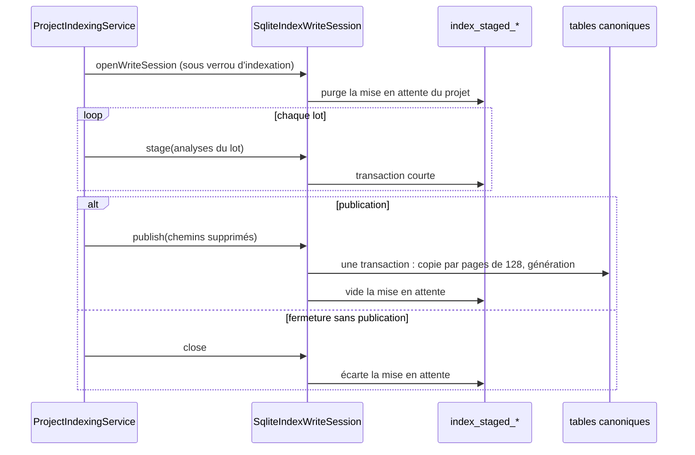

# SQLite multi-project write contention

## Threat model

NEXUS stores all registered projects in one SQLite database under `NEXUS_HOME`. The indexing single-flight contract is intentionally **per project**: a JVM mutex and an OS `FileLock` prevent two active index mutations of the same project, but different projects use different locks and may legitimately reach SQLite at the same time.

SQLite still permits only one effective writer at a time. WAL does not remove that writer serialization; it primarily improves reader/writer coexistence. NXA-09 therefore keeps the current journal-mode policy and adds bounded recovery for transient writer contention instead of introducing a JVM-global lock or changing storage architecture.

## Pre-fix reproduction

Before the remediation, a hermetic integration test held a real write transaction for project A and attempted a repository write for project B against the same database. With the production `PRAGMA busy_timeout = 5000`, the second writer failed with the driver's official result code:

```text
SQLITE_BUSY after 5012 ms
```

The timeout was bounded, but there was no application-level recovery after that first wait expired.

## Central transaction policy

`SqliteDatabase.writeTransaction(...)` is now the single transaction-retry boundary used by:

- `SqliteProjectRepository.save`;
- `SqliteIndexRepository.applyChanges`;
- `SqliteIndexWriteSession` (mise en attente, publication et nettoyage des analyses d'une indexation, voir [Indexation](#indexation-par-lots-mis-en-attente)) ;
- `SqliteIndexRepository.replaceExternalCodeIntelligence`.

Bootstrap/migrations use the same `SqliteWriteRetryPolicy`, while `SchemaMigrator` retains its own transaction rollback semantics.

Each retry is a **complete transaction attempt**:

1. open a fresh SQLite connection;
2. start a transaction;
3. run the whole mutation;
4. commit on success;
5. on failure, rollback before returning the error to the retry policy;
6. close the connection;
7. only then, if the error is recognized as transient contention, back off and retry from the beginning.

A transaction that has already committed is never replayed merely because closing the JDBC connection later fails.

## Retryable errors

Retry classification uses the Xerial driver's official `SQLiteException.getResultCode()` values. Only:

- `SQLITE_BUSY`;
- `SQLITE_LOCKED`

are retryable.

Constraint violations, SQL errors, schema errors, corruption, I/O failures, programming errors and arbitrary `SQLException` messages are not retried. No substring matching of exception text is used.

## Bounded timing

Production defaults remain:

```text
busy_timeout = 5000 ms
maxAttempts = 2
backoff = 50 ms
```

The worst-case contention wait attributable to this policy is therefore approximately:

```text
2 × 5000 ms + 50 ms = 10050 ms
```

There is no infinite retry loop. Internal/package-private constructor seams allow tests to use busy timeouts and backoffs measured in a few milliseconds without weakening production defaults.

## Exactly-once and generation semantics

A failed attempt is rolled back before a retry. Tests deliberately insert a row and then raise a synthetic official `SQLITE_BUSY`; the second attempt can insert the same primary key successfully only if the first attempt was fully rolled back.

For index mutations the whole `applyChanges` transaction, including `project_index_generations`, is replayed atomically. A recovered transient contention therefore produces one committed file state and exactly one generation increment.

External code-intelligence replacement follows the same rule. Importing an identical external snapshot remains a true no-op and does not increment generation.

## Indexation par lots mis en attente

Une indexation ne tient jamais une transaction d'écriture ouverte pendant l'analyse : les analyses des fichiers modifiés sont mises en attente par lots dans les tables transitoires `index_staged_*` (V014), chaque lot dans une courte transaction `writeTransaction`, puis publiées avec la génération par **une** transaction finale (décision [DATA-0074](../architecture/adr/DATA-0074-garantir-le-cycle-de-vie-et-la-coherence-des-index-derives.md)). Le temps de verrou d'écriture attribuable à une indexation est donc la somme de transactions courtes, et non la durée de l'indexation.

Scénario de contention couvert par `ProjectIndexingPublicationTest#anotherProjectCanWriteWhileAnIndexingIsInProgressBetweenBatches` : l'indexation d'un projet est suspendue en cours d'analyse, après plusieurs lots déjà mis en attente. Un autre projet écrit alors (`applyChanges` et `ProjectRepository.save`) sans attendre le `busy_timeout` ni échouer en `SQLITE_BUSY`, et la génération du projet indexé n'est pas publiée avant la fin. Les tests `SqliteIndexWriteSessionTest` couvrent l'atomicité de la publication et l'écart des analyses en attente d'une indexation qui échoue ou qui a été interrompue.

## Réglages des connexions et lots d'écriture

`SqliteDatabase` est le seul point d'ouverture des connexions SQLite des sources de production (`newConnection`, `DriverManager.getConnection("jdbc:sqlite:" …)`). Chaque connexion y reçoit, avant d'être rendue, `foreign_keys = ON`, le `busy_timeout` ci-dessus et deux réglages de performance :

| Réglage | Valeur | Raison |
|---|---|---|
| `PRAGMA temp_store` | `MEMORY` | Les triggers FTS5 (V008) des insertions canoniques créent des structures temporaires SQL ; sur disque, elles dominaient le chargement (run Scale Benchmark `34534070804`, PR #219 : 7 315 ms pour 100 000 symboles et autant de relations, plafond de 5 000 ms). Agrandir le cache de pages ne réduisait pas ce surcoût ; les garder en mémoire le réduit sans retirer les triggers. |
| `PRAGMA cache_size` | `-SqliteDatabase.PAGE_CACHE_KIB`, soit 64 MiB | Trois index commencent par `file_id` : `idx_symbols_file_provider` (V005), `idx_symbol_relations_file_provider` (V012) et `idx_symbols_file_fuzzy_prefilter` (V015). Une indexation qui écrit de nombreux fichiers par transaction y insère des clés hors ordre ; au-delà de quelques centaines de milliers de lignes, ils dépassent le cache par défaut de 2 MiB et chaque insertion relit des pages sur disque. |

Ces réglages ne touchent ni le fichier canonique, ni son journal, ni `synchronous`, ni les clés étrangères, ni les migrations publiées, ni les seuils du benchmark.

Choix de 64 MiB (sonde locale du 2026-11-08, peuplement d'un million de symboles et de relations, journal `DELETE`) : 42 à 52 s avec le cache par défaut, 38,5 à 39,8 s à 32 MiB, 32,2 à 35,2 s à 64 MiB, 35,4 à 37,3 s à 128 MiB. 64 MiB est la plus petite valeur mesurée qui ramène le peuplement sous le plafond relatif de +20 % du benchmark (run `42440042849`, PR #306 : 32 856 ms pour un plafond de 32 683 ms). Les index V012 et V015 ne peuvent pas être retirés (suppression par fichier, préfiltre approché scopé au projet) ; un cache agrandi pour les seules sessions d'écriture laisserait sans gain une écriture ouverte par `openConnection()` hors session. Toute autre valeur se remesure d'abord au palier d'un million de lignes (`ScaleRegressionBenchmarkTest`).

Coût : la mémoire temporaire et le cache sont de la mémoire native, hors heap Java, que le gate de heap ne mesure pas. Les temporaires n'ont plus de repli disque et dépendent des requêtes ; le cache est alloué à l'usage et peut atteindre 64 MiB par connexion. Une extension majeure de volumétrie qualifie donc aussi la mémoire du processus.

### Lots d'insertion `SqliteBatchInsert`

- Les lignes répétitives de `symbols` et `symbol_relations` (et de leurs tables de mise en attente `index_staged_symbols`, `index_staged_relations`) sont écrites par des `INSERT` multi-lignes paramétrés, au plus `ROW_LIMIT = 128` lignes par instruction. Aucun `INSERT INTO symbols` ni `INSERT INTO symbol_relations` n'existe hors de ce helper.
- Le SQL de structure est fermé par l'énumération `SqliteBatchInsert.Table` ; les valeurs sont toujours liées. Les instructions préparées sont mises en cache par taille de lot et réutilisées jusqu'à `close()`.
- Le helper ne possède pas la transaction : ni `commit`, ni `rollback`, ni `setAutoCommit`, ni savepoint, ni instruction `BEGIN`/`COMMIT`. L'appelant (`writeTransaction`, `SqliteIndexWriteSession`) garde les commits, les rollbacks et la visibilité de la génération FTS, ce qui permet de rejouer une transaction entière après une contention (voir plus haut).
- La borne de 128 limite le nombre de paramètres par instruction (8 colonnes × 128 = 1 024) tout en réduisant les allers-retours : la courbe locale passe d'environ 49,5 s à 35,6 s au palier d'un million de lignes, plafonds absolus inchangés.

Contrôles : `SqliteDatabaseHardeningTest` (`keepsTemporaryStorageOfEveryConnectionInMemory`, `sizesThePageCacheOfEveryConnection`, `onlySqliteDatabaseOpensConnectionsAndNothingElseSetsTempStore`), `SqliteBatchInsertTest` (`limitsEachStatementTo128Rows`, `symbolInsertsGoOnlyThroughTheHelperWhichOwnsNoTransaction`, `executesFullAndTailRowsWithBoundValues`), workflow `.github/workflows/scale-benchmark.yml`. Historique des mesures : ADR archivés [DATA-0050](../architecture/adr/archive/DATA-0050-conserver-les-temporaires-sqlite-en-memoire.md), [DATA-0051](../architecture/adr/archive/DATA-0051-borner-les-lots-d-ecriture-sqlite.md) et [DATA-0069](../architecture/adr/archive/DATA-0069-dimensionner-le-cache-de-pages-sqlite-des-connexions.md).

## Multi-process behavior

The retry mechanism is database-level and connection-level; it does not depend on a JVM-global mutex. Independent NEXUS processes sharing the same local `NEXUS_HOME` therefore see the same SQLite lock protocol and can recover from short `BUSY`/`LOCKED` intervals.

The existing per-project `FileLock` is retained. Distinct project locks can still be held concurrently; SQLite serialization is handled separately by the bounded transaction policy.

The qualified support boundary for `FileLock` remains a local filesystem. Network filesystems require separate qualification.

## Concurrent reads

The remediation does not serialize readers behind an application-wide lock. Integration coverage holds a real SQLite writer while reading a different project and requires the read to succeed.

The existing scale benchmark continues to exercise concurrent read/write behavior under DELETE and WAL journal modes and requires zero reader failures.

## Bootstrap

Two independent `SqliteDatabase` instances may start against the same fresh database. Migration/bootstrap attempts use the same bounded contention policy, with rollback/connection close before retry. Concurrent bootstrap is covered hermetically with independent connections and the final migration table must contain the expected migration set exactly once.

## Qualification expectations

NXA-09 qualification includes:

- real cross-project writer contention and recovery;
- bounded failure when contention outlives the policy;
- non-BUSY no-retry behavior;
- rollback-before-retry and exactly-once persistence;
- generation correctness;
- external refresh no-op preservation;
- concurrent reads;
- per-project OS `FileLock` compatibility;
- concurrent bootstrap;
- complete SQLite/index/provenance/core tests;
- scale/concurrent read-write benchmark;
- Linux and Windows repository gates;
- `./mvnw -B clean install`.

## OpenSpec sqlite-index-writes

Spec : [`openspec/specs/sqlite-index-writes/spec.md`](../../openspec/specs/sqlite-index-writes/spec.md) ; matrice de traçabilité : [openspec-traceability.md](openspec-traceability.md).

### Comportement existant vérifié

| Étiquette | Fait | Source |
|---|---|---|
| [Existant vérifié] | La migration V012 crée `idx_symbol_relations_file_provider` sur `symbol_relations(file_id, source_provider)` ; la suppression par fichier et la sonde de cascade sont servies par `SEARCH ... USING INDEX` ou `USING COVERING INDEX`, jamais par `SCAN`. | `core/src/main/resources/db/migration/V012__index_symbol_relations_by_file.sql` ; `SqliteGraphQueryPlanTest` |
| [Existant vérifié] | La migration V013 supprime `idx_symbol_relations_project`, `idx_indexed_files_project` et `idx_symbols_file` (`DROP INDEX IF EXISTS`) ; aucun index n'est préfixe strict d'un autre sur `symbol_relations`, `indexed_files` et `symbols`. | `core/src/main/resources/db/migration/V013__drop_redundant_prefix_indexes.sql` ; `SqliteGraphQueryPlanTest` |
| [Existant vérifié] | V012 et V013 ne touchent ni les faits canoniques ni le statut des projets : aucun rebuild. | `SchemaMigratorFileIndexUpgradeTest` |
| [Existant vérifié] | `SqliteFileWriter` prépare l'upsert (`RETURNING id`) et les deux suppressions une fois par transaction ; `SqliteBatchInsert` met ses instructions en cache par taille de lot. | `core/src/main/java/com/nexus/persistence/sqlite/SqliteFileWriter.java` ; `SqliteFileWriterTest` |
| [Existant vérifié] | Les analyses sont mises en attente par lot dans `index_staged_files`, `index_staged_symbols` et `index_staged_relations` (V014, DATA-0074), invisibles jusqu'à la publication qui copie vers les tables canoniques, vide la mise en attente et incrémente la génération ; la fermeture sans publication écarte la mise en attente. | `SqliteIndexWriteSession` ; `SqliteIndexWriteSessionTest` ; `ProjectIndexingPublicationTest` |

### Vues

Vue Diagramme de séquence — Comment les analyses d'un lot passent-elles par la mise en attente avant la publication ? (existant)



Exigences : `sqlite-index-writes › La suppression des relations d'un fichier utilise un index`, `sqlite-index-writes › Le schéma ne porte pas d'index préfixe redondant`, `sqlite-index-writes › Les migrations d'index conservent les données`, `sqlite-index-writes › L'écriture d'un fichier ne relit pas son identifiant`, `sqlite-index-writes › Les analyses en attente sont bornées par lot`.

### Écarts et limites

- [Écart] 1 — Le scénario de plan accepte `USING INDEX` ou `USING COVERING INDEX` ; SQLite émet `COVERING INDEX` quand l'index suffit, et les tests de plan acceptent les deux.
- Limite : la transaction de publication copie tout le volume modifié en une fois (jusqu'au corpus entier lors d'un rebuild) ; le verrou d'écriture est tenu pendant cette durée. Le scénario de contention ci-dessus la mesure.
- Limite : `SqliteIndexWriteSession` purge la mise en attente de tout le projet à l'ouverture, sans identifiant de session : l'ouverture hors du verrou d'indexation du projet effacerait la mise en attente d'une indexation vivante.
- Limite : après un arrêt brutal, la mise en attente reste jusqu'à la prochaine indexation du même projet ; aucun chemin de lecture ne la consulte.

### Propositions et questions ouvertes

- [Proposition] Documenter l'invariant « session ouverte sous verrou d'indexation » sur `IndexRepository.openWriteSession`, ou porter un identifiant de session dans les tables de mise en attente.
- [Question] Faut-il purger la mise en attente à l'ouverture de la base plutôt qu'à la prochaine indexation du projet ?
