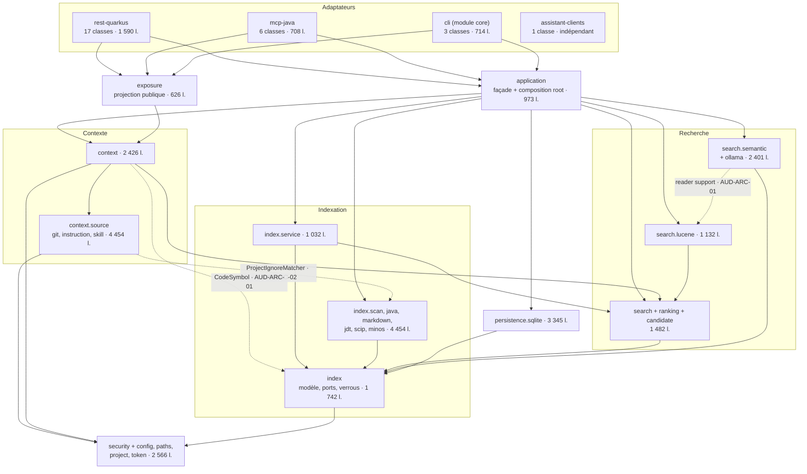

# Architecture observée — audit du 16 novembre 2026

Le découpage décrit ici est reconstruit à partir des imports des sources de production (origin/main @ `7ec5c5dc`), et non de la documentation. Le script compte les `import`, les `import static`, les jokers et les noms `com.nexus.*` pleinement qualifiés, hors commentaires et chaînes. Résultat : 32 packages et 165 arêtes au niveau package exact, aucune composante fortement connexe. `CoreArchitectureTest` (31 tests, verts dans le build Windows du 16/11) verrouille l'absence de cycle avec une baseline vide.

## Découpage réel

- **Cœur.** Le seul module Maven `core` contient 32 packages Java, soit environ 27 400 lignes en 239 types, conformément à ARCH-0076. La CLI (`com.nexus.cli`) vit dans ce module.
- **Couche haute.** `application` regroupe la façade `NexusApplication` (12 collaborateurs, 15 opérations) et la composition root `NexusApplicationFactory` (347 lignes), seule à instancier SQLite, Lucene, Ollama, JDT, SCIP et MINOS. Viennent ensuite `cli` et `exposure`, la projection publique commune des trois surfaces (ARCH-0085).
- **Adaptateurs.** `rest-quarkus` (17 classes) et `mcp-java` (6 classes) n'importent que la façade, la projection publique et des types valeur ou de politique. `assistant-clients` (1 classe) est indépendant du cœur.
- **Pipeline de contexte.** `context` (builder, budget, fédération) appelle `context.source` (git, instruction, skill : providers ARCH-0078), puis `context.model` (feuille), ainsi que `search` et `ranking`.
- **Pipeline de recherche.** `search` (services, stratégies) appelle `ranking` (+graph), puis `search.candidate` (modèle feuille). Les adaptateurs sont `search.lucene` et `search.semantic` (ports, plus lucene et ollama).
- **Indexation.** `index.service` (orchestration) dépend de `index`, qui porte le modèle et les ports, mais aussi les verrous et l'exécution de tâches (AUD-ARC-04). Les providers et importers `index.scan`, `index.java`, `index.markdown`, `jdt`, `scip` et `minos` (ARCH-0080) dépendent aussi d'`index`.
- **Persistance.** `persistence.sqlite` implémente `IndexRepository` (`index`) et `ProjectRepository` (`project`). Seule la composition root l'importe (AUD-ARC-10).
- **Fondations transverses.** `security` (redaction, garde de chemins, IO sûre), `config`, `paths`, `project` et `token`.

## Diagramme

Une flèche A → B signifie que A importe B ; l'épaisseur n'est pas représentée. En pointillés : les arêtes que le tableau des sens d'ARCH-0076 n'autorise pas ou ne mentionne pas.

Toutes les familles dépendent des fondations ; seules quelques-unes de ces arêtes sont dessinées.

## Écarts avec la documentation

1. Le tableau des sens d'ARCH-0076 (l. 70 à 82) est incomplet : cli, exposure, persistence, search.lucene, index.jdt/scip/minos et les fondations n'y figurent pas. Il est aussi faux sur 3 arêtes (context → index, context.source → index.scan, search.semantic.lucene → search.lucene). Seules 4 de ses lignes sont automatisées (AUD-ARC-01). ARCH-0076 étant accepté, la correction passe par un nouvel ADR (AUD-ARC-12).
2. ARCH-0076 (l. 65) annonce un package `index` limité au modèle et aux ports. Or il héberge `ProjectIndexLockManager`, `ExternalTaskRunner` et `IndexingCapacityGate` (AUD-ARC-04).
3. Le schéma « Composition » d'`overview.md` (l. 42 à 53) omet `exposure`, point de parité des trois surfaces, ainsi que `ProjectIndexLockManager`. Il ne situe pas non plus la CLI dans le module core. La vue par packages n'existe que dans `docs/developer/architecture-implementation.md`.
4. Si l'on regroupe par espace de premier niveau, `index`, `search` et `ranking` forment un cycle, via index.service → search → ranking → search.candidate → index. L'acyclicité n'est garantie qu'au niveau sous-package, ce qui est voulu (AUD-ARC-09).

## Ce que le diagramme ne montre pas

Un graphe de packages ne montre pas un défaut interne à un module. Les deux sujets majeurs de cet audit lui échappent donc : la redaction qui laisse passer des formes courantes (AUD-SEC-01, AUD-SEC-02), et l'absence de trace serveur sur les erreurs (AUD-QUA-01). Il ne voit pas non plus les dépendances par réflexion, ServiceLoader ou injection CDI, ni le code de test.
