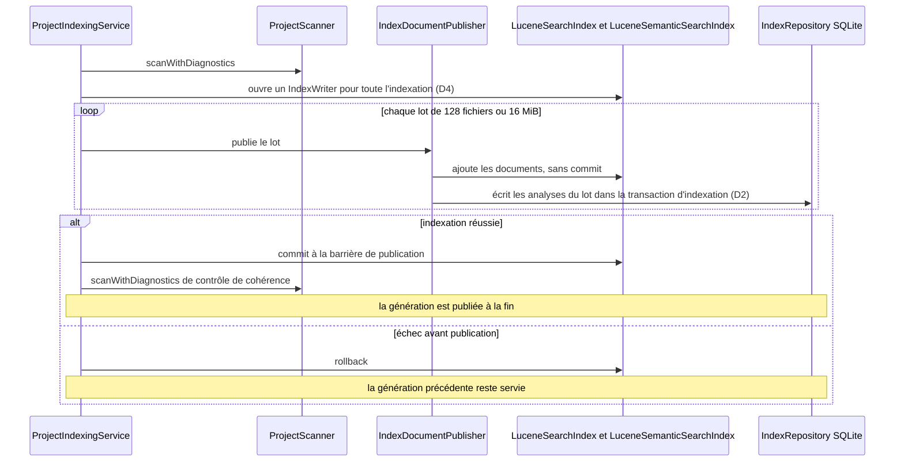
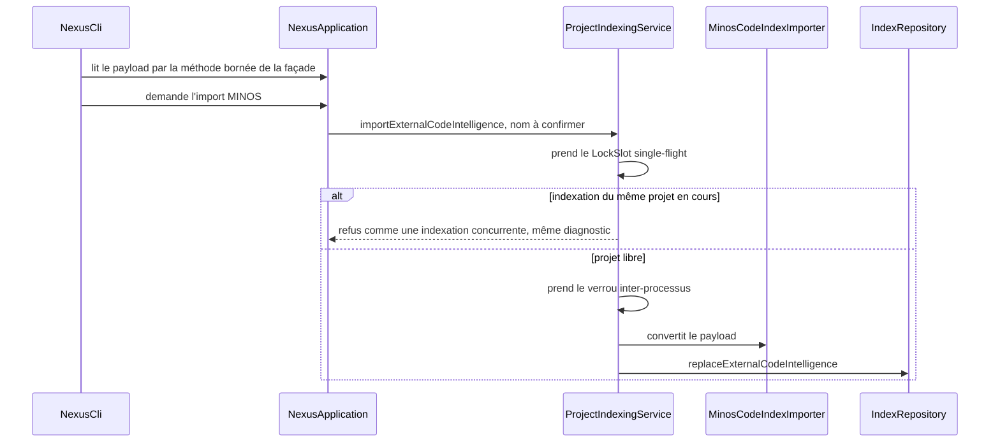

# Design

## Context

`ProjectIndexingService.indexLocked` scanne le projet (`scanWithDiagnostics`, ligne 246), publie les documents par lots de 128 fichiers ou 16 MiB via `IndexDocumentPublisher` (un `applyChanges` Lucene par lot : nouvel `IndexWriter` puis `commit`, `LuceneSearchIndex.java:96-118` et `:242-245`), accumule les `IndexedFileUpdate` de tous les fichiers modifiés (`IndexDocumentPublisher.java:34`), les écrit en une transaction SQLite (`indexRepository.applyChanges`, ligne 283), puis rescanne le projet pour contrôler la cohérence (ligne 303). `ProjectScanner` hache chaque fichier visité (`FileHasher.sha256`, ligne 158) sans raccourci.

`SqliteFileWriter` exécute, pour chaque fichier, un upsert suivi de `SELECT id FROM indexed_files WHERE project_id = ? AND relative_path = ?` (ligne 83) et deux `DELETE` préparés, dont `DELETE FROM symbol_relations WHERE file_id = ? AND source_provider = ?` (ligne 101). Les index de `symbol_relations` (V001, V002, V003) commencent tous par `project_id` ; `EXPLAIN QUERY PLAN` de cette suppression donne `SCAN symbol_relations`. `idx_symbol_relations_project`, `idx_indexed_files_project` (V001) et `idx_symbols_file` (V005) sont des préfixes stricts d'autres index. Le pilote est `sqlite-jdbc` 3.53.4.0 : `RETURNING` est disponible.

L'import MINOS (`NexusApplication.java:185-190`) acquiert `projectIndexLockManager` sans le `LockSlot` single-flight de `ProjectIndexingService` et instancie `MinosCodeIndexImporter` ; `NexusCli.java:150` lit le payload directement. `ProjectIndexingService` a cinq constructeurs publics (lignes 45, 54, 64, 76, 94), dont deux utilisent `ProjectIndexLockManager.processLocalOnly()`.

ADR applicables : ADR-0020 (migrations embarquées append-only), ADR-0022 (Lucene dérivé), ADR-0023 (SHA-256, « mesurer, puis metadata-first si nécessaire », sans seuil chiffré), ADR-0044 (contrat MINOS), ADR-0045 (writers Lucene operation-scoped), ADR-0051 (lots d'écriture SQLite bornés, transaction possédée par l'appelant), ADR-0052 (cohérence des lectures et des index dérivés).

### Dépendances envers d'autres sprints

- Le sprint 6 (fédération) réutilise `ProjectIndexingService` et `LuceneSearchIndex`, et son constat AUD-QUA-10 découpe les méthodes longues de l'indexation. Le sprint 5 se fusionne avant le sprint 6 ; si l'ordre s'inverse, les tâches 2, 4, 7 et 8 se rebasent sur le découpage d'AUD-QUA-10.
- Le sprint 4 ajoute une migration d'invalidation de redaction : les deux sprints prennent le numéro de migration suivant disponible au moment de l'implémentation.
- Aucun prérequis d'un sprint antérieur.

## Goals / Non-Goals

**Goals:**
- Coût de réindexation proportionnel aux fichiers modifiés, non à la taille de la base.
- Mémoire de l'indexation bornée par lot, non par nombre de fichiers modifiés.
- Un seul point d'entrée d'écriture d'index, avec un seul protocole de verrouillage.

**Non-Goals:**
- Changer la granularité de publication de la génération (toujours atomique à la fin).
- Supprimer le scan final de cohérence.
- Modifier le contrat JSON MINOS (ADR-0044) ou les contrats CLI/REST/MCP.

## Decisions

**D1 — Index `(file_id, source_provider)` sur `symbol_relations`.** Une migration d'évolution crée `idx_symbol_relations_file_provider ON symbol_relations(file_id, source_provider)`. Il sert la suppression par fichier et fournisseur, et, par son préfixe `file_id`, la vérification de la cascade de clé étrangère. `SqliteGraphQueryPlanTest` vérifie que les deux plans utilisent l'index. Le benchmark `ScaleRegressionBenchmarkTest` gagne un scénario qui réindexe des fichiers existants par `applyChanges` sur une base peuplée, au lieu d'insertions directes.

**D2 — Rétention bornée des analyses.** Mesurer d'abord le pic de heap d'un rebuild complet sur le profil `full` du benchmark d'échelle. Écrire ensuite les analyses dans SQLite au rythme des flushs de documents, dans la transaction d'indexation que possède l'appelant (ADR-0051), la génération restant publiée à la fin. Si la durée de la transaction d'écriture dégrade la contention mesurée par `docs/developer/sqlite-write-contention.md`, l'alternative est une table de staging (migration dédiée et ADR qui complète ADR-0051 et ADR-0052). Le choix entre les deux est tranché par la mesure et consigné dans la PR.

**D3 — Double hachage mesuré avant d'être optimisé.** Le benchmark scanner (`ProjectScannerCorpusBudgetBenchmarkTest`, workflow `scanner-corpus-benchmark.yml`) rapporte la part du hachage dans le scan initial et dans le scan final. ADR-0023 ne fixe pas de seuil chiffré : un raccourci (taille et date de modification, puis SHA-256 seulement en cas de différence) n'est introduit que si la mesure le justifie, et alors par un nouvel ADR qui complète ADR-0023 et fixe le seuil. Sinon, la mesure est consignée dans `docs/developer/indexing-pipeline.md` et le constat se ferme sans changement de code.

**D4 — Un writer Lucene par indexation.** `LuceneSearchIndex` et `LuceneSemanticSearchIndex` ouvrent un `IndexWriter` au début de l'indexation, l'alimentent à chaque flush et ne committent qu'à la barrière de publication ; en cas d'échec, `rollback`. Le writer reste operation-scoped au sens d'ADR-0045 (l'opération est l'indexation) et n'est jamais partagé entre indexations ni entre projets ; les readers mis en cache (ADR-0045, ADR-0055) ne voient le nouveau contenu qu'après le commit, comme aujourd'hui. Pas de nouvel ADR.

**D5 — Instructions préparées par transaction et `RETURNING id`.** `SqliteFileWriter` prépare l'upsert, les deux suppressions et les insertions par lot une fois par transaction et réutilise les `PreparedStatement` pour chaque fichier ; l'upsert se termine par `RETURNING id`. `SqliteBatchInsert` met en cache l'instruction de fin de lot par taille.

**D6 — Suppression des index préfixes, après plans.** Avant la migration, un test de plan vérifie, pour chaque requête qui utilise aujourd'hui `idx_symbol_relations_project`, `idx_indexed_files_project` ou `idx_symbols_file`, qu'un index plus large (`idx_symbol_relations_project_provider`, contrainte `UNIQUE(project_id, relative_path)`, `idx_symbols_file_provider`) la sert. La migration les supprime par `DROP INDEX IF EXISTS`. Les migrations publiées restent intactes.

**D7 — MINOS par `ProjectIndexingService`.** Une méthode `importExternalCodeIntelligence` (nom à confirmer) de `ProjectIndexingService` prend le `LockSlot` single-flight puis le verrou inter-processus, appelle `MinosCodeIndexImporter` composé dans `NexusApplicationFactory`, et écrit par `replaceExternalCodeIntelligence`. La façade délègue ; la CLI lit le payload par une méthode bornée de la façade et n'importe plus `MinosCodeIndexImporter`.

**D8 — Un constructeur public.** `ProjectIndexingService` garde un constructeur public complet, sans valeur par défaut pour `ProjectIndexLockManager`. Les variantes de commodité deviennent une fabrique de test (`core/src/test/java/com/nexus/index/ProjectIndexingServices.java` ou équivalent). Aucun code de production n'appelle `processLocalOnly()` hors composition explicite.

## Risks / Trade-offs

- [Transaction d'écriture plus longue (D2)] → mesurée avant adoption ; alternative de staging documentée.
- [Writer Lucene ouvert plus longtemps (D4)] → un seul writer par projet, déjà garanti par le verrou d'indexation ; rollback en cas d'échec, l'index reste celui de la génération précédente.
- [Suppression d'un index utilisé par une requête non testée (D6)] → test de plan sur toutes les requêtes connues ; la migration est réversible par une migration ultérieure qui recrée l'index.
- [Conflits avec le sprint 6 sur `ProjectIndexingService`] → ordre de fusion sprint 5 puis sprint 6.
- [Mesure D3 non concluante] → le constat AUD-PRF-08 se ferme par la mesure documentée, sans raccourci.

## Vues

Vue UML (diagramme de séquence) — Comment l'indexation cible enchaîne le scan, l'écriture par lot, le writer Lucene unique et la publication de la génération ?

Explication : aujourd'hui chaque lot Lucene ouvre un `IndexWriter` puis committe, et les `IndexedFileUpdate` de tous les fichiers modifiés s'accumulent jusqu'à une écriture SQLite unique (voir Context). La vue montre la cible de D2 et D4 : un writer par indexation, des analyses écrites au rythme des lots, un seul commit Lucene, rollback en cas d'échec. `[Question]` L'ordre exact entre le commit Lucene, le scan de contrôle et la publication de la génération n'est pas fixé par le design ; la vue ne l'affirme pas.

Exigences : `project-indexing-pipeline › Un writer Lucene par indexation, committé à la publication`, `sqlite-index-writes › Les analyses en attente sont bornées par lot`.

Vue UML (diagramme de séquence) — Comment un import MINOS prend-il les mêmes verrous qu'une indexation ?

Explication : aujourd'hui `NexusApplication` acquiert `projectIndexLockManager` sans le `LockSlot` et instancie `MinosCodeIndexImporter`, et `NexusCli` lit le payload directement (voir Context). La vue montre la cible de D7 : le verrou single-flight puis le verrou inter-processus sont pris dans `ProjectIndexingService`, et la CLI n'importe plus `MinosCodeIndexImporter`.

Exigences : `project-indexing-pipeline › Toute écriture d'index passe par ProjectIndexingService`.

## Traçabilité

[Existant vérifié] Les 14 tâches de `tasks.md` sont réalisées et fusionnées dans `develop` (PR 297). Les preuves ci-dessous citent les tests lus à l'archivage ; elles n'établissent pas qu'ils passent sur un HEAD ultérieur.

[Écart] Deux points diffèrent du design initial : D2 est réalisé par des tables de staging (migration V014, ADR DATA-0062) et non par l'écriture dans la transaction d'indexation, la mesure de contention l'ayant imposé ; l'ordre de la barrière de publication est : commit Lucene, publication canonique, imports externes, scan de cohérence, statut `READY` (voir `docs/developer/indexing-pipeline.md`). Les vues ci-dessus restent celles du design ; la page durable fait foi.

| Exigence (`capacité › titre`) | Scénario | Conception ou diagramme | Tâche | Test ou preuve |
|---|---|---|---|---|
| `project-indexing-pipeline › Toute écriture d'index passe par ProjectIndexingService` | Import MINOS pendant une indexation | D7 ; vue « import MINOS » | 7.1 | `ProjectIndexingServiceMinosImportTest` (refus pendant une indexation du même projet, verrou inter-processus tenu, projet non `READY`) |
| `project-indexing-pipeline › Toute écriture d'index passe par ProjectIndexingService` | Lecture du payload par la CLI | D7 ; vue « import MINOS » | 7.1 | `git grep MinosCodeIndexImporter` sans résultat dans `cli/` et `NexusApplication` ; `MinosPayloadTransportBoundTest` (borne de 128 MiB, seuil exact) ; REST et MCP n'exposent pas d'import MINOS en production, la borne commune est `MAX_EXPORT_BYTES` |
| `project-indexing-pipeline › Le service d'indexation exige un gestionnaire de verrou explicite` | Composition de production | D8 | 8.1 | `ProjectIndexingServiceCompositionTest` ; `git grep -c "public ProjectIndexingService("` égal à 1 ; aucun appel de production à `processLocalOnly()` |
| `project-indexing-pipeline › Un writer Lucene par indexation, committé à la publication` | Indexation de plusieurs lots | D4 ; vue « indexation cible » | 4.1 | `ProjectIndexingPublicationTest` (commit unique au-delà du lot par défaut), `LuceneSearchIndexSessionTest`, `LuceneSemanticSearchIndexSessionTest` |
| `project-indexing-pipeline › Un writer Lucene par indexation, committé à la publication` | Échec avant publication | D4 ; vue « indexation cible » | 4.1, 2.2 | `LuceneSearchIndexSessionTest` et `LuceneSemanticSearchIndexSessionTest` (rollback qui conserve l'index et la provenance) ; `ProjectIndexingPublicationTest` (échec après plusieurs lots) |
| `project-indexing-pipeline › La réindexation sur base peuplée est mesurée` | Profil CI du benchmark | D1 | 1.3 | scénario `reindexExistingFiles` de `ScaleRegressionBenchmarkTest`, profil `ci` ; aucun plafond n'est posé sur ce scénario |
| `sqlite-index-writes › La suppression des relations d'un fichier utilise un index` | Plan de la suppression par fichier | D1 | 1.1, 1.2 | `SqliteGraphQueryPlanTest › perFileRelationDeletionSeeksByFileAndProvider` ; migration V012 |
| `sqlite-index-writes › La suppression des relations d'un fichier utilise un index` | Plan de la cascade | D1 | 1.1, 1.2 | `SqliteGraphQueryPlanTest › foreignKeyCascadeProbeSeeksByFile` |
| `sqlite-index-writes › Le schéma ne porte pas d'index préfixe redondant` | Liste des index après migration | D6 | 6.1 | `SqliteGraphQueryPlanTest › redundantPrefixIndexesAreAbsentFromTheMigratedSchema`, `noIndexIsAStrictPrefixOfAnotherIndexOfTheSameTable` ; migration V013 |
| `sqlite-index-writes › Le schéma ne porte pas d'index préfixe redondant` | Requêtes existantes | D6 | 6.1 | `SqliteGraphQueryPlanTest › projectAndFileQueriesStayIndexedOnceThePrefixIndexesAreDropped` |
| `sqlite-index-writes › Les migrations d'index conservent les données` | Upgrade d'une base peuplée | D1, D6 | 1.2, 6.1 | `SchemaMigratorFileIndexUpgradeTest` (V012, V013, réouverture sans effet) |
| `sqlite-index-writes › L'écriture d'un fichier ne relit pas son identifiant` | Écriture de plusieurs fichiers | D5 | 5.1 | `SqliteFileWriterTest › preparedStatementCountDoesNotGrowWithTheNumberOfFiles`, `fileIdentifierComesFromTheUpsertNotFromASecondQuery` |
| `sqlite-index-writes › Les analyses en attente sont bornées par lot` | Rebuild complet | D2 ; vue « indexation cible » | 2.1, 2.2 | `ProjectIndexingPublicationTest › analysesAreStagedAtTheBatchPaceAndPublishedOnce`, `SqliteIndexWriteSessionTest` ; mesures dans `docs/project/history/` ; le heap vivant reste proportionnel au nombre de fichiers (limite connue, `IndexingHeapPeakBenchmarkTest`) |
| `sqlite-index-writes › Les analyses en attente sont bornées par lot` | Échec en cours d'indexation | D2 ; vue « indexation cible » | 2.2 | `ProjectIndexingPublicationTest › aFailureAfterSeveralBatchesLeavesThePreviousGenerationAndDerivedIndexesIntact` |

Aucun scénario sans tâche. Les tâches 3.1, 3.2 (double hachage, `AUD-PRF-08`, décision D3 : aucun raccourci, mesure consignée dans `docs/developer/indexing-pipeline.md`), 6.2 et 9.1 ne correspondent à aucun scénario.
