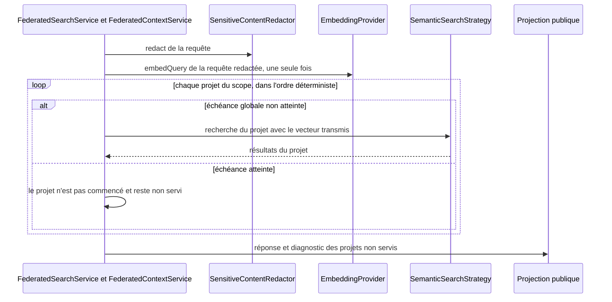

# Design

## Context

`FederatedSearchService.search` et `FederatedContextService.build` parcourent le scope fédéré (jusqu'à `FederatedScopePolicy.MAX_PROJECTS` = 100) dans une boucle synchrone et délèguent à la recherche ou au builder de contexte d'un seul projet. Tout ce que fait le chemin mono-projet est donc payé N fois :

- `SemanticSearchStrategy.search` appelle `embeddingProvider.embedQuery` pour chaque projet ; `OllamaEmbeddingProvider` ne mémoïse rien (timeout par requête 120 s).
- `SemanticSearchStrategy` appelle `semanticSearchIndex.isCompatible`, qui délègue à l'opération non cachée `LuceneSemanticSearchIndex.isCompatible` (`FSDirectory.open` puis `DirectoryReader.open` pour lire `getIndexCommit().getUserData()`). La sonde de readiness de `NexusApplication` appelle `searchIndex.isPresent` pour chaque projet, avec le même motif dans `LuceneSearchIndex`. Le cache de readers de l'ADR-0045 existe déjà mais n'est pas utilisé pour ces lectures.
- `GitRecencyCandidateEnricher` ouvre le dépôt, lit `MAX_COMMITS` = 50 commits et 50 diffs d'arbres à chaque recherche.
- `PersistentGitContextSourceProvider` garde `DEFAULT_CAPACITY` = 16 entrées LRU, une par projet : au-delà de 16 projets, un parcours cyclique évince chaque entrée avant sa réutilisation (ADR-0046 assume 16).
- `SqliteSymbolSearch` filtre `project_id` après le `MATCH` FTS global ; `idx_symbols_fuzzy_prefilter` (V008) n'a pas de colonne projet ; `SymbolSearchStrategy` interroge la requête puis chaque terme (`MAX_QUERY_TERMS` = 8).

L'ADR-0043 exclut tout parallélisme tant qu'une mesure ne le justifie pas. Le sprint garde cette règle : les gains viennent de la mutualisation, l'échéance borne la latence sans paralléliser.

## Goals / Non-Goals

**Goals:**
- Une requête fédérée sur N projets calcule un seul vecteur de requête.
- Aucune lecture de métadonnées Lucene n'ouvre de `DirectoryReader` hors du cache.
- Une échéance globale borne la fédération et la réponse nomme les projets non servis.
- Les caches Git servent une requête fédérée répétée sur 100 projets.
- Le coût d'une recherche de symboles dépend du projet ciblé.

**Non-Goals:**
- Paralléliser la boucle fédérée.
- Changer l'ordre ou le score des résultats servis.
- Modifier `NexusApplicationFactory.create`.
- Changer de fournisseur ou de modèle d'embedding.

## Decisions

**D1 — Découpage avant optimisation (`AUD-QUA-10`).** `FederatedContextService.build` est découpé en étapes privées nommées (validation de la requête et du scope, collecte par projet, sélection sous budget, métadonnées) et `ProjectIndexingService.indexLocked` en étapes (scan, diff, publication, providers externes, statut). Les tests existants (`FederatedContextServiceTest`, `FederatedContextBudgetScaleBenchmarkTest`, `ProjectIndexingServiceTest`) servent de filet ; aucun test n'est modifié dans cette étape. L'échéance (D3) s'insère ensuite dans l'étape « collecte par projet ».

**D2 — Vecteur de requête calculé par la fédération et transmis (`AUD-PRF-02`).** Le service fédéré calcule le vecteur une fois, sur la requête redactée (`SensitiveContentRedactor.redact`), et le transmet via le contexte de requête aux stratégies sémantiques par projet. La clé est (requête redactée normalisée, identifiant de modèle) ; la portée est la requête, sans cache inter-requêtes (pas d'état mémoire nouveau à borner). Alternative écartée : un cache LRU dans `OllamaEmbeddingProvider`, qui mélangerait des requêtes de clients différents et poserait une question de borne mémoire. Un échec du provider reste traité une fois et dégrade tous les projets avec le même diagnostic.

**D3 — Échéance globale vérifiée entre projets (`AUD-PRF-03`).** La fédération reçoit une échéance globale (borne par défaut fixée dans l'ADR à partir de la mesure de `FederatedContextBudgetScaleBenchmarkTest` et de la qualification sémantique). Elle est vérifiée avant chaque projet ; le temps restant plafonne les délais des appels bornables (embedding). Un projet commencé n'est pas interrompu. Les projets non commencés à l'échéance sont listés, dans l'ordre déterministe du scope, dans un diagnostic public de la réponse, émis par la projection publique unique (CLI, REST et MCP à parité). Alternative écartée : exécuteur avec timeout par projet, qui introduit le parallélisme exclu par l'ADR-0043. Nouvel ADR qui complète ADR-0043.

**D4 — Métadonnées Lucene lues sur le reader en cache (`AUD-PRF-04`).** `PersistentLuceneSemanticSearchIndex.isCompatible` et `PersistentLuceneSearchIndex.isPresent` lisent `userData` sur l'`IndexCommit` du reader acquis dans le cache de l'ADR-0045 (acquisition/libération symétriques). Sans reader en cache, la lecture passe par `SegmentInfos.readLatestCommit`, qui ne charge aucun segment. Aucun nouvel ADR : la décision applique l'ADR-0045.

**D5 — Cache de contexte Git dimensionné sur le scope (`AUD-PRF-06`).** `DEFAULT_CAPACITY` prend la valeur de `FederatedScopePolicy.MAX_PROJECTS`, avec une borne mémoire par entrée inchangée (les entrées portent des fragments déjà bornés). Les compteurs `CacheStats` existants sont exposés dans les métadonnées `explain`. La qualification `git-context-cache-qualification` est étendue à un scope de plus de 16 projets.

**D6 — Cache de récence par (dépôt, HEAD) (`AUD-PRF-07`).** `GitRecencyCandidateEnricher` mémorise, par (racine du dépôt, identifiant de HEAD), la liste ordonnée des chemins modifiés des `MAX_COMMITS` derniers commits, dans la borne `MAX_CUMULATIVE_CHANGED_PATHS` = 4096 existante, et applique ensuite le filtre de candidats. Un changement de HEAD invalide l'entrée ; la capacité suit D5. Cette décision rejoint le même ADR que D5, qui complète ADR-0046.

**D7 — Recherche de symboles scopée projet (`AUD-PRF-09`).** Une migration `V0NN` (skill `nexus-schema-migration`) ajoute un index de préfiltre fuzzy qui commence par la colonne projet (dénormalisée ou via `indexed_files`) ; `SqliteSymbolSearch` restreint le `MATCH` au projet avant le tri et interroge les termes en un lot (`json_each`) plutôt qu'une requête par terme. Le résultat (ordre et contenu) est identique à l'existant. Un benchmark peuple 25 puis 100 projets dans la même base.

## Dépendances envers d'autres sprints

- **Sprint 2, `AUD-DEP-19`** : la qualification sémantique réelle (`semantic-search-qualification.yml`) doit être stabilisée avant de mesurer D2 ; sans elle, le gain ne se prouve qu'en test unitaire avec un provider qui compte ses appels.
- **Sprint 5** : partage `ProjectIndexingService` (D1) et `LuceneSearchIndex` (D4). Le sprint 6 démarre après la fusion du sprint 5 dans `develop`, pas en parallèle. Le numéro de migration de D7 est le suivant disponible après les migrations du sprint 5.
- **Sprint 4, `AUD-QUA-09`** : le diagnostic des projets non servis (D3) passe par la projection publique unique livrée au sprint 4.

## Risks / Trade-offs

- [L'échéance rend la réponse dépendante du temps] → seuls le nombre de projets servis et le diagnostic varient ; l'ordre et les scores des projets servis restent déterministes. Les tests injectent une horloge et n'affirment rien sur la durée réelle.
- [Un projet commencé peut dépasser l'échéance] → assumé sans parallélisme ; le temps restant plafonne l'appel d'embedding, seul appel long bornable.
- [Capacité Git portée à 100 entrées] → mémoire bornée par la taille déjà plafonnée des fragments ; à confirmer par `PersistentGitContextSourceProviderBudgetTest`.
- [Cache de récence obsolète après un commit] → la clé contient HEAD ; un working tree modifié n'affecte pas la récence des commits.
- [Migration sur une base existante] → ajout d'index seulement, sans invalidation ; testé par un test d'upgrade.

## Vues

Vue UML (diagramme de séquence) — Comment une requête fédérée cible calcule-t-elle un seul vecteur et respecte-t-elle l'échéance globale ? ([Proposition] — cible, non disponible)

Explication : aujourd'hui la boucle synchrone délègue au chemin mono-projet, donc `embedQuery` est appelé par projet (voir Context). La vue montre la cible de D2 et D3 : un seul vecteur calculé sur la requête redactée, une échéance vérifiée avant chaque projet sans parallélisme (ADR-0043), un diagnostic public émis par la projection publique unique. `[Question]` D3 plafonne le délai d'embedding par le temps restant alors que D2 calcule le vecteur avant la boucle : le moment du calcul par rapport à l'échéance n'est pas fixé par le design, et la vue ne l'affirme pas.

Exigences : `federated-search-bounds › Le vecteur de requête est calculé une fois par requête fédérée`, `federated-search-bounds › La fédération respecte une échéance globale`, `federated-search-bounds › Les projets non servis sont nommés`.

## Traçabilité

Ces changements sont des plans non réalisés : aucune exigence n'est déclarée couverte, aucune case de `tasks.md` n'est cochée.

| Exigence (`capacité › titre`) | Scénario | Conception ou diagramme | Tâche | Test ou preuve |
|---|---|---|---|---|
| `federated-search-bounds › Le vecteur de requête est calculé une fois par requête fédérée` | Scope de plusieurs projets | D2 ; vue « requête fédérée cible » | 2.1 | à produire par la tâche 2.1 — test avec un `EmbeddingProvider` qui compte ses appels (1 appel pour 3 projets) ; test non écrit |
| `federated-search-bounds › Le vecteur de requête est calculé une fois par requête fédérée` | Requête redactée avant embedding | D2 ; vue « requête fédérée cible » | 2.1 | à produire par la tâche 2.1 — même test (requête transmise redactée) ; test non écrit |
| `federated-search-bounds › Le vecteur de requête est calculé une fois par requête fédérée` | Fournisseur indisponible | D2 | 2.2 | à produire par la tâche 2.2 — test ciblé (un seul appel, tous les projets dégradés avec le même diagnostic), puis workflow `semantic-search-qualification.yml` ; test non écrit |
| `federated-search-bounds › La fédération respecte une échéance globale` | Échéance atteinte en cours de scope | D3 ; vue « requête fédérée cible » | 3.1, 3.2 | à produire par la tâche 3.2 — test à horloge simulée (`FederatedContextServiceTest`, `FederatedSearchServicePolicyTest`) ; ADR de la tâche 3.1 non rédigé ; test non écrit |
| `federated-search-bounds › La fédération respecte une échéance globale` | Échéance non atteinte | D3 | 3.2 | à produire par la tâche 3.2 — test à horloge simulée ; l'absence de diagnostic et l'identité des résultats sans échéance ne sont pas décrites par la tâche : test non écrit |
| `federated-search-bounds › Les projets non servis sont nommés` | Diagnostic ordonné | D3 | 3.2 | à produire par la tâche 3.2 — test à horloge simulée (ordre du diagnostic, projets servis inchangés) ; test non écrit |
| `federated-search-bounds › Les projets non servis sont nommés` | Parité des interfaces | D3 | 3.3 | à produire par la tâche 3.3 — `./mvnw -B -ntp clean install` (tests REST et MCP inclus) ; le test de parité CLI, REST et MCP n'est pas décrit : test non écrit |
| `git-context-cache › Le cache de contexte Git couvre le scope fédéré maximal` | Requête fédérée répétée au-delà de 16 projets | D5 | 5.1, 5.2, 5.3 | à produire par la tâche 5.2 — test de 2 passages cycliques sur 20 projets (hits au second passage) ; à produire par la tâche 5.3 — exécution `workflow_dispatch` de `git-context-cache-qualification.yml` ; ADR de la tâche 5.1 non rédigé ; test non écrit |
| `git-context-cache › Les statistiques du cache Git sont exposées` | Explain après un hit | D5 | 5.2 | à produire par la tâche 5.2 — exposition des `CacheStats` dans `explain` ; le test qui lit les compteurs dans les métadonnées `explain` n'est pas décrit : test non écrit |
| `git-context-cache › La récence des commits est mise en cache par HEAD` | HEAD inchangé | D6 | 6.1 | à produire par la tâche 6.1 — test `GitRecencyCandidateEnricherTest` (second appel sans parcours de log) ; test non écrit |
| `git-context-cache › La récence des commits est mise en cache par HEAD` | Nouveau commit | D6 | 6.1 | à produire par la tâche 6.1 — même test (nouveau commit pris en compte) ; test non écrit |
| `lucene-reader-cache › La compatibilité sémantique est lue sur le reader en cache` | Recherches sémantiques successives | D4 | 4.1 | à produire par la tâche 4.1 — test qui compte les ouvertures de reader sur deux recherches successives ; test non écrit |
| `lucene-reader-cache › La compatibilité sémantique est lue sur le reader en cache` | Résultat inchangé | D4 | 4.1 | à produire par la tâche 4.1 — `LuceneSemanticSearchIndexTest,SemanticSearchStrategyTest` ; le cas « provenance différente, incompatible » n'est pas décrit par la tâche : test non écrit |
| `lucene-reader-cache › La présence de l'index lexical est lue sans ouvrir l'index` | Sonde de readiness répétée | D4 | 4.2 | à produire par la tâche 4.2 — `-Dtest='*LuceneSearchIndex*,NexusApplication*'` ; le test qui compte les ouvertures de reader entre deux sondes n'est pas décrit : test non écrit |
| `lucene-reader-cache › La présence de l'index lexical est lue sans ouvrir l'index` | Index absent | D4 | 4.2 | à produire par la tâche 4.2 — mêmes tests ciblés ; le cas « répertoire absent, rend absent sans erreur » n'est pas décrit : test non écrit |
| `symbol-search-scoping › La recherche de symboles est scopée projet avant le tri` | Plan de requête | D7 | 7.1, 7.2 | à produire par la tâche 7.2 — benchmark 25/100 projets peuplés dans la même base (plan `EXPLAIN` sans `SCAN` global) ; migration de la tâche 7.1 non écrite ; test non écrit |
| `symbol-search-scoping › La recherche de symboles est scopée projet avant le tri` | Résultats inchangés | D7 | 7.2 | à produire par la tâche 7.2 — `-Dtest='*SymbolSearch*,FederatedGoldenSearchCorpusTest'` ; test non écrit |
| `symbol-search-scoping › Les termes d'une requête sont interrogés en lot` | Requête de plusieurs termes | D7 | 7.2 | à produire par la tâche 7.2 — interrogation en lot dans `SymbolSearchStrategy` ; le test qui compte les requêtes SQL (8 termes contre 1 terme) n'est pas décrit : test non écrit |

Aucun scénario sans tâche (`tâche absente`). Les tâches 1.1, 1.2 (`AUD-QUA-10`, découpage sans nouveau comportement) et 8.1 (intégration) ne correspondent à aucun scénario.
