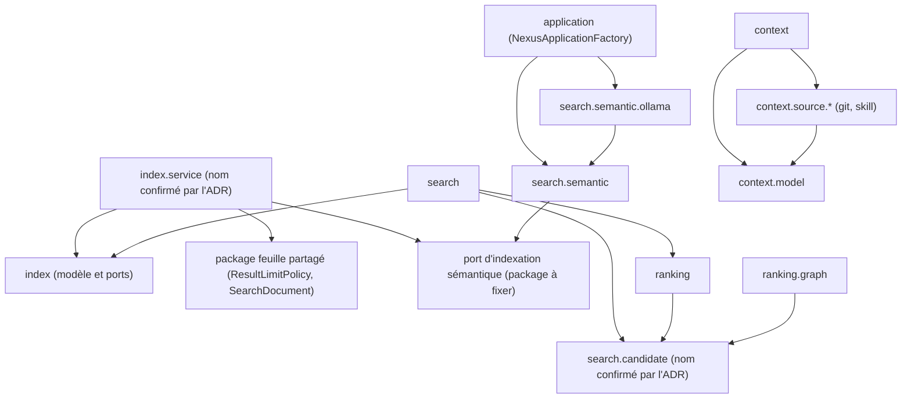

# Design

## Context

Le graphe des imports `com.nexus.*` du cœur (niveau package) contient une composante fortement connexe de 12 packages. Ses cycles bilatéraux, vérifiés sur `origin/develop` :

| Cycle | Arêtes qui le ferment | Constat |
|---|---|---|
| `index` ↔ `search` | `IndexRepository` → `search.ResultLimitPolicy` ; `ProjectIndexingService`, `IndexDocumentPublisher` → `search.SearchIndex`, `search.SearchDocument` ; `search.SearchDocument`, `SymbolSearchStrategy` → `index.*` | `AUD-ARC-02` |
| `index` ↔ `search.semantic` | `ProjectIndexingService`, `IndexDocumentPublisher` → `SemanticIndexingService` (classe concrète) | `AUD-ARC-02` |
| `index` ↔ `index.scan` | `ProjectIndexingService` → `index.scan.ProjectScanner` ; `ProjectScanner` → `index.FileCategory`, `ScannedFile`… | `AUD-ARC-02` (même déplacement) |
| `context` ↔ `context.source`, `.git`, `.skill` | `ContextSourceFragmentFactory`, `LocalGitContextSourceProvider` → `context.ContextFragment` ; `SkillContextSelector` → `context.ContextItem`, `ContextSelectionResult` | `AUD-ARC-04` |
| `search` ↔ `ranking`, `ranking.graph` | `ContextRanker`, `DeterministicContextRanker` → `search.SearchCandidate`… ; `GraphCandidateEnricher` → `search.CandidateEnricher`, `CandidateMerger` ; `ProjectGraphBuilder` → `search.ResultLimitPolicy` ; `SearchService` → `ranking.*` | `AUD-ARC-05` |
| `search.semantic` ↔ `search.semantic.ollama` | `SemanticSearchConfiguration` → `ollama.OllamaEmbeddingProvider` (instanciation l. 109) | `AUD-ARC-06` |
| `context` ↔ `security` | `PublicContextPolicy` → `context.*` | `AUD-ARC-03` (sprint 4) |

Le test d'architecture du sprint 3 (`AUD-ARC-07`) calcule ce graphe et porte une baseline de cycles qui ne peut que décroître. Chaque tâche de ce sprint retire les cycles qu'elle casse de la baseline ; le test échoue si un cycle retiré réapparaît.

## Goals / Non-Goals

**Goals:**
- Un graphe de packages du cœur acyclique, imposé par le test d'architecture.
- Des packages de modèle feuilles, dont dépendent orchestration, ports et adaptateurs.
- Aucun changement de comportement observable ni de format persistant.

**Non-Goals:**
- Découper le cœur en modules Maven ou ajouter des `module-info`.
- Réduire la visibilité des types publics.
- Renommer des champs publics des réponses CLI, REST ou MCP.

## Decisions

**D1 — Un cycle par tâche, baseline réduite à chaque pas.** L'ordre suit le sprint : `AUD-ARC-02`, `AUD-ARC-04`, `AUD-ARC-05`, `AUD-ARC-06`, puis `AUD-ARC-01`. Après chaque tâche, la baseline du test d'architecture perd les cycles cassés ; la tâche n'est terminée que lorsque le test passe avec la baseline réduite. Une tâche qui ne peut pas réduire la baseline est arrêtée et documentée plutôt que contournée par un ajout à la baseline.

**D2 — Orchestration de l'indexation hors du modèle (`AUD-ARC-02`).** `ProjectIndexingService`, `IndexDocumentPublisher` et `ExternalCodeIntelligenceRefresher` passent dans un package d'orchestration (`index.service`, nom confirmé par l'ADR). `index` garde le modèle et les ports (`IndexRepository`, `CodeSymbol`, `FileCategory`, `ScannedFile`…). `ResultLimitPolicy` et `SearchDocument` passent dans un package feuille partagé. Le service d'indexation dépend d'une interface d'indexation sémantique ; « désactivé » est une implémentation sans effet, plus `null`. Alternative écartée : déplacer `CodeSymbol` et `FileCategory` vers `search`, qui inverserait le cycle sans le casser.

**D3 — Modèle de contexte en package feuille (`AUD-ARC-04`).** `ContextFragment`, `ContextItem` et `ContextSelectionResult` passent dans `context.model`. `context` (builder) et `context.source.*` (providers) en dépendent ; `context.source.*` n'importe plus `context`.

**D4 — Modèle de candidats en package feuille (`AUD-ARC-05`).** `SearchCandidate`, `SearchSignals`, `CandidateType`, `CandidateEnricher` et `CandidateMerger` passent dans un package de candidats (`search.candidate`, nom confirmé par l'ADR). `ranking` et `ranking.graph` en dépendent et n'importent plus `search` ; `search` dépend de `ranking`. Les règles de score (ADR-0010, ADR-0025) sont inchangées, seules les déclarations de package bougent.

**D5 — Construction du fournisseur d'embeddings au composition root (`AUD-ARC-06`).** `SemanticSearchConfiguration` ne garde que des valeurs et le port `EmbeddingProvider` ; `fromEnvironment` et l'instanciation d'`OllamaEmbeddingProvider` passent dans `application` (`NexusApplicationFactory`). `search.semantic` n'importe plus `search.semantic.ollama`. Les bornes de configuration restent validées au même endroit fonctionnel (`SemanticSearchConfigurationBoundsTest` reste vert).

**D6 — Graphe acyclique imposé (`AUD-ARC-01`).** Une fois les cycles bilatéraux cassés, les cycles transitifs restants (s'il y en a) sont cassés par le même procédé, puis la baseline du test d'architecture devient vide : tout cycle de packages du cœur fait échouer le build. Les règles de sens (D2 à D5) sont ajoutées au test comme règles nommées, pour qu'un échec désigne le package fautif.

**D7 — ADR complémentaire.** Un nouvel ADR complète ADR-0004 (séparation logique par capacité) : graphe acyclique, packages de modèle feuilles, noms retenus, vérification par le test d'architecture. ADR-0004 n'est pas modifié.

## Dépendances envers d'autres sprints

- **Sprint 3, `AUD-ARC-07`** : le test d'architecture et sa baseline de cycles décroissante doivent être dans `develop` avant la première tâche. Sans lui, aucune tâche ne peut prouver la disparition d'un cycle.
- **Sprint 4, `AUD-ARC-03`** : le cycle `context` ↔ `security` est cassé au sprint 4 (déplacement de `PublicContextPolicy`, après la projection publique unique d'`AUD-QUA-09`). `AUD-ARC-01` ne peut aboutir qu'après lui.
- **Sprints 4, 5 et 6** : ils modifient `context`, `security`, `search` et l'indexation. Ce sprint démarre après leur fusion pour éviter des déplacements de fichiers concurrents.
- **Sprint 8, `AUD-ARC-12`** : la lecture de configuration par `System.getenv` dans le cœur y est traitée ; D5 déplace déjà la lecture sémantique vers le composition root, ce qui réduit ce périmètre.

## Risks / Trade-offs

- [Déplacements massifs, conflits avec des branches ouvertes] → une PR par constat ou un commit par constat, après fusion des sprints 4 à 6.
- [Les adaptateurs REST et MCP importent des types déplacés] → mise à jour des imports seulement ; le build du reactor (`./mvnw clean install`) et les tests de contrat REST/MCP vérifient l'absence de changement observable.
- [Les noms de packages proposés ne conviennent pas] → ils sont fixés par l'ADR avant le premier déplacement.
- [Un cycle transitif apparaît après les cassures bilatérales] → D6 le traite ; le test d'architecture le signale.

## Vues

Vue UML (diagramme de paquetages, adapté en `flowchart` Mermaid) — Quel est le sens de dépendance cible entre les packages du cœur après les déplacements ? ([Proposition] — cible, non disponible)

Explication : chaque flèche va du package dépendant vers le package dont il dépend. La vue reprend les sens de D2 à D5 : `index` ne dépend plus de `search`, `context.source.*` ne dépend plus de `context`, `ranking` et `ranking.graph` ne dépendent plus de `search`, `search.semantic` ne dépend plus de `search.semantic.ollama` (construit par `application`). Elle ne montre pas toutes les arêtes du cœur, seulement celles que le design nomme ; le graphe complet est vérifié par le test d'architecture (D6). `[Question]` Le package du port d'indexation sémantique n'est pas nommé par le design. Les noms `index.service` et `search.candidate` sont des propositions que l'ADR de la tâche 1.1 doit confirmer.

Exigences : `core-package-boundaries › Le graphe des packages du cœur est acyclique`, `core-package-boundaries › Le modèle et les ports d'indexation ne dépendent pas de la recherche`, `core-package-boundaries › Les sources de contexte ne dépendent pas du builder de contexte`, `core-package-boundaries › Le ranking ne dépend pas du service de recherche`, `core-package-boundaries › Le port d'embeddings ne construit pas son adaptateur`.

## Traçabilité

Ces changements sont des plans non réalisés : aucune exigence n'est déclarée couverte, aucune case de `tasks.md` n'est cochée.

| Exigence (`capacité › titre`) | Scénario | Conception ou diagramme | Tâche | Test ou preuve |
|---|---|---|---|---|
| `core-package-boundaries › Le graphe des packages du cœur est acyclique` | Graphe courant | D1, D6 ; vue « sens de dépendance cible » | 6.1 | à produire par la tâche 6.1 — `./mvnw -B -ntp -pl core test -Dtest='*Architecture*' ...` avec la baseline vidée ; test non écrit |
| `core-package-boundaries › Le graphe des packages du cœur est acyclique` | Cycle introduit | D6 (règles de sens nommées) | 6.1 | à produire par la tâche 6.1 — règles de sens nommées dans le test d'architecture ; le cas « `ranking` importe `search` fait échouer le test » n'est pas décrit comme test : test non écrit |
| `core-package-boundaries › Le modèle et les ports d'indexation ne dépendent pas de la recherche` | Imports du package index | D2 ; vue « sens de dépendance cible » | 2.1, 6.1 | à produire par la tâche 2.1 — `-Dtest='*Architecture*,ProjectIndexingService*'` ; à produire par la tâche 6.1 — règle `index` sans `search` ; tests non écrits |
| `core-package-boundaries › Le modèle et les ports d'indexation ne dépendent pas de la recherche` | Indexation sémantique désactivée | D2 | 2.2 | à produire par la tâche 2.2 — `-Dtest='*Architecture*,ProjectIndexingService*,NexusApplicationSemanticConfigurationTest'` ; le test de l'implémentation sans effet et du rapport lexical inchangé n'est pas décrit : test non écrit |
| `core-package-boundaries › Les sources de contexte ne dépendent pas du builder de contexte` | Imports des sources | D3 ; vue « sens de dépendance cible » | 3.1, 6.1 | à produire par la tâche 3.1 — `-Dtest='*Architecture*,DefaultContextBuilder*,SkillContext*,LocalGitContextSourceProvider*'` puis `./mvnw -B -ntp clean install` ; à produire par la tâche 6.1 — règle `context.source.*` sans `context` ; tests non écrits |
| `core-package-boundaries › Le ranking ne dépend pas du service de recherche` | Imports du ranking | D4 ; vue « sens de dépendance cible » | 4.1, 6.1 | à produire par la tâche 4.1 — `-Dtest='*Architecture*,*Ranker*,GraphCandidateEnricher*,FederatedGoldenSearchCorpusTest'` puis `clean install` ; à produire par la tâche 6.1 — règle `ranking` sans `search` ; tests non écrits |
| `core-package-boundaries › Le port d'embeddings ne construit pas son adaptateur` | Imports du port sémantique | D5 ; vue « sens de dépendance cible » | 5.1, 6.1 | à produire par la tâche 5.1 — `-Dtest='*Architecture*,SemanticSearchConfiguration*,NexusApplicationSemanticConfigurationTest'` ; à produire par la tâche 6.1 — règle `search.semantic` sans `ollama` ; tests non écrits |
| `core-package-boundaries › Le port d'embeddings ne construit pas son adaptateur` | Configuration Ollama inchangée | D5 | 5.1 | à produire par la tâche 5.1 — `SemanticSearchConfigurationBoundsTest` et `NexusApplicationSemanticConfigurationTest` inchangés ; le test comparant endpoint, modèle et bornes avant et après le déplacement n'est pas décrit : test non écrit |
| `core-package-boundaries › Le découpage ne change aucun comportement observable` | Contrats publics | Risks / Trade-offs, 2e puce | 3.1, 4.1, 7.1 | à produire par la tâche 7.1 — `/nx-validate` (contrats, `./mvnw -B -ntp clean install`, `scripts/self-smoke.ps1`) ; à produire par les tâches 3.1 et 4.1 — `clean install` (tests de contrat REST et MCP) ; exécutions non faites |

Aucun scénario sans tâche (`tâche absente`). Les tâches 1.1 (ADR), 1.2 (préalables) et 6.2 (documentation arc42) ne correspondent à aucun scénario.

## Écarts et points à vérifier

- `[Écart]` `proposal.md:30` écrit « `openspec/specs/` est vide » alors que `openspec/specs/core-package-boundaries/spec.md` existe désormais (7 exigences, dont `Les cycles de packages ne peuvent que décroître`, `spec.md:55`). Le même chemin est déclaré en capacité nouvelle (`proposal.md:25-26`) et le delta porte un `## Purpose` (`specs/core-package-boundaries/spec.md:3`) : pour une capacité existante, le schéma `detailed-uml` indique qu'un `## Purpose` de delta est ignoré. Aucune correction n'est faite ici ; le choix entre ADDED sur la capacité existante et MODIFIED relève de la mise à jour du changement.
- `[Écart]` `proposal.md:19` affirme qu'« aucun test d'architecture n'existe » : `core/src/test/java/com/nexus/architecture/CoreArchitectureTest.java` et `core/src/test/resources/architecture/package-cycles.txt` (22 arêtes de cycle, règle `cycles-baseline`, `CoreArchitectureTest.java:67`) sont présents au HEAD (`AUD-ARC-07` réalisé). La tâche 1.2 (`tasks.md`) en vérifie la présence.
- `[Écart]` `proposal.md:19` affirme que `PublicContextPolicy` est « toujours dans `security` » : elle est dans `core/src/main/java/com/nexus/exposure/PublicContextPolicy.java:22`, et aucune arête de `security` ne figure dans `package-cycles.txt`. La ligne `context` ↔ `security` du tableau de `design.md:15` et le prérequis `AUD-ARC-03` (`design.md:50`) sont donc à relire.
- `[Écart]` La baseline du HEAD contient les arêtes `ranking.graph -> index` et `search.semantic -> index` (`package-cycles.txt`) que le tableau de `design.md:9-14` ne nomme pas comme arêtes à casser ; D6 les couvre en bloc (« cycles transitifs restants »).
- `[Question]` L'exigence `core-package-boundaries › Le graphe des packages du cœur est acyclique` supprime la baseline, alors que l'exigence existante `Les cycles de packages ne peuvent que décroître` (`openspec/specs/core-package-boundaries/spec.md:55`) la définit : le sort de cette dernière exigence à la fin du changement n'est pas écrit.
