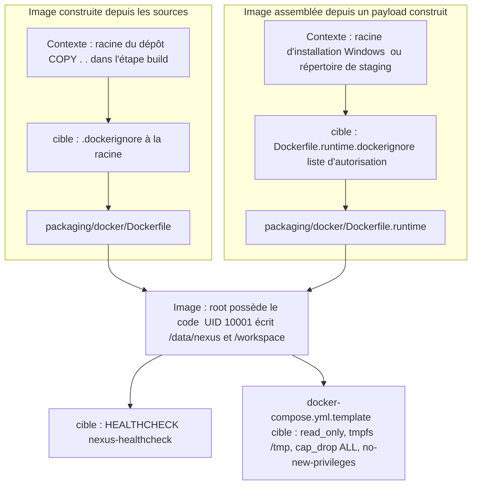

# Design

## Context

Deux Dockerfiles produisent la même image : `packaging/docker/Dockerfile` construit depuis les sources (contexte : racine du dépôt, `COPY . .` dans l'étape `build`), `packaging/docker/Dockerfile.runtime` assemble l'image depuis un payload déjà construit (contexte : racine d'installation Windows via le compose, `context: ..`, ou répertoire de staging dans `docker-distribution.yml`). Les deux créent `/opt/nexus` et les scripts d'entrée avec l'UID 10001 puis exécutent `USER 10001:10001`. Le compose (`docker-compose.yml.template`) porte la seule sonde de santé et monte `/workspace` en lecture seule.

La racine d'installation Windows contient aussi `docker/.env` (token REST) et, par défaut, le répertoire de données lié au conteneur : elle fait partie du contexte envoyé au moteur Docker par le compose.

Le dépôt est public, sous licence propriétaire source-available (`LICENSE`), avec un seul mainteneur. `docs/developer/branch-governance.md` décrit le ruleset « Protect main & develop » (id 20503835) ; lu le 29/10/2026 en lecture seule, il autorise `merge`, `squash` et `rebase`, les réglages du dépôt ont `allow_squash_merge` et `allow_rebase_merge` à `true`, et le signalement privé de vulnérabilités est désactivé. Ni `SECURITY.md` ni `CODEOWNERS` n'existent sur `origin/develop`.

`scripts/release/test-operational-doc-contracts.sh` lit déjà `quarkus.platform.version` dans le `pom.xml` et exige que trois documents contiennent ce numéro ; la ligne du SDK MCP est un littéral. La documentation courante recopie donc des versions que Dependabot modifie dans le seul `pom.xml`.

## Goals / Non-Goals

**Goals:**
- Image immuable pour son UID d'exécution, avec notices tierces et métadonnées OCI.
- Contextes de build des deux Dockerfiles réduits à ce que le build lit.
- Sonde de santé disponible hors compose ; exécution compose sans capacités, sans élévation de privilèges, racine en lecture seule.
- Merge commit seul accepté par GitHub ; canal privé de signalement ; propriétaires déclarés des fichiers sensibles.
- Une montée Dependabot d'une dépendance Maven ne rend aucun contrat documentaire rouge.

**Non-Goals:**
- Exiger une revue de code owner (le modèle solo de `branch-governance.md` reste en vigueur).
- Version du projet codée en dur (`AUD-QUA-12`, sprint 9).
- Wrapper Maven : sa version et son ancre SHA-512 restent recopiées par conception (contrat `test-tool-integrity-anchors.sh` inchangé).
- Image distroless, signature d'image, changement de base.

## Decisions

**D1 — Root possède le code, l'UID 10001 ne possède que les données.** `COPY` sans `--chown` pour les JAR, `quarkus-app` et les scripts ; `chmod 0755` sur les répertoires et scripts, `0644` sur les fichiers ; `chown 10001:10001` limité à `/data/nexus` et `/workspace`. La normalisation CRLF (`sed` exigé par `build-docker-image.ps1`) reste exécutée en root avant `USER`. Alternative écartée : garder `--chown` et compter sur `read_only` seul, qui ne protège pas un `docker run` direct.

**D2 — Fichiers d'ignore par Dockerfile.** Un `.dockerignore` à la racine pour `Dockerfile` (exclusion de `.git`, des `target/`, des fichiers d'environnement locaux, des données et espaces de travail locaux, de `docs/project/audits/`, des worktrees d'outils) et un `Dockerfile.runtime.dockerignore` à côté de `Dockerfile.runtime`, livré dans le payload, en liste d'autorisation (`*` puis `lib/`, `rest/`, les deux scripts de `docker/` copiés par le Dockerfile, `LICENSE`, `THIRD_PARTY_NOTICES.txt` ; rien d'autre de `docker/`). Le fichier propre au Dockerfile est lu par BuildKit, builder par défaut de Docker Desktop et de la CI. Alternative écartée : liste d'autorisation à la racine pour `Dockerfile`, fragile à chaque nouveau module Maven.

**D3 — Notices et labels sans version codée en dur.** `Dockerfile` copie `LICENSE` et `target/licenses/THIRD_PARTY_NOTICES.txt` depuis l'étape `build` ; `Dockerfile.runtime` les prend dans son contexte (déjà présents à la racine d'installation ; ajoutés au staging de `docker-distribution.yml`). Labels : `source` et `licenses` statiques (`LicenseRef-NEXUS-Proprietary`, la licence n'étant pas SPDX), `revision` et `version` par `ARG` alimentés par la CI ; sans valeur fournie, le label est vide plutôt qu'inventé.

**D4 — Sonde dans l'image, durcissement dans le compose.** `HEALTHCHECK` appelle `/usr/local/bin/nexus-healthcheck` avec les mêmes intervalles que le compose, qui garde sa propre déclaration. Le compose ajoute `read_only: true`, `tmpfs: [/tmp]` (extraction des bibliothèques natives SQLite et JNA), `cap_drop: [ALL]`, `security_opt: [no-new-privileges:true]`. Le smoke Docker existant (`docker-distribution.yml`, `test-docker-runtime.ps1`) qualifie le tout.

**D5 — Merge commit seul, réglé par le mainteneur.** Le ruleset passe `allowed_merge_methods` à `["merge"]` et le dépôt désactive squash et rebase ; ces réglages se font dans GitHub, hors PR. La PR met à jour `branch-governance.md` et le skill `nexus-pr-workflow`, et le contrat documentaire vérifie que la doc mentionne la restriction.

**D6 — CODEOWNERS déclaratif, SECURITY.md unique.** `.github/CODEOWNERS` désigne le mainteneur pour `.github/workflows/`, `scripts/release/`, `config/tool-integrity.properties`, `mvnw*`, `.mvn/` et `packaging/` ; la revue code owner n'est pas rendue obligatoire. `SECURITY.md` est un seul fichier : s'il existe déjà (section de traitement des alertes de `sprint-01-cloture-mesures`), ce changement le complète avec la politique de signalement privé, les versions prises en charge et le délai de réponse.

**D7 — La doc nomme la propriété, pas la version.** Les documents courants désignent la version Quarkus et SDK MCP par leur propriété du `pom.xml` (`quarkus.platform.version`, `mcp.sdk.version`) ; le contrat lit ces propriétés, exige leur présence et la mention de la propriété, et refuse tout littéral `Quarkus <x.y.z>` / `MCP SDK <x.y.z>` dans ces documents. Alternative écartée : comparer seulement `majeure.mineure`, qui casse encore à chaque mineure. Les ADR et documents datés ne sont pas concernés.

## Risks / Trade-offs

- [Une bibliothèque écrit sous `/opt/nexus` à l'exécution] → le smoke Docker échouerait ; `/tmp` en `tmpfs` couvre les extractions natives connues. À confirmer par le smoke de `docker-distribution.yml`.
- [Builder classique sans BuildKit] → `Dockerfile.runtime.dockerignore` est ignoré ; documenté dans la doc Docker, le compose officiel passe par BuildKit.
- [Image de repli construite depuis un staging incomplet] → le staging de `docker-distribution.yml` copie les notices, et le smoke vérifie leur présence dans l'image.
- [Merge via l'interface avant le réglage] → la PR documentaire précède la tâche mainteneur, mais le critère de sortie n'est atteint qu'après lecture du ruleset par `gh`.
- [Lecteur cherchant la version exacte dans la doc] → la doc renvoie au `pom.xml`, source unique.

## Vues

Vue organigramme — quel contexte et quel fichier d'ignore pour chacun des deux Dockerfiles, et quels réglages d'exécution s'ajoutent (Context, D2, D4) ? ([Proposition] — cible, non disponible)

Au HEAD, aucun `.dockerignore` n'existe, les `COPY` vers `/opt/nexus` et `/usr/local/bin` portent `--chown=10001:10001` (`packaging/docker/Dockerfile.runtime:10-15`, `packaging/docker/Dockerfile:26-27`), aucun `HEALTHCHECK` n'est déclaré dans les Dockerfiles et seule la sonde du compose existe (`packaging/docker/docker-compose.yml.template:46-49`). Les nœuds « cible » sont des [Proposition]. Notation : organigramme, pas UML.

Exigences : `container-image-hardening › Le code de l'image n'est pas modifiable par l'UID d'exécution`, `container-image-hardening › Le contexte de build ne contient que les entrées du build`, `container-image-hardening › La sonde de santé et les privilèges minimaux sont déclarés`.

## Traçabilité

Aucun scénario n'est couvert : le changement n'est pas réalisé. La colonne « Tâche » renvoie aux numéros de `tasks.md`. Les tâches 5.2 et 5.4 sont des réglages GitHub du mainteneur.

| Exigence (`capacité › titre`) | Scénario | Conception ou diagramme | Tâche | Test ou preuve |
|---|---|---|---|---|
| `container-image-hardening › Le code de l'image n'est pas modifiable par l'UID d'exécution` | Écriture refusée sur le code | D1 ; vue des contextes | 1.1 | à produire par la tâche 1.1 — `docker run --rm --entrypoint /bin/sh nexus-s10 -c 'test ! -w /opt/nexus/lib/nexus-cli.jar && ...'` ; test non écrit |
| `container-image-hardening › Le code de l'image n'est pas modifiable par l'UID d'exécution` | Contrat sur les Dockerfiles | D1 | 1.1 | à produire par la tâche 1.1 — refus d'un `--chown` ajouté à `scripts/release/test-operational-doc-contracts.sh`, puis `bash .claude/scripts/contracts.sh` ; test non écrit |
| `container-image-hardening › Le contexte de build ne contient que les entrées du build` | Historique Git absent de l'étape build | D2 ; vue des contextes | 2.1 | à produire par la tâche 2.1 — `docker build --target build` puis `test ! -e /workspace/.git` dans l'étape ; test non écrit |
| `container-image-hardening › Le contexte de build ne contient que les entrées du build` | Fichiers d'installation non copiés dans le contexte runtime | D2 ; vue des contextes | 2.2 | à produire par la tâche 2.2 — job « Smoke installed-payload fallback image » du workflow `Docker distribution` ; ce job n'est pas cité comme vérifiant l'exclusion de `docker/.env` ni du répertoire de données ; test non écrit |
| `container-image-hardening › L'image publie ses notices et ses métadonnées` | Inspection de l'image construite par la CI | D3 | 3.1, 3.2 | à produire par la tâche 3.2 — `docker inspect --format '{{json .Config.Labels}}' nexus-s10` et assertion ajoutée au smoke du workflow `Docker distribution` ; test non écrit |
| `container-image-hardening › La sonde de santé et les privilèges minimaux sont déclarés` | Conteneur lancé sans compose | D4 ; vue des contextes | 4.1 | à produire par la tâche 4.1 — `docker inspect --format '{{json .Config.Healthcheck}}' nexus-s10` puis smoke `docker-distribution.yml` (état `healthy`) ; test non écrit |
| `container-image-hardening › La sonde de santé et les privilèges minimaux sont déclarés` | Conteneur lancé par le compose | D4 ; vue des contextes | 4.2 | à produire par la tâche 4.2 — `pwsh -NoProfile -File scripts/release/test-docker-runtime.ps1` (sonde `UP`) ; test non écrit |
| `operational-documentation-contracts › La documentation ne recopie pas les versions des dépendances montées par Dependabot` | Montée de version par Dependabot | D7 | 6.2 | à produire par la tâche 6.2 — montée simulée dans une copie jetable puis `bash scripts/release/test-operational-doc-contracts.sh` ; preuve manquante |
| `operational-documentation-contracts › La documentation ne recopie pas les versions des dépendances montées par Dependabot` | Version recopiée dans la documentation | D7 | 6.1 | à produire par la tâche 6.1 — refus des littéraux par `bash .claude/scripts/contracts.sh` ; test non écrit |
| `operational-documentation-contracts › La documentation ne recopie pas les versions des dépendances montées par Dependabot` | Propriété absente du pom | D7 | 6.1 | à produire par la tâche 6.1 — lecture de `mcp.sdk.version` par le contrat, présence exigée ; test non écrit |
| `repository-governance › Seul le merge commit est accepté` | Lecture du ruleset | D5 | 5.2 | à produire par la tâche 5.2 — `gh api repos/FTurleque/nexus-context-engine/rulesets/20503835 ...` (`["merge"]`) ; preuve manquante |
| `repository-governance › Seul le merge commit est accepté` | Lecture des réglages du dépôt | D5 | 5.2 | à produire par la tâche 5.2 — `gh api repos/FTurleque/nexus-context-engine --jq '[.allow_squash_merge,.allow_rebase_merge]'` (`[false,false]`) ; preuve manquante |
| `repository-governance › Seul le merge commit est accepté` | Documentation alignée | D5 | 5.1 | à produire par la tâche 5.1 — assertion ajoutée au contrat puis `bash .claude/scripts/contracts.sh` ; test non écrit |
| `repository-governance › Les fichiers sensibles ont un propriétaire déclaré` | Fichier de workflow modifié | D6 | 5.3 | à produire par la tâche 5.3 — `bash .claude/scripts/contracts.sh` ; l'affichage du code owner par GitHub n'est pas cité comme vérifié ; test non écrit |
| `repository-security-settings › Un canal privé de signalement est ouvert et documenté` | Lecture du réglage | D6 | 5.4 | à produire par la tâche 5.4 — `gh api repos/FTurleque/nexus-context-engine/private-vulnerability-reporting` (`{"enabled":true}`) ; preuve manquante |
| `repository-security-settings › Un canal privé de signalement est ouvert et documenté` | Profil communautaire | D6 | 5.3 | à produire par la tâche 5.3 — `gh api repos/FTurleque/nexus-context-engine/community/profile` (liste des fichiers de profil) ; preuve manquante |

## Écarts et points à vérifier

- [Écart] `design.md:10` (section Context) écrit que « ni `SECURITY.md` ni `CODEOWNERS` n'existent sur `origin/develop` » : `SECURITY.md` existe sur `origin/develop` (`git ls-tree -r origin/develop --name-only`, ajouté par le commit `662df65a`, AUD-DEP-30) avec les sections « Traitement des alertes de sécurité » et « Délai de prise en charge » (`SECURITY.md:3-7`) ; `.github/CODEOWNERS` n'existe pas. D6 et la tâche 5.3 prévoient déjà le cas (« ou compléter celui de `sprint-01-cloture-mesures` »).
- [Existant vérifié] Le contrat `scripts/release/test-operational-doc-contracts.sh` exige aujourd'hui des littéraux : `Quarkus      <version>` dans `docs/developer/README.md`, `Quarkus est en <version>` dans `docs/developer/architecture-implementation.md`, `Quarkus     <version>` dans `docs/developer/rest-api.md` (`:124-126`) et `MCP SDK     2.1.0` dans `docs/developer/mcp.md` (`:129`) ; la tâche 6.1 doit inverser ces exigences.
- [Écart] D7 et le scénario « Version recopiée dans la documentation » refusent les formes `Quarkus <x.y.z>` et `MCP SDK <x.y.z>` ; les documents contiennent aussi la forme « SDK MCP 2.1.0 » (`docs/developer/architecture-implementation.md:203`, `docs/developer/mcp.md:15`) et des littéraux alignés par espaces multiples (`docs/developer/README.md:13`, `docs/developer/rest-api.md:10`). La forme exacte à refuser n'est pas fixée par les specs.
- [Existant vérifié] `packaging/docker/Dockerfile.runtime:8` et `packaging/docker/Dockerfile:20` font `chown -R 10001:10001 /opt/nexus /data/nexus /workspace` ; le compose monte `/workspace` en `:ro` (`packaging/docker/docker-compose.yml.template:45`) et ne déclare ni `read_only`, ni `cap_drop`, ni `security_opt`.
- [Question] Chevauchement de capacité avec `sprint-01-cloture-mesures` : les deux changements ajoutent des exigences à `repository-security-settings` (sprint 1 : surveillance Dependabot, secret scanning, traitement des alertes ; sprint 10 : canal privé de signalement) avec des `## Purpose` différents, et modifient tous deux `SECURITY.md`. La consolidation en une seule spec de référence n'est pas décidée ici.
- [Question] Chevauchement de capacité avec `sprint-11-finitions-et-micro-optimisations` : les deux changements ajoutent des exigences à `operational-documentation-contracts` (sprint 10 : versions de dépendances ; sprint 11 : formulations du graphe, du watch item FTS5 et de `AGENTS.md`) avec des `## Purpose` différents, et modifient tous deux `scripts/release/test-operational-doc-contracts.sh`. La tâche 4.2 de `sprint-09-chaine-de-release-executable` modifie aussi ce script sans delta de cette capacité.
- [Question] Chevauchement de fichiers avec `sprint-09-chaine-de-release-executable` : la tâche 2.2 de ce changement et la tâche 2.2 du sprint 9 modifient `scripts/release/build-windows-distribution.ps1` et `build-windows-installer.ps1` ; D3 attend des labels `revision` et `version` alimentés par la CI alors que le sprint 9 (D8) retire les versions littérales de `ci.yml`. L'ordre de fusion et la source de la valeur `version` ne sont pas décidés ici.
- Limites : les affirmations tirées de `gh` (ruleset 20503835 autorisant `merge`, `squash`, `rebase`, signalement privé désactivé) n'ont pas été relues, faute d'accès aux API depuis ce contrôle ; `findings.json` les consigne (`docs/project/audits/2026-10-17/findings.json:2405`).
