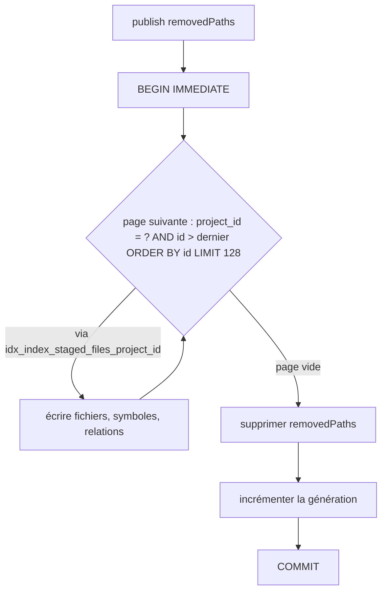
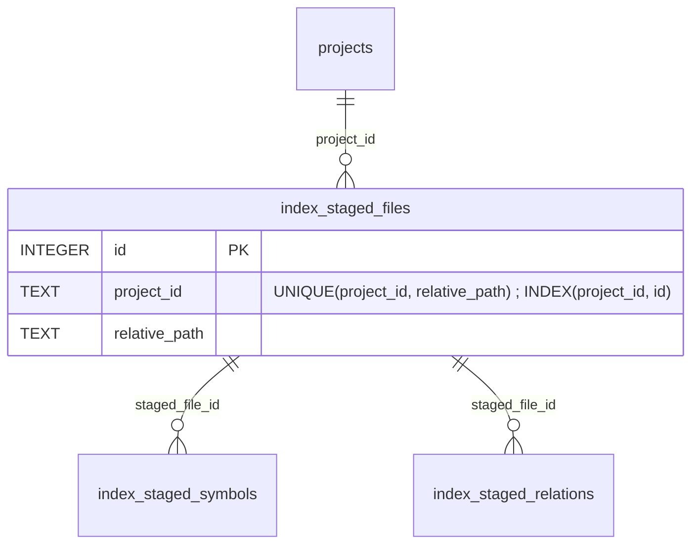

# Design

**Profil :** complet

## Contexte

- [Existant vérifié] Publication : `IndexWriteSession.publish` applique en une transaction les analyses en attente (`core/src/main/java/com/nexus/index/IndexWriteSession.java`) ; `SqliteFileWriter.writeStagedChanges` relit `index_staged_files` par pages de `SqliteBatchInsert.ROW_LIMIT` (128) avec `STAGED_FILES_PAGE_SQL` (`SqliteFileWriter.java:56-63`, boucle `:96-109`), sous le verrou d'écriture tenu par `SqliteIndexWriteSession` (`:55-58`).
- [Existant vérifié] `index_staged_files.id` est `INTEGER PRIMARY KEY` (alias du rowid) ; seul index : `UNIQUE (project_id, relative_path)` (`V014__index_staged_analyses.sql:10-22`).
- [Existant vérifié] `SqliteGraphQueryPlanTest` relève les plans par `EXPLAIN QUERY PLAN` (`:200-215`) et vérifie qu'aucun index n'est préfixe strict d'un autre de la même table (`noIndexIsAStrictPrefixOfAnotherIndexOfTheSameTable`, `:159`).
- [Existant vérifié] Recherche approchée : `FUZZY_BATCH_SQL`, `FUZZY_ORDERED_ARM_SQL`, `FUZZY_COUNT_ARM_SQL` (`SqliteSymbolSearch.java:155-196`) ; le bras ordonné par `idx_symbols_qualified_name` sert quand les candidats sont nombreux.
- [Existant vérifié] `ScaleRegressionBenchmarkTest` s'active par `-Dnexus.scale.benchmark.enabled=true` et un profil `ci|full` (`.github/workflows/scale-benchmark.yml:136-142`) ; `benchmarkSqliteTier` peuple puis mesure `searchSymbols` (`:173-208`) ; `benchmarkReindexExistingFiles` appelle `repository.applyChanges` (`:224-248`).
- [Existant vérifié] `SemanticSearchStrategy` calcule le vecteur par `queryContext.shared(queryVectorKey(), QueryVector.class, () -> embedQuery(query, queryContext))` (`:143`).

## Objectifs / Hors objectifs

**Objectifs :**
- `sqlite-index-writes › La publication du staging pagine par un index`.
- `symbol-search-scoping › La recherche approchée d'un projet seul est mesurée`.
- `project-indexing-pipeline › Le port d'indexation n'écrit les faits canoniques que par session` et `› La réindexation sur base peuplée est mesurée`.
- `federated-search-bounds › Un vecteur de requête partagé n'est réutilisé que pour la même requête`.

**Hors objectifs :**
- Réduire la durée totale de publication au-delà de la pagination (copies vers les tables canoniques).
- Fixer un seuil de performance absolu : aucun n'est sourcé.

## Composants et responsabilités

- `IndexRepository` (port, `core`) : perd `applyChanges` ; garde `openWriteSession`.
- `SqliteIndexRepository`, `SqliteFileWriter` : perdent `applyChanges` et le code d'écriture directe qu'il seul utilise ; `writeStagedChanges` reste l'unique chemin d'écriture des analyses.
- [Proposition] Support de test `core/src/test/java/com/nexus/index/IndexRepositoryWrites.java` : `static void apply(IndexRepository repository, UUID projectId, List<IndexedFileUpdate> updates, Set<String> removedPaths)` qui ouvre une session, met en attente par lots de `SqliteBatchInsert.ROW_LIMIT`, publie et ferme.
- `SemanticSearchStrategy` : construit la clé du vecteur avec le texte redacté de la requête.

## Modèle de domaine et invariants

Invariant `AUD-QUA-23` : dans un `SearchQueryContext`, une clé de vecteur désigne un unique triplet (fournisseur, modèle, texte redacté). Le contexte reste à portée de requête et non persistant.

## Traitements et interactions

Vue organigramme (cible) — publication d'une session ; couvre `sqlite-index-writes › La publication du staging pagine par un index`.

Lecture : avec un index `(project_id, id)`, chaque page est une recherche d'intervalle de coût proportionnel à sa taille ; sans lui, chaque page relit et trie toutes les lignes du projet (coût quadratique relevé par l'audit).

## États et transitions

Non applicable : le cycle de vie de la session (ouverte → publiée ou fermée) ne change pas.

## Contrats d'interface

- Port `IndexRepository` : **BREAKING** interne au réacteur — retrait de `void applyChanges(UUID, List<IndexedFileUpdate>, Set<String>)`. Aucun adaptateur REST, MCP ou CLI ne l'appelle (grep `adapters/` à refaire en tâche 3.1).
- `SearchQueryContext.shared` : signature inchangée ; la Javadoc précise que la clé doit inclure toute entrée dont dépend la valeur.

## Persistance et intégrité

Vue entité-relation (cible) — table de staging et son nouvel index ; couvre `sqlite-index-writes › La publication du staging pagine par un index`.

- [Décision] Index explicite `idx_index_staged_files_project_id ON index_staged_files(project_id, id)` plutôt que `(project_id)` seul : `(project_id)` serait un préfixe strict de `UNIQUE (project_id, relative_path)` et ferait échouer `noIndexIsAStrictPrefixOfAnotherIndexOfTheSameTable` ; `(project_id, id)` ne l'est pas et porte explicitement l'ordre de pagination.
- Migration de schéma seule : aucune donnée canonique, génération ou statut modifié ; pas de rebuild (même motif que V012 à V015).
- `AUD-PRF-29` : si la mesure justifie un index, il fait l'objet d'une migration distincte (numéro suivant), avec le même test de préfixe.

## Transactions, concurrence et idempotence

La transaction de publication reste unique ; seule sa durée baisse. `CREATE INDEX IF NOT EXISTS` rend la migration rejouable ; le checksum de migration est vérifié par `SchemaMigratorChecksumTest`.

## Sécurité et isolation

- La clé du vecteur contient le texte redacté de la requête, déjà transmis au fournisseur d'embeddings : aucune donnée sensible nouvelle n'est retenue ; la clé vit le temps de la requête.

## Erreurs et reprise

Non applicable : aucun nouveau chemin d'erreur ; un échec de migration suit la reprise documentée dans `docs/developer/sqlite-upgrade-recovery.md`.

## Observabilité

Les benchmarks rapportent les nouvelles mesures dans leur JSON (`target/scale-benchmark.json`) ; aucun journal de production n'est ajouté.

## Performance et mesure

- Bornes sourcées : plafond par défaut de 100 000 fichiers et mesures de l'audit (proposition). Aucun seuil de réussite n'est fixé.
- [Proposition] `AUD-PRF-27` : nouveau scénario de benchmark `stagedPublication` qui passe par `openWriteSession`/`stage`/`publish` sur 50 000 fichiers (`ci`) et 100 000 (`full`), rapporte la durée de `publish`.
- [Proposition] `AUD-PRF-29` : scénario `singleProjectFuzzy` — une base, un projet, 5 symboles par fichier, 9 termes (protocole de l'audit), comptage et récupération approchés, mesurés deux fois : schéma courant, puis schéma où `idx_symbols_file_fuzzy_prefilter` est remplacé par l'ancien index global (recréé par le test, sans migration).
- [Question] seuil de décision de `AUD-PRF-29` : voir proposition.

## Compatibilité, migration et retour arrière

- V016 s'applique au démarrage ; retour arrière : un binaire antérieur refuse une base à version supérieure (comportement du migrateur), d'où la section de mise à niveau dans `docs/developer/release-and-recovery.md`.
- `sprint-08-suite-borne-sk` ajoute aussi une migration : le numéro est fixé à l'implémentation selon l'ordre de fusion.

## Décisions

- [Décision] Retirer `applyChanges` du port plutôt que le réimplémenter en production par la session : il n'a pas d'appelant de production, et le support de test suffit.
- [Décision] Inclure le texte redacté dans la clé plutôt que figer la requête dans `SearchQueryContext.create(query, …)` : ne change pas la signature des trois appelants de `create()` et laisse un contexte servir plusieurs textes sans erreur silencieuse.
- Aucun ADR : DATA-0062 et DATA-0074 couvrent déjà le chemin d'écriture par session ; l'index et la clé sont des détails d'implémentation.

## Risques / Compromis

- [Risque] Le plan avec l'index peut différer sur sqlite-jdbc 3.54.1.0 → le test de plan s'exécute avec le pilote du build.
- [Risque] 20 fichiers de test à migrer vers le support → modification mécanique ; la suite par défaut le vérifie.
- [Risque] La mesure `AUD-PRF-29` ne montre pas de régression sur le pilote réel → le scénario reste dans le benchmark comme garde, sans correction.

## Stratégie de vérification

- `./mvnw -B -ntp -pl core test -Dtest=SqliteGraphQueryPlanTest,SchemaMigratorChecksumTest,SchemaMigratorTest -Dsurefire.failIfNoSpecifiedTests=false -Djacoco.skip=true`.
- `./mvnw -B -ntp -pl core test -Dtest=ScaleRegressionBenchmarkTest -Dnexus.scale.benchmark.enabled=true -Dnexus.scale.benchmark.profile=ci -Dnexus.scale.benchmark.output=target/scale-benchmark.json -Djacoco.skip=true` ; check `Hermetic scale benchmark` sur la PR.
- `./mvnw clean install` (suite par défaut, retrait de `applyChanges`).
- `openspec validate sprint-06-suite-performance-sqlite --strict`, `bash .claude/scripts/contracts.sh`.

## Traçabilité

| Exigence (`capacité › titre`) | Scénario | Conception ou diagramme | Tâche | Test ou preuve |
|---|---|---|---|---|
| `sqlite-index-writes › La publication du staging pagine par un index` | Plan de la page de staging | Organigramme de publication ; entité-relation | 1.1, 1.2 | test non écrit (`SqliteGraphQueryPlanTest`) |
| `sqlite-index-writes › La publication du staging pagine par un index` | Migration sur une base existante | Persistance et intégrité | 1.1, 1.3 | test non écrit (test d'upgrade V016) |
| `symbol-search-scoping › La recherche approchée d'un projet seul est mesurée` | Profil full du benchmark | Performance et mesure | 2.1 | test non écrit |
| `symbol-search-scoping › La recherche approchée d'un projet seul est mesurée` | Profil ci du benchmark | Performance et mesure | 2.1 | test non écrit |
| `project-indexing-pipeline › Le port d'indexation n'écrit les faits canoniques que par session` | Surface du port | Composants et responsabilités | 3.1 | preuve manquante |
| `project-indexing-pipeline › Le port d'indexation n'écrit les faits canoniques que par session` | Écriture dans un test | Composants et responsabilités | 3.2 | preuve manquante |
| `project-indexing-pipeline › La réindexation sur base peuplée est mesurée` | Profil CI du benchmark | Performance et mesure | 3.3 | test non écrit |
| `project-indexing-pipeline › La réindexation sur base peuplée est mesurée` | Durée de la transaction de publication | Performance et mesure | 3.3 | test non écrit |
| `federated-search-bounds › Un vecteur de requête partagé n'est réutilisé que pour la même requête` | Contexte réutilisé pour deux requêtes | Modèle de domaine et invariants | 4.1 | test non écrit |
| `federated-search-bounds › Un vecteur de requête partagé n'est réutilisé que pour la même requête` | Même requête sur plusieurs projets | Modèle de domaine et invariants | 4.1 | test existant à relire : test de `federated-search-bounds › Le vecteur de requête est calculé une fois par requête fédérée` (matrice) |

## Questions ouvertes

- [Question] Seuil de décision de `AUD-PRF-29` (proposition) : il change seulement le contenu de la tâche 2.2, dont la vérification reste la décision consignée.
