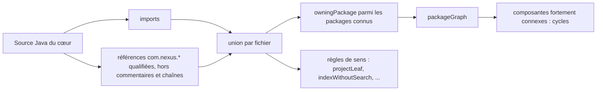
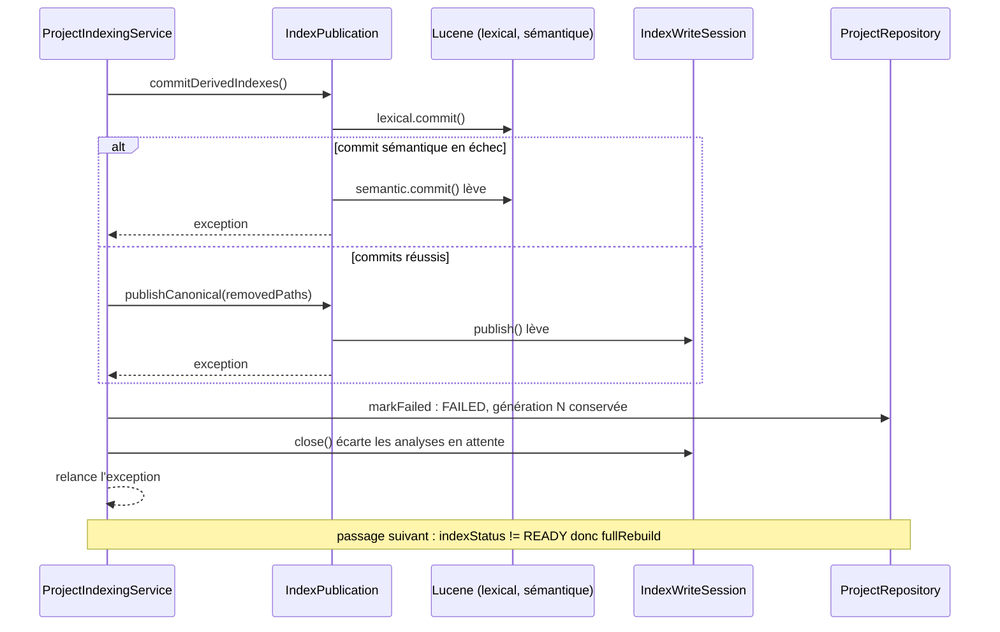

# Design

**Profil :** complet

## Contexte

- [Existant vérifié] `JavaSourceGraph` analyse les sources du cœur (package, imports) ; `packageGraph` ajoute une arête `a → b` pour chaque import d'un package connu (`JavaSourceGraph.java:103-120`). Les règles de sens de `CoreArchitectureRules` cherchent les préfixes surveillés dans les imports et, sous forme qualifiée, seulement pour `WATCHED_QUALIFIED_PREFIXES` (`CoreArchitectureRules.java:40-42`).
- [Existant vérifié] Les cas négatifs actuels de `CoreArchitectureTest` écrivent des sources temporaires (ex. `com/nexus/cli/NexusCli.java`, `:269-281`) ; le seul cas qualifié porte sur `java.sql.Types`.
- [Existant vérifié] Baseline de cycles vide (`core/src/test/resources/architecture/package-cycles.txt:1-3`, ARCH-0076).
- [Existant vérifié] `CliRenderer.renderError` appelle `com.nexus.security.PublicDiagnosticPolicy.internal().text(message)` (`core/src/main/java/com/nexus/cli/CliRenderer.java:257`) ; d'autres packages importent déjà `PublicDiagnosticPolicy` (`context`, `exposure`).
- [Existant vérifié] Barrière de publication : `IndexPublication.commitDerivedIndexes` committe le lexical puis le sémantique (`core/src/main/java/com/nexus/index/service/IndexPublication.java:59-64`) ; `publishCanonical` appelle `IndexWriteSession.publish` (`:67-69`). La session écarte les analyses en attente à sa fermeture sans publication (`IndexWriteSession.java`, Javadoc de classe).
- [Existant vérifié] `ProjectIndexingPublicationTest` instrumente la session par un proxy `recordingSession` qui délègue `publish` sans jamais lever (relevé de l'audit, `:292-295`).

## Objectifs / Hors objectifs

**Objectifs :**
- `core-package-boundaries › Le test d'architecture lit les références pleinement qualifiées du cœur`.
- `project-indexing-pipeline › Un échec à la barrière de publication rend le projet à reconstruire`.

**Hors objectifs :**
- Résoudre les références qualifiées par un vrai analyseur Java (types imbriqués, `static` qualifiés hors `com.nexus`) : l'extraction textuelle suffit pour `com.nexus.<package>.<Type>`.

## Composants et responsabilités

- [Proposition] `JavaSourceGraph.SourceFile` expose `qualifiedReferences()` : les jetons `com\.nexus(\.[a-z][a-z0-9_]*)+\.[A-Z]\w*` hors commentaires et littéraux de chaîne ; `packageGraph` et les règles de sens consomment `imports() ∪ qualifiedReferences()`.
- `CoreArchitectureRules.WATCHED_QUALIFIED_PREFIXES` reçoit `com.nexus.` comme racine analysée.

## Modèle de domaine et invariants

Invariant : une dépendance de code entre deux packages du cœur produit la même arête qu'elle soit importée ou qualifiée.

## Traitements et interactions

Vue organigramme (cible) — construction du graphe ; couvre `core-package-boundaries › Le test d'architecture lit les références pleinement qualifiées du cœur`.

Vue UML de séquence (existant, contractualisé) — échec après le commit Lucene ; couvre `project-indexing-pipeline › Un échec à la barrière de publication rend le projet à reconstruire`.

## États et transitions

`READY` → (échec à la barrière) → `FAILED` → (indexation réussie, rebuild complet) → `READY`. La transition existe (`ProjectIndexingService.java:208`, `:390-400`) ; ce changement la teste.

## Contrats d'interface

Non applicable : aucune API publique ni port modifié ; seule la forme d'une référence de `CliRenderer` peut changer.

## Persistance et intégrité

Non applicable au schéma ; l'invariant vérifié est « génération canonique inchangée, aucune analyse en attente » après l'échec.

## Transactions, concurrence et idempotence

La publication canonique reste une transaction SQLite unique ; son échec la fait annuler. Le verrou du projet est libéré dans le `finally` existant ; un test vérifie qu'une indexation suivante peut l'acquérir.

## Sécurité et isolation

Une recherche sur un projet `FAILED` est refusée par `ProjectReadiness` (`SearchService.java:48`, `FederatedSearchService.java:73`) : un Lucene committé sur un contenu non publié n'est jamais servi.

## Erreurs et reprise

Voir la séquence ; [Proposition] si le test montre que des analyses en attente subsistent après un échec de `publish`, consigner un [Écart] et corriger dans ce changement (purge par `close`).

## Observabilité

Non applicable : aucun journal ajouté.

## Performance et mesure

Non applicable : extraction textuelle bornée aux sources du cœur, dans un test.

## Compatibilité, migration et retour arrière

Non applicable : tests et une référence de code.

## Décisions

- [Décision] L'arête `cli → security` est légitime (le rendu d'erreur CLI applique la politique de diagnostic public, comme `context` et `exposure`) ; elle ne crée aucun cycle. [Proposition] Remplacer la référence qualifiée de `CliRenderer.java:257` par un `import` pour aligner le style sur le reste du package ; la dépendance devient visible dans les deux formes.
- [Décision] Le comportement de reprise existant (FAILED puis rebuild) est contractualisé plutôt que rendu atomique : l'atomicité Lucene/SQLite n'est pas promise au-delà de la garde `READY` (DATA-0062).
- Aucun ADR : ARCH-0076 et DATA-0062 couvrent les décisions ; ce changement renforce leur vérification.

## Risques / Compromis

- [Risque] L'extraction textuelle compte une référence dans un commentaire Javadoc `{@link com.nexus…}` → exclusion des commentaires ; un faux positif ferait échouer le test, pas le masquer.
- [Risque] Une règle de sens jusqu'ici aveugle échoue sur une référence qualifiée existante → la tâche 1.2 corrige le code ou documente l'écart avant d'activer la lecture.

## Stratégie de vérification

`./mvnw -B -ntp -pl core test -Dtest=CoreArchitectureTest,ProjectIndexingPublicationTest -Dsurefire.failIfNoSpecifiedTests=false -Djacoco.skip=true`, puis `./mvnw clean install` ; `openspec validate sprint-07-suite-garde-du-coeur --strict`.

## Traçabilité

| Exigence (`capacité › titre`) | Scénario | Conception ou diagramme | Tâche | Test ou preuve |
|---|---|---|---|---|
| `core-package-boundaries › Le test d'architecture lit les références pleinement qualifiées du cœur` | Cycle par nom pleinement qualifié | Organigramme du graphe | 1.1, 1.3 | test non écrit |
| `core-package-boundaries › Le test d'architecture lit les références pleinement qualifiées du cœur` | Remontée depuis project par nom pleinement qualifié | Organigramme du graphe | 1.1, 1.3 | test non écrit |
| `core-package-boundaries › Le test d'architecture lit les références pleinement qualifiées du cœur` | Graphe courant | Décisions (`cli → security`) | 1.2 | test non écrit |
| `project-indexing-pipeline › Un échec à la barrière de publication rend le projet à reconstruire` | Publication canonique en échec après le commit Lucene | Séquence d'échec | 2.1 | test non écrit |
| `project-indexing-pipeline › Un échec à la barrière de publication rend le projet à reconstruire` | Commit sémantique en échec après le commit lexical | Séquence d'échec | 2.2 | test non écrit |
| `project-indexing-pipeline › Un échec à la barrière de publication rend le projet à reconstruire` | Passage suivant | États et transitions | 2.1, 2.2 | test non écrit |
| `project-indexing-pipeline › Un échec à la barrière de publication rend le projet à reconstruire` | Aucun service avant READY | Sécurité et isolation | 2.1 | test non écrit |
