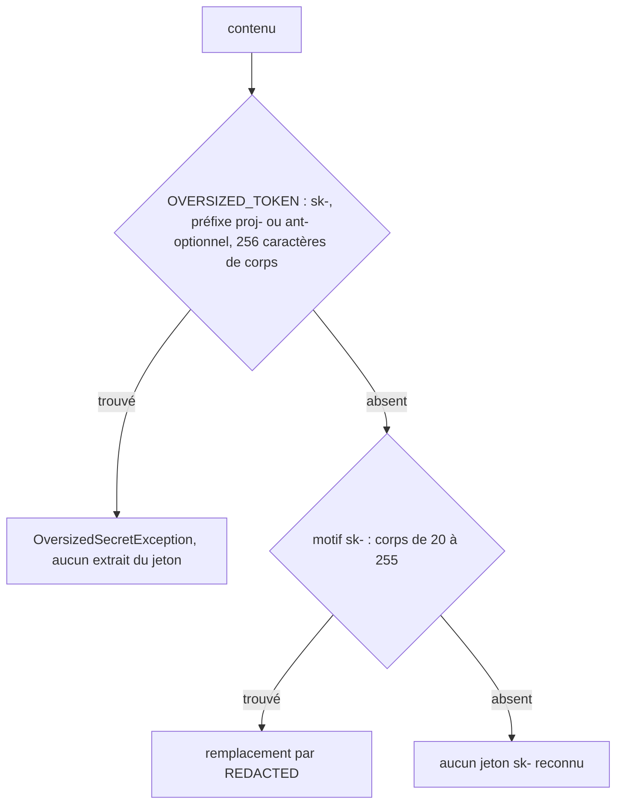

# Design

**Profil :** complet

## Contexte

- [Existant vérifié] `SensitiveContentRedactor.redact` refuse d'abord le contenu entier si `OVERSIZED_TOKEN`, `OVERSIZED_VALUE` ou `OVERSIZED_URI` trouve une valeur hors borne (`core/src/main/java/com/nexus/security/SensitiveContentRedactor.java:96-106`), puis masque les formats.
- [Existant vérifié] Motif de masquage `sk-(?:proj-|ant-)?+[A-Za-z0-9_-]{20,255}+(?![A-Za-z0-9_-])` (`:47-49`) : le corps est compté après le préfixe optionnel.
- [Existant vérifié] Motif de refus `sk-[A-Za-z0-9_-]{261}` (`:91`) : compte le préfixe `proj-`/`ant-` dans les 261 caractères, d'où une fenêtre de fuite de 256 à 260 pour `sk-`, de 256 pour `sk-ant-` (4 caractères de préfixe), aucune pour `sk-proj-` (5 caractères).
- [Existant vérifié] `POLICY_VERSION = "secret-redaction-v6"` (`:19`) ; `CONTENT_PROFILE_VERSION = 5` (`core/src/main/java/com/nexus/search/semantic/SemanticIndexingService.java:27`) ; dernière migration d'invalidation de redaction : `V011__invalidate_secret_format_indexes.sql` (motif à reprendre), test `SchemaMigratorSecretFormatUpgradeTest`.
- [Existant vérifié] Vue de la redaction avant indexation : `docs/developer/secret-redaction.md`, section « OpenSpec secret-redaction ».

## Objectifs / Hors objectifs

**Objectifs :** `secret-redaction › Un jeton sk- est masqué ou refusé à toute longueur de corps` ; `secret-redaction › Un changement de politique invalide les index dérivés` (version v7).

**Hors objectifs :** changer la forme du refus (`OversizedSecretException`) ou son traitement à l'indexation (`INDEX_REDACTION_LIMIT`).

## Composants et responsabilités

Non applicable : `SensitiveContentRedactor` garde sa responsabilité ; seul un motif change.

## Modèle de domaine et invariants

Invariant : pour chaque format à préfixe, `borne de masquage + 1 = borne de refus`, mesurées sur le même corps. Il n'existe aucune longueur où un jeton reconnu n'est ni masqué ni refusé.

## Traitements et interactions

Vue organigramme (cible) — décision pour un jeton de la famille `sk-` ; couvre `secret-redaction › Un jeton sk- est masqué ou refusé à toute longueur de corps`.

## États et transitions

Non applicable : traitement pur.

## Contrats d'interface

Non applicable : aucune API ; le refus reste `OversizedSecretException` et `redactField` le convertit en `[REDACTED]` (`SensitiveContentRedactor.java:122-131`).

## Persistance et intégrité

- [Décision] Migration d'invalidation sur le modèle de V011 : incrément de `project_index_generations`, projets `NOT_INDEXED`, `last_indexed_at` à `NULL`, faits canoniques conservés. Nom proposé `V0nn__invalidate_sk_token_bound_indexes.sql`, numéro fixé à l'implémentation (une migration de `sprint-06-suite-performance-sqlite` peut précéder).
- `POLICY_VERSION` passe à `secret-redaction-v7` ; `CONTENT_PROFILE_VERSION` passe à 6 (`content-v6`).

## Transactions, concurrence et idempotence

La migration est un lot SQL unique appliqué par le migrateur ; rejouée, elle est ignorée par la table d'historique des migrations.

## Sécurité et isolation

[Exigence] Le message d'erreur du refus ne contient aucune partie du jeton (vérification existante pour 4 096, `SensitiveContentRedactorTest#rejectsOversizedValuesWithoutPublishingAnySuffix`, étendue aux scénarios `sk-`). Les index d'une politique antérieure, qui peuvent contenir un `sk-` de 256 à 260 caractères en clair, sont invalidés et reconstruits.

## Erreurs et reprise

À l'indexation, un fichier refusé est exclu des index lexical et sémantique et reste dans l'index structurel (`secret-redaction › Une valeur sensible trop longue n'exclut que son fichier`) ; aucune reprise nouvelle.

## Observabilité

Diagnostic existant `INDEX_REDACTION_LIMIT`, sans valeur.

## Performance et mesure

Non applicable : un quantificateur borné de même taille ; aucun gain ni coût revendiqué.

## Compatibilité, migration et retour arrière

- Mise à niveau : rebuild normal des dérivés de chaque projet au premier passage ; section « Mise à niveau » ajoutée à `docs/developer/release-and-recovery.md` sur le modèle de V011 (`:185`).
- Retour arrière : un binaire antérieur refuse une base à version de schéma supérieure ; restaurer la sauvegarde de `NEXUS_HOME`.

## Décisions

- [Décision] Aligner le refus sur le masquage (`sk-(?:proj-|ant-)?+[A-Za-z0-9_-]{256}`) plutôt qu'étendre le masquage jusqu'à 260 : garde la borne documentée de 255 pour tous les préfixes et supprime la « borne composée ».
- Aucun ADR : la politique de redaction et son invalidation suivent un processus établi (skill `nexus-redaction-change`).

## Risques / Compromis

- [Risque] Un jeton `sk-proj-` réel de plus de 255 caractères de corps serait désormais refusé au lieu d'être masqué → déjà le cas aujourd'hui pour `sk-proj-` (refus à 256) ; aucun format public connu n'approche cette longueur.
- [Risque] Rebuild de tous les projets à la mise à niveau → inévitable pour purger d'éventuelles valeurs en clair ; documenté.

## Stratégie de vérification

- `./mvnw -B -ntp -pl core test -Dtest=SensitiveContentRedactorTest,SecretRedactionProbeTest -Dsurefire.failIfNoSpecifiedTests=false -Djacoco.skip=true`.
- Test d'upgrade de la migration (modèle `SchemaMigratorSecretFormatUpgradeTest`), `SchemaMigratorChecksumTest`.
- `bash .claude/scripts/contracts.sh` (`content-v6`), `./mvnw clean install`, `scripts/self-smoke.ps1`.
- `openspec validate sprint-08-suite-borne-sk --strict`.

## Traçabilité

| Exigence (`capacité › titre`) | Scénario | Conception ou diagramme | Tâche | Test ou preuve |
|---|---|---|---|---|
| `secret-redaction › Un jeton sk- est masqué ou refusé à toute longueur de corps` | Corps de 255 caractères | Organigramme sk- | 1.2 | test non écrit |
| `secret-redaction › Un jeton sk- est masqué ou refusé à toute longueur de corps` | Corps de 256 caractères | Organigramme sk- | 1.1, 1.2 | test non écrit |
| `secret-redaction › Un jeton sk- est masqué ou refusé à toute longueur de corps` | Préfixe sk-ant- à la borne | Organigramme sk- | 1.1, 1.2 | test non écrit |
| `secret-redaction › Un jeton sk- est masqué ou refusé à toute longueur de corps` | Préfixe sk-proj- à la borne | Organigramme sk- | 1.2 | test non écrit |
| `secret-redaction › Un jeton sk- est masqué ou refusé à toute longueur de corps` | Fenêtre sans fuite | Modèle de domaine et invariants | 1.1, 1.2 | test non écrit |
| `secret-redaction › Un changement de politique invalide les index dérivés` | Mise à jour d'une base existante | Persistance et intégrité | 2.2 | test non écrit (test d'upgrade de la migration) |
| `secret-redaction › Un changement de politique invalide les index dérivés` | Index lexical d'une ancienne politique | Persistance et intégrité | 2.1 | preuve existante à relire dans la matrice (test lexical de la version de politique), à réaligner sur v7 |
