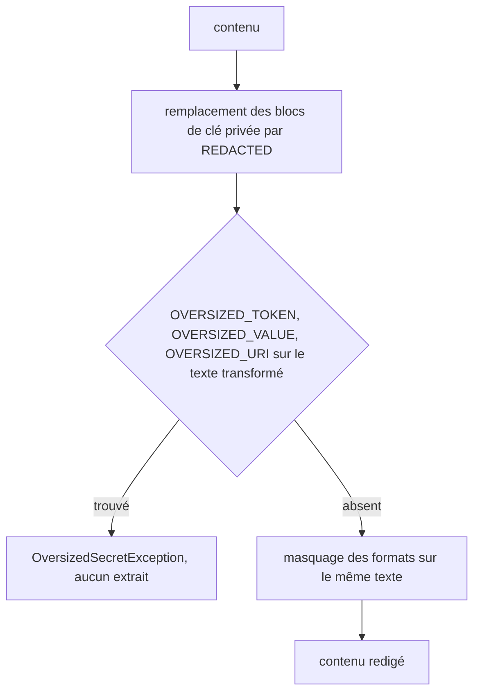

# Design

**Profil :** complet

## Contexte

- [Existant vérifié] `SensitiveContentRedactor.redact` refuse le contenu entier si `OVERSIZED_TOKEN`, `OVERSIZED_VALUE` ou `OVERSIZED_URI` trouve une valeur hors borne dans `content`, puis remplace les blocs de clé privée et masque les formats sur le résultat (`core/src/main/java/com/nexus/security/SensitiveContentRedactor.java:101-121`).
- [Existant vérifié] `replacePrivateKeyBlocks` remplace un bloc `-----BEGIN … PRIVATE KEY-----` … `-----END … PRIVATE KEY-----` par `[REDACTED]` en gardant ses séparateurs de ligne (`:138-177`). Le caractère qui précède un jeton collé au marqueur de fin passe de `-` à `]`.
- [Existant vérifié] Les familles à tirets (`sk-`, `xox?-`, `glpat-`, `AIza`) sont ancrées par `(?<![A-Za-z0-9_-])` au masquage (`:47`) et au refus (`:95`). Sur le contenu brut, le refus ne voit pas le jeton collé au marqueur ; sur le contenu transformé, le masquage le voit mais son quantificateur possessif s'arrête à 255 caractères et la garde de fin échoue.
- [Existant vérifié] Classes de corps : `xox[abposr]-[A-Za-z0-9-]` au masquage, `[A-Za-z0-9_-]` à la garde et au refus ; `gh[pousr]_[A-Za-z0-9]` et `(?:sk|rk)_(?:live|test)_[A-Za-z0-9]` au masquage avec `\b`, `\w` au refus ; `github_pat_\w` des deux côtés.
- [Existant vérifié] `POLICY_VERSION = "secret-redaction-v7"`, `CONTENT_PROFILE_VERSION = 6`, dernière migration `V018__invalidate_sk_token_bound_indexes.sql` et son test `SchemaMigratorSkTokenBoundUpgradeTest` (sprint 8).

## Objectifs / Hors objectifs

**Objectifs :** `secret-redaction › Un jeton collé à un bloc de clé privée est masqué ou refusé` ; `secret-redaction › Le masquage et le refus d'un jeton comptent la même classe de caractères` ; `secret-redaction › Un changement de politique invalide les index dérivés` (version v8).

**Hors objectifs :** l'ancrage des familles à tirets dans un identifiant à tirets, les formats à longueur fixe, la forme du refus (`OversizedSecretException`) et son traitement à l'indexation.

## Composants et responsabilités

Non applicable : `SensitiveContentRedactor` garde sa responsabilité ; l'ordre interne de `redact` et trois classes de caractères changent.

## Modèle de domaine et invariants

Invariant : le refus et le masquage lisent le même texte (contenu après remplacement des blocs de clé privée) et, pour chaque famille bornée, le même corps sur la même classe de caractères, avec `borne de refus = borne de masquage + 1`. Il n'existe ni voisinage ni longueur où un jeton reconnu n'est ni masqué ni refusé.

## Traitements et interactions

Vue organigramme (cible) — ordre de `redact` ; couvre `secret-redaction › Un jeton collé à un bloc de clé privée est masqué ou refusé`.

## États et transitions

Non applicable : traitement pur.

## Contrats d'interface

Non applicable : aucune API ; le refus reste `OversizedSecretException`, que `redactField` convertit en `[REDACTED]`.

## Persistance et intégrité

- [Décision] Migration `V019__invalidate_token_context_bound_indexes.sql` sur le modèle de V018 : incrément de `project_index_generations`, projets `NOT_INDEXED`, `last_indexed_at` à `NULL`, faits canoniques conservés.
- `POLICY_VERSION` passe à `secret-redaction-v8` ; `CONTENT_PROFILE_VERSION` passe à 7 (`content-v7`).

## Transactions, concurrence et idempotence

La migration est un lot SQL unique appliqué par le migrateur ; rejouée, elle est ignorée par l'historique des migrations.

## Sécurité et isolation

[Exigence] Le message du refus ne contient aucune partie du jeton. Les index d'une politique antérieure, qui peuvent contenir un jeton de ces formes en clair, sont invalidés et reconstruits.

## Erreurs et reprise

Un fichier refusé est exclu des index lexical et sémantique et reste dans l'index structurel (`secret-redaction › Une valeur sensible trop longue n'exclut que son fichier`) ; aucune reprise nouvelle.

## Observabilité

Diagnostic existant `INDEX_REDACTION_LIMIT`, sans valeur.

## Performance et mesure

Non applicable : `replacePrivateKeyBlocks` reste appelé une fois, avant le refus au lieu d'après ; les quantificateurs gardent leurs bornes et restent possessifs.

## Compatibilité, migration et retour arrière

- Mise à niveau : rebuild normal des dérivés de chaque projet ; section « Mise à niveau » de `docs/developer/release-and-recovery.md` sur le modèle de V018.
- Retour arrière : un binaire antérieur refuse une base à version de schéma supérieure ; restaurer la sauvegarde de `NEXUS_HOME`.

## Décisions

- [Décision] Lancer les trois contrôles de refus sur `replacePrivateKeyBlocks(content)`. Le refus et le masquage lisent ainsi le même voisinage, quel que soit le motif. Effet de bord accepté : une valeur hors borne entièrement contenue dans un bloc de clé privée est masquée avec le bloc au lieu de faire refuser le contenu ; elle n'est publiée dans aucun des deux cas.
- [Décision] Élargir le masquage au lieu de restreindre le refus : `xox[abposr]-[A-Za-z0-9_-]{10,255}+`, `gh[pousr]_\w{20,255}+`, `(?:sk|rk)_(?:live|test)_\w{16,255}+`, avec les refus `gh[pousr]_\w{256}`, `github_pat_\w{256}`, `(?:sk|rk)_(?:live|test)_\w{256}` et `xox[abposr]-[A-Za-z0-9_-]{256}`. Masquer un `_` de plus ne publie rien ; le retirer du refus créerait un jeton tronqué en clair.
- Aucun ADR : la politique de redaction et son invalidation suivent un processus établi (skill `nexus-redaction-change`).

## Risques / Compromis

- [Risque] Un identifiant de code qui commence par `ghp_`, `xoxb-` ou `sk_live_` et contient un `_` est désormais masqué → faux positif borné à ces préfixes rares ; un masquage excessif est préférable à une fuite.
- [Risque] Rebuild de tous les projets à la mise à niveau → inévitable pour purger d'éventuelles valeurs en clair ; documenté.

## Stratégie de vérification

- `./mvnw -B -ntp -pl core test -Dtest=SensitiveContentRedactorTest,SecretRedactionProbeTest -Dsurefire.failIfNoSpecifiedTests=false -Djacoco.skip=true`, tests en échec sur l'ancien code (sonde du 10/11).
- Test d'upgrade de V019 (modèle `SchemaMigratorSkTokenBoundUpgradeTest`), `SchemaMigratorChecksumTest`.
- `bash .claude/scripts/contracts.sh` (`content-v7`), `./mvnw clean install`, `scripts/self-smoke.ps1`, `archgate check`.
- `openspec validate sprint-08-suite-refus-contexte-redaction --strict`.

## Traçabilité

| Exigence (`capacité › titre`) | Scénario | Conception ou diagramme | Tâche | Test ou preuve |
|---|---|---|---|---|
| `secret-redaction › Un jeton collé à un bloc de clé privée est masqué ou refusé` | Corps de 255 caractères après le bloc | Organigramme de `redact` | 1.1, 1.3 | test non écrit |
| `secret-redaction › Un jeton collé à un bloc de clé privée est masqué ou refusé` | Corps de 256 caractères après le bloc | Organigramme de `redact` | 1.1, 1.3 | test non écrit |
| `secret-redaction › Le masquage et le refus d'un jeton comptent la même classe de caractères` | Jeton court contenant un tiret bas | Décisions | 1.2, 1.3 | test non écrit |
| `secret-redaction › Le masquage et le refus d'un jeton comptent la même classe de caractères` | Corps de 255 caractères contenant un tiret bas | Décisions | 1.2, 1.3 | test non écrit |
| `secret-redaction › Le masquage et le refus d'un jeton comptent la même classe de caractères` | Corps de 256 caractères contenant un tiret bas | Décisions | 1.2, 1.3 | test non écrit |
| `secret-redaction › Un changement de politique invalide les index dérivés` | Mise à jour d'une base existante | Persistance et intégrité | 2.2 | test non écrit (test d'upgrade de V019) |
| `secret-redaction › Un changement de politique invalide les index dérivés` | Index lexical d'une ancienne politique | Persistance et intégrité | 2.1 | preuve existante de la matrice, à réaligner sur v8 |
