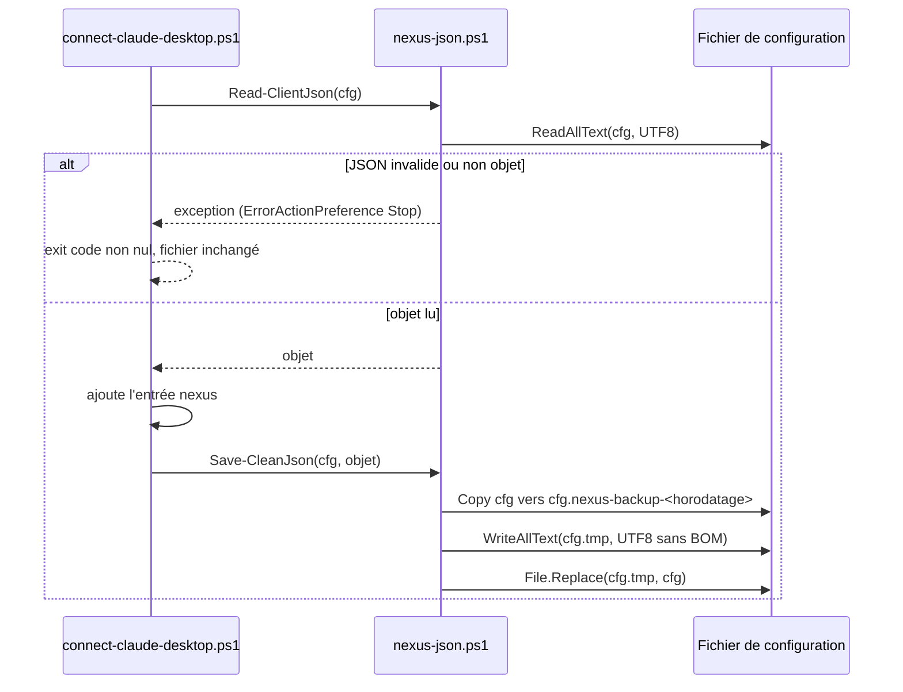

# Design

**Profil :** complet

## Contexte

- [Existant vérifié] Les scripts de connexion sont du texte PowerShell assemblé en Pascal par `packaging/windows/nexus-installer.iss.template` et écrits au premier lancement (`SaveStringToFile`, `:1459`, `:1689`). Ils chargent `nexus-json.ps1` (`Format-Json`, `Save-CleanJson`, `:1453-1458`) et sont exécutés par `{sys}\WindowsPowerShell\v1.0\powershell.exe` (`:1542`), donc Windows PowerShell 5.1.
- [Existant vérifié] Sous Windows PowerShell 5.1, `Get-Content` sans `-Encoding` lit un fichier UTF-8 sans BOM dans la page de code ANSI ; `Save-CleanJson` réécrit en UTF-8 : les caractères non ASCII sont doublement encodés.
- [Existant vérifié] Sans `$ErrorActionPreference = 'Stop'`, l'échec de `ConvertFrom-Json` laisse `$c` à `$null` ou, dans la boucle `foreach ($cfg in $cfgs)` (`:1680`), à l'objet du fichier précédent ; le script écrit ce contenu puis sort en 0.
- [Existant vérifié] `scripts/release/test-windows-installer.ps1:184` impose que le détecteur de clients reste ASCII, car Windows PowerShell 5.1 lit un script sans BOM en ANSI. Contrainte retenue pour les scripts générés : ils sont écrits en UTF-8 avec BOM (`SaveStringsToUTF8File`), car `SaveStringToFile` convertit vers la page ANSI avec correspondance « best-fit » (U+FF07 et U+02BC y deviennent une apostrophe ASCII que `PowerShellSingleQuote` n'a pas doublée) ; les données non ASCII des tests vivent dans les fichiers JSON de test.
- [Existant vérifié] `PowerShellSingleQuote` (`:388-392`) ; `test-windows-config-escaping.ps1` vérifie la présence des fonctions d'échappement dans la source durcie (`:19-38`) mais n'exécute aucun script généré.
- [Existant vérifié] Le compose (`packaging/docker/docker-compose.yml.template:3-8`) construit l'image depuis `docker/Dockerfile.runtime` sans `args:` ; l'installateur écrit le `.env` lu par Compose (`NEXUS_DOCKER_IMAGE`, `NEXUS_DOCKER_CONTAINER`).
- [Existant vérifié] `scripts/release/openspec_doc_contracts.py:73-84` (`check_links`) sait contrôler fichier et ancre ; `check_docs` (`:291-313`) ne l'applique qu'aux `design.md` actifs.

## Objectifs / Hors objectifs

**Objectifs :**
- `installer-client-configuration` › les quatre exigences.
- `container-image-hardening` › L'image construite par le compose porte sa version.
- `release-pipeline` › Les tags GHCR de version et latest viennent du workflow de release.
- `operational-documentation-contracts` › La documentation de publication GHCR nomme le workflow de release.
- `openspec-documentation-contracts` › Les liens relatifs des changements archivés sont contrôlés.

**Hors objectifs :**
- Changer le format des entrées `nexus` écrites (`McpEntryPsLiteral`) ou la détection des clients.
- Restaurer automatiquement une sauvegarde : elle sert à l'utilisateur, le script ne la relit pas.

## Composants et responsabilités

- `nexus-json.ps1` (généré) devient le seul point de lecture et d'écriture des configurations JSON de clients : [Proposition] fonctions `Read-ClientJson` (lecture UTF-8, objet ou échec) et `Save-CleanJson` étendue (sauvegarde, fichier temporaire, remplacement).
- Les scripts de connexion et de déconnexion n'appellent plus `Get-Content … | ConvertFrom-Json` directement.
- `PowerShellSingleQuote` reste la seule fonction d'échappement des littéraux PowerShell de l'installateur.

## Modèle de domaine et invariants

Invariant : un fichier de configuration de client n'est modifié que si son contenu d'origine a été lu comme objet JSON ; sinon ses octets sont inchangés. Aucun état partagé ne traverse deux fichiers d'une même boucle.

## Traitements et interactions

Vue UML de séquence (cible) — connexion d'un client ; couvre `installer-client-configuration` › « Un fichier de configuration illisible n'est jamais réécrit » et « Une sauvegarde précède toute réécriture d'une configuration existante ».

Lecture : la variable `$c` est réinitialisée à chaque tour de boucle. [Décision] À la connexion, `Add-NexusServerEntry` lit et contrôle tous les fichiers, sections comprises, avant d'en écrire un : un fichier invalide laisse tous les fichiers intacts et le script sort en 1, sans connexion partielle que le drapeau de désinstallation ignorerait. À la désinstallation, `Remove-NexusServerEntry` continue après un fichier illisible, retire l'entrée des fichiers lisibles et sort en 1 ; l'installateur conserve alors le drapeau `*Managed` pour qu'une désinstallation ultérieure réessaie.

## États et transitions

Non applicable : aucun cycle de vie persistant ; un fichier est soit inchangé, soit remplacé en une opération.

## Contrats d'interface

- Codes de sortie des scripts de connexion : `0` (entrée ajoutée), `10` (aucun fichier), `20` (déjà connecté) existent (`:1677`, `:1688`). [Proposition] Toute exception rend un code non nul distinct de ces trois valeurs (comportement par défaut de `powershell.exe -File` sur une exception non interceptée : code 1).
- [Décision] Nom de sauvegarde : `<fichier>.nexus-backup-<yyyyMMddHHmmss>`, dans le même dossier. Un dossier différent changerait les ACL héritées du profil.
- Compose : [Proposition] `build.args: { NEXUS_IMAGE_VERSION: "${NEXUS_IMAGE_VERSION}", NEXUS_IMAGE_REVISION: "${NEXUS_IMAGE_REVISION}" }`, valeurs écrites dans le `.env` par l'installateur depuis `{#NexusVersion}` et la révision connue au packaging. Si la révision n'est pas connue, la ligne est omise et le `Dockerfile.runtime` pose le label `unknown` : l'image de base UBI porte son propre label `revision`, qu'aucune instruction Dockerfile ne retire.
- [Question] Le préprocesseur Inno Setup dispose-t-il du SHA au packaging (`scripts/release/build-windows-installer.ps1`) ? Sinon, le scénario « Révision inconnue sur le poste » s'applique (label absent).

## Persistance et intégrité

- Configurations de clients : écriture `fichier temporaire + [System.IO.File]::Replace`, même volume, donc remplacement atomique au sens NTFS.
- Image locale : labels OCI seulement. Aucune donnée NEXUS ni migration SQLite.

## Transactions, concurrence et idempotence

- Un client IA ouvert peut réécrire son fichier pendant l'installation : la fenêtre se réduit à l'intervalle lecture → `Replace`. [Risque] accepté, déjà présent aujourd'hui.
- Idempotence : relancer la connexion ne duplique pas l'entrée (`exit 20` existant) et ne crée pas de sauvegarde, car rien n'est réécrit.

## Sécurité et isolation

- `PowerShellSingleQuote` double U+0027, U+2018, U+2019, U+201A et U+201B : PowerShell les traite tous comme délimiteurs de chaîne simple. Le nom de conteneur reste validé par `IsValidDockerName` (`:1146`).
- La sauvegarde contient ce que contenait déjà le fichier : aucun secret nouveau n'est écrit ; elle hérite des ACL du dossier du profil.
- Tags GHCR : la règle « immuable par version » est déjà portée par `ghcr-immutable-preflight.sh` ; ce changement rend l'état du registre conforme avant le premier usage.

## Erreurs et reprise

- JSON invalide : code 1, fichier intact ; l'utilisateur corrige son fichier puis relance la reconfiguration (`docs/user/windows-installation.md`, section « Upgrade / reconfiguration »).
- Échec de `Replace` : le fichier temporaire est supprimé dans un `finally` ; si `ReplaceFile` a déjà renommé l'original en sauvegarde, le `catch` le remet à sa place avant de relancer l'exception.

## Observabilité

L'installateur signale déjà l'échec d'un script de client. Un `trap` des scripts JSON affiche `NEXUS: <message>`, qui nomme le fichier en cause sans en afficher le contenu ; relancer le `.cmd` du client depuis `{app}\integrations\` le montre.

## Performance et mesure

Non applicable : fichiers de configuration de quelques kilo-octets, une écriture par client.

## Compatibilité, migration et retour arrière

- Les fichiers déjà corrompus par une version antérieure ne sont pas réparés : la correction n'agit que sur les écritures futures.
- Retour arrière : réinstaller la version précédente de l'installateur ; les sauvegardes restent sur le poste.
- Tags GHCR : la décision `AUD-DEP-34` (voir proposition, [Question]) est consignée dans le relevé de release (`docs/project/history/`) ; elle ne justifie pas d'ADR, car la politique d'immuabilité existe déjà.

## Décisions

- [Décision] Échappement complet de `PowerShellSingleQuote` plutôt que passage par variable d'environnement ou fichier JSON : changement local, testable, sans modifier la forme des scripts générés.
- [Décision] Arguments de build dans le compose plutôt que version figée dans `Dockerfile.runtime` au packaging : le même `Dockerfile.runtime` sert à la CI et au poste, sans fichier dérivé.
- [Décision] Les liens des designs de ce changement citent les chemins en code (`docs/developer/…`) plutôt qu'en liens relatifs : l'archivage déplace le dossier d'un niveau et casserait des liens écrits pour `openspec/changes/<nom>/`. Le contrôle des archives (tâche 5.2) détecte toute régression.
- [Proposition] Corriger les 9 liens de l'archive `2026-11-09-preciser-bornes-redaction-recence-git` en `../../../../docs/developer/…` : correction de lien autorisée dans un document figé, avec confirmation (`.claude/rules/documentation.md`, hook `guard-edit.ps1`).
- Aucun ADR : aucune décision structurante ni coûteuse à inverser.

## Risques / Compromis

- [Risque] Une sauvegarde par connexion accumule des fichiers → une seule sauvegarde par exécution d'installateur et par fichier ; nettoyage laissé à l'utilisateur, documenté.
- [Risque] D'autres archives OpenSpec portent des liens cassés et feraient échouer le contrat élargi → la tâche 5.2 liste et corrige tous les liens d'archive avant d'activer le contrôle.
- [Risque] Supprimer un tag GHCR déjà tiré → dépend de la [Question] de la proposition.

## Stratégie de vérification

- `pwsh -NoProfile -File scripts/release/test-windows-installer.ps1` (Windows, étend les cas existants `:195-215`) : JSON invalide, chemin `Hélène`, deux fichiers dont un invalide, sauvegarde présente, désinstallation.
- `pwsh -NoProfile -File scripts/release/test-windows-config-escaping.ps1` : génération puis analyse (`[System.Management.Automation.Language.Parser]::ParseInput`) d'un script avec `Jean’s`.
- Workflow `Windows installer` (`.github/workflows/windows-installer.yml`) sur la PR.
- `docker compose build` puis `docker inspect` sur une installation Docker locale (`scripts/release/test-docker-runtime.ps1`).
- `bash .claude/scripts/contracts.sh` (contrat GHCR, liens d'archive).
- `docker buildx imagetools inspect` et `gh attestation verify` pour les tags GHCR.
- `openspec validate sprint-13-installateur-et-release-finale --strict`.

## Traçabilité

| Exigence (`capacité › titre`) | Scénario | Conception ou diagramme | Tâche | Test ou preuve |
|---|---|---|---|---|
| `installer-client-configuration › Les configurations des clients sont lues et écrites en UTF-8` | Chemin accentué dans une autre entrée | Contexte ; séquence de connexion | 1.1, 1.4 | test non écrit (`scripts/release/test-windows-installer.ps1`) |
| `installer-client-configuration › Les configurations des clients sont lues et écrites en UTF-8` | Désinstallation | Contexte | 1.3, 1.4 | test non écrit |
| `installer-client-configuration › Un fichier de configuration illisible n'est jamais réécrit` | JSON invalide | Séquence de connexion | 1.2, 1.4 | test non écrit |
| `installer-client-configuration › Un fichier de configuration illisible n'est jamais réécrit` | Plusieurs fichiers dont un invalide | Séquence de connexion | 1.2, 1.4 | test non écrit |
| `installer-client-configuration › Une sauvegarde précède toute réécriture d'une configuration existante` | Connexion réussie | Contrats d'interface | 1.1, 1.4 | test non écrit |
| `installer-client-configuration › Une sauvegarde précède toute réécriture d'une configuration existante` | Échec pendant l'écriture | Erreurs et reprise | 1.1, 1.4 | test non écrit |
| `installer-client-configuration › Les valeurs injectées dans les scripts PowerShell générés sont échappées` | Dossier d'installation avec apostrophe typographique | Sécurité et isolation | 2.1 | test non écrit (`scripts/release/test-windows-config-escaping.ps1`) |
| `container-image-hardening › L'image construite par le compose porte sa version` | Construction locale après installation Docker | Contrats d'interface | 3.1 | test non écrit |
| `container-image-hardening › L'image construite par le compose porte sa version` | Révision inconnue sur le poste | Contrats d'interface | 3.1 | test non écrit |
| `release-pipeline › Les tags GHCR de version et latest viennent du workflow de release` | Préflight de la release finale | Sécurité et isolation | 4.2 | preuve manquante (tâche mainteneur) |
| `release-pipeline › Les tags GHCR de version et latest viennent du workflow de release` | Vérification de la provenance | Sécurité et isolation | 4.3 | preuve manquante (après release) |
| `release-pipeline › Les tags GHCR de version et latest viennent du workflow de release` | Workflow de distribution Docker | Contexte | 4.1 | test non écrit |
| `operational-documentation-contracts › La documentation de publication GHCR nomme le workflow de release` | Contrat documentaire | — | 4.1 | test non écrit |
| `openspec-documentation-contracts › Les liens relatifs des changements archivés sont contrôlés` | Lien d'archive cassé | Décisions | 5.2 | test non écrit |
| `openspec-documentation-contracts › Les liens relatifs des changements archivés sont contrôlés` | Ancre inexistante | Décisions | 5.2 | test non écrit |
| `openspec-documentation-contracts › Les liens relatifs des changements archivés sont contrôlés` | Archives conformes | Décisions | 5.1, 5.2 | test non écrit |

## Questions ouvertes

- [Question] Disponibilité du SHA au packaging de l'installateur (voir « Contrats d'interface ») : n'affecte que la valeur du label `revision`, pas les tâches.
