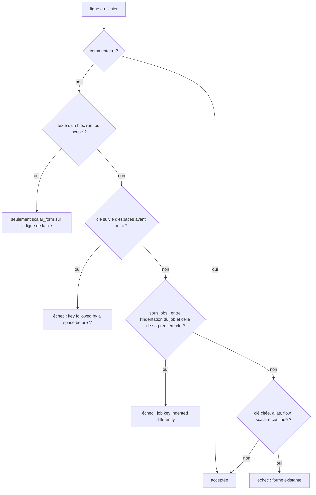

# Design

**Profil :** court (outillage)

## Contexte

- [Existant vérifié] Le contrat Maven est une liste de motifs appliqués ligne à ligne aux scripts actifs (`DIRECT_MAVEN_CALL`, `scripts/release/test-operational-doc-contracts.sh:586-602` ; jeton `MAVEN_TOKEN`, `:585` ; exceptions `MAVEN_CALL_EXCEPTIONS`, `:605`, vide au HEAD ; détection `powershell_maven_violations`, `:608-620`). Il ne voit un jeton nu qu'en début de ligne (`:588`) ou après `&` (`:587`), et `cmd` qu'avec `/c` (`:598-600`). L'auto-test liste vingt formes détectées (`:645-668`) et cinq non signalées (`:669-677`).
- [Existant vérifié] `workflow_hygiene.py` est un analyseur ligne à ligne sans dépendance. `RUN` (`scripts/release/workflow_hygiene.py:44`), `KEY` (`:58`) et `MAPPING_KEY` (`:59`) exigent « : » collé à la clé ; `jobs_of` fixe l'indentation des jobs à celle de la première clé sous `jobs:` (`:286-287`) et ne lit les clés de job qu'à `job_indent + 2` (`:294`). `check_forms` (`:237-252`) appelle `unread_line_form` (`:221-234`) sur chaque ligne, y compris le texte des blocs `run:`.
- [Existant vérifié] Les fixtures `forms` sont assertées avec fichier, ligne et message par `scripts/release/test-operational-doc-contracts.sh:708-735`, et avec un fragment du message par `scripts/release/test-tool-integrity-anchors.sh:170-187`.
- [Existant vérifié] La documentation courante contrôlée est la liste `current_docs` (`scripts/release/test-operational-doc-contracts.sh:375-402`) et ses motifs interdits (`:403-412`) ; `docs/developer/reproduce-and-debug.md` n'y figure pas. `docs/developer/ci-and-supply-chain.md`, qui y figure, cite `0.1.0-SNAPSHOT` à `:493`, `:530` et `:539` pour décrire l'absence de contrôle.
- [Existant vérifié] Aucune ligne des workflows et actions du dépôt n'a de clé espacée avant « : », et tous les corps de job y sont indentés de 2 (recherche du 2026-11-11 sur `.github/workflows` et `.github/actions`).

## Objectifs / Hors objectifs

**Objectifs :** `powershell-script-tooling › Le contrat Maven refuse un appel direct en position de commande`, `ci-workflow-tooling › Le contrôle d'hygiène refuse une clé espacée avant les deux-points`, `ci-workflow-tooling › Le contrôle d'hygiène lit les clés de job à l'indentation de leur corps`, `operational-documentation-contracts › La documentation courante ne cite pas la version de développement 0.1.0-SNAPSHOT`. Donner un contrat au scénario existant `powershell-script-tooling › Les scripts obsolètes ne sont pas des points d'entrée › Aucune référence vers un artefact inexistant`.

**Hors objectifs :** retirer les chaînes citées des messages (le contrat ne distingue pas une chaîne d'un code ; les faux positifs passent par `MAVEN_CALL_EXCEPTIONS`) ; lire les formes YAML absentes de la liste `forms`.

## Composants et responsabilités

- [Proposition] `DIRECT_MAVEN_CALL` gagne trois motifs :
  - jeton en position de commande : `(?:^|[=;{(|&]|(?<!\S)\.(?=\s))\s*['"]?` + `MAVEN_TOKEN` + `['"]?(?:\s|$)` ; le motif `^\s*` existant (`:588`) et le motif `&` (`:587`) s'y fondent ou restent, au choix de l'implémentation. Le `.` n'est un séparateur que seul entre blancs (dot-sourcing), pour ne pas lire `.\mvnw.cmd` d'un message comme un `.` suivi de `\mvnw.cmd` ;
  - `cmd` : l'option `/c` du motif existant devient `/[ck]` ;
  - `(?:\bpwsh|\bpowershell)(?:\.exe)?\b.*\s-c(?:ommand)?\b.*\bmvnw?(?:\.cmd)?\b`.
- [Proposition] Auto-test : une fixture détectée par forme de la spec (`assignment`, `semicolon`, `block`, `dot-source`, `cmd /k`, `pwsh -Command`, plus `subexpression` `$(mvn -v)` et `pipeline` `… | mvn …`), et les cinq fixtures non signalées existantes, dont `message` ; les scripts actifs du dépôt restent sans violation.
- [Proposition] `workflow_hygiene.py` :
  - `SPACED_KEY = ^\s*(?:-\s+)?[A-Za-z_][\w-]*\s+:(?:\s|$)` ; `unread_line_form` le signale (« key followed by a space before ':' ») sauf sur les lignes de texte d'un bloc `run:`/`script:`, que `check_forms` repère avec `run_blocks` ;
  - `jobs_of` retient pour chaque job l'indentation de sa première clé (`body_indent`) et lit les clés de job à cette indentation ; une clé dont l'indentation est strictement entre celle du job et `body_indent` est marquée (`__misaligned__`, sur le modèle de `__inline__`) et signalée par `check_forms` (« job key indented differently from the first key of job '<job>' »).
- [Proposition] Fixtures : `forms-spaced-run.yml`, `forms-spaced-runs-on.yml` (sans `timeout-minutes`), `timeout-missing-indent-4.yml`, `forms-misaligned-job-key.yml`, et une ligne `label : valeur` dans un bloc `run: |` de `valid-defaults-and-env.yml` (ou d'une nouvelle fixture valide).
- [Proposition] Contrat documentaire : `docs/developer/reproduce-and-debug.md` entre dans `current_docs` ; `0.1.0-SNAPSHOT` entre dans les motifs interdits (`:404-411`) ; une boucle sur `active_powershell_scripts()` refuse la même chaîne. La chaîne est tenue dans une constante du script pour que la page durable la désigne sans la recopier.

## Modèle de domaine et invariants

Non applicable : aucun modèle de domaine. Invariant des contrôles : une forme non lue est un échec, jamais un succès silencieux (fail-closed).

## Traitements et interactions

Vue organigramme — quelle décision `check_forms` prend-il pour une ligne après ce changement ; couvre `ci-workflow-tooling › Le contrôle d'hygiène refuse une clé espacée avant les deux-points` et `› Le contrôle d'hygiène lit les clés de job à l'indentation de leur corps`.

Lecture : les branches `E1` et `E2` sont ajoutées ; `E3` regroupe les formes du sprint 12 (`QUOTED_KEY`, `ALIAS`, `FLOW`, `scalar_form`), inchangées.

## États et transitions

Non applicable : contrôles sans état.

## Contrats d'interface

- `python3 scripts/release/workflow_hygiene.py <pins|forms|inputs|timeouts|runners|upstream> <chemins…>` : inchangé ; code 0 si conforme, 1 avec un message `fichier:ligne: …` par écart.
- Contrat Maven : message inchangé, `<script>:<ligne>: calls Maven directly instead of Invoke-Maven`.
- Contrat documentaire : message existant de `forbid` (`scripts/release/test-operational-doc-contracts.sh:24`).

## Persistance et intégrité

Non applicable : aucun format persisté ni ancre d'intégrité.

## Transactions, concurrence et idempotence

Non applicable : contrôles en lecture seule.

## Sécurité et isolation

Le changement ferme deux contournements de gates de sécurité : réintroduction d'un input interpolé dans `run:` (`AUD-SEC-07`) et appel du Maven non ancré du runner (`AUD-QUA-05`). Aucune nouvelle surface.

## Erreurs et reprise

Un faux positif du contrat Maven se traite par une entrée de `MAVEN_CALL_EXCEPTIONS` (script, ligne exacte), dont l'obsolescence fait elle-même échouer le contrat.

## Observabilité

Non applicable : messages des contrôles seulement.

## Performance et mesure

Non applicable : contrôles de quelques secondes.

## Compatibilité, migration et retour arrière

Les workflows et scripts actuels restent verts (voir Contexte). Retour arrière : retirer les motifs et fixtures ajoutés ; aucun format persisté.

## Décisions

- [Décision] Rester sur des motifs et des refus de formes, sans analyse syntaxique PowerShell ni parseur YAML épinglé, comme au sprint 12.
- [Décision] Le séparateur `.` n'est reconnu qu'entouré de blancs, pour ne pas signaler `.\mvnw.cmd` cité dans une phrase (fixture `message`).
- [Proposition] Lire le corps d'un job à l'indentation de sa première clé plutôt que refuser toute indentation autre que 2 : le YAML valide reste accepté et le contrôle `timeouts` voit le job.
- [Proposition] Étendre la recherche de `0.1.0-SNAPSHOT` aux scripts actifs, proposée par `docs/developer/ci-and-supply-chain.md:539`.
- Aucun ADR : ces décisions complètent des contrôles existants.

## Risques / Compromis

- [Risque] Faux positifs du motif de position de commande sur une chaîne qui contient `; mvn` ou `= mvn` → `MAVEN_CALL_EXCEPTIONS`, et une fixture non signalée pour le message existant de `scripts/nexus.ps1:9`.
- [Risque] Une ligne `clé : valeur` hors bloc `run:` légitime en YAML (par exemple dans `env:`) est refusée → effet voulu : la forme s'écrit collée.
- [Risque] La page durable doit décrire l'interdiction de `0.1.0-SNAPSHOT` sans contenir la chaîne → la nommer par la constante du script, et réécrire `ci-and-supply-chain.md:493`, `:530` et `:539`.

## Stratégie de vérification

`bash .claude/scripts/contracts.sh` (auto-test du contrat Maven, fixtures `forms`/`timeouts`, contrat documentaire), mutations manuelles sur une copie de `scripts/compare-jdt.ps1` et d'un workflow, `bash scripts/release/test-openspec-doc-contracts.sh`, `openspec validate sprint-14-gates-textuels-et-doc --strict`, syntaxe du diagramme Mermaid.

## Traçabilité

| Exigence (`capacité › titre`) | Scénario | Conception ou diagramme | Tâche | Test ou preuve |
|---|---|---|---|---|
| `powershell-script-tooling › Le contrat Maven refuse un appel direct en position de commande` | Affectation du résultat | Composants (`DIRECT_MAVEN_CALL`) | 1.1 | test non écrit |
| `powershell-script-tooling › Le contrat Maven refuse un appel direct en position de commande` | Après un point-virgule | Composants | 1.1 | test non écrit |
| `powershell-script-tooling › Le contrat Maven refuse un appel direct en position de commande` | Dans un bloc | Composants | 1.1 | test non écrit |
| `powershell-script-tooling › Le contrat Maven refuse un appel direct en position de commande` | Dot-sourcing | Composants, Décisions | 1.1 | test non écrit |
| `powershell-script-tooling › Le contrat Maven refuse un appel direct en position de commande` | Passage par cmd /k | Composants | 1.1 | test non écrit |
| `powershell-script-tooling › Le contrat Maven refuse un appel direct en position de commande` | Passage par pwsh -Command | Composants | 1.1 | test non écrit |
| `powershell-script-tooling › Le contrat Maven refuse un appel direct en position de commande` | Message qui cite le wrapper dans une phrase | Décisions | 1.1 | test non écrit |
| `ci-workflow-tooling › Le contrôle d'hygiène refuse une clé espacée avant les deux-points` | run espacé qui interpole un input | Organigramme `check_forms` (E1) | 2.1 | test non écrit |
| `ci-workflow-tooling › Le contrôle d'hygiène refuse une clé espacée avant les deux-points` | runs-on espacé sans timeout | Organigramme (E1) | 2.1 | test non écrit |
| `ci-workflow-tooling › Le contrôle d'hygiène refuse une clé espacée avant les deux-points` | Texte d'un bloc run | Organigramme (branche bloc) | 2.1 | test non écrit |
| `ci-workflow-tooling › Le contrôle d'hygiène lit les clés de job à l'indentation de leur corps` | Corps de job indenté de 4 sans timeout | Composants (`jobs_of`) | 2.2 | test non écrit |
| `ci-workflow-tooling › Le contrôle d'hygiène lit les clés de job à l'indentation de leur corps` | Clé de job désalignée | Organigramme (E2) | 2.2 | test non écrit |
| `ci-workflow-tooling › Le contrôle d'hygiène lit les clés de job à l'indentation de leur corps` | Corps de job indenté de 2 | Contexte | 2.2 | test non écrit |
| `operational-documentation-contracts › La documentation courante ne cite pas la version de développement 0.1.0-SNAPSHOT` | Ancienne version dans le guide de reproduction | Composants (contrat documentaire) | 3.2 | test non écrit |
| `operational-documentation-contracts › La documentation courante ne cite pas la version de développement 0.1.0-SNAPSHOT` | Artefact nommé sans version figée | Composants | 3.1 | test non écrit |
| `operational-documentation-contracts › La documentation courante ne cite pas la version de développement 0.1.0-SNAPSHOT` | Relevé daté hors contrôle | Périmètre (proposition) | 3.2 | test non écrit |
| `powershell-script-tooling › Les scripts obsolètes ne sont pas des points d'entrée` (existante) | Aucune référence vers un artefact inexistant | Composants | 3.2 | test non écrit |

## Questions ouvertes

- [Question] `AUD-QUA-27` : la page durable doit-elle désigner la chaîne interdite par la constante du script (proposé), ou faut-il retirer `docs/developer/ci-and-supply-chain.md` de la recherche pour pouvoir la citer en clair ? Sans effet sur les specs.
