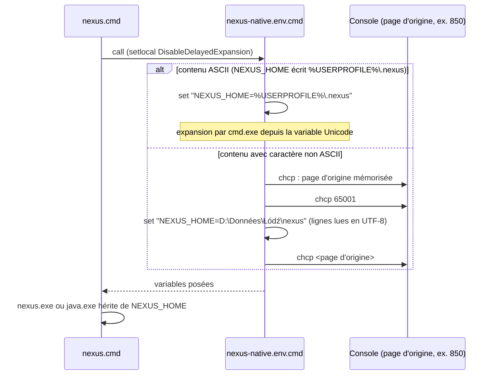

# Design

**Profil :** complet

## Contexte

- [Existant vérifié] L'installateur est un gabarit Pascal (`packaging/windows/nexus-installer.iss.template`) que deux scripts de durcissement réécrivent par remplacement exact avant compilation (`scripts/release/build-windows-installer.ps1`, appel de `Protect-NexusInstallerSource`) : `scripts/release/harden-windows-installer-source.ps1:166-182` remplace l'écrivain de `config\nexus-native.env.cmd` pour échapper `%` par `CmdEnvEscape` (`:26-33`), puis `scripts/release/harden-windows-rest-auth-source.ps1:15-45` remplace à nouveau ce bloc pour le jeton REST. Toute modification de l'écrivain touche donc le gabarit et les deux ancres.
- [Existant vérifié] `SaveStringToFile` prend une `AnsiString` : une variable `String` y est convertie vers la page ANSI (`packaging/windows/nexus-installer.iss.template:1438-1442`). `Content` (`:1282`) et `EnvContent` (`:1308`) sont des `String` ; `ComposeTemplate` est une `AnsiString` (`:1309`) recopiée sans conversion.
- [Existant vérifié] Inno Setup 7.0.2 compile l'installateur (`scripts/release/ensure-inno-setup.ps1:11`) ; Pascal Scripting y fournit `SaveStringsToUTF8FileWithoutBOM(FileName, S, Append)` (documentation Inno Setup, rubrique « SaveStringsToUTF8FileWithoutBOM »), à côté de `SaveStringsToUTF8File` déjà utilisé par `SavePowerShellScript` (`:1443-1450`).
- [Existant vérifié] `cmd.exe` décode un fichier batch dans la page de code de la console. Les lanceurs (`scripts/release/build-windows-distribution.ps1:260-273` et suivants) font `setlocal DisableDelayedExpansion` puis `call "%~dp0config\nexus-native.env.cmd"`. Le fichier pose `NEXUS_HOME` sans condition : il écrase la valeur de l'appelant (`scripts/release/harden-windows-rest-auth-source.ps1:38-44`).
- [Existant vérifié] `NEXUS_HOME` vaut par défaut `GetEnv('USERPROFILE') + '\.nexus'` (`packaging/windows/nexus-installer.iss.template:920`), est enregistré dans le registre en Unicode (`:1987`) et relu à la réinstallation (`:697`). La documentation utilisateur l'annonce sous la forme `%USERPROFILE%\.nexus` (`docs/user/windows-installation.md`, « Écran 4 — Configuration runtime »).
- [Existant vérifié] Le mode smoke force le déploiement natif, désactive Docker (`:131-134`) et laisse toutes les cases de clients décochées et désactivées (`:986-993` ; cases créées décochées `:767` et désactivées `:797` tant que le préflight des clients n'a pas tourné, préflight sauté en smoke `:873`) : ni fragment TOML ni fragment JSON n'est écrit, et `docker\.env` non plus.
- [Existant vérifié] `scripts/release/test-windows-config-escaping.ps1` rejoue déjà une règle Pascal (`PowerShellSingleQuote`) en PowerShell à partir de la source durcie, puis exécute le résultat ; c'est le modèle retenu pour l'écrivain du `.cmd`.
- [Existant vérifié] Le runtime Java embarqué ne démarre pas depuis un dossier qui contient un caractère absent de la page ANSI du poste : en page 1252, `nexus.exe` installé sous `…\Instàllé Łukasz` signale `could not find java.dll`, `java.exe -jar` `Unable to access jarfile …?ukasz…` ; sous `…\Instàllé Hélène`, les deux démarrent (relevé local du 11/11/2026, Temurin 21, installateur smoke). `NEXUS_HOME` n'est pas concerné : NEXUS le lit par `System.getenv`, en Unicode.
- [Existant vérifié] `chcp 65001` agit dans une console visible ou cachée (`CREATE_NO_WINDOW`, mode des clients MCP) ; dans un processus sans console (`DETACHED_PROCESS`), il échoue et la page de code reste celle d'origine (relevé local du 11/11/2026, page 850).
- [Existant vérifié] `NextButtonClick` valide chaque page de l'assistant (`packaging/windows/nexus-installer.iss.template:1066`) ; il est aussi appelé en installation silencieuse, où un refus interrompt l'installation.

## Objectifs / Hors objectifs

**Objectifs :**
- `installer-client-configuration` › Les fichiers de configuration générés par l'installateur sont écrits en UTF-8 sans BOM.
- `installer-client-configuration` › Les lanceurs natifs reçoivent les valeurs de la configuration native telles qu'elles ont été saisies.
- `installer-client-configuration` › L'assistant refuse un dossier d'installation hors de la page ANSI.

**Hors objectifs :**
- Faire démarrer le runtime Java depuis un dossier hors page ANSI : limite du lanceur Java, refusée en amont par l'assistant.
- Changer le contenu des fichiers (clés, ordre, échappements JSON et TOML) au-delà de l'encodage et de l'écriture de `NEXUS_HOME`.
- Faire lire la configuration native par NEXUS lui-même (fichier de propriétés UTF-8 lu par Java) : refonte écartée, voir « Décisions ».

## Composants et responsabilités

- [Proposition] Une procédure `SaveUtf8TextFile(Path, Text)` du gabarit, sur le modèle de `SavePowerShellScript`, devient le seul écrivain des fichiers de configuration non PowerShell : `SaveStringsToUTF8FileWithoutBOM`, échec journalisé comme aujourd'hui.
- [Proposition] Une fonction `CmdEnvPathValue(Value)` ajoutée par `harden-windows-installer-source.ps1` à côté de `CmdEnvEscape` : une valeur ASCII reste littérale (`CmdEnvEscape(Value)`), sans dépendre de la variable au lancement ; si `Value` contient un caractère non ASCII et commence, sans tenir compte de la casse ASCII et à une frontière de dossier, par la valeur de `LOCALAPPDATA` puis de `USERPROFILE` (préfixe le plus long d'abord), elle rend `%LOCALAPPDATA%` ou `%USERPROFILE%` suivi de `CmdEnvEscape(reste)` ; sinon `CmdEnvEscape(Value)`.
- [Proposition] Une fonction `CmdUtf8Frame(Body)` qui, si `Body` contient un caractère au-delà de `#127`, l'entoure de la sauvegarde de la page courante, de `chcp 65001 >nul` et de la restauration ; sinon rend `Body` inchangé.
- [Proposition] Une fonction `IsAnsiRoundTrip(Value)` du gabarit : vraie si `Value`, convertie en `AnsiString` (page ANSI active) puis reconvertie en `String`, est inchangée. `NextButtonClick` l'applique à `WizardDirValue()` sur la page `wpSelectDir` et refuse le dossier avec un message qui nomme la limite du runtime Java.
- Les lanceurs de `scripts/release/build-windows-distribution.ps1` ne changent pas.

## Modèle de domaine et invariants

Invariant : pour toute valeur `v` écrite par l'installateur dans un fichier de configuration, le lecteur prévu de ce fichier (`cmd.exe`, Compose, PowerShell en UTF-8, client MCP) obtient `v` à l'identique. Aucune conversion vers une page de code à huit bits n'intervient entre la saisie et le fichier.

## Traitements et interactions

Vue UML de séquence (cible) — un lanceur natif charge la configuration native ; couvre `installer-client-configuration` › « Les lanceurs natifs reçoivent les valeurs de la configuration native telles qu'elles ont été saisies ».



Lecture : la branche ASCII couvre les valeurs par défaut sous un profil accentué sans dépendre de `chcp` ; la branche `chcp` ne sert qu'à une valeur saisie hors profil ou à un caractère non ASCII dans une autre variable (URL Ollama). Les fichiers UTF-8 (TOML, JSON, `.env`) n'ont pas d'interaction nouvelle : seul leur encodage change.

## États et transitions

Non applicable : les fichiers sont écrits une fois par installation, sans cycle de vie.

## Contrats d'interface

- Forme cible de `config\nexus-native.env.cmd` pour un `NEXUS_HOME` hors profil non ASCII ([Proposition]) :

```text
@echo off
for /f "tokens=2 delims=:." %%P in ('chcp') do set "NEXUS_ENV_PREVIOUS_CP=%%P"
chcp 65001 >nul
set "NEXUS_HOME=D:\Données\Łódź\nexus"
set "NEXUS_REST_HOST=127.0.0.1"
...
chcp %NEXUS_ENV_PREVIOUS_CP% >nul
set "NEXUS_ENV_PREVIOUS_CP="
```

- `tokens=2 delims=:.` lit le numéro dans `Page de codes active : 850` comme dans `Active code page: 850.` ; l'espace de tête est accepté par `chcp`.
- Les fichiers UTF-8 sans BOM se terminent par une ligne vide supplémentaire (`SaveStringsTo*` ajoute un saut de ligne après chaque élément) : sans effet pour `cmd.exe`, Compose, TOML et JSON.
- Les codes de sortie des lanceurs et des scripts de connexion ne changent pas.

## Persistance et intégrité

- Registre : inchangé (valeurs Unicode). Une réinstallation réécrit les fichiers à partir du registre : un poste déjà touché est corrigé par la mise à jour.
- Aucune donnée NEXUS ni migration SQLite.

## Transactions, concurrence et idempotence

Non applicable : écriture unique en fin d'installation (`CurStepChanged`, `ssPostInstall`, `:2305-2306`), déjà non atomique aujourd'hui, et réécrite à chaque installation.

## Sécurité et isolation

- `NEXUS_HOME` refuse toujours retour à la ligne, guillemet double et `^` (`scripts/release/harden-windows-installer-source.ps1:93-99`) ; `%` reste doublé par `CmdEnvEscape` dans la partie littérale. La partie remplacée par `%USERPROFILE%` ou `%LOCALAPPDATA%` est développée par `cmd.exe` à partir de la variable de l'utilisateur courant : aucune valeur saisie n'est évaluée.
- Le jeton REST généré (`NEXUS_REST_API_TOKEN`) est hexadécimal (`GenerateLocalToken`, `packaging/windows/nexus-installer.iss.template:620-639`) et ne déclenche pas la branche `chcp` ; un jeton saisi non ASCII y passe comme toute autre valeur. Aucune sortie ajoutée ne l'affiche (`chcp` redirigé vers `nul`).

## Erreurs et reprise

- Échec d'écriture d'un fichier : journalisé (`Log`) comme pour `SavePowerShellScript` ; comportement inchangé.
- Si `chcp 65001` échoue (processus sans console), la page reste celle d'origine et une valeur littérale non ASCII est mal décodée ; les valeurs par défaut restent correctes par la branche ASCII. [Écart] Les valeurs littérales non ASCII sont réservées aux lanceurs qui disposent d'une console, visible ou cachée ; la limite est documentée dans `docs/developer/release-and-recovery.md` et `docs/user/windows-installation.md`.
- Dossier d'installation hors page ANSI : refusé par `NextButtonClick` avec un message qui nomme la limite ; en installation silencieuse, l'installation s'interrompt.

## Observabilité

Non applicable : aucun journal nouveau ; `chcp` est redirigé vers `nul` pour ne pas polluer la sortie standard des lanceurs MCP (canal JSON-RPC de `nexus-mcp.cmd`).

## Performance et mesure

Non applicable : un appel `chcp` de plus par lancement, seulement dans la branche non ASCII.

## Compatibilité, migration et retour arrière

- Pour des valeurs ASCII, le contenu des fichiers est identique octet pour octet à l'actuel, sauf la ligne vide finale : les lecteurs existants ne voient aucune différence.
- `%USERPROFILE%` et `%LOCALAPPDATA%`, écrits seulement pour un `NEXUS_HOME` accentué sous le profil, sont développés à l'exécution : pour une installation par utilisateur (`PrivilegesRequired=lowest`), c'est le profil de l'utilisateur qui lance NEXUS, celui qui a installé. [Écart] Un client qui lance `nexus-mcp.cmd` sans transmettre ces variables obtient `\.nexus` ; la limite est documentée dans `docs/developer/release-and-recovery.md`.
- Retour arrière : réinstaller la version précédente.

## Décisions

- [Décision] UTF-8 sans BOM pour `.env`, TOML et JSON : un BOM ferait partie de la première clé du `.env` lu par Compose et n'est pas attendu par les lecteurs TOML ; `connect-codex-desktop.ps1` lit déjà en UTF-8 (`:1847`).
- [Proposition] Pour le `.cmd`, les deux mécanismes du constat combinés plutôt qu'un seul : la référence `%USERPROFILE%` / `%LOCALAPPDATA%` rend le cas par défaut indépendant de la console ; `chcp 65001` encadré couvre une valeur saisie hors profil. Alternative écartée : refuser un `NEXUS_HOME` non ASCII à l'assistant, régression pour un dossier `D:\Données`. Alternative écartée : un fichier de propriétés lu par Java, qui changerait le contrat des lanceurs et de NEXUS pour un défaut d'installateur.
- [Proposition] En mode smoke, cocher et activer Codex Desktop et le client générique (`:986-993`) pour que le smoke écrive les fragments TOML et JSON ; la connexion réelle reste exclue du smoke (`:2324`).
- [Décision] Le smoke installe dans `Instàllé Hélène`, accents de la page ANSI dont les octets ANSI sont invalides en UTF-8 strict, et garde `Łukasz` dans le profil de test : le runtime Java ne démarre pas depuis un dossier qui contient `Ł`. Il prouve l'usage de `NEXUS_HOME` par Java : `project add`, puis `project list` dans un second processus, et `nexus.db` sous le profil.
- [Décision] Un dossier d'installation hors page ANSI est refusé par l'assistant (aller-retour `String` → `AnsiString` → `String`) plutôt que seulement documenté : sans ce refus, l'installation réussit et NEXUS ne démarre pas. Alternative écartée : un avertissement seul, qui laisse installer un produit inutilisable.
- [Décision] La branche `chcp` n'est garantie qu'avec une console, visible ou cachée ; un `NEXUS_HOME` non ASCII hors profil reste accepté par l'assistant. Alternative écartée : le refuser, régression pour un dossier `D:\Données` utilisé depuis une console.
- [Décision] `docker\.env` est couvert par le contrat statique (tâche 1.4) ; la preuve du scénario « Dossier de dépôt Docker accentué » reste partielle, sans lecture Compose.
- Aucun ADR : décision locale à l'installateur, sans format persistant ni contrat public nouveau.

## Risques / Compromis

- [Risque] `chcp 65001` sans console : la branche littérale non ASCII échoue → test 2.1 exécuté avec console visible et avec `CreateNoWindow` ; le mode `DETACHED_PROCESS` est documenté comme limite.
- [Risque] Une installation silencieuse dans un dossier hors page ANSI s'interrompt → message explicite, journalisé par Inno Setup (`/LOG`).
- [Risque] Une ancre de durcissement non mise à jour fait échouer la compilation (`Installer hardening anchor missing`) → les trois sources changent dans la même tâche 1.2, et `scripts/release/test-windows-config-escaping.ps1` charge la source durcie.
- [Risque] Le smoke écrit dans le profil réel du poste (`NEXUS_HOME` de `config\nexus-native.env.cmd` écrase celui du test) → le nouveau cas fixe `USERPROFILE` sur un dossier de `target\installer-smoke` pour l'installation et pour l'exécution de `nexus.cmd`.

## Stratégie de vérification

- `pwsh -NoProfile -File scripts/release/test-windows-config-escaping.ps1` : rejeu de `CmdEnvPathValue` et `CmdUtf8Frame` depuis la source durcie, fichier écrit en UTF-8 sans BOM, exécution par `cmd.exe` en page 850 avec console puis avec `CreateNoWindow`, valeurs `Données\Łódź` et `100%`, page restaurée ; contrat de `IsAnsiRoundTrip` et de son appel sur `wpSelectDir`, rejeu de l'aller-retour en page 1252 (`Łukasz` refusé, `Instàllé Hélène` accepté).
- `pwsh -NoProfile -File scripts/release/test-windows-installer.ps1 -Setup <setup smoke>` : profil `Hélène Łukasz` et `{app}` `Instàllé Hélène`, projet enregistré puis relu par `nexus.cmd` dans `NEXUS_HOME` sous le profil, fragments TOML et JSON sans BOM et décodés en UTF-8 strict, `connect-codex-desktop.ps1` sur un profil de test ; contrat statique : plus aucun `SaveStringToFile` sur `.env`, `.toml`, `.json` ni `nexus-native.env.cmd`.
- Workflow `Windows installer` (`.github/workflows/windows-installer.yml`) vert sur la PR.
- `bash scripts/release/test-openspec-doc-contracts.sh`, `bash .claude/scripts/contracts.sh`.
- `openspec validate sprint-14-installateur-encodage-utf8 --strict`.

## Traçabilité

| Exigence (`capacité › titre`) | Scénario | Conception ou diagramme | Tâche | Test ou preuve |
|---|---|---|---|---|
| `installer-client-configuration › Les fichiers de configuration générés par l'installateur sont écrits en UTF-8 sans BOM` | Dossier d'installation accentué dans le fragment Codex | Composants (`SaveUtf8TextFile`) ; Décisions | 1.1, 1.3, 2.2 | `scripts/release/test-windows-installer.ps1:505-509` (smoke : `codex-desktop.mcp.toml` sans BOM, UTF-8 strict, `command` égal au Java embarqué de `Instàllé Hélène`) |
| `installer-client-configuration › Les fichiers de configuration générés par l'installateur sont écrits en UTF-8 sans BOM` | Connexion de Codex Desktop depuis un dossier accentué | Contexte | 1.1, 2.2 | `scripts/release/test-windows-installer.ps1:515-537` (`connect-codex-desktop.ps1` installé, Windows PowerShell 5.1, `.codex\config.toml` existant : chemin intact, aucun U+FFFD, contenu existant conservé) |
| `installer-client-configuration › Les fichiers de configuration générés par l'installateur sont écrits en UTF-8 sans BOM` | Fragments JSON d'import manuel | Composants | 1.1, 1.3, 1.4, 2.2 | `scripts/release/test-windows-installer.ps1:510-513` (`generic-mcp.json` sans BOM, UTF-8 strict, commande égale au Java embarqué) ; `scripts/release/test-windows-installer.ps1:155-172` (contrat statique : `copilot-jetbrains.mcp.json` écrit par `SaveUtf8TextFile`) ; partiel : `copilot-jetbrains.mcp.json` n'est pas écrit par le smoke |
| `installer-client-configuration › Les fichiers de configuration générés par l'installateur sont écrits en UTF-8 sans BOM` | Dossier de dépôt Docker accentué | Décisions | 1.1, 1.4, 2.3 | `scripts/release/test-windows-installer.ps1:155-172`, `scripts/release/test-windows-config-escaping.ps1:53-59` (contrat statique : `.env` écrit par `SaveUtf8TextFile`, aucun `SaveStringToFile` sur `.env`) ; partiel : `.env` non écrit par le smoke, aucune lecture Compose |
| `installer-client-configuration › Les lanceurs natifs reçoivent les valeurs de la configuration native telles qu'elles ont été saisies` | Profil accentué et valeurs par défaut | Séquence (branche ASCII) | 1.2, 2.2 | `scripts/release/test-windows-installer.ps1:438-489` (profil `Hélène Łukasz`, `config\nexus-native.env.cmd` ASCII avec `%USERPROFILE%\.nexus`, `nexus.cmd project add` puis `project list` dans un second processus en page 850, `nexus.db` sous le profil, aucun `.nexus` ni dossier au nom altéré ailleurs) |
| `installer-client-configuration › Les lanceurs natifs reçoivent les valeurs de la configuration native telles qu'elles ont été saisies` | Dossier hors profil avec un caractère absent de la page ANSI | Séquence (branche `chcp`) ; Contrats d'interface | 1.2, 1.4, 2.1 | `scripts/release/test-windows-config-escaping.ps1:154-321` (rejeu de `CmdUtf8Frame` et `CmdEnvPathValue`, `Données\Łódź`, sonde de lanceur en page 850, console visible puis `CreateNoWindow`, contrôle négatif sans cadre) |
| `installer-client-configuration › Les lanceurs natifs reçoivent les valeurs de la configuration native telles qu'elles ont été saisies` | Signe pourcent dans la valeur | Sécurité et isolation | 1.2, 1.4, 2.1 | `scripts/release/test-windows-config-escaping.ps1:262-311` (`100%` et `Données 100%`, console visible puis `CreateNoWindow`) |
| `installer-client-configuration › Les lanceurs natifs reçoivent les valeurs de la configuration native telles qu'elles ont été saisies` | Page de code de la console restaurée | Contrats d'interface | 1.2, 1.4, 2.1 | `scripts/release/test-windows-config-escaping.ps1:299-310`, `:323-329` (page 850 relue après l'appel ; contrôle négatif sans lignes de fermeture) |
| `installer-client-configuration › L'assistant refuse un dossier d'installation hors de la page ANSI` | Dossier d'installation avec un caractère absent de la page ANSI | Composants (`IsAnsiRoundTrip`) ; Erreurs et reprise | 1.5, 2.4 | `scripts/release/test-windows-config-escaping.ps1:335-363` (contrat de `IsAnsiRoundTrip`, de `NextButtonClick` sur `wpSelectDir` et de `PrepareToInstall` ; aller-retour 1252 refusé pour `Łukasz`) ; `scripts/release/test-windows-installer.ps1:331-348` (installateur smoke compilé : `/DIR` contenant `Łukasz` refusé, code non nul, aucun fichier installé, message journalisé) |
| `installer-client-configuration › L'assistant refuse un dossier d'installation hors de la page ANSI` | Dossier d'installation accentué de la page ANSI | Composants (`IsAnsiRoundTrip`) | 1.5, 2.2, 2.4 | `scripts/release/test-windows-config-escaping.ps1:335-363` (aller-retour 1252 accepté pour `Instàllé Hélène`) ; `scripts/release/test-windows-installer.ps1:350-358` (installation smoke dans `Instàllé Hélène` réussie) |

## Questions ouvertes

Aucune : `chcp` sans console et la preuve de `docker\.env` sont tranchés dans « Décisions ».
