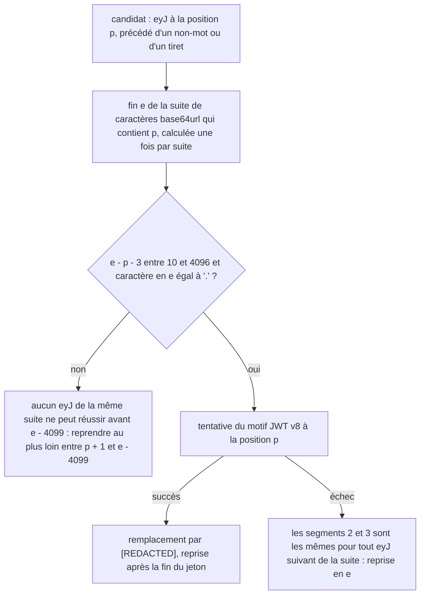

# Design

**Profil :** complet

## Contexte

- [Existant vérifié] `redact` remplace les blocs de clé privée, refuse le contenu si `OVERSIZED_TOKENS`, `OVERSIZED_VALUE` ou `OVERSIZED_URI` trouve une valeur hors borne, puis masque dans cet ordre : jetons à préfixe (9 passes), `JWT`, `BEARER`, `PASSWORD_OPTION`, `XML_SECRET_ELEMENT`, assignations, URL (`core/src/main/java/com/nexus/security/SensitiveContentRedactor.java:118-142`).
- [Existant vérifié] `JWT` : `\beyJ[A-Za-z0-9_-]{10,4096}+\.` puis deux segments de même forme, le dernier terminé par `\b` (`:78-81`). Le possessif ne revient pas en arrière, mais le moteur retente le motif à chaque `eyJ` précédé d'un non-mot, `-` compris. Dans « eyJ-eyJ-… », chaque tentative balaie jusqu'à 4 096 caractères avant d'échouer sur le `.` absent : le coût vaut le nombre d'occurrences multiplié par 4 096.
- [Existant vérifié] `XML_SECRET_ELEMENT` : `XML_OPEN`, puis `<!\[CDATA\[[^\]\r\n]{1,4096}+]]>` ou `[^<\r\n]{1,4096}+`, puis `</\2>` (`:72-74`). Sur « <password><![CDATA[ » répété, chaque ouverture balaie le CDATA jusqu'à 4 096 caractères sans trouver de `]`.
- [Existant vérifié] `XML_OPEN` : `<((?:[A-Za-z0-9_-]++[._-])*+` + `SENSITIVE_NAME` + `)` (`:38-39`). `OPTION_NAME` : `(?:[A-Za-z0-9]++-)*+` + `SENSITIVE_NAME` (`:36`). `SENSITIVE_NAME` contient des clés à séparateur interne (`api[_-]?key`, `access[_-]?key`, `private[_-]?key`, `:33-34`). `OVERSIZED_VALUE` réutilise `OPTION_NAME` et `XML_OPEN` (`:90-95`).
- [Existant vérifié] Garde-fou de temps existant, qui n'est pas une mesure : `SensitiveContentRedactorTest#malformedKeysAndOversizedValuesHaveBoundedLookahead`, `assertTimeoutPreemptively` à 10 s, « marge supérieure à x5 sur la durée nominale » (`core/src/test/java/com/nexus/security/SensitiveContentRedactorTest.java:54-65`).
- [Existant vérifié] `POLICY_VERSION = "secret-redaction-v8"` (`SensitiveContentRedactor.java:20`) ; `CONTENT_PROFILE_VERSION = 7` (`core/src/main/java/com/nexus/search/semantic/SemanticIndexingService.java:27`) ; dernière migration `V019__invalidate_token_context_bound_indexes.sql`, enregistrée à `core/src/main/java/com/nexus/persistence/sqlite/SchemaMigrator.java:39`, testée par `SchemaMigratorTokenContextBoundUpgradeTest`.
- [Existant vérifié] Sonde du 11/11 (classes compilées en `--release 21` depuis l'arbre courant, JDK 24, meilleur de 3) : 1 Mo de « eyJ- » 16 479 ms ; « <password><![CDATA[ » 1 614 ms ; code ordinaire 318 ms. Le motif `JWT` précédé de la garde `(?<![A-Za-z0-9_-])` traite 1 Mo de « eyJ- » en 22 ms. Ces durées sont indicatives et dépendent de la machine.
- Page durable : `docs/developer/secret-redaction.md`, section « OpenSpec secret-redaction ».

## Objectifs / Hors objectifs

**Objectifs :**
- `secret-redaction › Une répétition forgée de débuts de JWT ou de CDATA ne bloque pas la redaction`.
- `secret-redaction › Un JWT reste masqué quel que soit le séparateur qui le précède`.
- `secret-redaction › Un élément XML au nom composé est redigé`.
- `secret-redaction › Une option de ligne de commande au nom composé est redigée` (sous réserve de la [Question] 1 de la proposition).
- `secret-redaction › Un changement de politique invalide les index dérivés` (`secret-redaction-v9`).

**Hors objectifs :** réécrire la redaction en un scanner unique ; toucher `SecretAssignmentScanner` ou les bornes des jetons à préfixe ; poser un plafond de performance dans les gates de benchmark.

## Composants et responsabilités

Non applicable : `SensitiveContentRedactor` garde ses responsabilités et son API (`redact`, `redactField`). Seuls des motifs et la boucle d'application changent ; aucun appelant n'est modifié.

## Modèle de domaine et invariants

- Invariant de non-régression : tout contenu masqué par `JWT` ou par l'alternative CDATA sous `secret-redaction-v8` reste masqué à l'identique. La correction du coût ne retire aucun masquage.
- Invariant de coût : le travail de `JWT` et de `XML_SECRET_ELEMENT` est linéaire en longueur de contenu. Aucune position n'est rebalayée sur 4 096 caractères à chaque occurrence d'un préfixe.
- Invariant de nom : un nom d'élément ou d'option est sensible si et seulement s'il se termine par une entrée de `SENSITIVE_NAME`, précédée du début du nom ou d'un séparateur. Une clé qui contient elle-même un séparateur (`api_key`) reste reconnue.

## Traitements et interactions

Vue organigramme (cible) : quand une tentative du motif `JWT` peut-elle être sautée sans changer le résultat ? Couvre `secret-redaction › Une répétition forgée de débuts de JWT ou de CDATA ne bloque pas la redaction` et `secret-redaction › Un JWT reste masqué quel que soit le séparateur qui le précède`.

Toutes les positions `eyJ` d'une même suite de caractères base64url partagent la même fin de premier segment. Si cette fin ne mène pas à un `.` dans la borne, ou si les segments suivants échouent, aucune autre position de la suite ne peut réussir, sauf quand la suite dépasse 4 096 caractères : une position plus proche de la fin peut alors retrouver la borne. La reprise s'avance donc au plus loin entre `p + 1` et `e - 4099`. Chaque caractère n'est balayé qu'un nombre borné de fois.

Pour l'alternative CDATA de `XML_SECRET_ELEMENT`, une tentative balaie le corps jusqu'au premier `]`, CR ou LF. Toutes les ouvertures `<nom-sensible><![CDATA[` comprises dans ce corps s'arrêtent au même point. [Proposition] Mémoriser cette position de fin avec un pointeur qui ne recule jamais, et ne retenter l'alternative CDATA que si ce point a changé. L'alternative de valeur simple `[^<\r\n]` reste tentée à chaque ouverture : elle s'arrête au `<` suivant, sans surcoût. Ne pas sauter l'ouverture entière : une ouverture à valeur simple placée dans un CDATA non fermé doit rester masquée (voir Risques).

## États et transitions

Non applicable : traitement pur, sans état persistant hors version de politique.

## Contrats d'interface

Non applicable : aucune API ne change. Le refus reste `OversizedSecretException`, que `redactField` convertit en `[REDACTED]` (`SensitiveContentRedactor.java:148-157`). La projection publique applique la même redaction aux trois canaux (`ARCH-0085`).

## Persistance et intégrité

- [Décision] Ajouter la migration `core/src/main/resources/db/migration/V020__invalidate_composite_name_indexes.sql`, copie du corps de `V018`/`V019` : `INSERT OR IGNORE` de `project_index_generations`, génération incrémentée, projets `NOT_INDEXED`, `last_indexed_at` à `NULL`, faits canoniques conservés. Elle est enregistrée dans `SchemaMigrator` après `V019`. Le numéro est revérifié à l'implémentation (premier libre), conformément à `DATA-0020` (migrations append-only protégées par checksum).
- `POLICY_VERSION` passe à `secret-redaction-v9` et `CONTENT_PROFILE_VERSION` à 8 (`content-v8`). Lucene compare la version de politique de son commit, et le profil sémantique inclut la politique (`DATA-0074`).

## Transactions, concurrence et idempotence

La migration est un lot SQL unique appliqué par le migrateur. Rejouée, elle est ignorée grâce à l'historique des migrations. La redaction reste déterministe et idempotente.

## Sécurité et isolation

- Les index d'une politique antérieure peuvent contenir en clair une valeur d'élément XML au nom composé, de 5 000 caractères comme de 13 : sous v8, `<db-password>` suivi de 5 000 caractères n'est ni masqué ni refusé. Ils sont invalidés puis reconstruits (`DATA-0073` : Lucene est dérivé et reconstructible).
- Le message du refus d'une valeur XML trop longue ne contient aucune partie de la valeur (vérification existante `SensitiveContentRedactorTest#rejectsOversizedValuesWithoutPublishingAnySuffix`, à étendre au nom composé).

## Erreurs et reprise

Non applicable : aucune erreur nouvelle. Un fichier refusé reste exclu des index lexical et sémantique avec `INDEX_REDACTION_LIMIT` (`secret-redaction › Une valeur sensible trop longue n'exclut que son fichier`).

## Observabilité

Non applicable : diagnostics existants (`INDEX_REDACTION_LIMIT`, `CONTEXT_REDACTION_LIMIT`), sans valeur.

## Performance et mesure

- Seuil : 1 Mo en moins d'une seconde, pour « eyJ- » (critère de sortie du sprint 14, `docs/project/audits/2026-10-17/sprints.md:332`) et pour la répétition CDATA (action de `AUD-SEC-24`, `docs/project/audits/2026-10-17/findings.json`). Aucun autre seuil.
- Mesure : test JUnit dans `SensitiveContentRedactorTest`, `assertTimeoutPreemptively(Duration.ofSeconds(1), …)` sur chacun des deux contenus, après un appel de chauffe sur un contenu court, à la manière du garde-fou existant (`:54-65`).
- `AUD-PRF-30` : [Proposition] ajouter un banc opt-in `core/src/test/java/com/nexus/benchmark/RedactionThroughputBenchmarkTest.java`, activé par `-Dnexus.scale.benchmark.enabled=true` comme les autres bancs. Il compare `redact` et une variante qui saute chaque passe de `STRUCTURED_TOKENS` dont le préfixe littéral est absent (`indexOf` de `sk-`, `xox`, `AIza`, `glpat-`, `gh`, `github_pat_`, `AKIA`, `ASIA`, `npm_`, `sk_`, `rk_`), sur 1 Mo de code ordinaire et sur le corpus synthétique d'`IndexingHeapPeakBenchmarkTest`. Il écrit un rapport JSON sous `target/`. Le pré-filtre n'est livré que si la mesure confirme un surcoût ([Question] 4 ci-dessous) ; il ne change aucune sortie, donc aucune version de politique.

## Compatibilité, migration et retour arrière

- Mise à niveau : rebuild normal des dérivés de chaque projet au premier passage. Une section « Mise à niveau V020 — noms composés » est ajoutée à `docs/developer/release-and-recovery.md`, sur le modèle de V019 (`:298`).
- Retour arrière : un binaire antérieur refuse une base à version de schéma supérieure ; restaurer la sauvegarde de `NEXUS_HOME`.

## Décisions

- [Décision] Ne pas reprendre la garde `(?<![A-Za-z0-9_-])` proposée par l'audit pour `JWT` : elle laisse en clair un JWT précédé d'un `-`, masqué sous v8 (sonde du 11/11). Retenir à la place le saut de tentatives ci-dessus, à résultat identique. Si le projet préfère la garde ([Question] 2 de la proposition), retirer le scénario « JWT après un tiret » et documenter la limite, comme pour `sk-`.
- [Décision] Ne pas reprendre `(?:[A-Za-z0-9]++[._-])*+` proposé par l'audit : il casse `<api_key>`, `<access_key>`, `<private_key>` et `<api-key>` (sonde du 11/11).
- [Proposition] Nom XML : `<([A-Za-z0-9._-]++(?<=[<._-]` + `SENSITIVE_NAME` + `))`. Le nom est consommé de façon possessive, puis un lookbehind de longueur bornée vérifie qu'il se termine par une clé sensible précédée de `<` ou d'un séparateur. Option : `--?+[A-Za-z0-9-]++(?<=-` + `SENSITIVE_NAME` + `)`, en gardant la reconnaissance actuelle de `--api_key`. Sonde du 11/11 : tous les cas des scénarios conformes ; 500 000 composants traités en 172 ms.
- [Décision] Écarter une boucle paresseuse `(?:[A-Za-z0-9]++[._-])*?` : elle donne le bon résultat sur les noms courts, mais lève `StackOverflowError` sur un nom de 500 000 composants (sonde du 11/11).
- Aucun nouvel ADR : la politique de redaction et son invalidation suivent un processus établi (skill `nexus-redaction-change`, `DATA-0020`, `DATA-0073`, `DATA-0074`).

## Risques / Compromis

- [Risque] Saut CDATA trop large : sauter une ouverture entière masquerait mal `<password><![CDATA[x <password>v</password>` (la seconde ouverture, à valeur simple, est masquée sous v8). → Ne mémoriser que la fin du corps CDATA, et ajouter ce cas aux tests de non-régression.
- [Risque] Test de temps instable sur un runner lent : le code ordinaire prend environ 0,3 s par Mo. → Un appel de chauffe, des motifs linéaires (22 ms mesurés pour la garde seule) et la [Question] 3 sur la conduite à tenir en cas d'échec intermittent.
- [Risque] Un lookbehind de nom XML qui oublierait une entrée de `SENSITIVE_NAME`. → Le lookbehind réutilise la constante, et un test paramétré couvre chaque clé.
- [Risque] Rebuild de tous les projets à la mise à niveau. → Inévitable pour purger les valeurs XML en clair ; documenté.

## Stratégie de vérification

- `./mvnw -B -ntp -pl core test -Dtest=SensitiveContentRedactorTest,SecretRedactionProbeTest -Dsurefire.failIfNoSpecifiedTests=false -Djacoco.skip=true`. Les nouveaux tests de nom composé échouent sur le code v8 ; les tests de temps échouent sur le code v8 (environ 16 s).
- Test de non-régression : sur un corpus de cas positifs v8 (JWT isolé, après `-`, `=`, `:` ; CDATA avec `<` ; cas de la sonde), le texte rendu est identique à celui des motifs v8, recopiés dans le test.
- `./mvnw -B -ntp -pl core test -Dtest=SchemaMigratorChecksumTest,SchemaMigrator*UpgradeTest -Dsurefire.failIfNoSpecifiedTests=false -Djacoco.skip=true`.
- `bash .claude/scripts/contracts.sh` (`content-v8`, `secret-redaction-v9`), `archgate check`, `./mvnw clean install`, `pwsh -NoProfile -File scripts/self-smoke.ps1`.
- `openspec validate sprint-14-redaction-jwt-et-xml --strict`. Diagramme validé par le contrôle de types de `scripts/release/test-openspec-doc-contracts.sh`.

## Traçabilité

| Exigence (`capacité › titre`) | Scénario | Conception ou diagramme | Tâche | Test ou preuve |
|---|---|---|---|---|
| `secret-redaction › Une répétition forgée de débuts de JWT ou de CDATA ne bloque pas la redaction` | Répétition de débuts de JWT | Organigramme JWT | 1.1, 1.2 | test non écrit |
| `secret-redaction › Une répétition forgée de débuts de JWT ou de CDATA ne bloque pas la redaction` | Répétition d'ouvertures CDATA | Traitements et interactions (CDATA) | 1.1, 1.3 | test non écrit |
| `secret-redaction › Une répétition forgée de débuts de JWT ou de CDATA ne bloque pas la redaction` | CDATA légitime contenant un chevron | Modèle de domaine et invariants | 1.3, 1.4 | test non écrit |
| `secret-redaction › Un JWT reste masqué quel que soit le séparateur qui le précède` | JWT isolé | Organigramme JWT | 1.2, 1.4 | preuve existante partielle : `SecretRedactionProbeTest` (cas JWT, `:63`) ; test dédié non écrit |
| `secret-redaction › Un JWT reste masqué quel que soit le séparateur qui le précède` | JWT après un tiret | Organigramme JWT, Décisions | 1.2, 1.4 | test non écrit |
| `secret-redaction › Un élément XML au nom composé est redigé` | Nom composé par un tiret ou un tiret bas | Décisions (nom XML) | 2.1, 2.2 | test non écrit |
| `secret-redaction › Un élément XML au nom composé est redigé` | Clé sensible contenant un séparateur | Décisions (nom XML) | 2.1, 2.2 | test non écrit |
| `secret-redaction › Un élément XML au nom composé est redigé` | Nom qui ne se termine pas par une clé sensible | Modèle de domaine et invariants | 2.1, 2.2 | test non écrit |
| `secret-redaction › Un élément XML au nom composé est redigé` | Valeur d'un nom composé au-delà de la borne | Sécurité et isolation | 2.1, 2.2 | test non écrit |
| `secret-redaction › Une option de ligne de commande au nom composé est redigée` | Clé sensible composée dans une option | Décisions (option) | 2.1, 2.3 | test non écrit |
| `secret-redaction › Une option de ligne de commande au nom composé est redigée` | Option qui ne se termine pas par une clé sensible | Modèle de domaine et invariants | 2.1, 2.3 | test non écrit |
| `secret-redaction › Un changement de politique invalide les index dérivés` | Mise à jour d'une base existante | Persistance et intégrité | 3.2 | test non écrit (test d'upgrade de `V020`) |
| `secret-redaction › Un changement de politique invalide les index dérivés` | Index lexical d'une ancienne politique | Persistance et intégrité | 3.1 | preuve existante partielle à réaligner sur v9 : `LuceneSearchIndexTest#redactionPolicyCheckRejectsMissingOrObsoleteCommitPolicy` |

## Questions ouvertes

- [Question] 3 — Test de temps à 1 s : en cas d'échec intermittent sur un runner CI, faut-il garder le seuil absolu (critère du sprint) ou passer à un ratio par rapport au code ordinaire du même run ? Le passage au ratio demanderait de modifier le seuil de la spec.
- [Question] 4 — `AUD-PRF-30` : quel surcoût mesuré déclenche le pré-filtre ? L'audit parle de 30 à 60 % sur 2 vCPU, sans seuil de décision.
