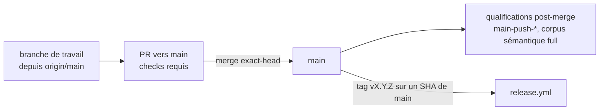

# Design

**Profil :** court

## Contexte

[Existant vérifié] Inventaire du 2026-11-12 (`git grep -w develop` hors documents datés) : dix-neuf workflows, `.github/dependabot.yml`, `.archgate/config.json`, deux hooks et leurs tests, le skill `nexus-pr-workflow` et l'outillage Claude qui l'appelle, la documentation courante, quatre specs et deux scripts de contrats citent `develop`. Le ruleset 20503835 « Protect main » protège déjà `main` seule avec les huit checks requis (proposal.md).

## Objectifs / Hors objectifs

**Objectifs :**
- Toute PR et toute qualification post-merge visent `main` (`scale-benchmark-gate`, `adr-rule-enforcement`, `semantic-search-qualification`).
- La gouvernance documentée nomme le ruleset réel (`repository-governance › Seul le merge commit est accepté`).
- Après le merge, `develop` peut être supprimée sans casser un workflow, un hook, Dependabot ou Archgate.

**Hors objectifs :**
- Modifier les règles du ruleset, la politique de tags ou `release.yml`.

## Composants et responsabilités

[Décision] Correspondance des déclencheurs et de l'outillage :

| Avant | Après |
|---|---|
| `pull_request` / `push` sur `[develop, main]` | `[main]` |
| `push` sur `develop` avec `paths` | `push` sur `main`, mêmes `paths` |
| `develop-push-scale-benchmark.yml`, `develop-push-scanner-corpus-benchmark.yml`, `develop-push-windows-installer.yml` | `main-push-*.yml` (`git mv`), workflow nommé « Main Push … » |
| `develop-push-docker-distribution.yml` | supprimé : `docker-distribution.yml` écoute déjà `push` sur `main` avec les mêmes chemins |
| Dependabot `target-branch: develop` | `target-branch: main` |
| Archgate `baseBranch: origin/develop` | `origin/main` |
| Hook : push direct refusé vers `develop` et `main` | refusé vers `main` |

Le skill `nexus-pr-workflow` perd les sections de promotion et de resynchronisation ; `/nx-release` prépare le tag de release sur `main`.

## Modèle de domaine et invariants

Non applicable : aucun modèle de données ni format persisté ne change.

## Traitements et interactions

Organigramme du flux cible (`scale-benchmark-gate`, `semantic-search-qualification`, `adr-rule-enforcement`).

## États et transitions

Non applicable : aucune entité ne change d'état.

## Contrats d'interface

Non applicable : aucun contrat CLI, REST ou MCP ne change.

## Persistance et intégrité

Non applicable : aucune table ni migration.

## Transactions, concurrence et idempotence

[Existant vérifié] Les groupes de concurrence des qualifications post-merge reposent sur `github.sha` ou `github.ref` ; ils restent valides sur `main`.

## Sécurité et isolation

[Existant vérifié] Le hook `guard-command.ps1` refuse le force-push et le push direct vers `main` ; le ruleset « Protect main » reste l'autorité.

## Erreurs et reprise

[Décision] Ordre : merge de la PR, puis suppression de `develop`. Le contrat `scripts/release/test-final-audit-contracts.sh` refuse toute mention de `develop` dans `.github/`, pour qu'aucun workflow ne dépende d'une branche absente.

## Observabilité

Non applicable : aucun journal applicatif ne change.

## Performance et mesure

[Existant vérifié] Un merge sur `main` déclenche les qualifications post-merge que déclenchait un merge sur `develop` ; la PR de promotion et son tour de CI disparaissent.

## Compatibilité, migration et retour arrière

Retour arrière : recréer `develop` depuis `main` et rétablir les déclencheurs par `git revert` du merge de ce changement.

## Décisions

- [Décision] ADR GEN-0089 « Intégrer et publier depuis la seule branche main ». BE-0090 consolide BE-0084 sur `main` et le remplace. GEN-0057 n'est pas réécrit : lien « Complété par : GEN-0089 » et écart constaté sur la base Archgate (choix du mainteneur du 2026-11-12, règle 5 de GEN-0057).
- [Décision] Suppression de l'enveloppe Docker plutôt que renommage, pour éviter deux runs identiques par push sur `main`.

## Risques / Compromis

- [Risque] Une régression vue seulement par le corpus complet ou le benchmark post-merge arrive sur `main` avant d'être détectée → la release reste un tag que le mainteneur pose après lecture des runs post-merge.

## Stratégie de vérification

- `pwsh -NoProfile -File .claude/hooks/tests/Test-Hooks.ps1`.
- `bash .claude/scripts/contracts.sh`, dont le refus de `develop` dans `.github/`.
- `archgate check`, `openspec validate flux-sur-main-seule --strict`.
- CI exact-head de la PR vers `main`.

## Traçabilité

| Exigence (`capacité › titre`) | Scénario | Conception ou diagramme | Tâche | Test ou preuve |
|---|---|---|---|---|
| `repository-governance › Seul le merge commit est accepté` | Lecture du ruleset | Composants et responsabilités | 4.2 | preuve manquante |
| `repository-governance › Seul le merge commit est accepté` | Lecture des réglages du dépôt | — | — | inchangé |
| `repository-governance › Seul le merge commit est accepté` | Documentation alignée | — | 3.1 | `scripts/release/test-operational-doc-contracts.sh` |
| `scale-benchmark-gate › Le check est produit sur toute PR` | PR hors des chemins surveillés | Traitements et interactions | 1.1 | CI de la PR |
| `scale-benchmark-gate › Le check est produit sur toute PR` | PR sur un chemin surveillé | Traitements et interactions | 1.1 | CI de la PR |
| `scale-benchmark-gate › Une seule liste de chemins surveillés` | Dérive de la liste | — | 1.1, 1.4 | `scripts/release/test-operational-doc-contracts.sh` |
| `scale-benchmark-gate › Le check est requis sur main` | Lecture du ruleset | — | 4.2 | preuve manquante |
| `adr-rule-enforcement › Les règles des ADR s'exécutent en CI` | Violation d'une règle | — | 1.1 | CI de la PR |
| `adr-rule-enforcement › Les règles des ADR s'exécutent en CI` | Aucune violation | — | 1.1 | CI de la PR |
| `semantic-search-qualification › Une PR exécute un corpus réduit borné` | PR touchant la recherche sémantique | — | 1.1 | `scripts/release/test-final-audit-contracts.sh` |
| `semantic-search-qualification › Le corpus complet s'exécute sur main` | Fusion sur main | Traitements et interactions | 1.1 | `scripts/release/test-final-audit-contracts.sh` |
| `semantic-search-qualification › Le corpus complet s'exécute sur main` | Rapport rattaché au SHA | — | 1.1 | `scripts/release/test-final-audit-contracts.sh` |
