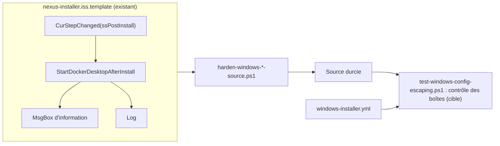
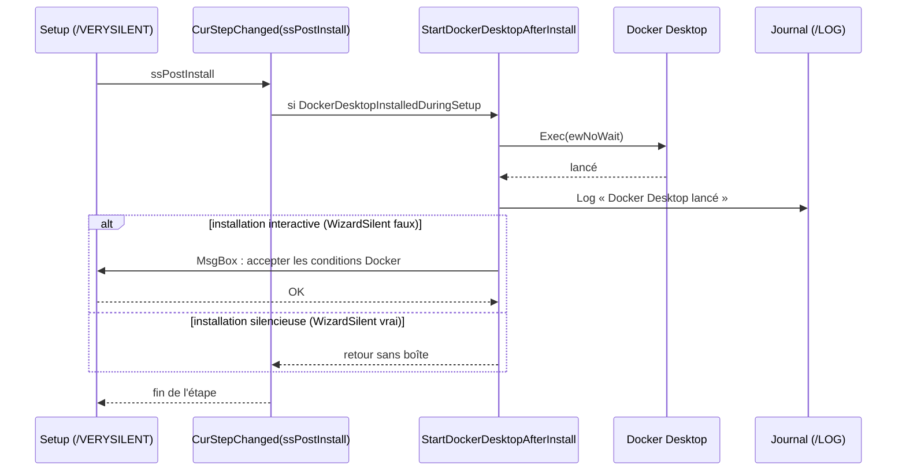
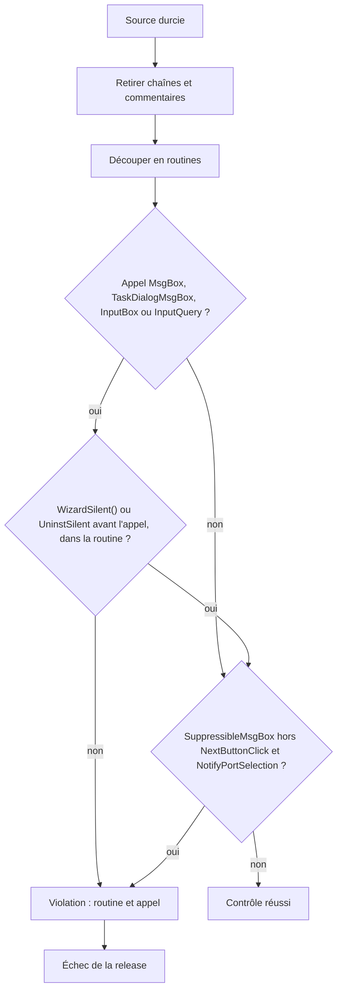

# Design

**Profil :** complet

## Contexte

- [Existant vérifié] L'installateur est un gabarit Pascal (`packaging/windows/nexus-installer.iss.template`) que `scripts/release/harden-windows-installer-source.ps1` et `scripts/release/harden-windows-rest-auth-source.ps1` réécrivent avant compilation. Le contrôle textuel `scripts/release/test-windows-config-escaping.ps1` analyse cette source durcie (`:11-14`) ; `.github/workflows/windows-installer.yml:77` l'exécute.
- [Existant vérifié] `StartDockerDesktopAfterInstall` quitte si `DockerDesktopInstalledDuringSetup` est faux (`packaging/windows/nexus-installer.iss.template:2281`), lance Docker Desktop par `Exec(…, SW_SHOWNORMAL, ewNoWait, …)` (`:2284`) et, si le lancement réussit, affiche `MsgBox(…, mbInformation, MB_OK)` (`:2285-2289`) sans garde. Elle est appelée en `ssPostInstall` sous la même condition (`:2488-2491`).
- [Existant vérifié] `DockerDesktopInstalledDuringSetup` passe à `True` quand `InstallDockerDesktopIfNeeded` a installé Docker Desktop (`:489`), après `Exec(…'install --user --backend=wsl-2 --quiet'…)` (`:477`). Elle est remise à `False` à l'initialisation de l'installation (`:879`).
- [Existant vérifié] Les gardes de mode silencieux du gabarit : `WizardSilent()` pour l'installation, `UninstSilent` (posé par `InitializeUninstall`, `:2578-2590`, d'après `/SILENT` ou `/VERYSILENT`) pour la désinstallation. Les `MsgBox(` gardés : `RunWhileClaudeDesktopClosed` (`:1819-1824`), l'avis des clients IA (`:2503-2504`), la question de désinstallation (`:2613-2617`).
- [Existant vérifié] Hors `MsgBox`, le gabarit n'appelle aucune autre primitive modale (`InputQuery(`, `InputBox(`, `TaskDialogMsgBox(`, `ExitSetupMsgBox(` : `git grep` du 15/11 sur le gabarit et les deux scripts de durcissement) ; les lanceurs générés et les scripts d'intégration n'ont ni `pause`, ni `set /p`, ni `Read-Host` (même relevé).
- [Existant vérifié] Le contrat du sprint 15 limite sa recherche de `MsgBox(` à `NextButtonClick` et `NotifyPortSelection` (`scripts/release/test-windows-config-escaping.ps1:420-455`, `scripts/release/test-windows-installer.ps1:74-98`) ; la conception du sprint 15 laissait expressément hors périmètre les boîtes hors validation des pages (`openspec/changes/sprint-15-installateur-caret/design.md`, « Hors objectifs »).
- [Écart] L'attente d'une installation silencieuse sur cette boîte est déduite de la lecture du gabarit ; elle n'a pas été rejouée avec un vrai Docker Desktop (`docs/project/audits/2026-10-17/etat-2026-11-15.md`, « Angles morts »).

## Objectifs / Hors objectifs

**Objectifs :**
- `installer-client-configuration` › Une installation silencieuse n'attend aucune réponse après l'installation de Docker Desktop.
- `installer-client-configuration` › Le contrôle de la source durcie refuse toute boîte modale sans garde de mode silencieux.

**Hors objectifs :**
- Les boîtes de validation de page : leur forme (`SuppressibleMsgBox(…, MB_OK, IDOK)`) est celle du sprint 15 et reste contrôlée à part.
- Le choix de lancer ou non Docker Desktop en installation silencieuse : le comportement actuel (lancement, sans attente) est conservé.
- Une exécution réelle de l'installateur avec installation de Docker Desktop (poste sans Docker, WSL 2, plusieurs minutes) dans la CI.

## Composants et responsabilités

Vue de composants (C4, niveau composants, existant) : le gabarit porte le comportement ; le contrôle lit la source durcie sans l'exécuter.

Le composant ajouté est le contrôle des boîtes (cible), qui lit la source durcie. Il couvre `installer-client-configuration › Le contrôle de la source durcie refuse toute boîte modale sans garde de mode silencieux`. Aucun composant du produit ne change de frontière.

## Modèle de domaine et invariants

Non applicable : aucune entité ni donnée persistante ; seul un message est conditionné.

Invariant du contrôle : tout appel `MsgBox(` (et `TaskDialogMsgBox(`, `InputBox(`, `InputQuery(`) du gabarit durci est précédé, dans sa routine, de `WizardSilent()` ou de `UninstSilent` ; tout `SuppressibleMsgBox(` appartient à `NextButtonClick` ou à `NotifyPortSelection`.

## Traitements et interactions

Séquence UML (cible) : étape post-installation après l'installation de Docker Desktop ; couvre `installer-client-configuration › Une installation silencieuse n'attend aucune réponse après l'installation de Docker Desktop`.

Notation : UML de séquence. Alternative d'erreur : si `Exec` échoue, ni journal de lancement ni boîte (comportement actuel inchangé).

Organigramme (cible) : décision du contrôle des boîtes sur la source durcie ; couvre `installer-client-configuration › Le contrôle de la source durcie refuse toute boîte modale sans garde de mode silencieux`.

Notation : organigramme (pas UML).

## États et transitions

Non applicable : aucune entité n'a de cycle de vie dans ce changement ; l'étape `docker-desktop` de la liste de progression garde ses états (`running`, `done`, `:2488-2493`).

## Contrats d'interface

[Existant vérifié] Paramètres Inno Setup concernés : `/SILENT`, `/VERYSILENT`, `/SUPPRESSMSGBOXES`. `MsgBox` n'est pas supprimée par `/SUPPRESSMSGBOXES` ; `SuppressibleMsgBox` l'est, mais reste affichée sans ce paramètre. Le contrôle est un script PowerShell sans paramètre ; il lève une exception au premier jeu de violations, qui nomme la routine et l'appel, et sort en code non nul comme les autres contrôles du fichier.

## Persistance et intégrité

Non applicable : aucune migration, aucun format persistant ; la clé de registre `DockerDesktopInstalledByNexus` n'est pas touchée (`:490`).

## Transactions, concurrence et idempotence

Non applicable : une seule étape séquentielle de l'installateur ; la garde n'ajoute aucun état.

## Sécurité et isolation

Non applicable : aucune donnée sensible ni surface réseau ; le message ne contient pas de chemin ni de secret. La licence Docker reste à accepter par l'utilisateur (`docs/user/windows-installation.md`, « Écran 7 — Docker Desktop ») : en installation silencieuse, le journal consigne seulement le lancement.

## Erreurs et reprise

- [Décision] Si `Exec` ne lance pas Docker Desktop, le comportement actuel est conservé (aucun avis). Le journal ne dit alors rien du lancement ; `nexus-docker-up.cmd` attend le moteur et sort en code 30 s'il n'est pas prêt (`:1410-1414`).
- Le contrôle d'une boîte non gardée échoue la release avant publication ; la reprise consiste à garder la boîte (ou à la remplacer par un journal).

## Observabilité

- [Décision] Le lancement de Docker Desktop est journalisé (`Log`) dans les deux modes, ce qui remplace dans le journal d'installation silencieuse l'information de la boîte. L'avis sur les conditions Docker reste, hors silencieux, dans la boîte.

## Performance et mesure

Non applicable : une chaîne de caractères journalisée ; le contrôle analyse un fichier d'environ 3 000 lignes sans valeur de seuil à fixer.

## Compatibilité, migration et retour arrière

Pas de format persistant ni de contrat public modifié. Retour arrière : rétablir la boîte non gardée, ce qui rouvre `AUD-QUA-33`.

## Décisions

- [Décision] Garde `not WizardSilent()` plutôt que `SuppressibleMsgBox(…, MB_OK, IDOK)` : sans `/SUPPRESSMSGBOXES`, une `SuppressibleMsgBox` s'afficherait et suspendrait un déploiement `/VERYSILENT`. C'est aussi la forme de l'avis voisin des clients IA (`:2503`). Alternative écartée : `SuppressibleMsgBox`, qui laisse le défaut pour qui oublie le paramètre.
- [Décision] Contrôle fondé sur la présence d'une garde dans la routine, avant l'appel, plutôt que sur une liste de routines : un `MsgBox` ajouté demain dans une routine sans garde est vu sans modifier le contrôle. Alternative écartée : liste de routines autorisées, qui se périme à chaque ajout.
- [Décision] Le contrôle vit dans `scripts/release/test-windows-config-escaping.ps1`, seul contrôle de la source durcie exécutable sans installateur construit (`windows-installer.yml:77`), et non dans `test-windows-installer.ps1`, qui exige un `Setup` compilé. Alternative écartée : dupliquer l'analyse dans les deux scripts.
- Aucun ADR : décision locale à un script d'installateur et à son contrôle, pas de choix structurant transversal.

## Risques / Compromis

- [Risque] La garde est cherchée dans la routine avant l'appel, pas dans le bloc qui l'enveloppe : une garde sur une autre branche d'un `if` satisferait le contrôle à tort → mitigation : le contrôle de la forme exacte de `StartDockerDesktopAfterInstall` (garde sur l'appel) et la relecture ; limite documentée.
- [Risque] L'analyse retire chaînes et commentaires par expressions régulières, pas par un vrai analyseur Pascal → mitigation : contrôles négatifs qui échouent sur une boîte injectée et sur la garde retirée.
- [Risque] Lancer Docker Desktop en installation silencieuse peut faire apparaître son propre écran de licence : non rejoué, limite documentée.

## Stratégie de vérification

- `pwsh -NoProfile -File scripts/release/test-windows-config-escaping.ps1` : exécuté ici (PowerShell 7) ; le contrôle d'origine échoue sur le gabarit actuel (tâche 1.1) puis réussit après la garde (1.2).
- `bash .claude/scripts/contracts.sh` (contrats documentaires et de traçabilité).
- `openspec validate sprint-16-installateur-msgbox-docker --strict`.
- Validation syntaxique des diagrammes Mermaid par l'outil de rendu avant la livraison.
- Compilation de la source durcie (tokens remplacés, fichiers de charge utile retirés) par `ISCC.exe` d'Inno Setup 6 : contrôle de syntaxe du `[Code]`.
- Non exécuté ici : `scripts/release/test-windows-installer.ps1` (exige un `Setup` compilé) et une installation silencieuse réelle avec Docker Desktop.

## Traçabilité

| Exigence (`capacité › titre`) | Scénario | Conception ou diagramme | Tâche | Test ou preuve |
|---|---|---|---|---|
| `installer-client-configuration › Une installation silencieuse n'attend aucune réponse après l'installation de Docker Desktop` | Docker Desktop installé en installation silencieuse | Séquence (alternative silencieuse) | 1.2 | `packaging/windows/nexus-installer.iss.template:2284-2294` (journal, puis boîte sous `not WizardSilent()`) ; `scripts/release/test-windows-config-escaping.ps1:507-522` (forme de l'avis) ; compilation de la source durcie par Inno Setup 6 ; installation silencieuse réelle : preuve manquante |
| `installer-client-configuration › Une installation silencieuse n'attend aucune réponse après l'installation de Docker Desktop` | Docker Desktop installé en installation interactive | Séquence (alternative interactive) | 1.2 | même forme : la boîte est conservée sous `not WizardSilent()` (`:2288-2294`) ; installation interactive réelle : preuve manquante |
| `installer-client-configuration › Une installation silencieuse n'attend aucune réponse après l'installation de Docker Desktop` | Docker Desktop déjà présent | Séquence (condition `DockerDesktopInstalledDuringSetup`) | 1.3 | `packaging/windows/nexus-installer.iss.template:2281` ; `scripts/release/test-windows-config-escaping.ps1:513-515` et contrôle négatif `:555-559` |
| `installer-client-configuration › Le contrôle de la source durcie refuse toute boîte modale sans garde de mode silencieux` | Gabarit courant | Organigramme du contrôle | 1.1 | `scripts/release/test-windows-config-escaping.ps1:489-505`, exécuté sur le gabarit durci `:524-531` (réussit sous PowerShell 7 et sous Windows PowerShell 5.1) |
| `installer-client-configuration › Le contrôle de la source durcie refuse toute boîte modale sans garde de mode silencieux` | Garde retirée de l'avis Docker Desktop | Organigramme du contrôle | 1.1 | contrôle négatif par mutation de `StartDockerDesktopAfterInstall`, `scripts/release/test-windows-config-escaping.ps1:532-543` ; le contrôle d'origine échoue sur le gabarit non corrigé en nommant `StartDockerDesktopAfterInstall` |
| `installer-client-configuration › Le contrôle de la source durcie refuse toute boîte modale sans garde de mode silencieux` | Boîte ajoutée dans une routine sans garde | Organigramme du contrôle | 1.1 | contrôles négatifs par injection d'un `MsgBox` et d'un `SuppressibleMsgBox` dans `IsSmokeBuild`, `scripts/release/test-windows-config-escaping.ps1:544-554` |

## Questions ouvertes

Aucune.
