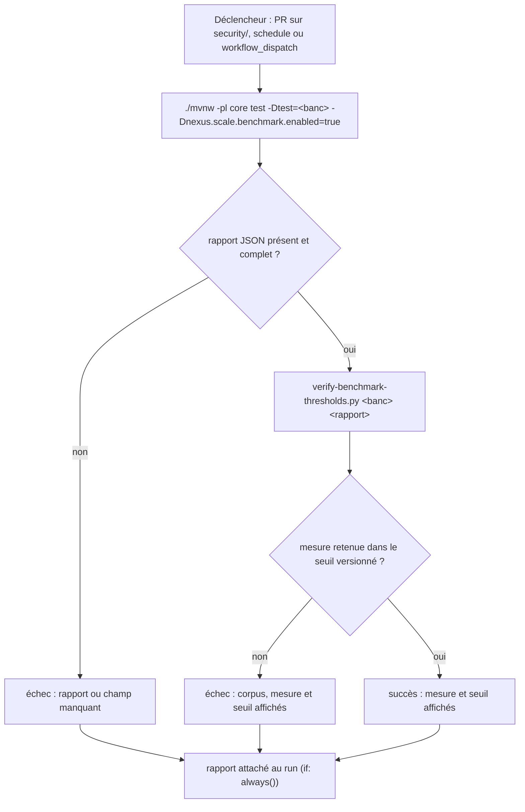

# Design

**Profil :** court (changement d'outillage : workflows, contrôles d'hygiène, montée de dépendance et seuils de bancs ; aucun comportement du produit NEXUS ne change).

## Contexte

- [Existant vérifié] Les contrôles d'hygiène des workflows sont des sous-commandes de `scripts/release/workflow_hygiene.py` (table `CHECKS` : `pins`, `forms`, `inputs`, `timeouts`, `runners`, plus `upstream` traité par `main`), lisant les workflows ligne à ligne sans bibliothèque YAML (docstring, `:1-35`). `bash .claude/scripts/contracts.sh` les exécute sur `.github/workflows` et `.github/actions` puis exige le rejet de chaque fixture négative de `scripts/release/fixtures/workflow-hygiene/` avec son message (`scripts/release/test-operational-doc-contracts.sh:735-770`).
- [Existant vérifié] Le contrôle `runners` ne vise qu'une liste fixe de jobs de benchmark, `PINNED_RUNNER_JOBS` (`scripts/release/workflow_hygiene.py:68-76`), et ses messages parlent de « benchmark job » (`:357-377`). `linux-reactor` et `build-sbom` n'y figurent pas.
- [Existant vérifié] Aucun contrôle ne lit `persist-credentials` (recherche de `persist` vide dans `workflow_hygiene.py`), ni les expressions `github.actor`, `steps.*.outputs.*` ou `github.event.pull_request.*` dans un bloc `run:` ; le contrôle `inputs` ne regarde que `inputs` (limite écrite dans `docs/developer/ci-and-supply-chain.md:452`).
- [Existant vérifié] Le contrat Docker de `scripts/release/test-operational-doc-contracts.sh:896-902` exige plusieurs chaînes dans `docker-distribution.yml` (dont `- '.dockerignore'`) mais aucune entrée liée au wrapper Maven.
- [Existant vérifié] `scale-benchmark.yml` vérifie ses budgets par un script testé (`python3 -m unittest discover -s scripts/tests -p 'test_scale_budgets.py'` puis `python3 scripts/verify-scale-budgets.py target`, `.github/workflows/scale-benchmark.yml:225-230`). Les bancs Lucene et Git vérifient leur rapport par un heredoc Python sous Linux (`lucene-lifecycle-benchmark.yml:126-177`, `git-context-cache-qualification.yml:113-163`) et par PowerShell sous Windows (`lucene-lifecycle-benchmark.yml:224-225`, `git-context-cache-qualification.yml:214`).
- [Existant vérifié] `RedactionThroughputBenchmarkTest` écrit son rapport à un chemin relatif au répertoire de lancement (`nexus.redaction.benchmark.output`, `RedactionThroughputBenchmarkTest.java:71-75` ; `docs/developer/indexing-pipeline.md:357`) ; `IndexingHeapPeakBenchmarkTest` lit le profil `ci` (2 000 fichiers) ou `full` (20 000) et le nombre de fichiers par `nexus.scale.benchmark.indexing.files` (`IndexingHeapPeakBenchmarkTest.java:71-79`).
- [Existant vérifié] Le contrat `scripts/release/test-final-audit-contracts.sh:233-249` (boucle `AUD-TST-09`) exige que cinq tests opt-in soient nommés dans leur workflow et dans `docs/developer/ci-and-supply-chain.md` ; il ne parcourt pas `src/test`.
- [Écart] `docs/developer/reproduce-and-debug.md:596` situe ce contrat en `:215-231` ; les commits `f0421c90` et `6e0a5aaf` l'ont décalé en `:233-249`. La tâche 6.2 réaligne la référence.
- [Existant vérifié] La documentation courante désigne Quarkus par sa propriété, sans numéro (`scripts/release/test-operational-doc-contracts.sh:48`, `:139-141`) ; la montée passe par le skill `nexus-dependency-bump`.
- Pages durables : `docs/developer/ci-and-supply-chain.md` (`#openspec-ci-workflow-tooling`, nouvelle section `#openspec-performance-benchmark-thresholds`, tableau « Tests de mesure opt-in »), `docs/developer/reproduce-and-debug.md` (`#openspec-test-suite-reliability`).

## Objectifs / Hors objectifs

**Objectifs :**
- `ci-workflow-tooling › Aucun checkout ne conserve le jeton dans la configuration Git`.
- `ci-workflow-tooling › Le contexte GitHub et les sorties d'étape arrivent dans le shell par l'environnement`.
- `ci-workflow-tooling › Les gates requis Linux tournent sur un JDK et une image épinglés`.
- `ci-workflow-tooling › Le filtre de chemins d'un gate couvre le wrapper Maven et son ancre` et `› Le filtre de chemins d'un gate ne contient aucun motif mort`.
- `performance-benchmark-thresholds` (cinq exigences) et `test-suite-reliability › Chaque test opt-in a un lanceur automatisé` (scénario des deux bancs).
- `AUD-DEP-01` sans exigence : Quarkus 3.40.1.2 et gate OSV du SBOM agrégé vert.

**Hors objectifs :** changer le protocole de mesure des bancs ; rendre requis un gate ou un banc ; épingler le JDK des jobs autres que les deux gates requis Linux.

## Composants et responsabilités

- [Décision] Les règles vérifiables sur les fichiers de workflow vont dans `workflow_hygiene.py`, pas dans un nouveau heredoc de `test-operational-doc-contracts.sh` : les contrôles y sont testés par fixture, et le sprint S7 (`AUD-QUA-10`) sort justement les heredocs Python de ce script. Quatre sous-commandes s'ajoutent à `CHECKS` :
  - `credentials` : chaque étape dont `uses:` désigne `actions/checkout` porte `persist-credentials: false` dans son bloc `with:` ;
  - `contexts` : aucune expression `github.actor`, `steps.<id>.outputs.<nom>` ou `github.event.pull_request.<champ>` sur une ligne de texte d'un bloc `run:` (réutilise `run_blocks` et `EXPRESSION`) ;
  - `toolchain` : pour les jobs `linux-reactor` (`ci.yml`) et `build-sbom` (`osv-scanner.yml`), `runs-on` correspond à `VERSIONED_RUNNER` et `java-version` est une version exacte égale à celle du job `windows-gate` ;
  - `paths` : table des entrées exigées par workflow et par événement (`docker-distribution.yml` `pull_request`/`push`, `windows-installer.yml`, `main-push-windows-installer.yml`), et refus d'un motif dont le premier segment littéral n'existe pas dans l'arbre suivi (lecture de `git ls-files` depuis la racine).
- [Décision] Les quatre contrôles commencent, comme `inputs` et `timeouts`, par `forms`, et sont appelés par la boucle de `test-operational-doc-contracts.sh:740-742` ; chaque contrôle a au moins une fixture négative rejetée avec son message.
- [Proposition] Les seuils des bancs secondaires vivent dans un script `scripts/verify-benchmark-thresholds.py` testé par `scripts/tests/test_benchmark_thresholds.py`, sur le modèle de `verify-scale-budgets.py`. Les étapes de vérification des workflows l'appellent sous Linux et sous Windows (Python est présent sur les deux images), au lieu de recopier un seuil dans un heredoc et un bloc PowerShell.
- [Proposition] Deux workflows non requis : `redaction-throughput-benchmark.yml` (déclencheurs `pull_request` sur `core/src/main/java/com/nexus/security/**`, le banc et le workflow lui-même, et `workflow_dispatch`) et `indexing-heap-benchmark.yml` (`schedule` hebdomadaire et `workflow_dispatch`). Chacun : `ubuntu-24.04`, JDK `21.0.12+101.0.LTS`, `timeout-minutes`, checkout `persist-credentials: false`, rapport en artefact, entrée dans `PINNED_RUNNER_JOBS`.

## Modèle de domaine et invariants

Non applicable : aucun modèle du produit ne change ; les seuils sont des constantes d'outillage.

## Traitements et interactions

Vue organigramme (cible) : comment un rapport de banc secondaire fait-il échouer son job ? Couvre `performance-benchmark-thresholds › Le banc de débit de redaction échoue sous son seuil`, `› Le pic de heap de l'indexation est mesuré par un job planifié et seuillé`, `› Les bancs Lucene et Git échouent sous un plancher de gain` et `› Le budget du banc du scanner suit un relevé retenu`.

L'étape d'upload s'exécute même en échec pour garder la mesure qui a fait rougir le job. Le test JUnit lui-même ne porte pas le seuil : il mesure et écrit le rapport, comme les autres bancs du paquet `com.nexus.benchmark`, ce qui permet de le relancer à la main sans échec.

## États et transitions

Non applicable : aucune entité ne change d'état.

## Contrats d'interface

- [Décision] `workflow_hygiene.py <check> <chemins…>` garde son contrat : code 0 et `workflow-hygiene-<check>=PASS`, code 1 et une ligne `workflow hygiene (<check>): <fichier>:<ligne>: <message>` par erreur, code 2 sur un usage invalide (`main`, `:464-483`).
- [Proposition] `verify-benchmark-thresholds.py <banc> <rapport>` : code 0 et une ligne `<banc>-<mesure>=<valeur> threshold=<seuil>` ; code 1 avec message nommant le corpus, la mesure et le seuil ; code 2 sur un banc inconnu.

## Persistance et intégrité

Non applicable : aucun format persisté ; les rapports sont des artefacts de run à rétention bornée.

## Transactions, concurrence et idempotence

Non applicable : les contrôles sont des lectures de fichiers ; les bancs tournent dans un `NEXUS_HOME` temporaire.

## Sécurité et isolation

- [Décision] `persist-credentials: false` sur les 25 checkouts : le code exécuté après le checkout ne trouve plus de jeton dans `.git/config`. Le job `publish` s'authentifie déjà explicitement (`GHCR_TOKEN` pour `docker login`, `release.yml:306` ; `GH_TOKEN` pour `gh`). Les étapes qui poussent avec Git après un checkout doivent recevoir leur jeton explicitement ; la tâche 4.2 les recense (`git push` dans `.github/workflows`).
- [Existant vérifié] Les expressions déplacées vers `env:` ne sont pas contrôlables par un attaquant (login GitHub, sorties d'un script du dépôt, SHA ; findings.md, `AUD-DEP-03`, Impact) : c'est de l'hygiène, alignée sur la règle déjà appliquée à `inputs`.
- [Existant vérifié] Quarkus 3.40.1.2 corrige des CVE non atteignables dans la configuration livrée selon l'audit (findings.md, `AUD-DEP-01`, Impact) ; la montée retire le risque lié à un changement de réglage.

## Erreurs et reprise

Un contrôle qui échoue nomme fichier, ligne et règle ; un banc qui échoue garde son rapport en artefact. Un faux positif d'un seuil se corrige par une PR qui change la constante et sa page, jamais par un `continue-on-error`.

## Observabilité

Chaque étape de vérification affiche la mesure et le seuil, en succès comme en échec.

## Performance et mesure

- [Existant vérifié] Aucun seuil n'est sourcé pour le débit de redaction, le pic de heap, les gains Lucene et Git, ni le budget resserré du scanner : l'audit les demande sans valeur (findings.md, `AUD-PRF-04`, Action). Le budget actuel du scanner est `scanMs <= 30_000` (`scanner-corpus-benchmark.yml:100`, `docs/developer/indexing-corpus-limits.md:71`).
- [Existant vérifié] Relevé daté disponible pour le heap : `docs/project/history/indexing-heap-and-hashing-measures-2026-11-07.md`, poste et JDK de sa date ; il n'est pas pris sur `ubuntu-24.04`.
- [Décision] Les valeurs se fixent à partir d'au moins un relevé sur le runner de référence (`ubuntu-24.04`, JDK `21.0.12+101.0.LTS`), consigné dans `docs/project/history/` avant d'écrire le seuil ; la page durable cite ce relevé et la valeur, le contrat vérifie leur concordance avec le script. Les questions ci-dessous décident de la métrique ; la tâche 5.1 les tranche avant 5.2.

## Compatibilité, migration et retour arrière

- [Existant vérifié] La montée Quarkus est une propriété du `pom.xml` ; retour arrière par revert. Les contrats documentaires ne recopient pas le numéro (voir Contexte).
- Les nouveaux contrôles d'hygiène s'appliquent aux PR suivantes ; aucun check requis ne change de nom (`docs/developer/branch-governance.md:39-47`).

## Décisions

- [Décision] `AUD-DEP-01` ne crée pas d'exigence : la version d'une dépendance n'est pas un comportement, et le gate OSV qui vérifie l'effet attendu existe (`osv-scanner.yml:77-89`).
- [Décision] Épingler le JDK et l'image des seuls gates requis Linux, comme l'audit le propose ; un contrôle `toolchain` le garde. Généraliser à tous les jobs (14 `java-version: '21'`) multiplierait les montées de JDK sans gain sur un check requis.
- [Décision] Satisfaire `test-suite-reliability › Chaque test opt-in a un lanceur automatisé` par un lanceur seuillé pour les deux bancs, selon le critère de sortie du sprint, plutôt que par le retrait de `src/test` que l'audit laissait possible pour `IndexingHeapPeakBenchmarkTest`. Le texte de la page durable qui qualifie l'absence de lanceur de « volontaire » est remplacé.
- [Décision] Supprimer `'src/**'` des deux filtres de `docker-distribution.yml` (aucun répertoire `src` à la racine), et l'interdire par le contrôle `paths`.
- [Proposition] Script de seuils partagé et deux workflows dédiés (section Composants) ; alternative écartée : ajouter les deux bancs à `scale-benchmark.yml`, check requis dont la liste de chemins surveillés est unique (`scale-benchmark-gate › Une seule liste de chemins surveillés`) et dont le temps de run augmenterait sur chaque PR de code.
- Aucun nouvel ADR : outillage de CI sans décision structurante coûteuse à inverser.

## Risques / Compromis

- [Risque] Un seuil absolu de durée rougit sur un runner partagé chargé. → Préférer une métrique de rapport (part des passes, heap vivant par fichier) ou un seuil relatif ; relevé de référence sur `ubuntu-24.04` ; les bancs restent non requis.
- [Risque] `persist-credentials: false` casse une étape qui poussait implicitement avec le jeton du checkout. → Recensement des `git push`/`git tag` à la tâche 4.2 et jeton explicite pour ces étapes ; run vert de chaque workflow touché exigé.
- [Risque] La montée Quarkus fait diverger une borne supérieure (`requireUpperBoundDeps`). → Relecture des exclusions (`pom.xml:321-333`) et build complet.
- [Risque] Le contrôle `paths` lit `git ls-files` : sur une copie sans `.git`, il ne peut conclure. → Échec explicite (code 2) plutôt qu'un succès silencieux.

## Stratégie de vérification

- Contrôles d'hygiène : `python3 scripts/release/workflow_hygiene.py <check> .github/workflows .github/actions` pour `credentials`, `contexts`, `toolchain`, `paths` (code 0), et chaque fixture négative rejetée avec son message dans `bash .claude/scripts/contracts.sh`.
- Seuils : `python3 -m unittest discover -s scripts/tests -p 'test_benchmark_thresholds.py'` (cas dans le seuil, hors seuil, rapport incomplet) ; run `workflow_dispatch` de chaque nouveau workflow, et un run rouge provoqué sur une branche de test (seuil temporairement abaissé, commit retiré avant fusion).
- Quarkus : `./mvnw -B -ntp clean install` (enforcer compris), présence et version de `com.aayushatharva.brotli4j` dans `target/sbom/bom.json`, check `OSV aggregate SBOM vulnerability gate / osv-scan` vert sur le run exact-head de la PR.
- Ensemble : `bash .claude/scripts/contracts.sh`, `pwsh -NoProfile -File scripts/self-smoke.ps1`, `openspec validate audit-1116-s1-ci-et-mesures --strict`.

## Traçabilité

| Exigence (`capacité › titre`) | Scénario | Conception ou diagramme | Tâche | Test ou preuve |
|---|---|---|---|---|
| `ci-workflow-tooling › Aucun checkout ne conserve le jeton dans la configuration Git` | Checkout du job de publication | Sécurité et isolation | 4.2 | tâche non réalisée ; preuve attendue : `.github/workflows/release.yml` (checkout du job `publish`) |
| `ci-workflow-tooling › Aucun checkout ne conserve le jeton dans la configuration Git` | Checkout sans la clé | Composants (`credentials`) | 4.1 | test non écrit (fixture `credentials-missing.yml`) |
| `ci-workflow-tooling › Aucun checkout ne conserve le jeton dans la configuration Git` | Checkout sans bloc with | Composants (`credentials`) | 4.1 | test non écrit (fixture `credentials-no-with.yml`) |
| `ci-workflow-tooling › Aucun checkout ne conserve le jeton dans la configuration Git` | Valeur true | Composants (`credentials`) | 4.1 | test non écrit (fixture `credentials-true.yml`) |
| `ci-workflow-tooling › Aucun checkout ne conserve le jeton dans la configuration Git` | Workflows du dépôt | Composants (`credentials`) | 4.1, 4.2 | tâche non réalisée ; preuve attendue : `bash .claude/scripts/contracts.sh` |
| `ci-workflow-tooling › Le contexte GitHub et les sorties d'étape arrivent dans le shell par l'environnement` | Connexion au registre de la release | Sécurité et isolation | 4.4 | tâche non réalisée ; preuve attendue : `.github/workflows/release.yml` (étape `docker login`) |
| `ci-workflow-tooling › Le contexte GitHub et les sorties d'étape arrivent dans le shell par l'environnement` | Base de la PR du benchmark d'échelle | Sécurité et isolation | 4.4 | tâche non réalisée ; preuve attendue : `.github/workflows/scale-benchmark.yml` |
| `ci-workflow-tooling › Le contexte GitHub et les sorties d'étape arrivent dans le shell par l'environnement` | Sortie d'étape interpolée | Composants (`contexts`) | 4.3 | test non écrit (fixture `contexts-step-output.yml`) |
| `ci-workflow-tooling › Le contexte GitHub et les sorties d'étape arrivent dans le shell par l'environnement` | Expression dans env | Composants (`contexts`) | 4.3 | test non écrit (cas ajouté à `valid-defaults-and-env.yml`) |
| `ci-workflow-tooling › Les gates requis Linux tournent sur un JDK et une image épinglés` | Lecture des deux jobs | Décisions | 2.1 | tâche non réalisée ; preuve attendue : `.github/workflows/ci.yml` (`linux-reactor`), `.github/workflows/osv-scanner.yml` (`build-sbom`) |
| `ci-workflow-tooling › Les gates requis Linux tournent sur un JDK et une image épinglés` | JDK flottant | Composants (`toolchain`) | 2.2 | test non écrit (fixture `toolchain-floating-jdk`) |
| `ci-workflow-tooling › Les gates requis Linux tournent sur un JDK et une image épinglés` | Image -latest | Composants (`toolchain`) | 2.2 | test non écrit (fixture `toolchain-latest-runner`) |
| `ci-workflow-tooling › Les gates requis Linux tournent sur un JDK et une image épinglés` | Versions divergentes entre gates | Composants (`toolchain`) | 2.2 | test non écrit (fixture `toolchain-divergent-jdk`) |
| `ci-workflow-tooling › Le filtre de chemins d'un gate couvre le wrapper Maven et son ancre` | PR qui ne modifie que l'ancre d'intégrité | Composants (`paths`) | 3.1 | tâche non réalisée ; preuve attendue : run des deux workflows sur une PR de test |
| `ci-workflow-tooling › Le filtre de chemins d'un gate couvre le wrapper Maven et son ancre` | Push qui ne modifie que le wrapper | Composants (`paths`) | 3.1 | tâche non réalisée ; preuve attendue : lecture du filtre `push` de `docker-distribution.yml` |
| `ci-workflow-tooling › Le filtre de chemins d'un gate couvre le wrapper Maven et son ancre` | Entrée retirée d'un filtre | Composants (`paths`) | 3.2 | test non écrit (fixture `paths-missing-wrapper`) |
| `ci-workflow-tooling › Le filtre de chemins d'un gate ne contient aucun motif mort` | Répertoire src absent | Composants (`paths`), Décisions | 3.2 | test non écrit (fixture `paths-dead-pattern`) |
| `ci-workflow-tooling › Le filtre de chemins d'un gate ne contient aucun motif mort` | Filtres du dépôt | Composants (`paths`) | 3.1, 3.2 | tâche non réalisée ; preuve attendue : `python3 scripts/release/workflow_hygiene.py paths .github/workflows` |
| `performance-benchmark-thresholds › Le débit de redaction est mesuré quand la redaction change` | PR qui modifie le redacteur | Composants (workflow de redaction), organigramme | 5.3 | tâche non réalisée ; preuve attendue : run `pull_request` de `redaction-throughput-benchmark.yml` |
| `performance-benchmark-thresholds › Le débit de redaction est mesuré quand la redaction change` | PR hors du paquet security | Composants (workflow de redaction) | 5.3 | tâche non réalisée ; preuve attendue : filtre `paths` du workflow |
| `performance-benchmark-thresholds › Le banc de débit de redaction échoue sous son seuil` | Régression du redacteur | Organigramme | 5.2, 5.3 | test non écrit (`scripts/tests/test_benchmark_thresholds.py`) |
| `performance-benchmark-thresholds › Le banc de débit de redaction échoue sous son seuil` | Mesure dans le seuil | Organigramme | 5.2, 5.3 | test non écrit |
| `performance-benchmark-thresholds › Le banc de débit de redaction échoue sous son seuil` | Rapport absent ou incomplet | Organigramme | 5.2 | test non écrit |
| `performance-benchmark-thresholds › Le pic de heap de l'indexation est mesuré par un job planifié et seuillé` | Run planifié dans le seuil | Composants (workflow de heap), organigramme | 5.4 | tâche non réalisée ; preuve attendue : run `workflow_dispatch` de `indexing-heap-benchmark.yml` |
| `performance-benchmark-thresholds › Le pic de heap de l'indexation est mesuré par un job planifié et seuillé` | Rétention qui croît | Organigramme | 5.2, 5.4 | test non écrit |
| `performance-benchmark-thresholds › Les bancs Lucene et Git échouent sous un plancher de gain` | Gain du cache Git sous le plancher | Organigramme | 5.5 | test non écrit |
| `performance-benchmark-thresholds › Les bancs Lucene et Git échouent sous un plancher de gain` | Gain Lucene sous le plancher | Organigramme | 5.5 | test non écrit |
| `performance-benchmark-thresholds › Les bancs Lucene et Git échouent sous un plancher de gain` | Gains au-dessus du plancher | Organigramme | 5.5 | tâche non réalisée ; preuve attendue : runs des deux workflows |
| `performance-benchmark-thresholds › Le budget du banc du scanner suit un relevé retenu` | Valeur divergente | Performance et mesure | 5.6 | test non écrit (contrat de concordance page/workflow) |
| `performance-benchmark-thresholds › Le budget du banc du scanner suit un relevé retenu` | Scan au-delà du budget | Organigramme | 5.6 | preuve existante partielle : `.github/workflows/scanner-corpus-benchmark.yml:100` (budget de 30 000 ms non dérivé d'un relevé) |
| `test-suite-reliability › Chaque test opt-in a un lanceur automatisé` | Intégration MINOS réelle | inchangé | — | preuve existante : `scripts/release/test-final-audit-contracts.sh:233-249` (`MinosRealIntegrationTest`, `:237`) |
| `test-suite-reliability › Chaque test opt-in a un lanceur automatisé` | Baselines de mesure | inchangé | — | preuve existante : `scripts/release/test-final-audit-contracts.sh:238-241` |
| `test-suite-reliability › Chaque test opt-in a un lanceur automatisé` | Bancs de débit de redaction et de pic de heap | Décisions | 5.3, 5.4, 5.7 | test non écrit (extension de `test-final-audit-contracts.sh`) |

## Questions ouvertes

- [Question] Métrique et seuil du banc de débit de redaction : médiane absolue de `redact`, rapport à la base de la PR, ou plafond de `tokenPassesShareOfRedact` ? Ne change ni les specs (« seuil versionné ») ni le découpage ; tranchée par la tâche 5.1.
- [Question] Seuil du pic de heap : `peakLiveHeapBytes` par fichier (recommandation de `docs/developer/indexing-pipeline.md:355`) ou absolu, et à partir de quel relevé sur `ubuntu-24.04` ?
- [Question] Bancs Lucene et Git : plancher absolu ou seuil relatif à la base ? Pour Lucene, `p95ImprovementRatio` mesure le prototype `persistentPrototype` face au cycle de vie de production ; si le mainteneur juge que ce gain ne garde pas le cache de readers de production, la tâche 5.5 se limite au banc Git et l'exigence Lucene est retirée du delta avant implémentation.
- [Question] Relevé de référence du budget du scanner : aucun relevé daté n'est cité dans `docs/developer/indexing-corpus-limits.md`.
