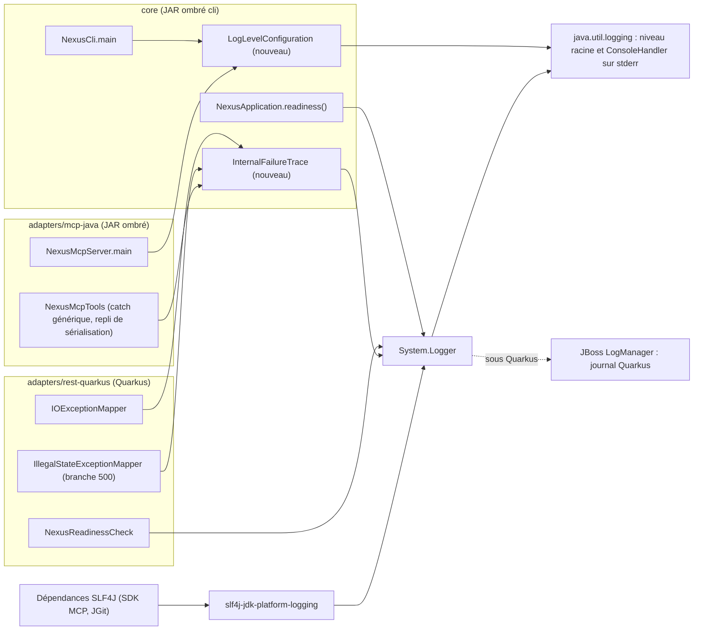
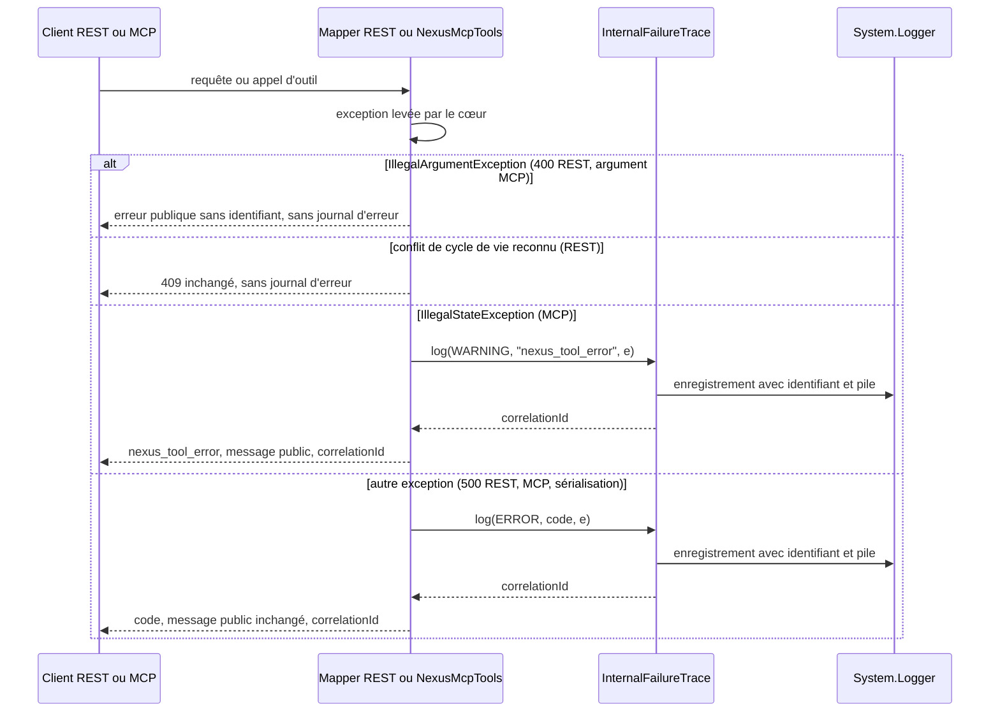
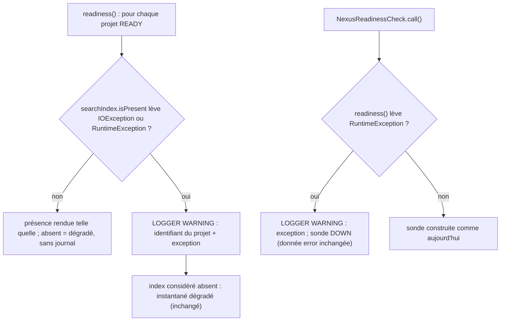

# Design

**Profil :** complet (changement fonctionnel : contrat public d'erreur, journalisation, configuration de lancement ; avec un volet outillage de couverture et de CI).

## Contexte

Relu au HEAD `6e0a5aaf`. Le code de production est celui du commit audité `7ec5c5dc` (`git log 7ec5c5dc..HEAD -- core adapters pom.xml distribution` est vide). Motivation et constats : `proposal.md`.

**Erreurs internes et disponibilité**

- [Existant vérifié] REST : `IOExceptionMapper.toResponse` (`adapters/rest-quarkus/src/main/java/com/nexus/api/IOExceptionMapper.java:15-19`) et la branche finale d'`IllegalStateExceptionMapper.toResponse` (`IllegalStateExceptionMapper.java:38-43`) construisent un `ErrorResponse(error, message)` (`ApiModels.java:43-44`) sans journaliser. Les deux conflits de cycle de vie sont reconnus au texte du message (`:20-23`, `:46-72`) et rendus en 409 (`:28-37`). Aucune classe de `adapters/rest-quarkus/src/main` ne déclare de logger. Le module n'a aucun `ExceptionMapper` générique : une autre `RuntimeException` passe au traitement par défaut de Quarkus.
- [Existant vérifié] MCP : le gestionnaire de chaque outil capture toute `Exception` et renvoie `{"error":"nexus_tool_error","message":safeMessage(e)}` en erreur (`adapters/mcp-java/src/main/java/com/nexus/mcp/NexusMcpTools.java:226-240`). `safeMessage` filtre le message d'une `IllegalArgumentException` par `PublicDiagnosticPolicy.internal().text`, rend « Opération NEXUS indisponible dans l'état courant » pour une `IllegalStateException` et « Erreur interne NEXUS » sinon (`:260-272`). Le repli de `textResult` rend `serialization_error` sans journaliser (`:251-256`).
- [Existant vérifié] Core : `NexusApplication.readiness()` avale `IOException | RuntimeException` de `searchIndex.isPresent` et déclare l'index absent (`core/src/main/java/com/nexus/application/NexusApplication.java:296-304`). Seul `NexusApiApplicationService.readiness()` l'appelle en production (`adapters/rest-quarkus/src/main/java/com/nexus/api/NexusApiApplicationService.java:138-139`), depuis `NexusReadinessCheck.call()`, qui avale lui-même une `RuntimeException` et publie `getClass().getSimpleName()` en donnée `error` (`NexusReadinessCheck.java:37-41`).
- [Existant vérifié] `PublicDiagnosticPolicy.internal().text` remplace tout le message par `[INTERNAL_PATH]` dès qu'il contient un chemin absolu ou une URI `file:` et redige le reste (`core/src/main/java/com/nexus/security/PublicDiagnosticPolicy.java:43-55`).
- [Existant vérifié] Tests de non-divulgation existants : `ExceptionMapperDisclosureTest#ioMapperDoesNotExposeInternalExceptionMessage`, `IllegalStateExceptionMapperTest` (`internal_state_error`, `:46`), `NexusMcpNegativeContractTest#assertPublicError` (`:117-124`, pas de `stackTrace`, pas de `results`).

**Journalisation de la CLI et du serveur MCP**

- [Existant vérifié] Le core et le serveur MCP journalisent par `System.Logger` (13 classes de production, dont `NexusMcpServer.java:26`). Sans configuration, `System.Logger` aboutit à `java.util.logging`, dont le gestionnaire console par défaut écrit sur stderr au niveau `INFO`.
- [Existant vérifié] Aucun `pom.xml` ne déclare SLF4J ; `docs/developer/reproduce-and-debug.md:81-87` documente l'avertissement « No SLF4J providers were found » et le repli NOP.
- [Existant vérifié] Le JAR CLI est l'artefact ombré `cli` du module `core` (`core/pom.xml:234-246`, copié en `lib/nexus-cli.jar` par `distribution/assembly.xml:12-16`) ; le JAR MCP est l'artefact ombré du module `adapters/mcp-java` (`adapters/mcp-java/pom.xml:157`). Le module REST règle `java.util.logging.manager=org.jboss.logmanager.LogManager` pour ses tests (`adapters/rest-quarkus/pom.xml:74`).
- [Existant vérifié] Le serveur MCP réserve stdout au framing JSON-RPC (`NexusMcpServer.java:21-22`, transport sur `System.out` en `:42-45`) ; `ARCH-0085` réserve le stdout de la CLI aux données de succès et envoie les erreurs sur stderr.
- [Existant vérifié] `NexusCli.main` (`core/src/main/java/com/nexus/cli/NexusCli.java:40-45`) et `NexusMcpServer.main` (`NexusMcpServer.java:31-32`) sont les deux points d'entrée ; la configuration d'environnement est résolue dans la composition root (`ARCH-0086`, `NexusConfiguration.pathsFromEnvironment()`).

**Couverture et suite**

- [Existant vérifié] `ContextFragmentFactory.fileFragments` (`core/src/main/java/com/nexus/context/ContextFragmentFactory.java:229-269`) : seuil plein `max(120, min(800, tokenBudget / 4))` (`:240`), `queryRanges` (`:271-289`), `queryTerms` (`:291-299`, termes d'au moins 2 caractères, séparateur `QUERY_TERM_SEPARATOR` `:48`), `mergeRanges` (`:301-320`, fusion si `start <= last.end + 1`). Constantes `:45-47`. Le plafond `MAX_QUERY_WINDOWS` est testé avant fusion (`:274`).
- [Existant vérifié] `core/pom.xml:79-93` (`BUNDLE` 0.84 / 0.69), règles `PACKAGE` existantes `:97-168`, règles `CLASS` à partir de `:171`. Table des seuils : `docs/developer/adapter-coverage-gates.md:64-75` ; règle d'écart : `:79-93` ; mesure de référence : `:95-114`.
- [Existant vérifié] `scripts/release/coverage_floors.py` refuse une inclusion à joker (`docs/developer/adapter-coverage-gates.md:91`). Une règle `PACKAGE` sur `com.nexus.context` ne couvre donc pas `com.nexus.context.model` ni `com.nexus.context.source.*`.
- [Existant vérifié] Aucun `@TestMethodOrder` ni `MethodOrderer` dans les tests REST et MCP ; `NexusMcpServerIntegrationTest` partage un `@BeforeAll` (`:92`) ; `NexusResourceTest` prépare son projet au premier test (`:58`).
- [Existant vérifié] Les trois tests `rejectsReverseProxyHttps*` existent (`adapters/rest-quarkus/src/test/java/com/nexus/api/NexusRestExposureGuardTest.java:212`, `:221`, `:230`) ; la preuve manuelle de la règle `CLASS` est décrite en `docs/developer/adapter-coverage-gates.md:190`.
- [Existant vérifié] Cinq workflows ont déjà un déclencheur `schedule:` (`action-pin-upstream.yml`, `codeql.yml`, `measurement-tools.yml`, `osv-scanner.yml`, `semantic-search-qualification.yml`) ; `scripts/release/workflow_hygiene.py:67-75` déclare les jobs de mesure qui exigent une image épinglée.

## Objectifs / Hors objectifs

**Objectifs :**
- `operational-logging` : les sept exigences.
- `context-file-fragments` : les cinq exigences, vérifiées par un test unitaire.
- `test-suite-reliability › Le découpage d'un fichier en fenêtres de contexte est exécuté par la suite par défaut`.
- `coverage-gates › Les paquets critiques du core ont un plancher par paquet`, `coverage-gates › La preuve qu'une règle de classe fait échouer le build est rejouée automatiquement`, `coverage-gates › La page de couverture publie la mesure de référence des planchers`.
- `adapter-contract-tests › Un job planifié exécute les tests REST et MCP en ordre aléatoire`.

**Hors objectifs :** typer les conflits de cycle de vie (`AUD-QUA-06`, S6) ; journaux JSON côté REST ; journaliser les erreurs d'utilisation (400, `IllegalArgumentException`) ; dédupliquer les journaux de la sonde de disponibilité ; modifier le comportement de `ContextFragmentFactory`.

## Composants et responsabilités

Vue de composants (C4 niveau composant, rendue en `flowchart`), cible : qui journalise quoi, et où vont les enregistrements. Couvre `operational-logging › Une erreur interne REST est journalisée avec un identifiant renvoyé au client`, `› Une erreur interne d'outil MCP est journalisée…`, `› Une disponibilité dégradée journalise sa cause`, `› Les messages SLF4J des dépendances atteignent le journal…`, `› Les journaux de la CLI et du serveur MCP ne s'écrivent pas sur stdout`.

Le trait pointillé est une cible : sous Quarkus, `System.Logger` aboutit au gestionnaire JBoss que Quarkus installe ; un test de la tâche 2.1 le vérifie par capture.

- [Proposition] `com.nexus.application.InternalFailureTrace` (core, Java simple, `System.Logger`) : `record Trace(String correlationId)` et `static Trace log(System.Logger.Level level, String code, Throwable failure)`. Il tire l'identifiant, journalise `"Erreur interne NEXUS " + code + " [" + correlationId + "]"` avec l'exception, et rend l'identifiant. Les deux adaptateurs l'appellent ; aucun ne réimplémente la génération ni le format. Alternative écartée : un code par adaptateur (trois copies du même format, dérive possible entre REST et MCP).
- [Proposition] `com.nexus.config.LogLevelConfiguration` (core) : lit `NEXUS_LOG_LEVEL` dans une `Map<String, String>` d'environnement injectée (testable), règle le niveau du logger racine `java.util.logging` et de ses gestionnaires console, et rend un avertissement éventuel que l'appelant écrit sur stderr. Appelée en première instruction de `NexusCli.main` et de `NexusMcpServer.main`, pas depuis `NexusCli.execute` (testé sans effet global) ni par REST (Quarkus garde son réglage).
- Les adaptateurs restent minces (`ARCH-0075`) : ils appellent `InternalFailureTrace` et ajoutent l'identifiant à leur réponse.

## Modèle de domaine et invariants

- Invariant de corrélation : un identifiant est produit par erreur interne, une seule fois, et apparaît dans exactement un enregistrement de journal et une réponse. [Décision] `UUID.randomUUID().toString()` : aléatoire, sans lien avec la requête, l'exception ou un chemin (`operational-logging › La journalisation n'étend pas la sortie publique d'erreur`).
- Invariant de non-divulgation : la réponse publique ne gagne que le champ d'identifiant ; `error` et `message` gardent leurs valeurs actuelles.
- Invariant de flux : aucun enregistrement de journal de la CLI ou du serveur MCP n'atteint `System.out`.
- Invariant de comportement : `readiness()` rend le même instantané qu'avant ; seule la trace s'ajoute.

## Traitements et interactions

Séquence (UML, cible) : erreur interne REST et MCP. Couvre `operational-logging › Une erreur interne REST est journalisée avec un identifiant renvoyé au client`, `› Une erreur interne d'outil MCP est journalisée avec un identifiant renvoyé au client`, `› La journalisation n'étend pas la sortie publique d'erreur`.

Organigramme (cible) : sonde de disponibilité. Couvre `operational-logging › Une disponibilité dégradée journalise sa cause`.

## États et transitions

Non applicable : aucune entité ne change d'état ; `IndexStatus` et le calcul de `ReadinessSnapshot` sont inchangés.

## Contrats d'interface

- REST, réponses 500 `io_error` et `internal_state_error` (`IOExceptionMapper`, `IllegalStateExceptionMapper`) : [Décision] le record `ErrorResponse` gagne un troisième composant `correlationId` (chaîne, facultatif), omis du JSON quand il est nul (`@JsonInclude(JsonInclude.Include.NON_NULL)` sur le composant) ; un constructeur à deux arguments garde les appels existants des réponses 400 et 409. Exemple : `{"error":"io_error","message":"Une erreur interne d'entrée/sortie s'est produite","correlationId":"3f0c…"}`. Les réponses 400, 403, 409 et 429 ne changent pas.
- MCP, résultat d'erreur d'outil : la carte `nexus_tool_error` (hors `IllegalArgumentException`) et le repli `serialization_error` gagnent la clé `correlationId`. Le repli est aujourd'hui une chaîne JSON littérale (`NexusMcpTools.java:254`) : il la compose avec l'identifiant, sans passer par Jackson.
- Compatibilité : ajout d'un champ facultatif, sans retrait ni renommage. `ARCH-0085` décrit la sortie de succès et la séparation données/erreurs ; il ne fige pas le corps d'erreur. [Question] (ouverte en proposition) : faut-il un ADR qui complète `ARCH-0085` pour le corps d'erreur public ? Le design propose de s'en passer et de documenter le champ dans `docs/developer/rest-api.md` et `docs/developer/mcp.md`.
- Variable `NEXUS_LOG_LEVEL` (CLI et MCP) : [Décision] valeurs acceptées, sans tenir compte de la casse, les noms de `System.Logger.Level` : `ALL`, `TRACE`, `DEBUG`, `INFO`, `WARNING`, `ERROR`, `OFF`. Correspondance `java.util.logging` : celle de la plateforme (`TRACE` → `FINER`, `DEBUG` → `FINE`, `INFO` → `INFO`, `WARNING` → `WARNING`, `ERROR` → `SEVERE`). Absente : niveau par défaut de la plateforme (`INFO`). Inconnue : avertissement en français sur stderr, niveau par défaut, exécution poursuivie, code de sortie inchangé. [Décision] Une configuration explicite `-Djava.util.logging.config.file` reste lue par la JVM ; `NEXUS_LOG_LEVEL`, s'il est posé, règle ensuite le niveau racine et celui des gestionnaires console.
- REST : niveau par `quarkus.log.level` ou `QUARKUS_LOG_LEVEL`, documenté seulement.

## Persistance et intégrité

Non applicable : aucune table, migration, version de politique ni index dérivé ne change.

## Transactions, concurrence et idempotence

Non applicable aux données. `LogLevelConfiguration` s'exécute une fois, sur le thread `main`, avant la création de `NexusApplication` ; `InternalFailureTrace` est sans état (UUID et `System.Logger` sont sûrs entre threads).

## Sécurité et isolation

- La réponse publique ne gagne qu'un UUID aléatoire : aucun chemin, message d'exception, classe ni pile (`operational-logging › La journalisation n'étend pas la sortie publique d'erreur`, tests de la tâche 2.5).
- [Décision] Le journal serveur reçoit l'exception complète (message et pile), comme le propose l'audit (« stack complète »). Il est local à l'opérateur : stderr de la CLI ou du processus MCP, journal Quarkus pour REST.
- [Risque] Un message d'exception peut contenir un chemin absolu ou un fragment de contenu ; dans l'image Docker, le journal Quarkus part sur la sortie du conteneur et peut atteindre un collecteur. → [Question] Faut-il passer le message journalisé par `SensitiveContentRedactor` (masque les secrets, garde les chemins utiles au diagnostic) ? `PublicDiagnosticPolicy.internal().text` ne convient pas : il remplace tout le message par `[INTERNAL_PATH]` dès qu'il voit un chemin.
- Le serveur MCP continue de ne rien écrire sur stdout ; le pont SLF4J aboutit à `System.Logger`, puis au gestionnaire console sur stderr.

## Erreurs et reprise

- Erreurs publiques inchangées dans leurs codes et messages ; seul `correlationId` s'ajoute aux erreurs internes.
- `NEXUS_LOG_LEVEL` invalide ne fait jamais échouer le démarrage : un serveur MCP qui refuserait de démarrer casserait le client sans message visible.
- Un échec de journalisation ne doit pas masquer la réponse : `System.Logger.log` ne lève pas en usage normal ; aucune reprise propre n'est ajoutée.

## Observabilité

C'est l'objet du change : enregistrements `ERROR` pour les 500 REST et les erreurs MCP inattendues, `WARNING` pour les `IllegalStateException` MCP et la sonde de disponibilité, réglage du niveau CLI/MCP, journaux des dépendances SLF4J. Les métriques Micrometer REST (`NexusApiApplicationService.java:196-209`) ne changent pas.

- [Risque] La sonde de disponibilité est appelée périodiquement : une panne durable de lecture d'index produit un avertissement à chaque appel. → Accepté pour ce sprint (une ligne par projet et par appel) ; [Question] limiter à un enregistrement par changement d'état si le volume gêne.

## Performance et mesure

Aucun seuil : ni l'audit ni le critère de sortie n'en fixent. La journalisation ne s'exécute que sur le chemin d'erreur. Le job en ordre aléatoire saute JaCoCo (`-Djacoco.skip=true`) ; sa durée n'est pas bornée par un budget, seulement par `timeout-minutes` (règle `ci-workflow-tooling › Chaque job non réutilisable est borné dans le temps`), valeur reprise des jobs de build existants.

## Compatibilité, migration et retour arrière

- Clients REST et MCP : champ ajouté, facultatif ; un client qui ignore les champs inconnus n'est pas affecté. `quarkus.jackson.fail-on-unknown-properties=true` (`application.properties:4`) ne vise que les requêtes entrantes.
- Distribution : le JAR CLI et le JAR MCP embarquent un nouveau fournisseur SLF4J ; aucune option de lancement ne change. Retour arrière : revenir à la version précédente rétablit le repli NOP.
- [Proposition] Pont : `org.slf4j:slf4j-jdk-platform-logging`, version gérée par une propriété du `pom.xml` racine alignée sur le `slf4j-api` résolu (`./mvnw dependency:tree`) ; dépendance `<optional>true</optional>` du module `core`, pour qu'elle entre dans le JAR ombré `cli` sans être transitive vers REST (où Quarkus fournit son propre fournisseur SLF4J) ; dépendance directe du module `adapters/mcp-java`. Un second fournisseur côté REST provoquerait l'avertissement SLF4J de fournisseurs multiples, vérifié par la tâche 4.1.
- [Question] (ouverte en proposition) : ce choix de pont justifie-t-il un ADR qui complète `GEN-0031` (JAR CLI autonome) ? Le design juge que non (une dépendance d'exécution réversible, sans effet sur un format ou un contrat), sous réserve de l'avis du mainteneur.

## Décisions

- [Décision] Ordre des groupes : `AUD-TST-13` (groupe 1), puis le code de `AUD-QUA-01` et `AUD-DEP-05` (groupes 2 à 4), puis la remesure `AUD-TST-14` (groupe 5), puis les planchers `AUD-TST-04` (groupe 6), puis les jobs `AUD-TST-05` (groupe 7). L'ordre interne du sprint (`TST-13` avant `TST-14`, `TST-14` avant `TST-04`) est respecté ; placer le code de journalisation avant la remesure évite de mesurer `com.nexus.application`, `com.nexus.cli` et `com.nexus.api` avant qu'ils changent, ce qui rendrait la table périmée dès la fin du sprint (même raison que l'audit donne pour `TST-13` : éviter une double remesure).
- [Décision] Planchers : partie entière de la plus basse des mesures Linux et Windows, moins 2 points (`docs/developer/adapter-coverage-gates.md:81`). Aucun chiffre n'est fixé ici ; la tâche 5.2 et la tâche 6.1 les calculent sur la remesure. L'audit annonce 90 % / 84 % pour `com.nexus.security` d'après la seule mesure Windows ; la colonne Linux peut abaisser ce résultat.
- [Décision] Une règle `PACKAGE` par paquet exact, sans joker (refusé par `coverage_floors.py`). Les sous-paquets de `com.nexus.context` restent sous le seul `BUNDLE`.
- [Décision] `IllegalArgumentException` n'est pas journalisée comme erreur interne : c'est une erreur d'utilisation, déjà rendue au client ; la journaliser au niveau erreur noierait les vraies pannes.
- [Proposition] Ordre aléatoire : orienteurs JUnit Jupiter (`junit.jupiter.testclass.order.default=org.junit.jupiter.api.ClassOrderer$Random`, `junit.jupiter.testmethod.order.default=org.junit.jupiter.api.MethodOrderer$Random`) avec une graine explicite `junit.jupiter.execution.order.random.seed`, passés en propriétés système Maven. La graine vaut l'input `seed` de `workflow_dispatch` ou, à défaut, `github.run_id`, transmise par `env:` (`ci-workflow-tooling › Les inputs ne sont jamais interpolés dans du shell`) et affichée dans le journal. Écarté : `-Dsurefire.runOrder=random` proposé par l'audit, qui ordonne les classes avec une seconde graine et ne touche pas l'ordre des méthodes.
- [Proposition] Preuve de règle `CLASS` : un script `scripts/release/prove-class-floor-regression.sh` lance `./mvnw -B -ntp -pl adapters/rest-quarkus -am clean verify "-Dtest=!NexusRestExposureGuardTest#rejectsReverseProxyHttps*" -Dsurefire.failIfNoSpecifiedTests=false`, exige un code non nul et la ligne `Rule violated for class com.nexus.api.NexusRestTransportPolicy` dans la sortie, et échoue sinon. L'exclusion par `-Dtest` évite d'éditer une copie des sources comme le proposait l'audit. Le `clean` est obligatoire (`append` du module REST, `docs/developer/adapter-coverage-gates.md:193`). [Question] L'exclusion `!Classe#méthode*` combinée à `-am` (le filtre s'applique aussi au core, sans y correspondre) est à confirmer sur la version de Surefire du dépôt ; à défaut, le script désactive les trois tests dans une copie de travail jetable, comme le proposait l'audit.
- [Proposition] Les deux jobs vivent dans un nouveau workflow `.github/workflows/test-order-and-floor-proof.yml` (planification hebdomadaire et `workflow_dispatch`, plus `pull_request` sur le workflow, le script et les `pom.xml` pour la preuve de règle). Ni l'un ni l'autre n'est un check requis de `main`. Écarté : les ajouter à `measurement-tools.yml`, dont les jobs sont des mesures à image épinglée (`workflow_hygiene.py:74`) et que le sprint S1 modifie aussi.
- Aucun ADR n'est écrit par ce change ; les deux [Question] d'ADR restent au mainteneur.

## Risques / Compromis

- [Risque] Le sprint S1 (change `audit-1116-s1`) épingle `java-version` et impose `persist-credentials: false` aux workflows. → Le nouveau workflow reprend dès sa création les conventions de `ci.yml` au HEAD de la branche et passe `workflow_hygiene.py`.
- [Risque] Le sprint S6 retouche `IllegalStateExceptionMapper` (`AUD-QUA-06`). → La journalisation reste dans la seule branche 500, sans toucher à la reconnaissance des conflits.
- [Risque] Un test Quarkus dépend de son ordre, et le job aléatoire échoue dès sa première exécution. → C'est l'effet recherché ; la graine publiée permet le rejeu, et la correction suit dans une PR à part.
- [Risque] La capture des journaux en test dépend du gestionnaire `java.util.logging` actif (JBoss LogManager sous Quarkus, `adapters/rest-quarkus/pom.xml:74`). → Les tests attachent un `java.util.logging.Handler` au logger de la classe et le retirent en `finally`.
- [Compromis] La remesure exige un build Linux (artefact `nexus-ci-evidence-<sha>` de NEXUS CI) et un build Windows au même commit : le commit mesuré est le dernier commit de code du sprint ; une modification de code postérieure impose une nouvelle remesure.

## Stratégie de vérification

Commande ciblée, notée `TEST(<module>, <classes>)` : `./mvnw -B -ntp -pl <module> -am test -Dtest=<classes> -Dsurefire.failIfNoSpecifiedTests=false -Djacoco.skip=true`.

- Fenêtres : nouveau `core/src/test/java/com/nexus/context/ContextFragmentFactoryFileWindowsTest.java`, un test par scénario de `context-file-fragments`, fichiers générés en mémoire au-dessus du seuil ; mutation locale de `mergeRanges` (non commitée) pour le scénario « Régression de la fusion ».
- Journalisation : `ExceptionMapperDisclosureTest`, `IllegalStateExceptionMapperTest`, nouveau `adapters/rest-quarkus/src/test/java/com/nexus/api/InternalErrorLoggingTest.java` (et un cas `@QuarkusTest` de bout en bout pour vérifier que l'enregistrement atteint le journal Quarkus), `NexusMcpNegativeContractTest`, nouveau `adapters/mcp-java/src/test/java/com/nexus/mcp/NexusMcpToolErrorLoggingTest.java`, `NexusReadinessCheck` et `NexusApplicationHardeningTest` (index qui lève), `core/src/test/java/com/nexus/config/LogLevelConfigurationTest.java`, `NexusMcpServerLifecycleTest` (processus réel, `NEXUS_LOG_LEVEL=DEBUG`, stdout JSON-RPC seul).
- Couverture : `./mvnw -B -ntp clean install` puis `python scripts/release/coverage_floors.py --platform windows --reports-dir <rapports>` sous Windows, même contrôle dans les jobs `Linux reactor Maven build` et `Windows gate` de NEXUS CI ; `bash .claude/scripts/contracts.sh` (`--skip-reports`).
- CI : `python scripts/release/workflow_hygiene.py .github/workflows/*.yml` ; exécution `workflow_dispatch` des deux jobs sur la branche ; preuve négative du script (règle `CLASS` retirée dans une copie de travail, script en échec).
- Ensemble : `./mvnw -B -ntp clean install`, `pwsh -NoProfile -File scripts/self-smoke.ps1`, `archgate check`, `openspec validate audit-1116-s2-couverture-et-erreurs-tracees --strict`.

## Traçabilité

| Exigence (`capacité › titre`) | Scénario | Conception ou diagramme | Tâche | Test ou preuve |
|---|---|---|---|---|
| `operational-logging › Une erreur interne REST est journalisée avec un identifiant renvoyé au client` | Erreur d'entrée/sortie | Séquence d'erreur interne ; Contrats d'interface | 2.1, 2.2 | test non écrit (`InternalErrorLoggingTest`) |
| `operational-logging › Une erreur interne REST est journalisée avec un identifiant renvoyé au client` | Erreur interne d'état | Séquence d'erreur interne | 2.1, 2.2 | test non écrit (`InternalErrorLoggingTest`) |
| `operational-logging › Une erreur interne REST est journalisée avec un identifiant renvoyé au client` | Conflit de cycle de vie | Séquence d'erreur interne (branche 409) | 2.1 | test non écrit (`InternalErrorLoggingTest`, avec `IllegalStateExceptionMapperTest` existant) |
| `operational-logging › Une erreur interne REST est journalisée avec un identifiant renvoyé au client` | Erreur de requête | Décisions (`IllegalArgumentException`) | 2.1 | test non écrit (`InternalErrorLoggingTest`) |
| `operational-logging › Une erreur interne d'outil MCP est journalisée avec un identifiant renvoyé au client` | Exception inattendue d'un outil | Séquence d'erreur interne | 2.3, 2.4 | test non écrit (`NexusMcpToolErrorLoggingTest`) |
| `operational-logging › Une erreur interne d'outil MCP est journalisée avec un identifiant renvoyé au client` | Opération indisponible dans l'état courant | Séquence d'erreur interne (branche WARNING) | 2.3, 2.4 | test non écrit (`NexusMcpToolErrorLoggingTest`) |
| `operational-logging › Une erreur interne d'outil MCP est journalisée avec un identifiant renvoyé au client` | Argument invalide | Décisions (`IllegalArgumentException`) | 2.3 | test non écrit (`NexusMcpToolErrorLoggingTest`) |
| `operational-logging › Une erreur interne d'outil MCP est journalisée avec un identifiant renvoyé au client` | Réponse non sérialisable | Contrats d'interface (repli) | 2.3, 2.4 | test non écrit (`NexusMcpToolErrorLoggingTest`, sur le modèle du `brokenMapper` de `NexusMcpNegativeContractTest`) |
| `operational-logging › La journalisation n'étend pas la sortie publique d'erreur` | Chemin et pile absents de la réponse | Sécurité et isolation | 2.5 | test non écrit (`ExceptionMapperDisclosureTest`, `NexusMcpNegativeContractTest` complétés) |
| `operational-logging › La journalisation n'étend pas la sortie publique d'erreur` | Deux erreurs identiques | Modèle de domaine et invariants | 2.5 | test non écrit (`InternalErrorLoggingTest`, `NexusMcpToolErrorLoggingTest`) |
| `operational-logging › Une disponibilité dégradée journalise sa cause` | Lecture de l'index dérivé en échec | Organigramme de la sonde | 3.1, 3.2 | test non écrit (`NexusApplicationHardeningTest`) |
| `operational-logging › Une disponibilité dégradée journalise sa cause` | Sonde REST en échec | Organigramme de la sonde | 3.3 | test non écrit (`NexusReadinessCheckTest`) |
| `operational-logging › Une disponibilité dégradée journalise sa cause` | Index dérivé absent sans exception | Organigramme de la sonde | 3.1 | test non écrit (`NexusApplicationHardeningTest`) |
| `operational-logging › Les messages SLF4J des dépendances atteignent le journal de la CLI et du serveur MCP` | Commande CLI qui charge une dépendance SLF4J | Compatibilité (pont) | 4.1 | preuve manquante (self-smoke ou exécution du JAR, tâche 4.1) |
| `operational-logging › Les messages SLF4J des dépendances atteignent le journal de la CLI et du serveur MCP` | Message d'une dépendance | Vue de composants | 4.1, 4.3 | test non écrit (`NexusMcpServerLifecycleTest`, `DEBUG`) |
| `operational-logging › Le niveau de journalisation de la CLI et du serveur MCP se règle par une variable documentée` | Passage en debug | Contrats d'interface (`NEXUS_LOG_LEVEL`) | 4.2, 4.3 | test non écrit (`LogLevelConfigurationTest`, `NexusMcpServerLifecycleTest`) |
| `operational-logging › Le niveau de journalisation de la CLI et du serveur MCP se règle par une variable documentée` | Valeur inconnue | Erreurs et reprise | 4.2 | test non écrit (`LogLevelConfigurationTest`) |
| `operational-logging › Le niveau de journalisation de la CLI et du serveur MCP se règle par une variable documentée` | Variable absente | Contrats d'interface | 4.2 | test non écrit (`LogLevelConfigurationTest`) |
| `operational-logging › Les journaux de la CLI et du serveur MCP ne s'écrivent pas sur stdout` | Session MCP en debug | Vue de composants | 4.3 | test non écrit (`NexusMcpServerLifecycleTest`) |
| `operational-logging › Les journaux de la CLI et du serveur MCP ne s'écrivent pas sur stdout` | Commande CLI en JSON | Vue de composants | 4.3 | test non écrit (test CLI en sous-processus, tâche 4.3) |
| `context-file-fragments › Un fichier sous le seuil plein est servi entier` | Petit fichier | Contexte (fileFragments) | 1.1 | test non écrit (`ContextFragmentFactoryFileWindowsTest`) |
| `context-file-fragments › Au-delà du seuil, chaque ligne qui contient un terme ouvre une fenêtre de cinq lignes de part et d'autre` | Terme au milieu du fichier | Contexte (queryRanges) | 1.1 | test non écrit (`ContextFragmentFactoryFileWindowsTest`) |
| `context-file-fragments › Au-delà du seuil, chaque ligne qui contient un terme ouvre une fenêtre de cinq lignes de part et d'autre` | Termes près des bords | Contexte (queryRanges) | 1.1 | test non écrit (`ContextFragmentFactoryFileWindowsTest`) |
| `context-file-fragments › Au-delà du seuil, chaque ligne qui contient un terme ouvre une fenêtre de cinq lignes de part et d'autre` | Terme d'un seul caractère | Contexte (queryTerms) | 1.1 | test non écrit (`ContextFragmentFactoryFileWindowsTest`) |
| `context-file-fragments › Les fenêtres qui se chevauchent ou se touchent sont fusionnées` | Deux occurrences proches | Contexte (mergeRanges) | 1.1 | test non écrit (`ContextFragmentFactoryFileWindowsTest`) |
| `context-file-fragments › Les fenêtres qui se chevauchent ou se touchent sont fusionnées` | Fenêtres contiguës | Contexte (mergeRanges) | 1.1 | test non écrit (`ContextFragmentFactoryFileWindowsTest`) |
| `context-file-fragments › Les fenêtres qui se chevauchent ou se touchent sont fusionnées` | Fenêtres séparées | Contexte (mergeRanges) | 1.1 | test non écrit (`ContextFragmentFactoryFileWindowsTest`) |
| `context-file-fragments › Au plus quatre lignes correspondantes ouvrent une fenêtre` | Cinq occurrences éloignées | Contexte (plafond avant fusion) | 1.1 | test non écrit (`ContextFragmentFactoryFileWindowsTest`) |
| `context-file-fragments › Au plus quatre lignes correspondantes ouvrent une fenêtre` | Occurrences proches comptées avant fusion | Contexte (plafond avant fusion) | 1.1 | test non écrit (`ContextFragmentFactoryFileWindowsTest`) |
| `context-file-fragments › Sans correspondance, les quarante premières lignes sont servies` | Aucun terme présent | Contexte (repli) | 1.1 | test non écrit (`ContextFragmentFactoryFileWindowsTest`) |
| `test-suite-reliability › Le découpage d'un fichier en fenêtres de contexte est exécuté par la suite par défaut` | Couverture des trois méthodes | Stratégie de vérification | 1.2 | preuve manquante (`core/target/site/jacoco/jacoco.xml`, tâche 1.2) |
| `test-suite-reliability › Le découpage d'un fichier en fenêtres de contexte est exécuté par la suite par défaut` | Régression de la fusion | Stratégie de vérification (mutation locale) | 1.2 | preuve manquante (tâche 1.2) |
| `coverage-gates › Les paquets critiques du core ont un plancher par paquet` | Régression concentrée sur un paquet critique | Décisions (planchers) | 6.1, 6.2 | preuve manquante (tâche 6.2) |
| `coverage-gates › Les paquets critiques du core ont un plancher par paquet` | Plancher publié | Décisions (planchers) | 6.1 | preuve manquante (`coverage_floors.py --skip-reports`, tâche 6.1) |
| `coverage-gates › Les paquets critiques du core ont un plancher par paquet` | Mesure courante sur les deux plateformes | Décisions (planchers) | 6.1, 9.1 | preuve manquante (jobs `Linux reactor Maven build` et `Windows gate`) |
| `coverage-gates › La preuve qu'une règle de classe fait échouer le build est rejouée automatiquement` | Règle qui mord | Décisions (preuve de règle `CLASS`) | 7.2 | preuve manquante (exécution `workflow_dispatch`, tâche 7.2) |
| `coverage-gates › La preuve qu'une règle de classe fait échouer le build est rejouée automatiquement` | Règle devenue inopérante | Décisions (preuve de règle `CLASS`) | 7.2 | preuve manquante (preuve négative du script, tâche 7.2) |
| `coverage-gates › La page de couverture publie la mesure de référence des planchers` | Plancher sans mesure publiée | Contexte (`coverage_floors.py`) | 5.1, 6.1 | preuve existante : fixture `scripts/release/fixtures/coverage-floors/floor-without-measure` rejetée par `scripts/release/test-operational-doc-contracts.sh` |
| `coverage-gates › La page de couverture publie la mesure de référence des planchers` | Mesure relevée au commit cité | Risques / Compromis (remesure) | 5.1 | preuve manquante (rapports Linux et Windows du commit mesuré, tâche 5.1) |
| `adapter-contract-tests › Un job planifié exécute les tests REST et MCP en ordre aléatoire` | Exécution hebdomadaire | Décisions (ordre aléatoire) | 7.1 | preuve manquante (exécution du job, tâche 7.1) |
| `adapter-contract-tests › Un job planifié exécute les tests REST et MCP en ordre aléatoire` | Dépendance d'ordre introduite | Décisions (ordre aléatoire) | 7.1 | preuve manquante (essai local avec un test dépendant d'ordre, tâche 7.1) |
| `adapter-contract-tests › Un job planifié exécute les tests REST et MCP en ordre aléatoire` | Rejeu d'un échec | Décisions (graine explicite) | 7.1 | preuve manquante (deux exécutions à graine égale, tâche 7.1) |

## Questions ouvertes

- [Question] Rediger le message d'exception journalisé par `SensitiveContentRedactor` avant de l'écrire (voir « Sécurité et isolation ») ? Sans effet sur les specs : la réponse publique est la même dans les deux cas.
- [Question] Limiter les avertissements de la sonde de disponibilité à un par changement d'état (voir « Observabilité ») ?
- [Question] Ajouter une règle `CLASS` sur `ContextFragmentFactory`, que l'audit propose d'« envisager » après le test ? Elle se décide après la remesure du groupe 5, selon l'écart entre la classe et `com.nexus.context`.
- [Question] La donnée `error` de `NexusReadinessCheck` (nom simple de la classe de l'exception, `NexusReadinessCheck.java:40`) doit-elle disparaître de la sonde de management ? Hors périmètre ; le listener de management est loopback par défaut (`application.properties:8-10`).
- [Question] ADR pour le champ `correlationId` (complément d'`ARCH-0085`) et pour le pont SLF4J (complément de `GEN-0031`) : voir « Contrats d'interface » et « Compatibilité ».
