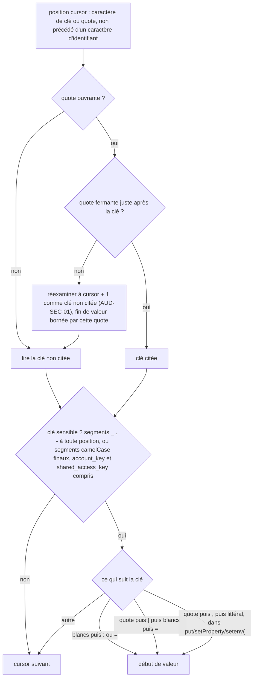
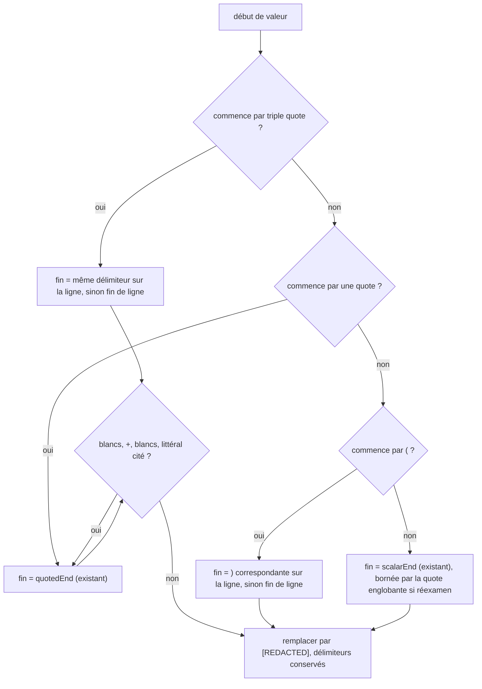

# Design

**Profil :** complet

## Contexte

- [Existant vérifié] `SensitiveContentRedactor.redact` (`core/src/main/java/com/nexus/security/SensitiveContentRedactor.java:160-186`) enchaîne les passes : blocs de clé privée (`:164`), refus des valeurs trop longues (`OVERSIZED_TOKENS` `:152-155`, `OVERSIZED_VALUE` `:131`, `OVERSIZED_URI` `:139-142`, `:166-169`), jetons à préfixe filtrés par `STRUCTURED_TOKEN_PREFIXES` (`:171-175`), JWT, `Bearer`, option de ligne de commande, éléments XML, `SecretAssignmentScanner.redact` (`:180`), puis `URI_TOKEN_USER` et `URI_CREDENTIAL` si le contenu contient `://` (`:184-185`).
- [Existant vérifié] `SecretAssignmentScanner.assignmentValueStart` (`core/src/main/java/com/nexus/security/SecretAssignmentScanner.java:49-79`) parcourt les clés sans regex récursive. Une clé commence sur un caractère de clé ou une quote non précédés d'un caractère d'identifiant (`:54-55`). Une clé citée non refermée fait sauter le curseur à la fin de la clé (`:63-67`) : c'est la cause d'`AUD-SEC-01`. Seuls `:` et `=` sont acceptés comme séparateurs (`:72`).
- [Existant vérifié] `SENSITIVE_KEY_COMPONENT` (`SecretAssignmentScanner.java:15-18`) compare un composant à un segment entier délimité par `^`, `_`, `.`, `-` ou la fin. `secretKey` est reconnu parce que `secret[_-]?key` couvre le segment entier ; `dbPassword` ne l'est pas (`AUD-SEC-02`). Un composant est reconnu à toute position : `password_hint` est sensible.
- [Existant vérifié] Une valeur citée s'arrête à la première quote non échappée de sa ligne (`quotedEnd`, `:96-114`), une valeur non citée à la première `,`, `}`, `]`, `;`, fin de ligne ou `#` de commentaire (`scalarEnd`, `:116-126`) : causes d'`AUD-SEC-03`. La borne de 4 096 caractères lève `OversizedSecretException` (`:132-137`).
- [Existant vérifié] `URI_CREDENTIAL` (`SensitiveContentRedactor.java:123-125`) exige un mot de passe `[^\s/@]{3,4096}` ; `OVERSIZED_URI` (`:139-142`) compte la même classe `[^\s/@]` pour le refus (`AUD-SEC-04`).
- [Existant vérifié] `STRUCTURED_TOKENS` (`:71-80`) et `STRUCTURED_TOKEN_PREFIXES` (`:86-89`) vont par paires ; `RedactionThroughputBenchmarkTest` affirme autant de familles de préfixes que de motifs (`core/src/test/java/com/nexus/benchmark/RedactionThroughputBenchmarkTest.java:49`).
- [Existant vérifié] Comportements figés que ce change touche : `passwordHint="ordinary value"` intact (`core/src/test/java/com/nexus/security/SensitiveContentRedactorTest.java:473`) ; format PuTTY en clair (`SensitiveContentRedactorTest.java:893-900`, `#unrecognizedPrivateKeyMarkerFormsStayInClear`, et `docs/developer/secret-redaction.md:260`) ; sonde de 35 cas, 19 formats, 2 limites (`core/src/test/java/com/nexus/security/SecretRedactionProbeTest.java:80-83`).
- [Existant vérifié] `POLICY_VERSION = "secret-redaction-v11"` (`SensitiveContentRedactor.java:21`) ; `CONTENT_PROFILE_VERSION = 10` (`core/src/main/java/com/nexus/search/semantic/SemanticIndexingService.java:27`, profil construit `:171-172`) ; dernière migration `V022`, enregistrée à `core/src/main/java/com/nexus/persistence/sqlite/SchemaMigrator.java:42`. Premier numéro libre : `V023`.
- [Existant vérifié] `.ppk` n'est pas indexé en contenu aujourd'hui (`ProjectScanner.isSupportedTextSource` n'accepte que les extensions de `SourceLanguage`, `core/src/main/java/com/nexus/index/scan/ProjectScanner.java:195-197` et `core/src/main/java/com/nexus/index/SourceLanguage.java:18-24`). Le risque porte sur un bloc PuTTY recopié dans un `.md` ou un littéral de code.
- [Existant vérifié] Aucun test n'épingle `SENSITIVE_SUFFIXES` (`git grep kdbx -- core/src/test` vide).
- Page durable : `docs/developer/secret-redaction.md`, section « OpenSpec secret-redaction ».

## Objectifs / Hors objectifs

**Objectifs :**
- `secret-redaction › Une clé sensible placée en tête d'une chaîne citée est redigée` (`AUD-SEC-01`).
- `secret-redaction › Une clé camelCase qui se termine par un composant sensible est redigée`, `› Une clé sensible écrite en indice cité est redigée`, `› Le second argument d'un appel put, setProperty ou setenv à clé sensible est redigé`, `› Le littéral SQL d'un mot de passe est redigé` (`AUD-SEC-02`).
- `secret-redaction › Une valeur sensible triple-quotée est redigée en entier`, `› Une valeur sensible concaténée ou parenthésée est redigée jusqu'à la fin de l'expression` (`AUD-SEC-03`).
- `secret-redaction › Le mot de passe d'une URL est redigé quels que soient sa longueur et ses @` (`AUD-SEC-04`).
- `secret-redaction › Les clés AccountKey et SharedAccessKey sont sensibles`, `› Les jetons hf_, SG. et ya29. sont masqués ou refusés`, `› L'URL d'un webhook Slack est masquée`, `› Les lignes privées d'une clé PuTTY sont masquées` (`AUD-SEC-05`).
- `secret-redaction › Les formats de secrets courants sont redigés` (sonde de 69 cas) et `› Un changement de politique invalide les index dérivés` (`secret-redaction-v12`).

**Hors objectifs :** un parseur de langage (Java, Python, SQL) ; une analyse multiligne des affectations ; le découpage camelCase des noms XML et d'option ; les formes sans règle proposée par l'audit (`PasswordAuthentication`, `PGPASSWORD`, `DB_PASS`, voir Questions ouvertes).

## Composants et responsabilités

Non applicable pour la structure : `SensitiveContentRedactor` et `SecretAssignmentScanner` gardent leur API (`redact`, `redactField`) et leur ordre d'appel (`:160-186`). Aucun appelant ne change ; la correction vaut pour CLI, REST et MCP par la projection publique (`ARCH-0085`). Répartition interne cible :

- `SecretAssignmentScanner` : réexamen de clé (`AUD-SEC-01`), découpage camelCase, indice cité, appels `put`/`setProperty`/`setenv`, SQL, triple quote, continuation `+` et valeur parenthésée, composants `account_key` et `shared_access_key`.
- `SensitiveContentRedactor` : `URI_CREDENTIAL` et `OVERSIZED_URI`, familles `hf_`, `SG.`, `ya29.` (motif, préfixe et refus), webhook Slack, bloc PuTTY (passe voisine de `replacePrivateKeyBlocks`), `POLICY_VERSION`.
- `ProjectIgnoreMatcher.SENSITIVE_SUFFIXES` : `.ppk`.

## Modèle de domaine et invariants

- Invariant de réexamen (`AUD-SEC-01`) : une clé citée sans quote fermante juste après elle est réexaminée à `cursor + 1` comme clé non citée. Le caractère précédent est alors la quote, qui n'est pas un caractère d'identifiant (`:92-94`). Chaque position est examinée un nombre borné de fois : le parcours reste linéaire.
- Invariant de chaîne englobante : une valeur non citée trouvée par réexamen s'arrête aussi à la première occurrence non échappée de la quote ouvrante de sa chaîne, sur la ligne. La quote reste visible (`"POSTGRES_PASSWORD=[REDACTED]"`). Une valeur qui contiendrait cette quote non échappée la terminerait plus tôt : cas de chaîne invalide, accepté.
- Invariant camelCase (`AUD-SEC-02`) : la clé est découpée aux transitions minuscule→majuscule (règle de l'audit). La clé est sensible si une suite de segments finaux, recollés, forme un composant de `SENSITIVE_KEY_COMPONENT` (`dbPassword` → `Password` ; `myApiKey` → `ApiKey` ; `awsSecretAccessKey` → `SecretAccessKey`). Un composant suivi d'un autre segment camelCase ne rend pas la clé sensible (`passwordHint`, `passwordEncoder`, `tokenService`). Les segments à séparateurs gardent la règle actuelle, composant à toute position. Pas de transition majuscule→majuscule : `DBPassword` reste une limite.
- Invariant de séparateur étendu : après la clé, `:` et `=` restent les seuls séparateurs d'affectation. Les nouvelles formes sont des déclencheurs à part, chacun lié à une syntaxe : `]` puis `=` après un indice cité ; `,` entre deux littéraux dans les parenthèses d'un appel `put`, `setProperty` ou `setenv` ; `IDENTIFIED BY` ou `PASSWORD` puis un littéral entre apostrophes.
- Invariant de fin de valeur (`AUD-SEC-03`) : une valeur ouverte par `"""` ou `'''` s'arrête au même délimiteur sur sa ligne. Après une valeur citée, chaque suite « blancs, `+`, blancs, littéral cité » sur la ligne prolonge le masquage. Une valeur ouverte par `(` s'arrête à la `)` correspondante sur sa ligne, en comptant l'imbrication hors littéraux cités. Une virgule de premier niveau termine la valeur : `{"password": "FAKEa", "token": "FAKEb"}` garde la clé `"token"` reconnue.
- Invariant d'URL (`AUD-SEC-04`) : l'autorité va de `://` au premier `/`, `?`, `#` ou blanc ; le mot de passe va du premier `:` après l'utilisateur jusqu'au dernier `@` de l'autorité, dès 1 caractère. `OVERSIZED_URI` compte le même texte pour le refus, comme l'exige le principe « refus et masquage lisent la même classe ».
- Invariant de famille bornée (`AUD-SEC-05`) : chaque nouveau motif de `STRUCTURED_TOKENS` a son entrée dans `STRUCTURED_TOKEN_PREFIXES`, au même rang (`hf_`, `SG.`, `ya29.`, `hooks.slack.com/services/`). `hf_` et `ya29.` ont leur motif de refus dans `OVERSIZED_TOKENS`, à la borne de masquage plus un.
- Invariant de lignes : le masquage d'un bloc PuTTY conserve chaque CR et LF (`.claude/rules/search-and-redaction.md`) ; les autres formes restent sur une ligne.
- Invariant de non-régression : sur tout contenu, ce qui est masqué sous v11 l'est encore sous v12, sauf les deux cas assumés et figés par un test : le cas PuTTY de `#unrecognizedPrivateKeyMarkerFormsStayInClear`, désormais masqué ; aucune valeur visible sous v11 ne devient visible sous v12. La continuation `+` et les parenthèses ne masquent que davantage.

## Traitements et interactions

Vue organigramme (cible) : comment le scanner décide-t-il qu'une position ouvre une valeur sensible ? Couvre `secret-redaction › Une clé sensible placée en tête d'une chaîne citée est redigée`, `› Une clé camelCase qui se termine par un composant sensible est redigée`, `› Une clé sensible écrite en indice cité est redigée`, `› Le second argument d'un appel put, setProperty ou setenv à clé sensible est redigé` et `› Les clés AccountKey et SharedAccessKey sont sensibles`.

Explication : le seul changement de chemin pour `AUD-SEC-01` est la branche « quote fermante absente », qui reprend à `cursor + 1` au lieu de `end`. Le test de sensibilité gagne la règle camelCase de fin de clé et deux composants. Les deux sorties ajoutées (indice, appel) ne s'ouvrent que pour une clé citée. Le nom de l'appel est lu à rebours depuis la parenthèse qui précède la quote ouvrante, sur au plus la longueur de `setProperty`.

Vue organigramme (cible) : où s'arrête une valeur sensible ? Couvre `› Une valeur sensible triple-quotée est redigée en entier` et `› Une valeur sensible concaténée ou parenthésée est redigée jusqu'à la fin de l'expression`.

Le SQL (`IDENTIFIED BY`, `PASSWORD`) et les familles de `SensitiveContentRedactor` (URL, jetons, webhook, PuTTY) restent des motifs ou boucles indépendants, appliqués à leur place dans `redact` : le SQL dans le scanner, comme déclencheur à mot-clé ; l'URL dans `URI_CREDENTIAL` ; les jetons et le webhook dans `STRUCTURED_TOKENS` ; le bloc PuTTY juste après `replacePrivateKeyBlocks`, avant le refus, pour que les jetons collés à ses lignes aient le même voisinage au masquage et au refus.

## États et transitions

Non applicable : la redaction est une fonction pure du contenu, sans état persistant hors version de politique.

## Contrats d'interface

Non applicable : `SensitiveContentRedactor.redact` et `redactField` gardent leur signature et leur exception (`OversizedSecretException`). La projection publique applique la même redaction aux trois canaux (`ARCH-0085`).

## Persistance et intégrité

- [Décision] Ajouter `core/src/main/resources/db/migration/V023__invalidate_assignment_form_indexes.sql`, copie du corps de `V022` (`INSERT OR IGNORE` de `project_index_generations`, génération incrémentée, projets `NOT_INDEXED`, `last_indexed_at` à `NULL`, faits canoniques conservés), avec un commentaire SQL en français qui cite `secret-redaction-v12` et les cinq constats. Enregistrée dans `SchemaMigrator` après `V022` (`:42`), conformément à `DATA-0020` et au skill `nexus-schema-migration`.
- [Décision] `POLICY_VERSION` passe à `secret-redaction-v12`, `CONTENT_PROFILE_VERSION` à 11 (`content-v11`). Lucene compare la version de politique de son commit (`core/src/main/java/com/nexus/search/lucene/LuceneSearchIndex.java:203`), et le profil sémantique inclut la politique (`DATA-0074`).
- Une seule version, un seul profil, une seule migration pour les cinq constats : les corrections partielles ne changent ni la version ni le schéma tant que le passage n'est pas complet (tâche 7.1).

## Transactions, concurrence et idempotence

La migration est un lot SQL unique appliqué par le migrateur ; rejouée, elle est ignorée grâce à l'historique des migrations. La redaction reste déterministe et idempotente : `[REDACTED]` ne contient ni clé sensible, ni préfixe de jeton, ni `@`, et un second passage rend le même texte (test de la tâche 6.2).

## Sécurité et isolation

- Les index construits sous `secret-redaction-v11` ou avant peuvent contenir en clair les valeurs des formes d'`AUD-SEC-01` à `AUD-SEC-05`. Ils sont invalidés puis reconstruits (`DATA-0073`).
- Les tests n'utilisent que des valeurs factices préfixées `FAKE`. Les jetons à préfixe (`hf_`, `SG.`, `ya29.`, webhook Slack) sont assemblés à l'exécution par `synthetic(...)` (`SecretRedactionProbeTest.java`), comme les jetons existants, pour qu'aucun littéral au format d'un vrai secret n'entre dans le dépôt.
- Relecture par `nexus-security-auditor` avant la PR (skill `nexus-redaction-change`, étape 7).

## Erreurs et reprise

- `hf_` et `ya29.` au-delà de 255 caractères de corps lèvent `OversizedSecretException`. Le fichier est exclu des index lexical et sémantique avec `INDEX_REDACTION_LIMIT`, comme pour les autres familles (`secret-redaction › Une valeur sensible trop longue n'exclut que son fichier`).
- Une valeur triple-quotée, concaténée ou parenthésée de plus de 4 096 caractères est refusée par `requireWithinLimit` (`SecretAssignmentScanner.java:132-137`), compte fait sur toute l'étendue masquée.

## Observabilité

Non applicable : la redaction ne produit pas de diagnostic propre ; `INDEX_REDACTION_LIMIT` et `CONTEXT_REDACTION_LIMIT` ne changent pas.

## Performance et mesure

- Aucun seuil nouveau dans ce change : ni l'audit ni le critère de sortie du sprint S3 n'en fixent. Le seuil du banc `RedactionThroughputBenchmarkTest` est fixé par le sprint S1 (`AUD-PRF-04`, change `audit-1116-s1-ci-et-mesures`). Le critère de sortie exige que le banc passe ce seuil dans le workflow branché au sprint 1 (tâche 7.3) : dépendance bloquante pour la clôture du sprint, pas pour l'implémentation.
- Garde-fous de coût, sur le modèle de `#endThenBeginRepetitionsHaveBoundedCost` (environ 1 Mo sous 10 s, seuil des garde-fous voisins de `SensitiveContentRedactorTest`) : répétition de `"password` sans quote fermante, de `x"password=` collés, de `+ "a"` après une valeur, de `(` non refermées, de `https://u:` suivi de `@` répétés, de clés camelCase longues (`aB` répété). Ils prouvent que le réexamen à `cursor + 1` et la recherche du dernier `@` restent linéaires.
- `STRUCTURED_TOKEN_PREFIXES` garde le saut de passe : un contenu sans `hf_`, `SG.`, `ya29.` ni `hooks.slack.com` ne paie pas les nouveaux motifs.

## Compatibilité, migration et retour arrière

- Mise à niveau : rebuild normal des dérivés de chaque projet au premier passage. Section « Mise à niveau V023 — formes d'affectation » de `docs/developer/release-and-recovery.md`, sur le modèle de V022.
- Retour arrière : un binaire antérieur refuse une base à version de schéma supérieure ; restaurer la sauvegarde de `NEXUS_HOME`.
- Rendu : des textes aujourd'hui visibles deviennent masqués (masquage en plus). C'est voulu ; aucune valeur masquée sous v11 ne redevient visible (tâche 6.1).

## Décisions

- [Décision] Un passage de politique unique pour les cinq constats (`v12`, `content-v11`, `V023`), comme le sprint S3 le motive : une seule reconstruction d'index.
- [Décision] `AUD-SEC-01` : reprise à `cursor + 1`, correction proposée par l'audit, complétée par l'arrêt de la valeur à la quote englobante. Alternative écartée : masquer jusqu'à la fin de la ligne, qui cacherait la suite de la commande (`postgres`).
- [Décision] camelCase en fin de clé seulement. Alternatives écartées : composant à toute position, qui masquerait `passwordHint`, figé intact par `SensitiveContentRedactorTest.java:473`, et `passwordEncoder` ou `tokenService` ; découpage aussi aux transitions majuscule→majuscule, non demandé par l'audit.
- [Décision] Continuation `+` sans condition, continuation `,` seulement dans les parenthèses de la valeur : protège la reconnaissance des clés suivantes d'un objet JSON.
- [Décision] Appels limités à `put`, `setProperty` et `setenv`, la liste de l'action de l'audit. `PasswordAuthentication` est hors règle tant que la question ouverte n'est pas tranchée.
- [Décision] SQL limité au littéral entre apostrophes, forme de l'audit et syntaxe des littéraux de chaîne SQL standard.
- [Décision] Format PuTTY masqué de `Private-Lines:` à `Private-MAC:` inclus (action de l'audit), jusqu'à la fin du contenu sans `Private-MAC:`. C'est le choix déjà fait pour un `BEGIN` sans `END` : masquer en trop plutôt que fuir. Le cas « format PuTTY » quitte `#unrecognizedPrivateKeyMarkerFormsStayInClear`.
- [Décision] `.ppk` ajouté à `SENSITIVE_SUFFIXES` sans nouvelle exigence OpenSpec : la `[Question]` de `docs/developer/indexing-pipeline.md:416` (exigences pour les exclusions intégrées) reste ouverte, et l'ajout est couvert par un test unitaire.
- [Décision] Sonde : un cas par forme listée dans les preuves d'`AUD-SEC-01` à `AUD-SEC-05` qui n'y figure pas déjà, plus `setenv` (nommé par l'action d'`AUD-SEC-02`) : 34 cas nouveaux, 69 au total (tableau ci-dessous). `password: |` est déjà un cas `KNOWN_LIMIT` (`SecretRedactionProbeTest.java:76`) et n'est pas dupliqué.
- Aucun nouvel ADR : la politique de redaction et son invalidation suivent un processus établi (skill `nexus-redaction-change`, `DATA-0020`, `DATA-0073`, `DATA-0074`).

Cas ajoutés à `SecretRedactionProbeTest` (valeurs factices, jetons assemblés à l'exécution) :

| # | Constat | Forme | Attente |
|---:|---|---|---|
| 1 | AUD-SEC-01 | `String cs = "password=FAKE…;user=sa";` | `REDACTED` |
| 2 | AUD-SEC-01 | `docker run -e "POSTGRES_PASSWORD=FAKE…" postgres` | `REDACTED` |
| 3 | AUD-SEC-01 | `- "POSTGRES_PASSWORD=FAKE…"` | `REDACTED` |
| 4 | AUD-SEC-01 | `curl -H "Authorization: token FAKE…"` | `REDACTED` |
| 5 | AUD-SEC-01 | `String s = "secret: FAKE…";` | `REDACTED` |
| 6 | AUD-SEC-01 | `env: ["TOKEN=FAKE…"]` | `REDACTED` |
| 7 | AUD-SEC-02 | `String dbPassword = "FAKE…";` | `REDACTED` |
| 8 | AUD-SEC-02 | `private String jwtSecret = "FAKE…";` | `REDACTED` |
| 9 | AUD-SEC-02 | `String keystorePassword = "FAKE…";` | `REDACTED` |
| 10 | AUD-SEC-02 | `String myApiKey = "FAKE…";` | `REDACTED` |
| 11 | AUD-SEC-02 | `awsSecretAccessKey = "FAKE…"` | `REDACTED` |
| 12 | AUD-SEC-02 | `os.environ["DB_PASSWORD"] = "FAKE…"` | `REDACTED` |
| 13 | AUD-SEC-02 | `config["password"] = "FAKE…"` | `REDACTED` |
| 14 | AUD-SEC-02 | `props.put("password", "FAKE…")` | `REDACTED` |
| 15 | AUD-SEC-02 | `System.setProperty("javax.net.ssl.keyStorePassword", "FAKE…")` | `REDACTED` |
| 16 | AUD-SEC-02 | `setenv("API_TOKEN", "FAKE…", 1)` | `REDACTED` |
| 17 | AUD-SEC-02 | `CREATE USER app IDENTIFIED BY 'FAKE…'` | `REDACTED` |
| 18 | AUD-SEC-02 | `ALTER ROLE app WITH PASSWORD 'FAKE…'` | `REDACTED` |
| 19 | AUD-SEC-02 | `new PasswordAuthentication("user", "FAKE…".toCharArray())` | selon la question ouverte |
| 20 | AUD-SEC-02 | `PGPASSWORD=FAKE…` | selon la question ouverte |
| 21 | AUD-SEC-02 | `DB_PASS=FAKE…` | selon la question ouverte |
| 22 | AUD-SEC-02 | `password hunter2` (valeur factice) | `KNOWN_LIMIT` |
| 23 | AUD-SEC-03 | `password = """FAKE…"""` | `REDACTED` |
| 24 | AUD-SEC-03 | `password = "abc" + "FAKE…";` | `REDACTED` |
| 25 | AUD-SEC-03 | `requests.get(url, auth=('user', 'FAKE…'))` | `REDACTED` |
| 26 | AUD-SEC-04 | `https://admin:p@ssFAKE@db.example.com/` | `REDACTED` |
| 27 | AUD-SEC-04 | `https://u:ab@host/` | `REDACTED` |
| 28 | AUD-SEC-05 | chaîne de connexion `AccountKey=FAKE…==` | `REDACTED` |
| 29 | AUD-SEC-05 | chaîne de connexion `SharedAccessKey=FAKE…=` | `REDACTED` |
| 30 | AUD-SEC-05 | jeton `hf_` | `REDACTED` |
| 31 | AUD-SEC-05 | jeton `SG.<22>.<43>` | `REDACTED` |
| 32 | AUD-SEC-05 | URL de webhook Slack | `REDACTED` |
| 33 | AUD-SEC-05 | jeton `ya29.` | `REDACTED` |
| 34 | AUD-SEC-05 | bloc PuTTY `Private-Lines:` … `Private-MAC:` | `REDACTED` |

Le test affirme 69 cas, 19 formats `auditFormat` et un nombre de `KNOWN_LIMIT` égal à 3 plus le nombre de cas 19 à 21 épinglés comme limite.

## Risques / Compromis

- [Risque] Le réexamen d'`AUD-SEC-01` masque une valeur dans une chaîne de prose (`"secret: voir la doc"`). → Masquage en plus, jamais une fuite ; même règle que la forme non citée, déjà en vigueur.
- [Risque] La règle camelCase masque `isAuth = true`, `hasToken = false` ou `userToken = null`. → Masquage en plus, cohérent avec `auth=` et les scalaires courts masqués depuis v5 (`SensitiveContentRedactorTest.java:480`) ; mesuré par la tâche 2.3.
- [Risque] `account_key` rend sensible une colonne métier `account_key = 42`. → Masquage en plus, demandé par l'action de l'audit ; consigné dans `secret-redaction.md`.
- [Risque] Le mot `PASSWORD` suivi d'un littéral entre apostrophes dans de la prose Markdown est masqué. → Masquage en plus, jamais une fuite.
- [Risque] Une valeur parenthésée non refermée masque la fin de sa ligne. → Masquage en plus, borné à la ligne.
- [Risque] Débit de redaction dégradé par les nouveaux motifs. → Banc du sprint S1 (tâche 7.3) et garde-fous de coût (tâche 6.3).
- [Risque] Rebuild de tous les projets à la mise à niveau. → Inévitable pour purger les valeurs en clair ; documenté.

## Stratégie de vérification

- Commande ciblée : `./mvnw -B -ntp -pl core test -Dtest=SensitiveContentRedactorTest,SecretRedactionProbeTest -Dsurefire.failIfNoSpecifiedTests=false -Djacoco.skip=true`. Chaque nouveau test de forme échoue d'abord sur le code `secret-redaction-v11`, puis passe après la correction.
- Non-régression contre v11 : la boucle `SecretAssignmentScanner` v11 et les motifs `URI_CREDENTIAL` et `OVERSIZED_URI` v11 sont recopiés dans le test comme référence (skill `nexus-redaction-change`, étape 2). Un corpus généré vérifie qu'aucun fragment masqué sous v11 n'est visible sous v12.
- `./mvnw -B -ntp -pl core test -Dtest=SchemaMigrator*Test,SemanticIndexingServiceTest,LuceneSearchIndexTest,SqliteWriteContentionIntegrationTest -Dsurefire.failIfNoSpecifiedTests=false -Djacoco.skip=true`.
- Banc : `RedactionThroughputBenchmarkTest` dans le workflow branché par le sprint S1, à son seuil.
- `bash .claude/scripts/contracts.sh` (`content-v11`, `secret-redaction-v12`, `V023`), `./mvnw -B -ntp clean install`, `pwsh -NoProfile -File scripts/self-smoke.ps1`, `archgate check`, `openspec validate audit-1116-s3-redaction-v12-affectations --strict`.
- Syntaxe des deux organigrammes Mermaid validée avant la recopie dans `docs/developer/secret-redaction.md`.

## Traçabilité

| Exigence (`capacité › titre`) | Scénario | Conception ou diagramme | Tâche | Test ou preuve |
|---|---|---|---|---|
| `secret-redaction › Une clé sensible placée en tête d'une chaîne citée est redigée` | Six formes de l'audit | Organigramme de reconnaissance de clé | 1.1, 1.2 | test non écrit |
| `secret-redaction › Une clé sensible placée en tête d'une chaîne citée est redigée` | Quote fermante conservée | Invariant de chaîne englobante | 1.1, 1.2 | test non écrit |
| `secret-redaction › Une clé sensible placée en tête d'une chaîne citée est redigée` | Clés citées JSON inchangées | Invariant de réexamen | 1.1 | test non écrit |
| `secret-redaction › Une clé camelCase qui se termine par un composant sensible est redigée` | Champs camelCase de l'audit | Invariant camelCase | 2.1, 2.2 | test non écrit |
| `secret-redaction › Une clé camelCase qui se termine par un composant sensible est redigée` | Composant sensible suivi d'un autre segment | Invariant camelCase, Décisions | 2.1, 2.3 | preuve existante partielle : `SensitiveContentRedactorTest#recognizesAllSupportedCompoundSpellingsAndKeepsKeyBoundaries` (`passwordHint`) ; autres cas : test non écrit |
| `secret-redaction › Une clé sensible écrite en indice cité est redigée` | Indice de dictionnaire | Organigramme de reconnaissance de clé | 2.4 | test non écrit |
| `secret-redaction › Une clé sensible écrite en indice cité est redigée` | Indice non sensible | Organigramme de reconnaissance de clé | 2.4 | test non écrit |
| `secret-redaction › Le second argument d'un appel put, setProperty ou setenv à clé sensible est redigé` | Appels de l'audit | Organigramme de reconnaissance de clé | 2.5 | test non écrit |
| `secret-redaction › Le second argument d'un appel put, setProperty ou setenv à clé sensible est redigé` | Premier argument non sensible | Organigramme de reconnaissance de clé | 2.5 | test non écrit |
| `secret-redaction › Le littéral SQL d'un mot de passe est redigé` | Création et modification d'un rôle | Traitements et interactions | 2.6 | test non écrit |
| `secret-redaction › Une valeur sensible triple-quotée est redigée en entier` | Chaîne Python triple-quotée | Organigramme de fin de valeur | 3.1 | test non écrit |
| `secret-redaction › Une valeur sensible triple-quotée est redigée en entier` | Délimiteur absent de la ligne | Organigramme de fin de valeur | 3.1 | test non écrit |
| `secret-redaction › Une valeur sensible concaténée ou parenthésée est redigée jusqu'à la fin de l'expression` | Concaténation | Organigramme de fin de valeur | 3.2 | test non écrit |
| `secret-redaction › Une valeur sensible concaténée ou parenthésée est redigée jusqu'à la fin de l'expression` | Tuple d'authentification | Organigramme de fin de valeur | 3.2 | test non écrit |
| `secret-redaction › Une valeur sensible concaténée ou parenthésée est redigée jusqu'à la fin de l'expression` | Virgule de premier niveau | Invariant de fin de valeur, Décisions | 3.2 | test non écrit |
| `secret-redaction › Le mot de passe d'une URL est redigé quels que soient sa longueur et ses @` | Mot de passe contenant @ | Invariant d'URL | 4.1 | test non écrit |
| `secret-redaction › Le mot de passe d'une URL est redigé quels que soient sa longueur et ses @` | Mot de passe court | Invariant d'URL | 4.1 | test non écrit |
| `secret-redaction › Le mot de passe d'une URL est redigé quels que soient sa longueur et ses @` | @ dans le chemin | Invariant d'URL | 4.1 | test non écrit |
| `secret-redaction › Les clés AccountKey et SharedAccessKey sont sensibles` | Chaînes de connexion Azure | Organigramme de reconnaissance de clé | 5.1 | test non écrit |
| `secret-redaction › Les jetons hf_, SG. et ya29. sont masqués ou refusés` | Jetons nominaux | Invariant de famille bornée | 5.2 | test non écrit |
| `secret-redaction › Les jetons hf_, SG. et ya29. sont masqués ou refusés` | Corps trop long | Invariant de famille bornée, Erreurs et reprise | 5.2 | test non écrit |
| `secret-redaction › L'URL d'un webhook Slack est masquée` | Webhook dans du code | Invariant de famille bornée | 5.3 | test non écrit |
| `secret-redaction › Les lignes privées d'une clé PuTTY sont masquées` | Fichier PuTTY dans un README | Décisions (PuTTY) | 5.4 | test non écrit ; `SensitiveContentRedactorTest#unrecognizedPrivateKeyMarkerFormsStayInClear` fige l'inverse jusqu'à la tâche 5.4 |
| `secret-redaction › Les lignes privées d'une clé PuTTY sont masquées` | Ligne Private-MAC absente | Décisions (PuTTY) | 5.4 | test non écrit |
| `secret-redaction › Les formats de secrets courants sont redigés` | Sonde versionnée | Décisions (tableau de la sonde) | 6.4 | `SecretRedactionProbeTest#probeHasThirtyFiveCasesIncludingTheNineteenAuditFormats` à réécrire pour 69 cas : test non écrit |
| `secret-redaction › Les formats de secrets courants sont redigés` | Cas négatifs | Invariant camelCase | 6.4 | preuve existante : `SecretRedactionProbeTest#redactsInScopeFormatsAndLeavesOrdinaryCodeIntact` (cas `INTACT`) |
| `secret-redaction › Les formats de secrets courants sont redigés` | Formats hors périmètre | Décisions | 6.4 | preuve existante partielle (deux limites) ; cas `password hunter2` : test non écrit |
| `secret-redaction › Un changement de politique invalide les index dérivés` | Mise à jour d'une base existante | Persistance et intégrité | 7.2 | test non écrit (`SchemaMigratorAssignmentFormUpgradeTest`) |
| `secret-redaction › Un changement de politique invalide les index dérivés` | Index lexical d'une ancienne politique | Persistance et intégrité | 7.1 | preuve existante, à réaligner sur v12 : `LuceneSearchIndexTest#redactionPolicyCheckRejectsMissingOrObsoleteCommitPolicy` |

## Questions ouvertes

- [Question] `PasswordAuthentication`, `PGPASSWORD` et `DB_PASS` : règle ou limite connue (proposition, Questions ouvertes). La réponse change l'attente des cas 19 à 21, pas le nombre de cas ni l'approche. Par défaut, sans réponse avant la tâche 6.4, ils sont épinglés `KNOWN_LIMIT` et cités comme limites dans `secret-redaction.md`.
- [Question] Longueur minimale du corps de `hf_` et de `ya29.` (proposition, Questions ouvertes). Elle se règle dans la tâche 5.2 sans changer les specs, qui ne fixent que la borne haute.
