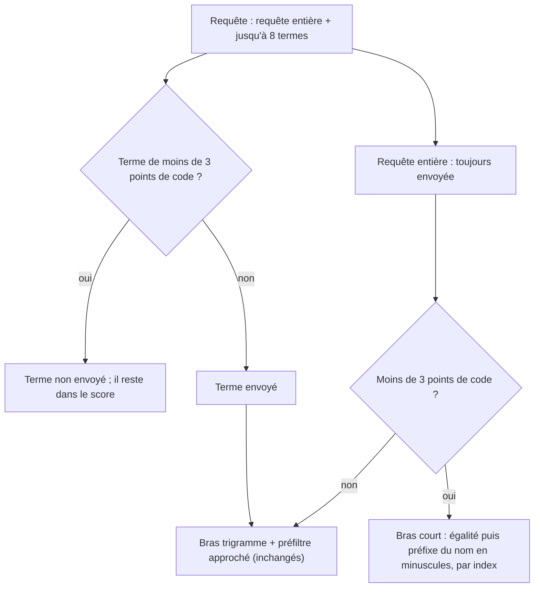
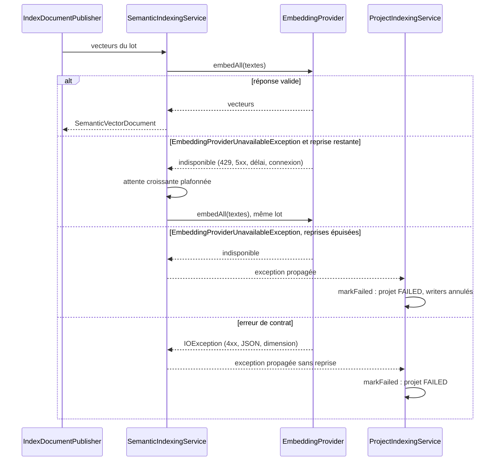
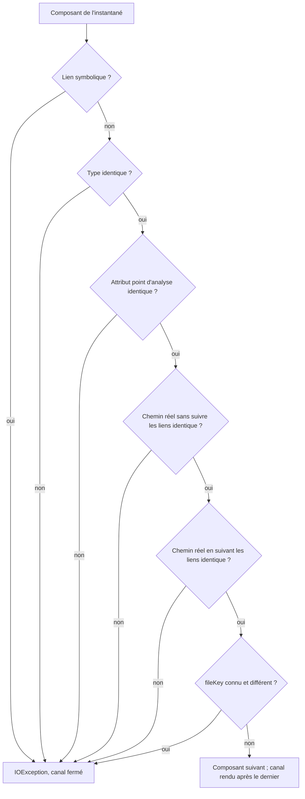

# Design

**Profil :** complet

## Contexte

Les preuves sont relues au HEAD `6e0a5aaf` ; le code n'a pas changé depuis le commit audité `7ec5c5dc` (seul `scripts/release/test-final-audit-contracts.sh` diffère hors documentation).

### Recherche de symboles (`AUD-PRF-01`)

- [Existant vérifié] `SymbolSearchStrategy.search` découpe la requête en au plus 8 termes de 128 caractères (`core/src/main/java/com/nexus/search/SymbolSearchStrategy.java:31-32`, `:42`), puis envoie en un lot la requête entière suivie des termes qui en diffèrent (`:48-52`). Les termes servent ensuite au score (`exactScore`, `fuzzyScore`, `pathScore`, `:69-75`).
- [Existant vérifié] `SqliteSymbolSearch.searchNormalized` sépare les requêtes d'au moins `TRIGRAM_MIN_CODE_POINTS = 3` points de code (bras trigramme et préfiltre approché) des autres (bras `LIKE_ARM_SQL`) (`core/src/main/java/com/nexus/persistence/sqlite/SqliteSymbolSearch.java:98-105` ; `core/src/main/java/com/nexus/persistence/sqlite/SqliteIndexSql.java:24`). `LIKE_ARM_SQL` (`SqliteSymbolSearch.java:222-247`) filtre par `LIKE '%x%'` sur le nom et le nom qualifié, ou par premier caractère et longueur, puis trie par `CASE` avant `LIMIT`.
- [Existant vérifié] Le préfiltre approché choisit déjà entre un index global et un index scopé par fichier selon la part de fichiers du projet (`PROJECT_FILE_SHARE_SQL`, `SqliteSymbolSearch.java:216-220` ; section « OpenSpec symbol-search-scoping » de `docs/developer/large-scale-search.md`). Les index d'expression existants portent sur `SUBSTR(LOWER(name), 1, 1), LENGTH(name)` (`V008`, `V015` avec `file_id` en tête, `V017`) ; aucun ne porte sur `LOWER(name)` entier.
- [Existant vérifié] Mesure de l'audit avec le SQLite 3.53.1 de Python, pas sqlite-jdbc : environ 0,7 s par terme court à 1 M de symboles, plan `SEARCH s USING INDEX idx_symbols_file_fuzzy_prefilter (file_id=?)` puis `USE TEMP B-TREE FOR ORDER BY` (`docs/project/audits/2026-11-16/findings.md`, `AUD-PRF-01`). Les chiffres absolus restent à remesurer avec sqlite-jdbc.
- [Existant vérifié] Le banc d'échelle mesure `symbolExact` (`BenchSymbol00000010`), `symbolContains` (`ScaleNeedle`), `symbolMissingWorstCase` et `relationContains` (`core/src/test/java/com/nexus/benchmark/ScaleRegressionBenchmarkTest.java:252-255`, `:274-275`) ; les symboles générés se nomment `BenchSymbol%08d` ou `ScaleNeedle%08d` (`:983-984`). `scripts/verify-scale-budgets.py:45-48` et `:96-100` bornent ces quatre mesures et `targeted100Files`.
- [Existant vérifié] Dernière migration : `V022__invalidate_end_begin_same_line_indexes.sql`, enregistrée à `core/src/main/java/com/nexus/persistence/sqlite/SchemaMigrator.java:42`.

### Indexation sémantique (`AUD-PRF-05`, `AUD-PRF-02`)

- [Existant vérifié] `SemanticIndexingService.excerpt` normalise le contenu redigé entier par `WHITESPACE` (`\s+`) puis `trim()`, et garde `DEFAULT_EXCERPT_CHARS = 320` caractères par `safePrefixEnd`, qui ne coupe pas une paire de substitution ; un contenu vide après normalisation donne le chemin relatif (`core/src/main/java/com/nexus/search/semantic/SemanticIndexingService.java:25`, `:28`, `:278-302`).
- [Existant vérifié] Chaque lot est envoyé par un appel unique `embeddingProvider.embedAll(List.copyOf(texts))` (`SemanticIndexingService.java:209-211`) ; un nombre de vecteurs ou une dimension incorrects lèvent une `IOException` (`:212-216`, `:250-257`).
- [Existant vérifié] `OllamaEmbeddingProvider` lève `EmbeddingProviderUnavailableException` pour HTTP 429 et 5xx (`core/src/main/java/com/nexus/search/semantic/ollama/OllamaEmbeddingProvider.java:284-285`), délai dépassé (`:262`, `:265`, `:309-311`) et connexion impossible (`:267-268`) ; une `IOException` pour un autre statut non 2xx (`:287`), une réponse illisible ou incomplète (`:291-301`), et une interruption (`:269-271`). `EmbeddingProviderUnavailableException` est dans `com.nexus.search.semantic` (import `:6`).
- [Existant vérifié] L'indexation calcule les embeddings en ligne pendant la boucle des fichiers, sous le verrou du projet (`core/src/main/java/com/nexus/index/service/IndexDocumentPublisher.java:110-137`, `:255-261`) ; un échec rend le projet `FAILED` (`core/src/main/java/com/nexus/index/service/ProjectIndexingService.java:238-239`) et force un rebuild complet au passage suivant (`:208`).
- [Existant vérifié] `DEFAULT_TIMEOUT = Duration.ofSeconds(60)` (`OllamaEmbeddingProvider.java:33`) sert de défaut à `NEXUS_OLLAMA_TIMEOUT_SECONDS`, borné à 600 s (`core/src/main/java/com/nexus/application/NexusApplicationFactory.java:294-298` ; `core/src/main/java/com/nexus/search/semantic/SemanticSearchConfiguration.java:12`). La qualification réelle passe 120 s (`.github/workflows/semantic-search-qualification.yml:65`, `:117`, `:282`). Le même délai sert au vecteur de requête hors fédération (`core/src/main/java/com/nexus/search/semantic/SemanticSearchStrategy.java:205-206`).

### Repli de lecture (`AUD-SEC-07`)

- [Existant vérifié] Sans `SecureDirectoryStream`, `SafeFileIO.openReadNoFollow` capture un instantané de chaque composant depuis la racine du système de fichiers, ouvre, puis revalide (`core/src/main/java/com/nexus/security/SafeFileIO.java:133-148`, `:171-211`, `:213-240`). L'identité capturée est `toRealPath(NOFOLLOW_LINKS)`, `fileKey()`, `isDirectory()`, `isRegularFile()` (`:203-208`) ; `fileKey()` nul n'est pas comparé (`:235-236`).
- [Existant vérifié] La seam de package `openReadNoFollow(Path, boolean strict, boolean forceFallback, ChannelOpener)` permet de forcer le repli et d'agir entre instantané et ouverture (`SafeFileIO.java:113-116`, `:151-154`). `SafeFileIOTest#visibleReplacementDuringFallbackOpeningClosesChannelBeforeReading` l'utilise avec un lien symbolique ; `SafeFileIOTest` tourne sur `windows-latest` (`.github/workflows/filesystem-semantics-qualification.yml:55`, `:103`, `:112`).
- [Existant vérifié] `SEC-0082` retient « fallback de compatibilité best-effort par défaut, mode strict exigible » et nomme la limite ABA (`docs/architecture/adr/SEC-0082-borner-le-support-filesystem-et-la-traversee-des-chemins.md:24`, `:31`).

Pages durables : `docs/developer/large-scale-search.md` (section « OpenSpec symbol-search-scoping »), `docs/developer/semantic-search.md` (nouvelle section « OpenSpec semantic-embedding-indexing »), `docs/developer/filesystem-support.md` (nouvelle section « OpenSpec safe-file-reads »).

## Objectifs / Hors objectifs

**Objectifs :**
- `symbol-search-scoping › Les termes courts d'une requête ne déclenchent pas de recherche par sous-chaîne`.
- `symbol-search-scoping › Une requête entière courte ne cherche que l'égalité et le préfixe du nom`.
- `symbol-search-scoping › La recherche courte est mesurée sous budget`.
- `semantic-embedding-indexing › L'extrait sémantique ne normalise qu'un préfixe borné`.
- `semantic-embedding-indexing › Une indisponibilité transitoire du fournisseur est reprise un nombre borné de fois`.
- `semantic-embedding-indexing › Une erreur de contrat du fournisseur n'est pas reprise`.
- `semantic-embedding-indexing › Le délai Ollama par défaut est celui de la qualification réelle`.
- `safe-file-reads › Le repli de lecture refuse une jonction substituée avant toute lecture`.

**Hors objectifs :** reprise dans le fournisseur Ollama lui-même (elle s'appliquerait aussi au chemin de requête, qui dégrade déjà) ; conservation des vecteurs après un échec ; changement de la recherche de relations ; fermeture de la limite ABA.

## Composants et responsabilités

- [Décision] `SymbolSearchStrategy` filtre les termes courts avant d'appeler `IndexRepository.searchSymbols` ; la requête entière reste toujours dans le lot. Le port `IndexRepository` ne change pas.
- [Décision] `SqliteSymbolSearch` remplace `LIKE_ARM_SQL` par un bras « égalité puis préfixe du nom en minuscules » pour les requêtes de moins de trois points de code. Seule la requête entière peut encore y arriver ; un appelant direct du dépôt (tests, benchmark) qui envoie un terme court obtient le même bras.
- [Décision] La reprise vit dans `SemanticIndexingService` (cœur, paquet `com.nexus.search.semantic`), autour de l'appel `embedAll` d'un lot. Elle ne dépend que de `EmbeddingProviderUnavailableException`, déjà dans ce paquet : la règle `core-package-boundaries › Le port d'embeddings ne construit pas son adaptateur` reste tenue. Le fournisseur Ollama ne change que sa constante `DEFAULT_TIMEOUT`.
- [Décision] `SafeFileIO` garde sa structure ; `ComponentIdentity` capture deux attributs de plus, comparés à la revalidation.

## Modèle de domaine et invariants

- Invariant de requête courte : un terme de moins de trois points de code n'atteint jamais la base de symboles, sauf s'il est la requête entière. Le nombre de requêtes SQL reste celui d'une requête d'un terme (`symbol-search-scoping › Les termes d'une requête sont interrogés en lot`).
- Invariant d'extrait : `excerpt(contenu)` est égal à `prefix320(trim(collapse(contenu)))`, où `collapse` remplace chaque suite de `\s` (espace, `\t`, `\n`, `\x0B`, `\f`, `\r`) par une espace, `trim` retire en tête et en fin les caractères ≤ U+0020, et `prefix320` est `safePrefixEnd` à 320.
- Invariant de reprise : seule `EmbeddingProviderUnavailableException` est reprise ; toute autre `IOException` ou `RuntimeException` sort au premier appel. Le nombre d'appels d'un lot est au plus `1 + reprises maximales`.
- Invariant de repli : un composant revalidé a le même type, le même chemin réel sans suivre les liens, le même chemin réel en suivant les liens, le même attribut « point d'analyse » (`isOther()` du répertoire) et, s'il existe, le même `fileKey()` qu'à l'instantané.

## Traitements et interactions

### Termes courts et requête entière (cible)

Vue organigramme (cible) : quelles requêtes atteignent la base de symboles, et par quel bras ? Couvre `symbol-search-scoping › Les termes courts d'une requête ne déclenchent pas de recherche par sous-chaîne` et `symbol-search-scoping › Une requête entière courte ne cherche que l'égalité et le préfixe du nom`.

Pour `how is the db id mapped`, la requête entière et `how`, `the`, `mapped` partent dans le lot trigramme ; `is`, `db` et `id` ne partent pas mais comptent dans `exactScore` et `fuzzyScore`. Pour `id`, seule la requête entière part, dans le bras court.

### Reprise d'un lot (cible)

Vue séquence UML (cible) : que se passe-t-il quand le fournisseur échoue pendant l'indexation d'un lot ? Couvre `semantic-embedding-indexing › Une indisponibilité transitoire du fournisseur est reprise un nombre borné de fois` et `semantic-embedding-indexing › Une erreur de contrat du fournisseur n'est pas reprise`.

Interruption : l'attente est interruptible ; le fil garde son indicateur d'interruption et une `InterruptedIOException` sort sans nouvel appel, ce qui passe par le même `markFailed`.

### Extrait borné (cible)

[Décision] Un seul balayage du contenu redigé, sans `Matcher` sur le texte entier : il saute les caractères ≤ U+0020 de tête (après réduction des blancs, ce sont exactement ceux que `trim` retire), réduit chaque suite de `\s` à une espace et ajoute les caractères à un tampon de 321 caractères au plus. Il s'arrête au premier caractère supérieur à U+0020 lu une fois le tampon plein : la fin du contenu ne peut alors plus rien rogner dans les 320 premiers caractères. Si la fin du contenu arrive avant, il rogne la fin du tampon comme `trim`. `safePrefixEnd` s'applique ensuite au tampon. Pour un contenu ordinaire, le balayage lit environ 321 caractères ; il ne lit jusqu'à la fin que si tout ce qui suit le 320e caractère retenu est formé de caractères ≤ U+0020, sans jamais allouer plus que le tampon.

### Revalidation du repli (cible)

Vue organigramme (cible) : quand la revalidation d'un composant refuse-t-elle l'ouverture ? Couvre `safe-file-reads › Le repli de lecture refuse une jonction substituée avant toute lecture`.

Une jonction ancêtre déjà présente donne les mêmes valeurs à l'instantané et à la revalidation : elle reste lisible. Un répertoire remplacé par une jonction change l'attribut point d'analyse et le chemin réel suivi.

## États et transitions

Non applicable : les états de projet (`INDEXING`, `READY`, `FAILED`) et leurs transitions ne changent pas ; la reprise se déroule à l'intérieur de l'état `INDEXING` (`ProjectIndexingService.java:208-210`, `:238-239`).

## Contrats d'interface

- Non applicable aux surfaces CLI, REST et MCP : aucune option, aucun champ ni aucun code d'erreur ne change. Les résultats d'une requête de symboles courte changent (voir Compatibilité).
- [Existant vérifié] Le port `EmbeddingProvider` (`core/src/main/java/com/nexus/search/semantic/EmbeddingProvider.java`) ne change pas.
- [Proposition] `SemanticIndexingService` reçoit un constructeur de package qui prend la politique de reprise et une fonction d'attente, pour que les tests n'attendent pas réellement ; les constructeurs publics gardent leur signature et appliquent la politique par défaut.
- [Décision] La variable `NEXUS_OLLAMA_TIMEOUT_SECONDS` garde son nom et sa borne de 600 s ; seul son défaut passe de 60 à 120 s.

## Persistance et intégrité

- [Proposition] Une migration d'évolution de schéma ajoute l'index du nom en minuscules, sur le modèle de `V015` et `V017` (DDL `CREATE INDEX IF NOT EXISTS`, commentaire SQL en français, skill `.claude/skills/nexus-schema-migration/`, `DATA-0020`). Elle n'invalide aucun index dérivé et ne repasse aucun projet `NOT_INDEXED`.
- [Décision] Numéro : celui qui suit la migration de `AUD-SEC-01` (change `audit-1116-s3-redaction-v12-affectations`, sprint S3, qui prend `V023` si rien d'autre n'est fusionné avant). `AUD-PRF-01` dépend de `AUD-SEC-01` dans l'audit pour cette raison d'ordre : la migration de ce change s'écrit après la fusion de S3, avec le numéro relu sur `main` à ce moment.
- [Question] Forme de l'index et du bras court. Options : (a) index global `LOWER(name)`, rapide pour un projet seul mais qui parcourt les noms des autres projets ; (b) index `(file_id, LOWER(name))`, scopé, mais qui sonde chaque fichier du projet puis trie les correspondances ; (c) les deux, choisis par `PROJECT_FILE_SHARE_SQL` comme le préfiltre approché. [Proposition] (c), pour rester conforme à `symbol-search-scoping › La recherche de symboles est scopée projet avant le tri`. À trancher sur `EXPLAIN QUERY PLAN` et la mesure du banc, avant d'écrire la migration.
- [Proposition] Le bras court sépare l'égalité (`LOWER(name) = ?`) et le préfixe (`LOWER(name) >= ? AND LOWER(name) < ?`, borne haute calculée en Java) au lieu de `LIKE 'x%'`, que SQLite n'optimise pas sur une expression sans `case_sensitive_like`. L'ordre de sortie garde l'égalité avant le préfixe ; le tri secondaire reste `qualified_name, relative_path, start_line, source_provider`.

## Transactions, concurrence et idempotence

- La migration est un lot SQL unique, ignoré au rejeu grâce à l'historique des migrations et protégé par checksum.
- La reprise d'un lot se fait sous le verrou du projet déjà tenu par l'indexation (`IndexDocumentPublisher.java:110-137`) ; aucun writer n'est committé pendant l'attente. Le même lot est renvoyé à l'identique : la redaction n'est pas rejouée (`SemanticIndexingService.java:231-248`).
- `SafeFileIO` reste sans état partagé ; la revalidation lit les attributs deux fois par composant.

## Sécurité et isolation

- Le repli refuse une jonction substituée pendant la fenêtre instantané–ouverture visible à la revalidation. Le résidu reste : une substitution ABA (jonction posée puis retirée avant la revalidation) n'est pas détectée, comme pour un lien symbolique (`SEC-0082`). À documenter dans `docs/developer/filesystem-support.md`.
- [Écart] L'action de l'audit dit « refuser les attributs `isOther()` d'un répertoire ». L'instantané part de la racine du système de fichiers (`SafeFileIO.java:184-186`) : un refus inconditionnel casserait la lecture de tout projet placé sous un dossier redirigé par jonction. La comparaison avant/après tient l'objectif (détecter la substitution) sans ce coût.
- La reprise renvoie au fournisseur le même texte déjà redigé ; aucun contenu supplémentaire ne sort.
- Le test de jonction n'utilise que des fichiers factices sous `@TempDir`.

## Erreurs et reprise

- [Décision] Seule `EmbeddingProviderUnavailableException` est reprise ; après la dernière tentative, c'est elle qui sort, avec le motif de la dernière tentative et les précédentes en exceptions supprimées.
- [Question] Nombre de reprises, attente initiale, facteur et plafond. L'audit donne « par exemple 3 tentatives avec attente croissante, plafonnée » ; `docs/developer/semantic-search.md` ne fixe rien. [Proposition] Trois tentatives au total, comme l'exemple de l'audit ; attente et plafond à fixer par le mainteneur. Avec un délai de 120 s, trois tentatives d'un lot peuvent tenir le verrou du projet plus de six minutes avant l'échec.
- Erreur de contrat : comportement inchangé, échec au premier appel (`docs/developer/semantic-search.md:103`, `:107`).
- Repli : `IOException` « Type de composant modifié » ou « Chemin réel modifié pendant l'ouverture » selon la comparaison qui échoue ; message en français, canal fermé (`SafeFileIO.java:141-147`).

## Observabilité

- [Proposition] Chaque reprise journalise un avertissement avec `code=embedding_provider_unavailable` (code déjà documenté, `docs/developer/semantic-search.md:102`), le numéro de tentative, le nombre maximal et l'attente, sans texte de document.
- Aucun diagnostic public nouveau pour la recherche de symboles ni pour le repli.

## Performance et mesure

- Requête courte : aucun budget n'est sourcé. [Question] Budget p95 par palier dans `scripts/verify-scale-budgets.py`, à poser sur la première mesure sqlite-jdbc du banc (profil `ci` en PR, `full` hors PR). [Proposition] Requête mesurée : `be`, préfixe de presque tous les symboles générés (`BenchSymbol%08d`), pire cas du tri des correspondances ; clé de rapport `symbolShort`.
- Extrait : la mesure de l'audit (74 à 89 ms et une copie complète par fichier de 8 Mo) est le point de départ ; aucun seuil. Le scénario « Gros document » vérifie l'arrêt du balayage, pas une durée.
- Reprise : aucun coût sans échec ; coût borné par le nombre de tentatives, le délai et le plafond d'attente.
- Repli : un `toRealPath()` et une lecture d'attribut de plus par composant et par lecture, à l'instantané et à la revalidation, sur Windows seulement. Aucun seuil ; durée de `FilesystemSemanticsQualificationTest` sur `windows-latest` à comparer avant et après, à titre indicatif.

## Compatibilité, migration et retour arrière

- Mise à niveau : la migration crée l'index au premier démarrage, sans rebuild des dérivés ; sa durée croît avec le nombre de symboles. Section à ajouter dans `docs/developer/release-and-recovery.md`.
- Retour arrière : un binaire antérieur refuse une base à version de schéma supérieure ; restaurer la sauvegarde de `NEXUS_HOME`.
- [Écart] Résultats d'une requête courte : une sous-chaîne au milieu d'un nom ou d'un nom qualifié n'est plus candidate. Le scénario `symbol-search-scoping › La recherche de symboles est scopée projet avant le tri › Résultats inchangés` vise la migration du préfiltre scopé (`V015`), pas ce changement voulu ; la page durable le précisera.
- Délai Ollama : un utilisateur sans `NEXUS_OLLAMA_TIMEOUT_SECONDS` voit le délai passer de 60 à 120 s, y compris pour le vecteur de requête hors fédération ; la recherche fédérée reste plafonnée par son échéance globale (`BE-0081`, `SemanticSearchStrategy.java:205`).
- Extrait : sortie identique, donc aucun changement du profil sémantique `content-vN` ni rebuild.

## Décisions

- [Décision] Filtrer les termes courts dans `SymbolSearchStrategy` plutôt que dans le dépôt SQLite : le dépôt continue de servir toute requête qu'on lui envoie, et la règle de découpage reste au même endroit que le découpage (action de l'audit).
- [Décision] Extrait par balayage unique exact plutôt que par normalisation d'un préfixe fixe (« 4 × `DEFAULT_EXCERPT_CHARS` » dans l'action de l'audit) : le préfixe fixe donne un extrait différent quand ce préfixe ne contient que des blancs ou que la fin du document rogne dans les 320 premiers caractères. L'égalité stricte évite de changer le profil sémantique et un rebuild.
- [Décision] Reprise dans `SemanticIndexingService`, pas dans le fournisseur : elle ne touche que l'indexation, vaut pour tout fournisseur et laisse le chemin de requête dégrader sans attendre.
- [Décision] Comparaison avant/après dans le repli au lieu d'un refus de tout point d'analyse (voir Sécurité et isolation).
- Aucun nouvel ADR : la migration suit `DATA-0020`, le fail-closed de l'indexation et la dégradation de la requête suivent `BE-0090` et `DATA-0074`, le repli best-effort suit `SEC-0082`. Une décision de reprise ou de disjoncteur commune aux chemins de requête et d'indexation justifierait un ADR ; elle n'est pas prise ici.

## Risques / Compromis

- [Risque] Une requête courte légitime (`id`, `io`) perd des candidats par sous-chaîne. → C'est le choix de l'audit ; les recherches lexicale Lucene et sémantique restent servies, et le scénario « Égalité et préfixe » fige le comportement.
- [Risque] Index de plus sur `symbols` : taille de base et coût d'écriture de l'indexation. → Mesure du peuplement par le banc d'échelle (plafond `population-safety` existant, `scale-benchmark-gate`).
- [Risque] La reprise allonge un échec persistant et garde le verrou du projet. → Nombre de tentatives et plafond bornés ; erreur de contrat jamais reprise.
- [Risque] Un attribut point d'analyse qui change sans attaque (fichier OneDrive hydraté pendant la lecture) fait échouer une lecture. → L'échec est une `IOException` ordinaire ; le passage suivant relit le fichier.
- [Risque] Le test de jonction dépend de `cmd /c mklink /J`, disponible sans droit d'administrateur. → Sur Windows, un échec de création fait échouer le test au lieu de l'ignorer.

## Stratégie de vérification

Commande de test ciblé, notée `TEST(<classes>)` : `./mvnw -B -ntp -pl core test -Dtest=<classes> -Dsurefire.failIfNoSpecifiedTests=false -Djacoco.skip=true`.

- Recherche de symboles : `TEST(SymbolSearchStrategyShortTermTest,SqliteSymbolSearchScopingTest,SchemaMigrator*Test)` ; le nouveau test de plan échoue sur le code actuel (parcours par `file_id` seul).
- Banc : `TEST(ScaleRegressionBenchmarkTest)` avec `-Dnexus.scale.benchmark.profile=ci`, puis `python scripts/verify-scale-budgets.py` sur le rapport, et `python -m unittest scripts/tests/test_scale_budgets.py`.
- Indexation sémantique : `TEST(SemanticIndexingServiceTest,ProjectIndexingSemanticRetryTest,ProjectIndexingPublicationTest,OllamaEmbeddingProvider*Test,SemanticSearchConfigurationBoundsTest)`.
- Repli : `TEST(SafeFileIOTest)` sur Windows ; le nouveau test échoue sur le code actuel ; qualification `filesystem-semantics-qualification.yml` sur `windows-latest`.
- Ensemble : `bash .claude/scripts/contracts.sh`, `./mvnw -B -ntp clean install`, `pwsh -NoProfile -File scripts/self-smoke.ps1`, `archgate check`, `openspec validate audit-1116-s4-robustesse-requete-indexation --strict`, syntaxe Mermaid (`scripts/openspec/check-mermaid.mjs`, voir `docs/developer/openspec.md`).

## Traçabilité

| Exigence (`capacité › titre`) | Scénario | Conception ou diagramme | Tâche | Test ou preuve |
|---|---|---|---|---|
| `symbol-search-scoping › Les termes courts d'une requête ne déclenchent pas de recherche par sous-chaîne` | Requête en langage naturel | Organigramme des termes courts | 2.1, 2.2 | test non écrit (`SymbolSearchStrategyShortTermTest`) |
| `symbol-search-scoping › Les termes courts d'une requête ne déclenchent pas de recherche par sous-chaîne` | Requête dont tous les termes sont courts | Organigramme des termes courts | 2.1, 2.2 | test non écrit (`SymbolSearchStrategyShortTermTest`) |
| `symbol-search-scoping › Une requête entière courte ne cherche que l'égalité et le préfixe du nom` | Égalité et préfixe | Persistance et intégrité | 2.3, 2.5 | test non écrit (`SqliteSymbolSearchScopingTest`) |
| `symbol-search-scoping › Une requête entière courte ne cherche que l'égalité et le préfixe du nom` | Plan de requête | Persistance et intégrité | 2.3, 2.4, 2.5 | test non écrit (`SqliteSymbolSearchScopingTest`) |
| `symbol-search-scoping › Une requête entière courte ne cherche que l'égalité et le préfixe du nom` | Projet voisin | Persistance et intégrité | 2.3, 2.5 | test non écrit (`SqliteSymbolSearchScopingTest`) |
| `symbol-search-scoping › La recherche courte est mesurée sous budget` | Rapport du benchmark | Performance et mesure | 2.6 | test non écrit (`ScaleRegressionBenchmarkTest`) |
| `symbol-search-scoping › La recherche courte est mesurée sous budget` | Budget dépassé | Performance et mesure | 2.7 | test non écrit (`scripts/tests/test_scale_budgets.py`) |
| `symbol-search-scoping › La recherche courte est mesurée sous budget` | Mesure absente | Performance et mesure | 2.7 | test non écrit (`scripts/tests/test_scale_budgets.py`) |
| `semantic-embedding-indexing › L'extrait sémantique ne normalise qu'un préfixe borné` | Équivalence de sortie | Extrait borné | 3.1, 3.2 | test non écrit (`SemanticIndexingServiceTest`) ; preuve existante partielle : `SemanticIndexingServiceTest#doesNotSplitSurrogatePairsAtEmbeddingOrExcerptBoundaries` |
| `semantic-embedding-indexing › L'extrait sémantique ne normalise qu'un préfixe borné` | Contenu vide ou blanc | Extrait borné | 3.1, 3.2 | test non écrit (`SemanticIndexingServiceTest`) |
| `semantic-embedding-indexing › L'extrait sémantique ne normalise qu'un préfixe borné` | Gros document | Extrait borné | 3.1, 3.2 | test non écrit (`SemanticIndexingServiceTest`) |
| `semantic-embedding-indexing › Une indisponibilité transitoire du fournisseur est reprise un nombre borné de fois` | 503 puis 200 | Séquence de reprise | 4.1, 4.2 | test non écrit (`ProjectIndexingSemanticRetryTest`) |
| `semantic-embedding-indexing › Une indisponibilité transitoire du fournisseur est reprise un nombre borné de fois` | Indisponibilité persistante | Séquence de reprise | 4.1, 4.2 | test non écrit (`ProjectIndexingSemanticRetryTest`) |
| `semantic-embedding-indexing › Une indisponibilité transitoire du fournisseur est reprise un nombre borné de fois` | Interruption pendant l'attente | Séquence de reprise | 4.1, 4.2 | test non écrit (`SemanticIndexingServiceTest`) |
| `semantic-embedding-indexing › Une erreur de contrat du fournisseur n'est pas reprise` | Dimension incorrecte | Séquence de reprise | 4.1, 4.2 | test non écrit (`ProjectIndexingSemanticRetryTest`) |
| `semantic-embedding-indexing › Une erreur de contrat du fournisseur n'est pas reprise` | HTTP 400 | Séquence de reprise | 4.1, 4.2 | test non écrit (`ProjectIndexingSemanticRetryTest`) |
| `semantic-embedding-indexing › Le délai Ollama par défaut est celui de la qualification réelle` | Variable absente | Contrats d'interface | 4.3 | test non écrit |
| `semantic-embedding-indexing › Le délai Ollama par défaut est celui de la qualification réelle` | Variable fournie | Contrats d'interface | 4.3 | test non écrit ; preuve existante partielle : `SemanticSearchConfigurationBoundsTest` (bornes de la variable) |
| `semantic-embedding-indexing › Le délai Ollama par défaut est celui de la qualification réelle` | Valeur documentée divergente | Compatibilité | 4.4 | test non écrit (auto-test de `scripts/release/test-operational-doc-contracts.sh`) |
| `safe-file-reads › Le repli de lecture refuse une jonction substituée avant toute lecture` | Répertoire remplacé par une jonction | Organigramme de revalidation | 5.1, 5.2 | test non écrit (`SafeFileIOTest`) |
| `safe-file-reads › Le repli de lecture refuse une jonction substituée avant toute lecture` | Jonction ancêtre préexistante | Organigramme de revalidation | 5.1, 5.2 | test non écrit (`SafeFileIOTest`) |
| `safe-file-reads › Le repli de lecture refuse une jonction substituée avant toute lecture` | Fichier ordinaire | Organigramme de revalidation | 5.2 | preuve existante : `core/src/test/java/com/nexus/security/SafeFileIOTest.java#forcedCompatibilityFallbackReadsOrdinaryFile` |
| `safe-file-reads › Le repli de lecture refuse une jonction substituée avant toute lecture` | Runner Windows en CI | Stratégie de vérification | 5.3 | preuve manquante (run `filesystem-semantics-qualification.yml` sur `windows-latest` après la tâche 4.1) |

## Questions ouvertes

- [Question] Le délai de 120 s doit-il s'appliquer aussi au vecteur de requête hors fédération (`SemanticSearchStrategy.java:205-206`) ? La spec fixe le défaut du fournisseur, qui sert aux deux chemins ; un défaut propre à l'indexation demanderait un nouveau paramètre et une exigence de plus.
- [Question] Le résidu `find_usages` d'un symbole de 1 ou 2 caractères (`core/src/main/java/com/nexus/persistence/sqlite/SqliteRelationQueries.java:61-62`, `:88-99`) mérite-t-il un constat de suivi ? Il est hors du critère de sortie de S4.
