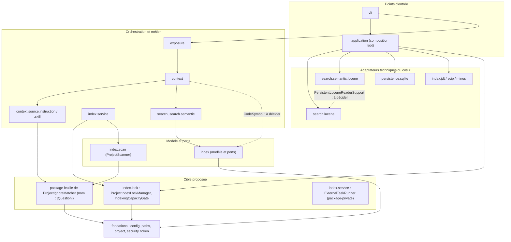
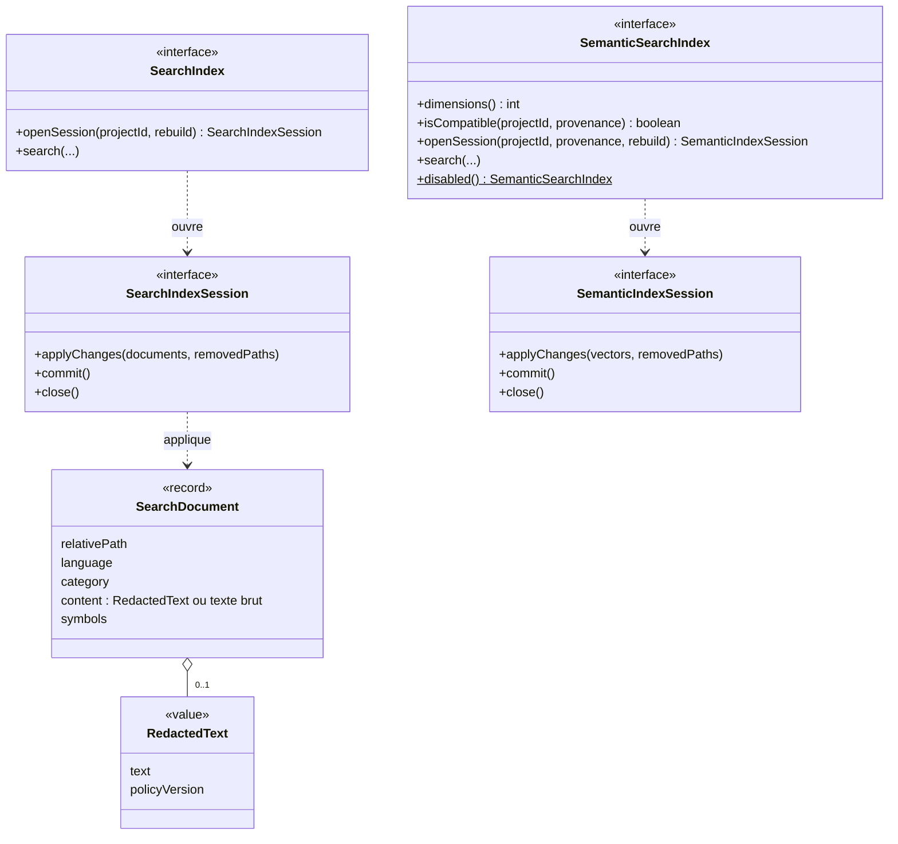
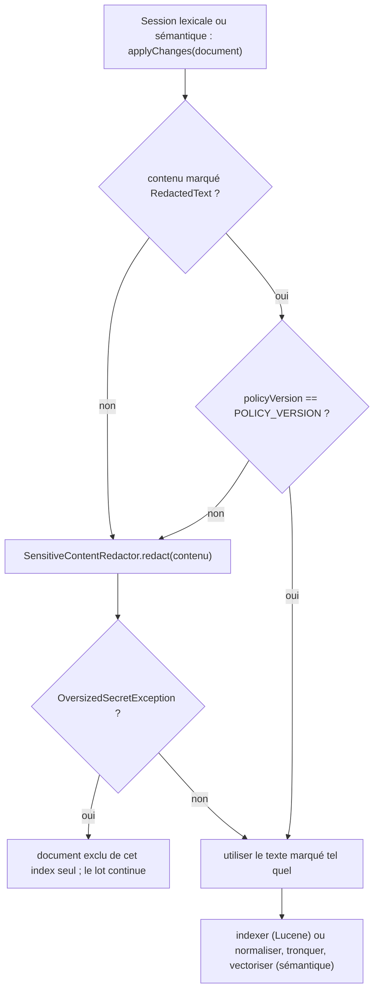
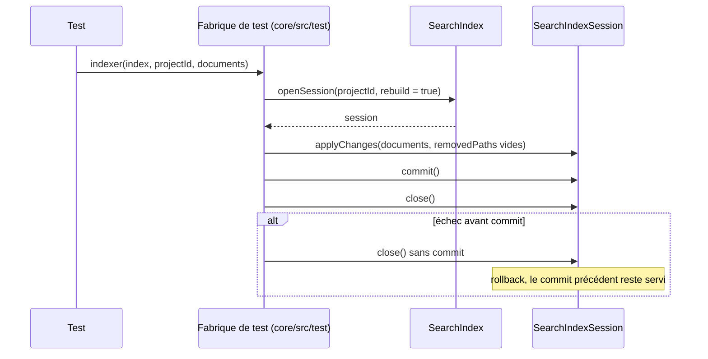

# Design

**Profil :** complet

## Contexte

- [Existant vérifié] `CoreArchitectureTest` lit les imports et les références `com.nexus.*` pleinement qualifiées (`core/src/test/java/com/nexus/architecture/CoreArchitectureRules.java:40-45`). Il exige un graphe acyclique (baseline vide), mais ne déclare que quatre règles de sens (`:23-26`). `docs/developer/architecture-implementation.md:416` le reconnaît : « les règles de sens couvrent quatre sens ».
- [Existant vérifié] Relevé du graphe réel par script au HEAD `6e0a5aaf` : imports et noms `com.nexus.*` qualifiés de `core/src/main/java`, commentaires retirés, rattachés au plus long package connu, comme le fait `JavaSourceGraph`. Arêtes hors fondations :
  - `cli ─► application, context, exposure, index, project, ranking, search` ;
  - `exposure ─► context, context.model, index, project, ranking, search` ;
  - `context ─► context.model, context.source, context.source.git, context.source.skill, index, project, ranking, search, search.candidate` ;
  - `context.source.instruction ─► context.source, index.scan, project, search.candidate` ;
  - `context.source.skill ─► context.model, context.source, index.scan, project, search.candidate` ;
  - `index.jdt ─► index, index.scan` et `index.minos ─► index, index.scan` (`ProjectScanner`) ;
  - `index.service ─► index, index.scan, project, search` ;
  - `persistence.sqlite ─► index, persistence, project` ;
  - `search ─► index, project, ranking, ranking.graph, search.candidate` ;
  - `search.candidate ─► index, project` ;
  - `search.lucene ─► index, project, search, search.candidate` ;
  - `search.semantic ─► index, project, search, search.candidate` ;
  - `search.semantic.lucene ─► index, search.lucene, search.semantic` ;
  - `search.semantic.ollama ─► search.semantic`.

  Les fondations ne dépendent que d'elles-mêmes : `security ─► config, paths` ; `config`, `paths`, `project`, `token` et `persistence` ne référencent aucun autre package `com.nexus`. Ce relevé n'est pas le test : la tâche 5.1 le recalcule avec `JavaSourceGraph`.
- [Existant vérifié] Écritures d'index : la production n'ouvre que des sessions (`core/src/main/java/com/nexus/index/service/IndexDocumentPublisher.java:65,69`). Les ports gardent toutefois `rebuild`/`applyChanges` et un `openSession` par défaut qui crée une `Direct*Session` (`core/src/main/java/com/nexus/search/SearchIndex.java:11-23`, `core/src/main/java/com/nexus/search/semantic/SemanticSearchIndex.java:30-70`). Les implémentations Lucene portent les deux chemins (`LuceneSearchIndex.java:101-118` et `:389-410`).
- [Existant vérifié] Redaction : `IndexDocumentPublisher.java:188` et `:212-214` (première passe, seul `new SearchDocument(` de production en `:195`), `LuceneSearchIndex.java:317` (deuxième passe), `SemanticIndexingService.java:184` et `:240` (troisième passe). Un refus de redaction (`OversizedSecretException`) exclut le document de l'index concerné (`LuceneSearchIndex.java:305-314`).
- [Existant vérifié] Le port `SemanticIndexing` a déjà une implémentation sans effet, `SemanticIndexing.disabled()` (`core/src/main/java/com/nexus/index/SemanticIndexing.java:18-20`), utilisée en `core/src/main/java/com/nexus/application/NexusApplicationFactory.java:159`. `SemanticSearchIndex` n'en a pas (`:160`, `null`).
- Pages durables : `docs/developer/architecture-implementation.md` (« OpenSpec core-package-boundaries », `:277`), `docs/developer/indexing-pipeline.md` (« OpenSpec project-indexing-pipeline », `:418`), `docs/developer/secret-redaction.md` (« OpenSpec secret-redaction », `:79`).

## Objectifs / Hors objectifs

**Objectifs :**
- `core-package-boundaries › Les dépendances entre packages du cœur suivent une matrice d'autorisations complète`, `› Chaque règle de la matrice a une fixture négative`, `› Les adaptateurs techniques du cœur ne sont référencés que par la composition`, `› Aucun package du cœur ne dépend des points d'entrée`.
- `core-package-boundaries › La politique d'exclusion de fichiers est hors du package de scan d'indexation`, `› Le package du modèle d'index ne porte ni verrou ni exécution de tâches`.
- `core-package-boundaries › Une recherche sémantique désactivée est une implémentation sans effet du port`, `› Le code de production n'expose pas de commodité réservée aux tests`.
- `project-indexing-pipeline › Les index dérivés n'écrivent les documents que par session`, `› La provenance d'un index sémantique n'est jamais ignorée`, `› Le service d'indexation sémantique n'expose que son port`, `› Le service d'indexation exige un gestionnaire de verrou explicite`.
- `secret-redaction › La redaction est idempotente`, `› Un contenu redigé par l'indexation n'est pas redigé de nouveau par les index dérivés`, `› Chaque document est redigé une fois avant l'embedding`.

**Hors objectifs :** réduire la visibilité des autres types publics du cœur ; contrôler les imports des adaptateurs Maven (ARCH-0075) ; changer la politique de redaction ou ses motifs ; dédupliquer le code Lucene au-delà de ce que la suppression du chemin par lot rend mort.

## Composants et responsabilités

Vue de composants (C4 niveau composant, rendue en `flowchart`) : quels packages de `core` change-t-on de place, et quelles arêtes la matrice doit-elle décider ? Couvre `core-package-boundaries › La politique d'exclusion de fichiers est hors du package de scan d'indexation`, `› Le package du modèle d'index ne porte ni verrou ni exécution de tâches` et `› Les adaptateurs techniques du cœur ne sont référencés que par la composition`. Les traits pleins sont les arêtes existantes conservées, les pointillés les arêtes ou placements à décider par l'ADR, et les nœuds `cible` les packages proposés.

- [Existant vérifié] `context.source.instruction` et `.skill` dépendent aujourd'hui de `index.scan` pour `ProjectIgnoreMatcher` (proposition, `AUD-ARC-02`). `ProjectIndexLockManager`, `IndexingCapacityGate` et `ExternalTaskRunner` sont dans `com.nexus.index` (proposition, `AUD-ARC-04`).
- [Proposition] `ProjectIgnoreMatcher` part dans un package feuille qui ne référence que `paths` et `security`, plus JGit (`ProjectIgnoreMatcher.java:7`). `index.scan` et `context.source.*` en dépendent. Ce package n'est pas `com.nexus.paths`, pour ne pas faire entrer JGit dans une fondation sans dépendance externe.
- [Proposition] `ProjectIndexLockManager` et `IndexingCapacityGate` partent dans `com.nexus.index.lock`, importé par `application` et `index.service` seulement (`ProjectIndexingService` est le seul consommateur hors `application`). `ExternalTaskRunner` part dans `com.nexus.index.service`, en visibilité package, à côté de son unique utilisateur `ExternalCodeIntelligenceRefresher` ; son test `ExternalTaskRunnerTest` suit.
- [Décision] Ces placements ne sont mis en œuvre qu'après l'acceptation de l'ADR (tâche 1.2), conformément à l'ordre du sprint.

## Modèle de domaine et invariants

Vue de classes (UML) : quels ports d'écriture restent après `AUD-QUA-02`, et où se place le marquage du contenu redigé (`AUD-PRF-03`) ? Couvre `project-indexing-pipeline › Les index dérivés n'écrivent les documents que par session`, `› La provenance d'un index sémantique n'est jamais ignorée` et `secret-redaction › Un contenu redigé par l'indexation n'est pas redigé de nouveau par les index dérivés`. Cible ; `RedactedText` est une `[Proposition]` de nom.

- [Exigence] Invariant d'écriture unique : un index dérivé ne reçoit de documents que par une session ouverte, appliquée par lots, puis committée ou annulée. Les ports n'ont ni `rebuild` ni `applyChanges` (`project-indexing-pipeline › Les index dérivés n'écrivent les documents que par session`).
- [Exigence] Invariant de provenance : `openSession` du port sémantique est abstraite et exige une provenance non nulle. Le défaut actuel qui l'avale (`SemanticSearchIndex.java:35-40`, `:53-59`) disparaît avec les méthodes qu'il surchargeait.
- [Proposition] Invariant de marquage : le contenu d'un `SearchDocument` est soit marqué comme redigé (porteur de la version de politique qui l'a produit), soit brut. Seul `IndexDocumentPublisher`, qui vient d'appeler le redacteur, crée un contenu marqué. Une session ne fait confiance à la marque que si sa version est `SensitiveContentRedactor.POLICY_VERSION`, et redige sinon. Un contenu redigé sous une autre politique est ainsi redigé de nouveau, pas servi tel quel.
- [Proposition] La valeur marquée ne peut pas être construite hors du package de sécurité, ou du pipeline, sans passer par le redacteur : une fabrique `SensitiveContentRedactor.redactMarked(String)` renvoie la valeur marquée. Cela empêche un appelant de marquer un texte brut. Un `boolean redacted` sur `SearchDocument` serait plus simple, mais n'offrirait pas cette garantie : variante écartée (voir Décisions).
- [Exigence] Invariant d'idempotence : `redact(redact(x)) == redact(x)` pour la politique courante. C'est la condition pour que retirer les passes 2 et 3 laisse le contenu indexé inchangé (`secret-redaction › La redaction est idempotente`).

## Traitements et interactions

Organigramme (cible) : une session d'index dérivé doit-elle appeler le redacteur ? Couvre `secret-redaction › Un contenu redigé par l'indexation n'est pas redigé de nouveau par les index dérivés` et `› Chaque document est redigé une fois avant l'embedding`.

Sur le chemin de production, `IndexDocumentPublisher` crée toujours un contenu marqué à la version courante : chaque session prend la branche « oui / oui » et le redacteur n'est appelé qu'une fois par fichier. Les deux autres branches gardent la barrière pour tout autre producteur de `SearchDocument` (tests, futurs importeurs).

Séquence (UML) : comment un test écrit-il dans un index après la suppression de l'API par lot ? Couvre `project-indexing-pipeline › Les index dérivés n'écrivent les documents que par session` (scénario « Écriture dans un test »).

## États et transitions

Non applicable : aucune entité ne gagne d'état. Le cycle de vie d'une session (ouverte, appliquée, committée ou annulée) est inchangé, et décrit par `project-indexing-pipeline › Un writer Lucene par indexation, committé à la publication`.

## Contrats d'interface

- [Existant vérifié] Ports Java concernés : `core/src/main/java/com/nexus/search/SearchIndex.java`, `core/src/main/java/com/nexus/search/semantic/SemanticSearchIndex.java`, `core/src/main/java/com/nexus/index/SemanticIndexing.java`, `core/src/main/java/com/nexus/index/SearchDocument.java`. Aucune surface CLI, REST ni MCP n'appelle ces méthodes (`rg '\.rebuild\(|\.applyChanges\('` sur `adapters/*/src/main` vide).
- [Proposition] `SearchIndex` : retrait de `applyChanges(UUID, List, Set)` et de `rebuild(UUID, List)`. `openSession(UUID, boolean)` devient abstraite.
- [Proposition] `SemanticSearchIndex` : retrait des deux `rebuild` et des deux `applyChanges`. `openSession(UUID, SemanticIndexProvenance, boolean)` devient abstraite, et une fabrique statique `disabled()` est ajoutée : `dimensions()` vaut 0 et `isCompatible` vaut `false`, `search` rend une liste vide, `openSession` lève `IllegalStateException` (aucun appel attendu, puisque `SemanticIndexing.disabled()` n'ouvre pas de session), et `close()` ne fait rien.
- [Proposition] `SemanticIndexingService` : retrait des quatre méthodes publiques `rebuild`/`applyChanges` (`SemanticIndexingService.java:94-125`).
- [Proposition] `SearchDocument` : le composant `content` reste une `String` pour les lecteurs. Un accesseur ou un composant supplémentaire porte la marque `RedactedText`. La forme exacte (composant optionnel, type scellé `Content`) se décide à l'implémentation, sous la contrainte que la marque ne se fabrique pas hors du redacteur.
- [Proposition] `NexusApplication` : le champ `semanticSearchIndex` n'est jamais `null`. `semanticSearchEnabled` est retiré au profit de la configuration, déjà passée en `NexusApplicationFactory.java:239` (`semanticSearchConfiguration.enabled()`), ou d'une requête sur le port. `ReadinessSnapshot.semanticSearchEnabled` reste au même nom et à la même valeur, car c'est un champ public de la disponibilité.
- [Proposition] `ProjectIndexLockManager.processLocalOnly()` part dans `core/src/test/java/com/nexus/index/service/ProjectIndexingServices.java`. Le constructeur qu'elle appelle devient accessible au package de test, ou une fabrique de test dédiée est ajoutée sous `core/src/test/java/com/nexus/index/lock/`. `RepositoryPath.fromPath` et `ProjectPathGuard.containsSymbolicLink` sont supprimés si leurs tests peuvent passer par l'API publique restante, rendus package-private sinon.

## Persistance et intégrité

Non applicable : aucun schéma SQLite ni format Lucene ne change. Le contenu indexé reste identique, à condition que la redaction soit idempotente (tâche 8.1) ; sinon, la tâche 8.1 bloque la suite (voir Risques).

## Transactions, concurrence et idempotence

- [Existant vérifié] Le verrou de projet (`ProjectIndexLockManager`, autorité de sérialisation des mutations selon DATA-0074:47) change de package, pas de comportement. Les tests `ProjectIndexLockManagerTest`, `IndexingCapacityGateTest` et `ProjectIndexLockProbe` le suivent dans `index.lock`. Les workflows `filesystem-semantics-qualification.yml` et `smb-filesystem-qualification.yml` filtrent sur leurs chemins : ils sont mis à jour dans la même tâche.
- La session reste la frontière transactionnelle des index dérivés : un seul commit à la barrière de publication, et rollback à la fermeture sans commit.

## Sécurité et isolation

- [Exigence] La barrière de redaction reste dans les sessions pour tout contenu non marqué, ou marqué sous une autre politique : retirer les passes ne doit jamais ouvrir de chemin par lequel un texte brut atteindrait Lucene ou le fournisseur d'embeddings.
- [Proposition] La marque ne se construit que par le redacteur (voir Modèle de domaine). Un test vérifie qu'un document non marqué contenant un secret factice n'en laisse aucune trace dans l'index lexical ni dans le texte d'embedding.
- Revue `nexus-security-auditor` requise : le diff touche `security/` (`ProjectPathGuard`, redacteur) et le chemin d'indexation.

## Erreurs et reprise

- [Existant vérifié] Un document que la redaction refuse est exclu de l'index concerné, seul (`LuceneSearchIndex.java:305-314`, `SemanticIndexingService.java:236-247`). Ce comportement reste sur la branche « non marqué ». Sur la branche marquée, le refus a déjà eu lieu dans `IndexDocumentPublisher.java:189-193` (diagnostic `INDEX_REDACTION_LIMIT`).
- `SemanticSearchIndex.disabled().openSession` lève `IllegalStateException` : un appel serait un défaut de composition, pas une erreur utilisateur.

## Observabilité

Non applicable : aucun journal ni diagnostic nouveau. Les diagnostics `INDEX_REDACTION_LIMIT` et les avertissements d'exclusion existants sont conservés, et la disponibilité garde le champ `semanticSearchEnabled`.

## Performance et mesure

- [Existant vérifié] `ScaleRegressionBenchmarkTest.java:744` publie `totalFullIndexMs`. `scripts/verify-scale-budgets.py:186` ne le borne (`<= 6000`) qu'au profil `full`.
- [Écart] L'estimation de l'audit, environ 0,45 s de CPU par Mo indexé pour les deux passes redondantes, vient d'une mesure hors dépôt : elle ne fixe pas de seuil.
- [Décision] Aucun seuil nouveau. La tâche 8.4 mesure `portfolio.totalFullIndexMs` avant et après, sur le même runner, le même profil et le même commit de base, et consigne les deux valeurs. Le gain est démontré si la valeur baisse ; son ampleur attendue reste une `[Question]` (proposal.md).
- [Proposition] Un test de comptage, avec un redacteur instrumenté ou un compteur de test, prouve sans bruit de mesure qu'un fichier n'est redigé qu'une fois sur le chemin de production. Il porte le scénario « Contenu marqué par le pipeline ».

## Compatibilité, migration et retour arrière

- API Java interne au cœur : **BREAKING** pour un éventuel implémenteur externe de `SearchIndex` ou de `SemanticSearchIndex`. Aucun n'existe dans le dépôt hors des quatre classes Lucene et des doubles de test. Les adaptateurs REST et MCP n'en dépendent pas.
- Contrats publics CLI, REST et MCP, formats SQLite et Lucene : inchangés (`core-package-boundaries › Le découpage ne change aucun comportement observable`, exigence existante, rejouée par les tests de contrat et le self-smoke).
- Retour arrière : revert du merge commit, sans migration à défaire.

## Décisions

- [Décision] Un ADR est justifié pour `AUD-ARC-12` : la matrice et les placements contraignent durablement tous les packages du cœur, et ARCH-0076 accepté ne peut pas être réécrit. Il est rédigé par le skill `nexus-adr` (tâche 1.1), avec le préfixe `ARCH`, le numéro suivant libre au moment de l'écriture, `Complète : ARCH-0076`, l'entrée d'index de `docs/architecture/adr/README.md` et `docs/architecture/arc42/09-decisions.md`.
- [Proposition] Contenu de décision de cet ADR, à valider par le mainteneur :
  - la matrice complète des sens, du dépendant vers ses dépendances, fondations (`config`, `paths`, `project`, `security`, `token`, `persistence`) comprises, `cli` et `exposure` ajoutés, construite depuis le relevé du Contexte ;
  - `application` est le seul package à référencer `persistence.sqlite`, `search.lucene`, `search.semantic.lucene`, `search.semantic.ollama`, `index.jdt`, `index.scip` et `index.minos`. Exception à décider : `search.semantic.lucene ─► search.lucene` pour `PersistentLuceneReaderSupport`, à autoriser nommément ou à déplacer vers un support Lucene commun ;
  - seul `cli` référence `application`, et personne ne référence `cli` ;
  - `context ─► index` est autorisé (le modèle `CodeSymbol` est un type de modèle d'index), ou bien `CodeSymbol` sort vers un package de modèle ;
  - la place de `ProjectIgnoreMatcher` (package feuille, nom en `[Question]`) et de `index.lock`, et `ExternalTaskRunner` package-private dans `index.service` ;
  - la règle de maintenance : toute nouvelle arête passe par la matrice du test et par une mise à jour de l'ADR, ou de la page générée si l'option générée est retenue.
- [Proposition] Matrice encodée dans `CoreArchitectureRules` comme une table `package → ensemble de dépendances autorisées`, fondations comprises, et non comme des règles d'interdiction. Un package absent de la table échoue (« package non classé »). Les quatre règles de sens existantes restent comme noms stables, couvertes par la matrice, pour ne pas casser les références des docs et des ADR. Alternative écartée : ArchUnit, dépendance de test supplémentaire refusée par `core-package-boundaries › Le test d'architecture fait partie de la suite par défaut`.
- [Proposition] Une fixture négative par entrée de matrice, générée par le test : pour chaque package, une classe qui référence un package hors de son ensemble. Un contrôle de complétude fait échouer le test si une entrée n'a pas de fixture. Générer les fixtures évite d'écrire à la main une trentaine de cas qui divergeraient.
- [Proposition] Marquage par le type (`RedactedText` porteur de la version) plutôt qu'un booléen ou qu'un retrait pur et simple de la barrière. Le booléen permet de marquer un texte brut ; le retrait pur supprime la barrière que `docs/developer/secret-redaction.md:134` déclare volontaire.
- [Décision] `AUD-QUA-02` avant `AUD-PRF-03` : le marquage n'est mis en place que dans les sessions, une fois le chemin par lot supprimé.
- [Décision] Les tests de l'API par lot sont réécrits sur les sessions, par une fabrique de test qui offre l'ancienne commodité, et non supprimés : ils couvrent le contenu indexé, pas le chemin.

## Risques / Compromis

- [Risque] La redaction n'est pas idempotente sur une forme : retirer une passe changerait le contenu indexé. → La tâche 8.1 écrit d'abord le test d'idempotence (sonde et contenus générés) ; s'il échoue, la suite de `AUD-PRF-03` s'arrête, et l'écart est remonté au sprint de redaction (`nexus-redaction-change`) au lieu de monter `POLICY_VERSION` ici.
- [Risque] Déplacer des fichiers casse des chemins épinglés : filtres de workflows, contrats `test-final-audit-contracts.sh:142` et `test-operational-doc-contracts.sh:280`, règle Archgate de BE-0083, « Mise en œuvre » de DATA-0074, SEC-0082 et ARCH-0076. → Chaque tâche de déplacement inclut `git grep` de l'ancien chemin, `bash .claude/scripts/contracts.sh` et `archgate check`. Les fichiers d'ADR acceptés ne sont touchés qu'après confirmation du mainteneur (hook `guard-edit.ps1`, `[Question]` de la proposition).
- [Risque] Réécrire les 17 fichiers de test de l'API par lot leur fait perdre une assertion. → Réécriture mécanique par la fabrique de test, même nombre de tests avant et après (relevé Surefire), revue du diff de test.
- [Risque] La matrice fige des arêtes aujourd'hui fortuites. → L'ADR les liste explicitement ; une arête retirée plus tard passe par un ADR, comme toute décision acceptée.
- [Compromis] Laisser les quatre noms de règles de sens historiques ajoute une redondance avec la matrice, mais garde stables les références d'ARCH-0076 et de la documentation.

## Stratégie de vérification

- Commande ciblée, notée `TEST(<classes>)` dans tasks.md : `./mvnw -B -ntp -pl core test -Dtest=<classes> -Dsurefire.failIfNoSpecifiedTests=false -Djacoco.skip=true`.
- Architecture : `TEST(CoreArchitectureTest)`. Chaque fixture négative échoue sur sa règle ; une fixture retirée fait échouer le contrôle de complétude.
- Ports d'index : `TEST(LuceneSearchIndex*Test,LuceneSemanticSearchIndex*Test,SemanticIndexingServiceTest,ProjectIndexing*Test,SemanticIndexProvenanceIntegrationTest)`, plus `rg '\.rebuild\(|\.applyChanges\(' core/src adapters/*/src` limité aux sessions.
- Redaction : `TEST(SensitiveContentRedactorTest,SecretRedactionProbeTest)` (idempotence), puis le test de comptage de 8.3.
- Mesure : `ScaleRegressionBenchmarkTest` au profil `full`, avant et après, avec les valeurs consignées.
- Intégration : `./mvnw -B -ntp clean install`, `bash .claude/scripts/contracts.sh`, `archgate check`, `pwsh -NoProfile -File scripts/self-smoke.ps1`, `pwsh -NoProfile -File .claude/hooks/tests/Test-Hooks.ps1` si un hook ou un chemin qu'il cite change, `openspec validate audit-1116-s5-frontieres-coeur-api-index --strict`.
- Diagrammes : rendu Mermaid vérifié avant de les reporter dans les pages durables.

## Traçabilité

| Exigence (`capacité › titre`) | Scénario | Conception ou diagramme | Tâche | Test ou preuve |
|---|---|---|---|---|
| `core-package-boundaries › Les dépendances entre packages du cœur suivent une matrice d'autorisations complète` | Dépendance non autorisée | Décisions (matrice), vue de composants | 1.1, 5.1 | test non écrit |
| `core-package-boundaries › Les dépendances entre packages du cœur suivent une matrice d'autorisations complète` | Référence pleinement qualifiée non autorisée | Décisions (matrice) | 5.1 | test non écrit |
| `core-package-boundaries › Les dépendances entre packages du cœur suivent une matrice d'autorisations complète` | Package non classé | Décisions (matrice) | 5.1 | test non écrit |
| `core-package-boundaries › Les dépendances entre packages du cœur suivent une matrice d'autorisations complète` | Graphe courant | Contexte (relevé), Décisions | 5.1, 5.3 | test non écrit |
| `core-package-boundaries › Chaque règle de la matrice a une fixture négative` | Fixture par règle | Décisions (fixtures générées) | 5.2 | test non écrit |
| `core-package-boundaries › Chaque règle de la matrice a une fixture négative` | Règle sans fixture | Décisions (contrôle de complétude) | 5.2 | test non écrit |
| `core-package-boundaries › Les adaptateurs techniques du cœur ne sont référencés que par la composition` | Adaptateur Lucene référencé par l'exposition | Vue de composants | 5.1, 5.2 | test non écrit |
| `core-package-boundaries › Les adaptateurs techniques du cœur ne sont référencés que par la composition` | Adaptateur SQLite référencé par le contexte | Vue de composants | 5.1, 5.2 | test non écrit |
| `core-package-boundaries › Aucun package du cœur ne dépend des points d'entrée` | Remontée vers la CLI | Décisions (matrice) | 5.1, 5.2 | test non écrit |
| `core-package-boundaries › Aucun package du cœur ne dépend des points d'entrée` | Remontée vers la composition | Décisions (matrice) | 5.1, 5.2 | test non écrit |
| `core-package-boundaries › Aucun package du cœur ne dépend des points d'entrée` | Point d'entrée CLI | Contexte (`cli ─► application`) | 5.1 | test non écrit |
| `core-package-boundaries › La politique d'exclusion de fichiers est hors du package de scan d'indexation` | Imports des sources de contexte | Vue de composants | 1.1, 3.1 | test non écrit |
| `core-package-boundaries › La politique d'exclusion de fichiers est hors du package de scan d'indexation` | Exclusions inchangées | Vue de composants | 3.1, 3.2 | preuve existante à rejouer : `ProjectScannerTest`, `ProjectIgnoreMatcherBuiltInExclusionTest`, `ProjectIgnoreMatcherBudgetTest` ; test de découverte à écrire |
| `core-package-boundaries › Le package du modèle d'index ne porte ni verrou ni exécution de tâches` | Contenu du package index | Vue de composants | 1.1, 4.1, 4.2 | test non écrit |
| `core-package-boundaries › Le package du modèle d'index ne porte ni verrou ni exécution de tâches` | Visibilité de l'exécuteur | Vue de composants | 4.2 | preuve manquante (compilation) |
| `core-package-boundaries › Le package du modèle d'index ne porte ni verrou ni exécution de tâches` | Verrouillage inchangé | Transactions, concurrence | 4.1 | preuve existante à rejouer : `ProjectIndexLockManagerTest`, `IndexingCapacityGateTest` |
| `core-package-boundaries › Une recherche sémantique désactivée est une implémentation sans effet du port` | Composition sans recherche sémantique | Contrats d'interface | 6.1, 6.2 | test non écrit |
| `core-package-boundaries › Une recherche sémantique désactivée est une implémentation sans effet du port` | Composition avec recherche sémantique | Contrats d'interface | 6.2 | test non écrit |
| `core-package-boundaries › Le code de production n'expose pas de commodité réservée aux tests` | Verrou limité au processus | Contrats d'interface | 7.1 | test non écrit |
| `core-package-boundaries › Le code de production n'expose pas de commodité réservée aux tests` | Méthodes de chemins | Contrats d'interface | 7.2 | preuve manquante (compilation) |
| `project-indexing-pipeline › Les index dérivés n'écrivent les documents que par session` | Surface des ports | Vue de classes | 2.2, 2.3 | test non écrit |
| `project-indexing-pipeline › Les index dérivés n'écrivent les documents que par session` | Écriture dans un test | Séquence de la fabrique de test | 2.1 | test non écrit |
| `project-indexing-pipeline › Les index dérivés n'écrivent les documents que par session` | Rebuild par session | Vue de classes | 2.1 | preuve existante à rejouer : `LuceneSearchIndexSessionTest`, `LuceneSemanticSearchIndexSessionTest` |
| `project-indexing-pipeline › La provenance d'un index sémantique n'est jamais ignorée` | Provenance persistée au commit | Modèle de domaine (invariant de provenance) | 2.3 | preuve existante à rejouer : `SemanticIndexProvenanceIntegrationTest` |
| `project-indexing-pipeline › La provenance d'un index sémantique n'est jamais ignorée` | Provenance absente | Modèle de domaine | 2.3 | test non écrit |
| `project-indexing-pipeline › Le service d'indexation sémantique n'expose que son port` | Méthodes publiques du service | Contrats d'interface | 2.4 | test non écrit |
| `project-indexing-pipeline › Le service d'indexation exige un gestionnaire de verrou explicite` | Composition de production | Contrats d'interface | 7.1 | preuve existante à rejouer : `ProjectIndexingServiceCompositionTest` |
| `project-indexing-pipeline › Le service d'indexation exige un gestionnaire de verrou explicite` | Verrouillage limité au processus dans les tests | Contrats d'interface | 7.1 | test non écrit |
| `secret-redaction › La redaction est idempotente` | Corpus de la sonde de redaction | Modèle de domaine (idempotence), Risques | 8.1 | test non écrit |
| `secret-redaction › La redaction est idempotente` | Contenus générés | Modèle de domaine (idempotence) | 8.1 | test non écrit |
| `secret-redaction › Un contenu redigé par l'indexation n'est pas redigé de nouveau par les index dérivés` | Contenu marqué par le pipeline | Organigramme des sessions, Performance | 8.2, 8.3 | test non écrit |
| `secret-redaction › Un contenu redigé par l'indexation n'est pas redigé de nouveau par les index dérivés` | Contenu non marqué | Organigramme des sessions, Sécurité | 8.3 | test non écrit |
| `secret-redaction › Un contenu redigé par l'indexation n'est pas redigé de nouveau par les index dérivés` | Contenu non marqué que la redaction refuse | Erreurs et reprise | 8.3 | preuve existante à rejouer : tests d'exclusion de `LuceneSearchIndexTest` et `SemanticIndexingServiceTest` |
| `secret-redaction › Chaque document est redigé une fois avant l'embedding` | Document envoyé au fournisseur | Organigramme des sessions | 8.3 | preuve existante à rejouer : `SemanticIndexingServiceTest` |
| `secret-redaction › Chaque document est redigé une fois avant l'embedding` | Document redigé par le pipeline | Organigramme des sessions | 8.3 | test non écrit |

## Questions ouvertes

- [Question] Faut-il générer le tableau de l'ADR depuis la matrice du test (une seule source), ou le tenir à la main avec un contrôle d'égalité ? Le choix ne change ni les specs ni les tâches : la tâche 1.1 retient l'une des deux formes et la tâche 9.1 la documente.
- Les autres questions (package de `ProjectIgnoreMatcher`, arêtes `context ─► index` et `search.semantic.lucene ─► search.lucene`, fichiers d'ADR acceptés, ampleur du gain) sont dans la proposition. L'ADR tranche les trois premières avant les tâches 3 à 5.
