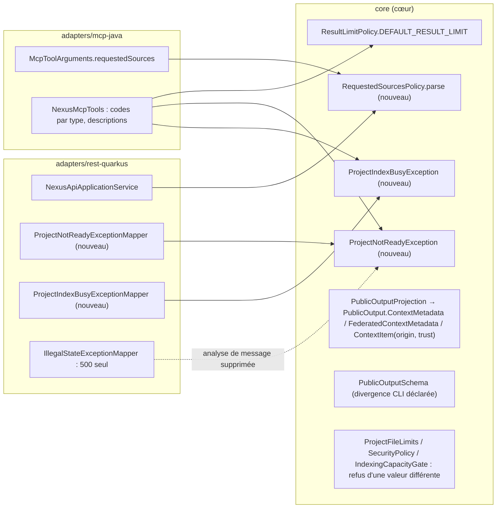
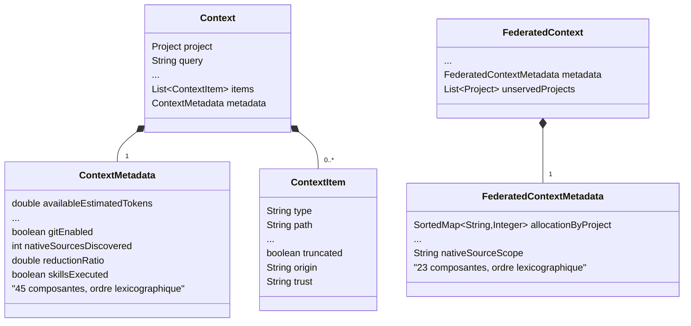
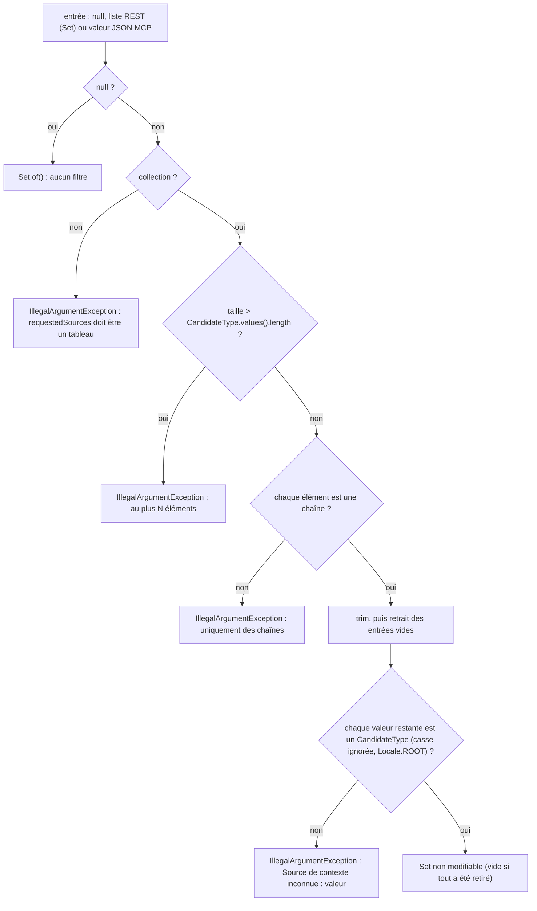
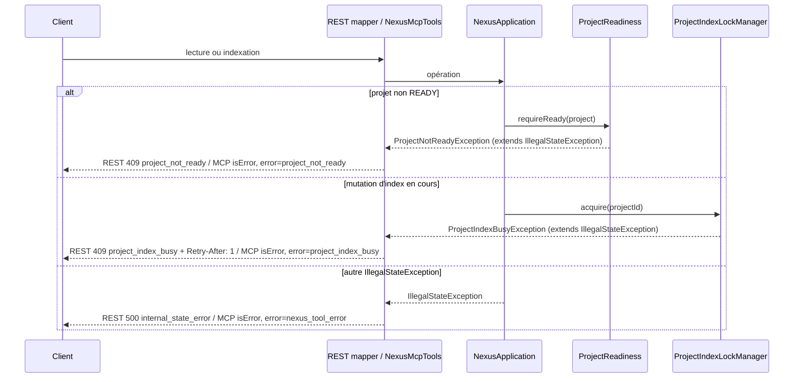
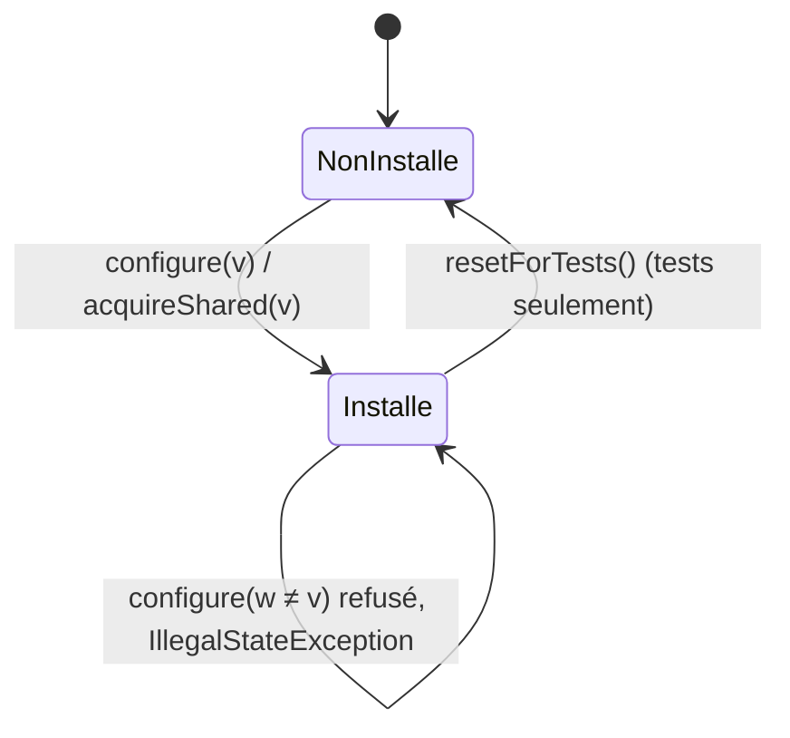

# Design

**Profil :** complet

## Contexte

L'état relu est celui de la proposition (preuves au HEAD `6e0a5aaf`, code identique au commit audité `7ec5c5dc`). Ce qui compte pour l'approche :

- [Existant vérifié] Les trois canaux sérialisent les records de `PublicOutput` produits par `PublicOutputProjection` (`ARCH-0085`, `docs/developer/rest-api.md:195-203`). `PublicOutputSchema.divergences` descend dans les composantes de type record et les listes de records, mais pas dans les `Map` (`core/src/main/java/com/nexus/exposure/PublicOutputSchema.java:56-86`) : `Context.metadata` et `FederatedContext.metadata`, des `SortedMap<String, Object>` (`PublicOutput.java:126,147`), échappent au contrat.
- [Existant vérifié] Avant projection, `PublicContextPolicy.metadata` retire `query`, passe le reste par `PublicDiagnosticPolicy.metadata` (filtrage des chemins et bornes de profondeur et de nombre de valeurs), puis remet la requête du client (`core/src/main/java/com/nexus/exposure/PublicContextPolicy.java:41-49`, `core/src/main/java/com/nexus/security/PublicDiagnosticPolicy.java:76-101`). Cette politique doit continuer de s'appliquer aux valeurs textuelles des records.
- [Existant vérifié] Le cœur a déjà un précédent d'erreur d'état typée mappée par type : `IndexingCapacityExceededException extends IllegalStateException` et `IndexingCapacityExceededExceptionMapper` (`core/src/main/java/com/nexus/index/IndexingCapacityExceededException.java:4`, `adapters/rest-quarkus/src/main/java/com/nexus/api/IndexingCapacityExceededExceptionMapper.java:11-15`).
- [Existant vérifié] REST masque le message d'une `IllegalArgumentException` en « Requête invalide » sauf deux cas listés (`adapters/rest-quarkus/src/main/java/com/nexus/api/IllegalArgumentExceptionMapper.java:20-35`) ; MCP renvoie le message filtré par `PublicDiagnosticPolicy` (`adapters/mcp-java/src/main/java/com/nexus/mcp/NexusMcpTools.java:262-267`). Les deux canaux n'ont donc pas le même texte d'erreur pour une entrée invalide, et ce change ne les aligne pas.
- [Existant vérifié] Les états de processus et leurs appelants : `NexusConfiguration.java:70-73`, `NexusApplicationFactory.java:133`, `NexusRestExposureGuard.java:29`, `ProjectIndexLockManager.java:76,94` (`IndexingCapacityGate.configuredLimit` puis `acquireShared`). `SecurityPolicy.Posture` est un record de deux chaînes brutes, validées à la lecture (`core/src/main/java/com/nexus/config/SecurityPolicy.java:52-64,76-78`).
- Prérequis : `audit-1116-s2-couverture-et-erreurs-tracees` modifie les mêmes mappers (journalisation, corrélation) ; `audit-1116-s5-frontieres-coeur-api-index` déplace `IndexingCapacityGate` et `ProjectIgnoreMatcher` et écrit l'ADR qui complète `ARCH-0076`. Les noms de paquet cités ci-dessous pour ces classes sont ceux d'avant S5 ; l'implémentation suit l'emplacement fixé par S5.

## Objectifs / Hors objectifs

**Objectifs :**
- `query-parameter-normalization` : les cinq exigences.
- `project-state-conflicts` : les cinq exigences.
- `process-wide-configuration` : les quatre exigences.
- `context-content-provenance` : les quatre exigences.
- `public-output-projection › Les métadonnées de contexte suivent le contrat typé de la sortie publique`.

**Hors objectifs :** aligner le texte des erreurs `400` REST sur MCP ; découper `ContextBuildMetadata.metadata` en étapes (`AUD-QUA-03`, S7) ; changer la sélection ou la priorité des instructions ; journaliser les erreurs (S2).

## Composants et responsabilités

Vue de composants (C4 niveau composant, rendue en `flowchart` à sous-graphes) : qui porte chaque contrat après le change ? La cible est en traits pleins ; la flèche pointillée est le chemin supprimé.

- [Décision] La normalisation des sources est une classe du cœur (`com.nexus.search.candidate.RequestedSourcesPolicy`, à côté de `CandidateType`), sans dépendance vers un adaptateur. Elle prend une `Collection<?>` (MCP reçoit des objets JSON non typés, REST des `String`) et rend un `Set<CandidateType>` non modifiable. Couvre `query-parameter-normalization › REST et MCP convertissent les sources demandées par une même règle du cœur`.
- [Décision] Les deux exceptions vivent près de leur émetteur : `ProjectNotReadyException` dans `com.nexus.project` (levée par `ProjectReadiness.requireReady`), `ProjectIndexBusyException` dans le paquet du verrou d'index (levée par `ProjectIndexLockManager.busy`, emplacement fixé par S5). Les adaptateurs ont déjà le droit d'importer ces paquets pour des types d'erreur (précédent de `IndexingCapacityExceededExceptionMapper`, règles `ARCH-0075`).
- [Décision] Les adaptateurs restent minces : un mapper par type en REST, un `switch` par type dans `NexusMcpTools.tool(...)` en MCP. Aucune logique d'état n'y entre.

## Modèle de domaine et invariants

Vue de classes (UML) de la sortie publique cible : que devient le contrat de clés ? Couvre `public-output-projection › Les métadonnées de contexte suivent le contrat typé de la sortie publique` et `context-content-provenance › Chaque élément de contexte porte sa provenance et sa confiance`.

Adaptation de notation : les `...` remplacent les composantes inchangées ; la note entre guillemets résume la liste complète, qui vit dans le code.

- [Décision] Invariant d'ordre : les composantes des deux records de métadonnées sont déclarées dans l'ordre lexicographique de leur nom, qui est l'ordre JSON actuel (tri par clé de `PublicOutputProjection.sortedMetadata`). Un test compare la liste des composantes à sa version triée.
- [Décision] Invariant de types : chaque composante a un type scalaire, `String`, `List<String>`, `SortedMap<String, Integer|Long>` pour les tableaux par projet (clés libres : identifiant de projet), ou un record public dédié quand la structure a des clés fixes (limites et compteurs de découverte et de matérialisation). Aucune composante n'a le type `Object`.
- [Décision] Invariant d'alignement : une même notion dans les deux contextes porte le même nom de composante et le même type (par exemple les limites et le travail de découverte native).
- [Décision] Invariant de confiance : `origin` vaut `repository` et `trust` vaut `untrusted` pour tout élément construit à partir du contenu du dépôt indexé, c'est-à-dire tous les types actuels (`FILE`, `SYMBOL`, `TEST`, `DOCUMENTATION`, `INSTRUCTION`, `SKILL`, `GIT`). Les valeurs sont des constantes du cœur ; aucune n'est dérivée du contenu.
- [Proposition] Les valeurs sont des chaînes plutôt qu'un booléen, pour laisser place à une future provenance hors dépôt (par exemple une instruction fournie par l'opérateur) sans changer de type ; aucune autre valeur n'est créée par ce change.

## Traitements et interactions

### Conversion des sources demandées

Organigramme (cible) : comment une liste de sources devient-elle un filtre ? Couvre les trois premières exigences de `query-parameter-normalization`.

- [Décision] La règle retenue est celle de MCP (`McpToolArguments.java:72-99`), la plus tolérante sur les blancs et la seule bornée. Pour REST, une entrée vide passe de « refusée » à « ignorée » : c'est un assouplissement, sans requête jusque-là acceptée qui deviendrait refusée, hormis une liste de plus de sept entrées distinctes, qui échouait déjà sur une valeur inconnue.
- [Décision] Le message « Source de contexte inconnue » reste le même texte dans le cœur ; REST continue de le masquer en « Requête invalide » (`IllegalArgumentExceptionMapper`), MCP de l'exposer filtré.

### Conflits d'état

Séquence (UML) : comment un conflit d'état parvient-il au client ? Couvre `project-state-conflicts` (cinq exigences).

- [Existant vérifié] JAX-RS choisit le mapper du type le plus proche (`IndexingCapacityExceededExceptionMapper` coexiste déjà avec `IllegalStateExceptionMapper`). Les deux nouveaux mappers prennent donc le pas sans ordre à configurer.
- [Décision] En MCP, le `catch (Exception exception)` de `NexusMcpTools.tool` (`:235-238`) choisit le code d'erreur par type avant `safeMessage` ; les messages publics sont ceux de REST (« Le projet n'est pas prêt pour cette opération », « Une mutation d'index est déjà en cours pour ce projet »), sans identifiant.

## États et transitions

Vue d'états (UML) d'un état de processus : que se passe-t-il à la seconde installation ? Couvre `process-wide-configuration` (trois premières exigences).

- [Décision] Valeur de référence comparée : pour `ProjectFileLimits`, la borne en octets ; pour `IndexingCapacityGate`, la limite du sémaphore ; pour `SecurityPolicy`, chaque posture normalisée (`trim`, casse ignorée, `null` et blanc équivalents). La normalisation évite qu'un `TRUE` de l'environnement et un `true` filtré soient vus comme différents ; une valeur invalide reste refusée à la lecture comme aujourd'hui.
- [Décision] La comparaison et l'installation se font sous verrou de classe (`synchronized`) pour que deux compositions concurrentes ne contournent pas le refus. Le champ reste `volatile` pour les lectures.
- [Décision] Avant installation, les valeurs par défaut et les propriétés JVM s'appliquent comme aujourd'hui (`ARCH-0086`, « avant leur installation… »). Une lecture n'installe rien.
- [Décision] `resetForTests()` est une méthode statique de chaque état, de visibilité la plus réduite que permettent les tests appelants ; un test d'architecture de `CoreArchitectureTest` (et son équivalent dans les adaptateurs) interdit tout appel depuis `src/main/java`. Couvre `process-wide-configuration › Les tests remettent les états de processus à zéro explicitement`.

## Contrats d'interface

- REST (`docs/developer/rest-api.md`) : `requestedSources` de `POST /api/v1/projects/{projectId}/context`, `/explain/context` et des endpoints fédérés ignore désormais les entrées vides et refuse plus de sept entrées (`400 bad_request`). `409 project_not_ready` et `409 project_index_busy` (+ `Retry-After: 1`) inchangés pour le client ; `500 internal_state_error` pour toute autre `IllegalStateException`.
- MCP (`docs/developer/mcp.md`) : résultat en erreur `{"error":"project_not_ready",…}` ou `{"error":"project_index_busy",…}` au lieu de `nexus_tool_error` pour ces deux cas (**BREAKING** pour un client qui testait l'ancien code) ; `find_usages` sans `limit` rend au plus `ResultLimitPolicy.DEFAULT_RESULT_LIMIT` relations au lieu de 20 ; descriptions des quatre outils de contexte complétées.
- Sortie publique (trois canaux) : `ContextItem` gagne `origin` et `trust` en fin de record (ajout de composante permis par `ARCH-0085`, « Ajouter un champ public en ajoutant une composante au record ») ; `metadata` garde ses clés et leur ordre.
- CLI (`docs/developer/cli.md`) : aucune option nouvelle ; `PublicOutputSchema` déclare l'absence de sources demandées en CLI (par exemple `CLI_WITHOUT_REQUESTED_SOURCES`), en plus de `CLI_COMMAND_FIELD` et `MCP_ONLY_OPERATIONS`.
- Port Java : `RequestedSourcesPolicy.parse(Object)` ou `parse(Collection<?>)` ; `ProjectNotReadyException(UUID, IndexStatus)` et `ProjectIndexBusyException(UUID)`, messages internes inchangés.

## Persistance et intégrité

Non applicable : aucun schéma SQLite ni index dérivé ne change ; métadonnées et provenance sont calculées à la construction du contexte.

## Transactions, concurrence et idempotence

- L'installation d'un état de processus est idempotente pour la même valeur et atomique sous verrou de classe (voir États et transitions).
- `ProjectIndexBusyException` est levée au même point que l'actuelle `IllegalStateException` (`ProjectIndexLockManager.java:222-231`) : aucun verrou n'est tenu quand elle sort.

## Sécurité et isolation

- [Décision] `trust` = `untrusted` sur tout contenu du dépôt ; NEXUS n'affirme jamais qu'un contenu est fiable. La mise en garde des descriptions MCP s'adresse au modèle qui lit la liste des outils.
- [Existant vérifié] Bornes déjà en place, reprises par le modèle de menace : `AGENTS.md` imbriqué servi seulement pour des cibles sous son répertoire, skills limitées à trois racines (`ProjectScanner.java:266-270`), `node_modules`, `dist`, `build` exclus (`ProjectIgnoreMatcher.java:40-54`), références `@chemin` confinées et limitées à cinq niveaux (`InstructionReferenceResolver.java:20-28`), configuration opérationnelle des agents écartée (`SEC-0033`), sources natives fédérées `project-local` (`FederatedContextService.java:370`).
- [Décision] Le modèle de menace écrit couvre : acteur (auteur d'un dépôt, d'une dépendance vendorisée, d'un sous-module ou d'une contribution externe), vecteurs (`AGENTS.md`, `CLAUDE.md`, `SKILL.md`, références `@chemin`), amplification par NEXUS (priorité et budget réservé), bornes existantes, marquage `trust`, limites restantes (pas de désactivation par projet, `vendor/` et `third_party/` découverts) et conduite attendue de l'agent.
- Les records de métadonnées gardent le filtrage de `PublicDiagnosticPolicy` sur leurs valeurs textuelles (`skillDiagnostics`, `gitDiagnostics`, `skillsSelected`…). Couvre le scénario « Valeurs redigées et filtrées ».

## Erreurs et reprise

- Nouvelles erreurs utilisateur, en français (`user-facing-error-language`) : refus d'une configuration de processus différente (nomme la variable, sans valeur sensible) ; refus d'une liste de sources trop longue (message MCP existant repris).
- Un refus de configuration à la composition empêche l'ouverture de la seconde `NexusApplication` ; la première reste utilisable.

## Observabilité

Non applicable dans ce change : la journalisation serveur des erreurs des mappers et du `catch` MCP est livrée par `audit-1116-s2-couverture-et-erreurs-tracees`. Les nouveaux mappers par type suivent la règle que S2 aura fixée pour les `409` (prérequis).

## Performance et mesure

Non applicable : aucune borne ni seuil nouveau. La conversion des sources porte sur sept entrées au plus ; la construction de records remplace des `put` dans une `LinkedHashMap`.

## Compatibilité, migration et retour arrière

- JSON de `metadata` : identique hors `explain` (test « Forme JSON inchangée »). Sous `explain`, la forme de `gitContextCache` dépend de Q3.
- Clés `origin` et `trust` ajoutées : un client qui ignore les clés inconnues n'est pas affecté ; un client à schéma strict doit les accepter. Changement signalé dans la note de version.
- MCP : codes `project_not_ready` et `project_index_busy` (**BREAKING** ciblé), limite par défaut de `find_usages` passée de 20 à 10.
- REST : entrée vide de `requestedSources` acceptée (assouplissement), liste de plus de sept entrées refusée.
- Processus : une composition qui changeait silencieusement une valeur échoue désormais ; la CLI, le serveur MCP et le serveur REST composent une seule application par processus, donc aucun déploiement documenté n'est touché.
- Retour arrière : revenir au binaire précédent ; aucune donnée persistée n'est concernée.

## Décisions

- [Décision] Records typés pour toutes les clés de métadonnées, pas seulement les 11 du self-smoke : l'audit pose ce minimum, mais un record partiel et une `Map` résiduelle au même niveau JSON ne se comparent pas par `PublicOutputSchema` sans annotation Jackson dans le cœur, contraire à `ARCH-0085`. Alternative écartée : constantes partagées de noms de clés (le compilateur ne voit pas une clé oubliée).
- [Décision] Champs `origin` et `trust` sur tout `ContextItem`, valeurs constantes pour ce change. Alternative écartée : champ présent seulement pour `INSTRUCTION` et `SKILL` (clé conditionnelle, contraire au contrat de clés fixes des records).
- [Décision] Divergence CLI déclarée plutôt qu'une option `--sources` (besoin non exprimé ; ajout possible plus tard sans casser).
- [Décision] Sous-classes d'`IllegalStateException` plutôt que nouvelle hiérarchie, pour la compatibilité des appelants (`project-state-conflicts › Les conflits d'état restent des erreurs d'état pour les appelants existants`).
- [Décision] Refus d'une valeur différente plutôt que remise à zéro publique : la seule remise à zéro est réservée aux tests.
- [Proposition] ADR de sécurité qui complète `SEC-0033` pour le marquage de confiance et le modèle de menace (Q1 de la proposition), écrit par le skill `nexus-adr` hors de ce change, avant la PR qui ajoute `origin`/`trust`.
- [Question] ADR qui complète `ARCH-0086` pour la règle « une valeur par processus » et la borne de concurrence d'indexation (Q2 de la proposition). À défaut, la règle est documentée dans `docs/developer/architecture-implementation.md` seulement ; aucune entrée « Écarts constatés » n'est nécessaire, car la décision d'`ARCH-0086` est respectée et seule sa mise en œuvre se durcit.
- Aucun ADR pour les métadonnées typées, la normalisation des sources et les exceptions typées : elles appliquent `ARCH-0085` et `ARCH-0075` sans changer leur décision.

## Risques / Compromis

- [Risque] Un test du dépôt compose deux applications avec des valeurs différentes et casse au refus. → `resetForTests()` dans le `@AfterEach` des tests concernés ; recensement par une exécution complète `./mvnw -B -ntp clean install` avant la PR.
- [Risque] Un record de métadonnées change l'ordre JSON par erreur. → Test de l'ordre lexicographique des composantes et test « Forme JSON inchangée » sur les trois canaux.
- [Risque] Un client MCP s'appuyait sur `nexus_tool_error`. → Changement signalé dans `docs/developer/mcp.md` et la note de version ; le code reste `nexus_tool_error` pour toutes les autres erreurs.
- [Risque] Le marquage `trust` donne une fausse impression de protection. → Le modèle de menace écrit dit explicitement que le marquage informe l'agent sans filtrer le contenu.
- [Risque] Conflit de fusion avec S2 sur les mappers et `NexusMcpTools`. → Ce change part d'une branche à jour de `main` après la fusion de S2.

## Stratégie de vérification

- Cœur : `./mvnw -B -ntp -pl core test -Dtest=RequestedSourcesPolicyTest,ProjectReadinessTest,ProjectIndexLockManagerTest,ProjectFileLimitsTest,SecurityPolicyTest,IndexingCapacityGateTest,NexusConfigurationTest,PublicOutputProjectionTest,CliOutputParityTest,CoreArchitectureTest -Dsurefire.failIfNoSpecifiedTests=false -Djacoco.skip=true` (classes de test nouvelles ou complétées).
- REST : `./mvnw -B -ntp -pl adapters/rest-quarkus -am test -Dtest=IllegalStateExceptionMapperTest,NexusProjectStateConflictIntegrationTest,NexusRestOutputParityTest,NexusApiApplicationServiceRequestedSourcesTest,NexusRestExposureGuardTest -Dsurefire.failIfNoSpecifiedTests=false -Djacoco.skip=true`.
- MCP : `./mvnw -B -ntp -pl adapters/mcp-java -am test -Dtest=NexusMcpServerIntegrationTest,NexusMcpOutputParityTest,NexusMcpErrorSanitizationTest,NexusMcpNegativeContractTest,McpToolArgumentsTest -Dsurefire.failIfNoSpecifiedTests=false -Djacoco.skip=true`.
- Intégration : `./mvnw -B -ntp clean install`, `pwsh -NoProfile -File scripts/self-smoke.ps1` (11 clés de `metadata` lues sans modification du script), `bash .claude/scripts/contracts.sh`, `archgate check`, `openspec validate audit-1116-s6-contrats-adaptateurs-contexte --strict`.
- Diagrammes : rendu Mermaid vérifié à la recopie dans les pages durables.

## Traçabilité

| Exigence (`capacité › titre`) | Scénario | Conception ou diagramme | Tâche | Test ou preuve |
|---|---|---|---|---|
| `query-parameter-normalization › REST et MCP convertissent les sources demandées par une même règle du cœur` | Valeurs valides avec casse et blancs | Organigramme de conversion | 1.1, 1.2, 1.3 | test non écrit (`RequestedSourcesPolicyTest`, test REST/MCP de parité des sources) |
| `query-parameter-normalization › REST et MCP convertissent les sources demandées par une même règle du cœur` | Valeur inconnue | Organigramme de conversion | 1.1, 1.2, 1.3 | test non écrit |
| `query-parameter-normalization › Une entrée vide des sources demandées est traitée de la même façon par tous les canaux` | Entrée vide parmi des valeurs valides | Organigramme de conversion | 1.1, 1.2, 1.3 | test non écrit |
| `query-parameter-normalization › Une entrée vide des sources demandées est traitée de la même façon par tous les canaux` | Seulement des entrées vides | Organigramme de conversion | 1.1, 1.2, 1.3 | test non écrit |
| `query-parameter-normalization › Le nombre de sources demandées est borné de la même façon par tous les canaux` | Liste trop longue | Organigramme de conversion | 1.1, 1.2 | test non écrit |
| `query-parameter-normalization › Les limites par défaut viennent de la politique commune` | find_usages sans limite | Contrats d'interface (MCP) | 1.4 | test non écrit |
| `query-parameter-normalization › L'absence de sources demandées en CLI est une divergence déclarée` | Divergence lue dans le contrat | Contrats d'interface (CLI) | 1.5, 6.1 | test non écrit |
| `public-output-projection › Les métadonnées de contexte suivent le contrat typé de la sortie publique` | Clé de métadonnée renommée | Vue de classes | 2.1, 2.2, 2.3 | test non écrit |
| `public-output-projection › Les métadonnées de contexte suivent le contrat typé de la sortie publique` | Clés lues par le self-smoke | Vue de classes | 2.3, 7.2 | preuve manquante (`scripts/self-smoke.ps1` à rejouer) |
| `public-output-projection › Les métadonnées de contexte suivent le contrat typé de la sortie publique` | Forme JSON inchangée | Modèle de domaine (ordre) | 2.4 | test non écrit |
| `public-output-projection › Les métadonnées de contexte suivent le contrat typé de la sortie publique` | Valeurs redigées et filtrées | Sécurité et isolation | 2.2 | test non écrit |
| `process-wide-configuration › Une borne de taille différente de celle installée est refusée` | Seconde composition avec une autre borne | Vue d'états | 3.1 | test non écrit |
| `process-wide-configuration › Une borne de taille différente de celle installée est refusée` | Seconde composition avec la même borne | Vue d'états | 3.1 | test non écrit |
| `process-wide-configuration › Une posture de sécurité différente de celle installée est refusée` | Adaptateur REST puis composition root | Vue d'états | 3.2 | test non écrit |
| `process-wide-configuration › Une posture de sécurité différente de celle installée est refusée` | Posture stricte remplacée | Vue d'états | 3.2 | test non écrit |
| `process-wide-configuration › Une limite de concurrence d'indexation différente est refusée` | Deux limites dans le même processus | Vue d'états | 3.3 | test non écrit (`IndexingCapacityGateTest` existant à compléter) |
| `process-wide-configuration › Les tests remettent les états de processus à zéro explicitement` | Deux tests aux bornes différentes | États et transitions | 3.4 | test non écrit |
| `process-wide-configuration › Les tests remettent les états de processus à zéro explicitement` | Remise à zéro appelée par du code de production | États et transitions | 3.4 | test non écrit (règle de `CoreArchitectureTest`) |
| `project-state-conflicts › REST signale un projet non prêt par son type d'erreur` | Statistiques d'un projet non indexé | Séquence des conflits | 4.1, 4.2 | preuve existante partielle : `NexusProjectStateConflictIntegrationTest` (message réel), à réaligner sur le type |
| `project-state-conflicts › REST signale une mutation d'index en cours comme conflit relançable` | Deux indexations concurrentes | Séquence des conflits | 4.1, 4.2 | preuve existante partielle : `NexusProjectStateConflictIntegrationTest`, à réaligner |
| `project-state-conflicts › La classification REST ne dépend pas du texte des messages du cœur` | Message du cœur reformulé | Séquence des conflits | 4.2 | test non écrit |
| `project-state-conflicts › La classification REST ne dépend pas du texte des messages du cœur` | Erreur d'état quelconque qui imite un message de conflit | Séquence des conflits | 4.2 | test non écrit (`IllegalStateExceptionMapperTest` à réécrire) |
| `project-state-conflicts › MCP distingue un projet non prêt d'une mutation d'index en cours` | Recherche sur un projet non indexé | Séquence des conflits | 4.3 | test non écrit |
| `project-state-conflicts › MCP distingue un projet non prêt d'une mutation d'index en cours` | Autre erreur d'état | Séquence des conflits | 4.3 | preuve existante partielle : `NexusMcpErrorSanitizationTest` (message générique) |
| `project-state-conflicts › Les conflits d'état restent des erreurs d'état pour les appelants existants` | Appelant qui attrape IllegalStateException | Décisions | 4.1 | test non écrit |
| `context-content-provenance › Chaque élément de contexte porte sa provenance et sa confiance` | Élément de code | Vue de classes | 5.1 | test non écrit |
| `context-content-provenance › Chaque élément de contexte porte sa provenance et sa confiance` | Clés absentes d'un canal | Vue de classes | 5.1 | test non écrit (parité des trois canaux) |
| `context-content-provenance › Les instructions et skills du dépôt ne sont jamais marquées fiables` | AGENTS.md imbriqué | Modèle de domaine (confiance) | 5.2 | test non écrit |
| `context-content-provenance › Les instructions et skills du dépôt ne sont jamais marquées fiables` | Skill sélectionnée | Modèle de domaine (confiance) | 5.2 | test non écrit |
| `context-content-provenance › Les outils MCP de contexte déclarent que le contenu servi est une donnée` | Liste des outils | Sécurité et isolation | 5.3 | test non écrit |
| `context-content-provenance › Le modèle de menace d'injection d'instructions est écrit` | Contrat documentaire | Sécurité et isolation | 5.4 | tâche non réalisée |

## Questions ouvertes

- [Question] Nom exact des constantes et de la classe de normalisation (`RequestedSourcesPolicy`, `CLI_WITHOUT_REQUESTED_SOURCES`) : détail d'implémentation, sans effet sur les specs.
- Les questions Q1 à Q4 de la proposition restent ouvertes ; Q3 (forme de `gitContextCache` sous `explain`) se tranche avant la tâche 2.2, sans changer l'exigence (« sans `explain` »).
