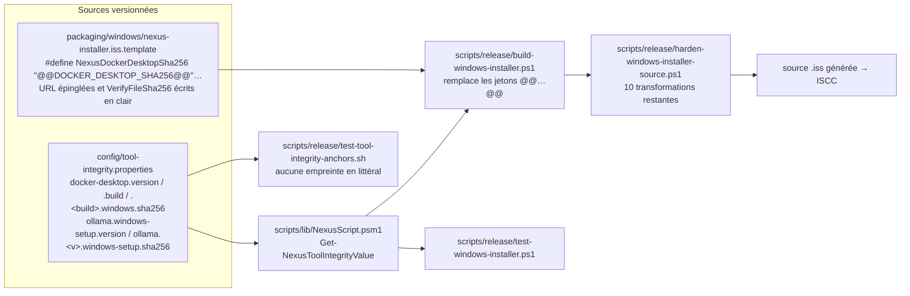
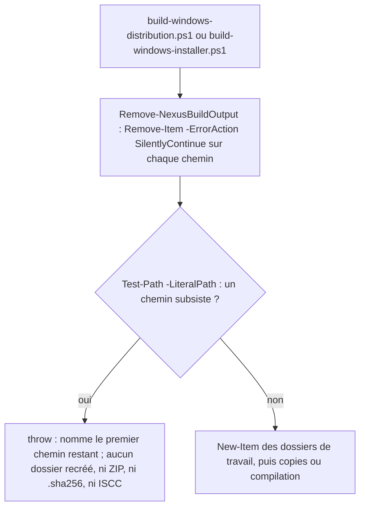

# Design

**Profil :** court (outillage et refactoring sans effet observable). Les sections qui portent une exigence nouvelle (test d'architecture, construction Windows, empreintes de l'installateur) sont détaillées ; les autres tiennent en une ligne justifiée.

## Contexte

- [Existant vérifié] Constats et critère de sortie : `docs/project/audits/2026-11-16/findings.md` (`AUD-QUA-03` `:136-143`, `AUD-QUA-07` `:171-178`, `AUD-QUA-09` `:189-196`, `AUD-QUA-10` `:198-204`, `AUD-DEP-07` `:338-344`), `docs/project/audits/2026-11-16/sprints.md` (section S7). Preuves relues au HEAD `6e0a5aaf` (voir `proposal.md`, « What Changes »).
- [Existant vérifié] Mesure par accolades rejouée avec un script local (déclaration à accolade fermante incluse, chaînes et commentaires neutralisés) : mêmes neuf méthodes et mêmes longueurs que l'audit. Le même script relève aussi trois déclarations de record de 84 à 114 lignes (`PersistentGitContextSourceProvider.Fingerprint` `core/src/main/java/com/nexus/context/source/git/PersistentGitContextSourceProvider.java:162`, `ContextMaterializationLimits` `core/src/main/java/com/nexus/context/ContextMaterializationLimits.java:7`, `SemanticIndexProvenance` `core/src/main/java/com/nexus/search/semantic/SemanticIndexProvenance.java:10`) et `JdtLanguageServerCodeIntelligenceProvider.Configuration` (`:273`, 87 lignes), que l'audit exclut comme records.
- [Existant vérifié] `CoreArchitectureTest` lit les sources du cœur par `JavaSourceGraph` (`core/src/test/java/com/nexus/architecture/JavaSourceGraph.java`) et compare les cycles à `core/src/test/resources/architecture/package-cycles.txt` (`CoreArchitectureTest.java:157-170`, `:626-633`). Le test est dans la suite par défaut (`core-package-boundaries › Le test d'architecture fait partie de la suite par défaut`).
- [Existant vérifié] Les quatre `closeQuietly` (`ProjectIndexLockManager.java:234`, `IndexDocumentPublisher.java:81`, `LuceneSearchIndex.java:155`, `SqliteFileWriter.java:272`) sont dans des packages qui importent déjà `com.nexus.security` (relevé par `grep` des imports : `index`, `index.service`, `search.lucene`, `persistence.sqlite`). `SafeFileIO` et `PrivateStoragePolicy` y vivent.
- [Existant vérifié] `NexusMcpTools.safeMessage` est appelé par nom dans `adapters/mcp-java/src/test/java/com/nexus/mcp/NexusMcpErrorSanitizationTest.java:16,22,32` et `NexusMcpNegativeContractTest.java:55,60`.
- [Existant vérifié] Le contrat des scripts PowerShell (redéfinitions de `Invoke-Maven`, appels Maven directs) vit dans le premier bloc Python de `scripts/release/test-operational-doc-contracts.sh`, lancé par `.claude/scripts/contracts.sh:32` et `.github/workflows/ci.yml:123-124`. `scripts/tests/Test-NexusScript.ps1` teste `NexusScript.psm1` sous PowerShell 7 et Windows PowerShell 5.1 (`.github/workflows/ci.yml:46-52`).
- [Existant vérifié] `scripts/install-jdtls.ps1:55-75` lit déjà une empreinte dans `config/tool-integrity.properties` (`Get-PinnedHash`, messages propres à JDT LS). Le contrat `test-operational-doc-contracts.sh:313` exige la chaîne `Get-PinnedHash` dans ce script.
- [Existant vérifié] Le template porte déjà des `#define` remplis par jetons `@@…@@` (`packaging/windows/nexus-installer.iss.template:1-10`). `build-windows-installer.ps1:148-160` les remplace et échoue sur un jeton non résolu. `harden-windows-installer-source.ps1` applique 15 remplacements, dont cinq pour l'épinglage externe : vérificateur `VerifyFileSha256` (`:340`), URL Docker (`:352`), contrôle SHA-256 Docker (`:368`), URL Ollama (`:380`), contrôle SHA-256 Ollama (`:396`).
- [Existant vérifié] `.github/workflows/windows-installer.yml:19-30` ne déclenche ni sur `config/tool-integrity.properties` ni sur `scripts/lib/**`. Le premier manque est traité par `AUD-DEP-02` (sprint 1, change `audit-1116-s1-ci-et-mesures`), le second apparaît avec ce change.
- Prérequis : `audit-1116-s5-frontieres-coeur-api-index` (`AUD-QUA-02` retire le chemin d'écriture par lot de `IndexDocumentPublisher`, `LuceneSearchIndex` et `SemanticIndexingService`) et `audit-1116-s6-contrats-adaptateurs-contexte` (`AUD-QUA-04` réécrit `ContextBuildMetadata.metadata`). Les lignes citées ici seront relues sur le HEAD qui suit leur merge.

## Objectifs / Hors objectifs

**Objectifs :**
- `core-package-boundaries › Les méthodes du cœur restent sous 80 lignes hors baseline décroissante`.
- `powershell-script-tooling › Un module partagé porte les fonctions communes des scripts` et `› Les scripts PowerShell actifs activent le mode strict`.
- `operational-documentation-contracts › Les contrats documentaires opérationnels s'exécutent depuis des modules Python testés`.
- `build-reproducibility › Une construction Windows échoue si la sortie précédente subsiste`.
- `installer-client-configuration › Les empreintes des programmes d'installation téléchargés viennent du fichier d'intégrité`.
- Sans exigence nouvelle : utilitaires uniques de `AUD-QUA-07`, sous `core-package-boundaries › Le découpage ne change aucun comportement observable`.

**Hors objectifs :** les dix autres transformations de `harden-windows-installer-source.ps1` (échappement, validations, garde REST), qui ne relèvent pas de l'épinglage ; vider la baseline des méthodes longues ; changer les versions qualifiées de Docker Desktop et d'Ollama.

## Composants et responsabilités

- [Décision] `CoreArchitectureTest` gagne une règle de longueur, appuyée sur un lecteur de membres ajouté à côté de `JavaSourceGraph`. La baseline `core/src/test/resources/architecture/long-methods.txt` suit le modèle de `package-cycles.txt` : une entrée par ligne, triée, commentaires `#` autorisés.
- [Décision] `com.nexus.security.PublicDiagnosticPolicy` porte la fonction statique interne unique `causeMessage(Throwable)` : le message, ou le nom simple de la classe si le message est nul ou blanc. Elle ne filtre pas, car le filtrage reste aux frontières (`CliRenderer.java:258`, `PublicOutputProjection`). Appelants : `NexusCli`, `LocalGitContextSourceProvider`, et la branche `IllegalArgumentException` de la projection MCP.
- [Décision] `com.nexus.security.Closeables.closeSuppressing(Throwable primary, AutoCloseable... resources)` ferme chaque ressource non nulle dans l'ordre et ajoute tout échec de fermeture en `suppressed` à `primary`. Elle est placée près de `SafeFileIO` pour ne créer aucune arête de package nouvelle.
- [Décision] `NexusMcpTools.safeMessage` devient `publicErrorMessage`, sans changement de corps hors l'appel à `causeMessage`. Le nom `safeMessage` ne désigne plus qu'une seule définition, puis aucune : la fonction interne s'appelle `causeMessage`.
- [Décision] Le proxy de `SqliteDatabase.openConnection` devient une classe imbriquée nommée `ThreadBoundConnectionHandler implements InvocationHandler`, avec un corps sur plusieurs lignes.
- [Décision] `scripts/lib/NexusScript.psm1` gagne `Measure-Quality`, `Get-JavaVersionText`, `Get-JavaMajorVersion`, `Remove-NexusBuildOutput` et `Get-NexusToolIntegrityValue`. `Get-PinnedHash` de `install-jdtls.ps1` devient une enveloppe de `Get-NexusToolIntegrityValue` avec le motif SHA-256 et garde son nom, que le contrat `:313` exige.
- [Décision] `scripts/release/contract_checks.py` porte `text`, `require`, `forbid` et `fail`, avec le préfixe de message de chaque contrat en paramètre pour garder les messages actuels. Cinq modules remplacent les cinq heredocs : `operational_doc_contracts.py` (lignes 4-733), `docker_contracts.py` (821-925, « Sprint 10 : conteneur »), `ghcr_publication_contracts.py` (927-970, « Sprint 13 »), `benchmark_release_contracts.py` (1008-1137, « Sprint 14 »), `maven_doc_contracts.py` (1140-1269, « Sprint 15 »). Leurs tests vivent dans `scripts/tests/test_contract_*.py` (unittest, comme `test_scale_budgets.py`).

Vue de composants (C4 niveau composant, adaptée en `flowchart`) : qui lit les empreintes après le change ? Couvre `installer-client-configuration › Les empreintes des programmes d'installation téléchargés viennent du fichier d'intégrité`.

Lecture : le fichier d'intégrité est la seule source des empreintes. La construction et le test de l'installateur les lisent par la même fonction. Le contrat d'ancres refuse toute recopie dans `scripts/` et `packaging/`. Avant le change, les empreintes partaient de trois littéraux (harden, build, test), et le template ne montrait pas ce qui était livré.

## Modèle de domaine et invariants

- Invariant de mesure : longueur d'un membre = numéro de ligne de son accolade fermante − numéro de ligne de sa déclaration + 1. La déclaration est la ligne qui porte le nom suivi de `(`. Annotations et Javadoc au-dessus ne comptent pas. Chaînes, blocs de texte, caractères et commentaires sont neutralisés avant le comptage des accolades.
- Invariant de périmètre : méthodes et constructeurs (constructeurs compacts compris) des types nommés de `core/src/main/java`. Le corps d'un record, d'une classe ou d'un enum n'est pas un membre. Lambdas et classes anonymes comptent dans la méthode qui les contient.
- Invariant de clé : une entrée de baseline vaut `<nom qualifié du type>#<méthode>(<types simples des paramètres>)`, ce qui distingue les surcharges. La clé ne contient pas de numéro de ligne, pour qu'un ajout au-dessus ne la change pas.
- Invariant de baseline décroissante : comme `core-package-boundaries › Les cycles de packages ne peuvent que décroître`, une entrée qui ne désigne plus un membre de 80 lignes ou plus fait échouer le test.
- Invariant des empreintes : la valeur d'une clé `*.sha256` du fichier d'intégrité fait exactement 64 caractères hexadécimaux en minuscules (motif de `Get-PinnedHash` et de `test-tool-integrity-anchors.sh`).

## Traitements et interactions

Organigramme (cible) : que fait une construction Windows de sa sortie précédente ? Couvre `build-reproducibility › Une construction Windows échoue si la sortie précédente subsiste`.

Lecture : la suppression garde `SilentlyContinue` pour qu'un chemin déjà absent ne soit pas une erreur. La vérification qui suit rend l'échec explicite. Les scripts appellent la même fonction du module, testée une fois.

## États et transitions

Non applicable : aucune entité à cycle de vie n'est créée ni modifiée.

## Contrats d'interface

- Fonctions PowerShell ajoutées à `scripts/lib/NexusScript.psm1` (exportées comme les fonctions actuelles) :
  - `Remove-NexusBuildOutput -LiteralPath <string[]> [-Recurse]` : supprime, puis lève une exception `Previous build output could not be removed: <chemin>` si un chemin subsiste.
  - `Get-NexusToolIntegrityValue -Key <string> [-Pattern <regex>] [-Path <fichier>]` : rend la valeur de la première ligne `clé=valeur`. Elle lève `Tool integrity key missing: <clé> (<fichier>)` si la clé manque, `Tool integrity value for <clé> does not match <motif>` si la valeur est mal formée. Le fichier par défaut est `config/tool-integrity.properties`.
  - `Measure-Quality`, `Get-JavaVersionText`, `Get-JavaMajorVersion` : signature de `compare-jdt.ps1:19` pour la première ; pour les deux fonctions Java, celle de `validate-phase-6.ps1:10,35` (`$JavaExecutable`, `$VersionText`), appelants de `validate-minos-integration.ps1` adaptés.
- Nouvelles clés de `config/tool-integrity.properties` : `docker-desktop.version=4.86.0`, `docker-desktop.build=236216`, `docker-desktop.236216.windows.sha256=<empreinte actuelle>`, `ollama.windows-setup.version=0.33.3`, `ollama.0.33.3.windows-setup.sha256=<empreinte actuelle>`. Le modèle est celui de `archgate.version` et `archgate.<v>.linux-x64.sha256`.
- Nouveaux jetons du template : `@@DOCKER_DESKTOP_VERSION@@`, `@@DOCKER_DESKTOP_BUILD@@`, `@@DOCKER_DESKTOP_SHA256@@`, `@@OLLAMA_VERSION@@`, `@@OLLAMA_SHA256@@`, chacun derrière un `#define`. Le code Pascal les lit par `{#…}`, par exemple `'https://desktop.docker.com/win/main/amd64/{#NexusDockerDesktopBuild}/Docker%20Desktop%20Installer.exe'`.
- Modules Python : chaque module expose `main() -> int` et s'exécute par `python3 scripts/release/<module>.py` depuis la racine. Un échec garde le message actuel et le code de sortie non nul.
- Java : `PublicDiagnosticPolicy.causeMessage(Throwable)` et `Closeables.closeSuppressing(Throwable, AutoCloseable...)`, publiques dans le cœur, sans exposition REST, MCP ou CLI.

## Persistance et intégrité

Non applicable : aucun format SQLite, Lucene ou fichier utilisateur ne change. `config/tool-integrity.properties` gagne cinq clés sans modifier les existantes.

## Transactions, concurrence et idempotence

Non applicable : refactoring et scripts de build sans état partagé. `Closeables.closeSuppressing` garde l'ordre de fermeture des appelants actuels.

## Sécurité et isolation

- L'installateur vérifie les mêmes empreintes, puis Authenticode, dans le même ordre (`distribution/README.md:59`). Seul l'endroit où l'empreinte est écrite change. La source générée doit contenir les mêmes URL épinglées et les mêmes appels `VerifyFileSha256` qu'avant (tâche 5.4).
- `causeMessage` ne filtre pas : il ne doit atteindre aucune sortie publique sans passer par `PublicDiagnosticPolicy.text` ou par la projection publique, comme aujourd'hui.

## Erreurs et reprise

- Construction Windows : un chemin non supprimé arrête le script avant toute écriture. La reprise consiste à libérer le fichier (fermer le processus qui le tient) et à relancer.
- Fichier d'intégrité : une clé manquante ou mal formée arrête la construction avant la génération du `.iss`.
- `ProjectIndexLockManager` : l'échec de fermeture d'un canal, ignoré aujourd'hui, devient `suppressed` de l'exception levée. Le message de cette exception ne change pas, et le mapping REST en 409 non plus.

## Observabilité

Non applicable : aucun journal ni métrique ajouté. Le diagnostic « contexte Git indisponible » garde son préfixe (`LocalGitContextSourceProvider.java:168`), voir la question ouverte sur le nom du type.

## Performance et mesure

Le seul seuil est celui du critère de sortie du sprint 7 : moins de 80 lignes. La règle lit les 239 fichiers sources du cœur (relevé au HEAD), déjà lus par `JavaSourceGraph`. Aucun budget de durée n'est fixé.

## Compatibilité, migration et retour arrière

- Sorties CLI, REST et MCP inchangées, hors la question du nom de type dans le diagnostic Git. Tests de contrat REST et MCP et self-smoke inchangés (`core-package-boundaries › Le découpage ne change aucun comportement observable`).
- Retour arrière : revert de la PR. Le fichier d'intégrité garde des clés en trop sans effet.
- Dépendance de séquence : les changes S1 à S6 ajoutent des contrôles à `test-operational-doc-contracts.sh`. L'extraction se fait sur le HEAD qui les contient, pour éviter un conflit sur un fichier de 1 269 lignes.

## Décisions

- [Décision] La règle de longueur va dans le test d'architecture, pas dans un script de contrats. Le critère accepte l'un ou l'autre. Le test d'architecture lit déjà le code de production du cœur, tourne sous Windows et Linux dans la suite par défaut, et a le modèle de baseline décroissante. Alternative écartée : un script Python dans `contracts.sh`, qui dupliquerait l'analyse des sources Java.
- [Décision] Baseline des six méthodes qui restent au-dessus de 80 lignes, au lieu de les découper toutes : l'action de l'audit ne vise que `discover`, `rank` et `importDocument` et garde `create`. La baseline rend la dette visible et interdit qu'elle grandisse.
- [Décision] `causeMessage` suit la forme CLI (message ou nom du type) : c'est la plus simple, et elle passe déjà par le filtre de `CliRenderer`. La forme `Type: message` du contexte Git disparaît, sauf réponse contraire à la question ouverte.
- [Décision] `Closeables` va dans `com.nexus.security` et non dans un nouveau package `com.nexus.io`. Un nouveau package fondation demanderait une ligne de plus dans la matrice des sens du sprint 5 ; les quatre appelants importent déjà `security`.
- [Décision] Les versions et les builds qualifiés vivent aussi dans le fichier d'intégrité, comme `archgate.version`, pour que la version et l'empreinte changent ensemble dans un seul fichier. L'audit proposait d'écrire les URL épinglées en clair dans le template ; elles y sont, avec le build et la version en `#define`.
- [Décision] Pour les fonctions Java recopiées, retenir l'implémentation de `validate-phase-6.ps1`, point d'entrée de validation documenté (`powershell-script-tooling › Les scripts obsolètes ne sont pas des points d'entrée`).
- Aucun nouvel ADR : décisions d'outillage locales et réversibles. `ARCH-0076`, complété au sprint 5, n'est pas touché, car aucune arête de package n'est ajoutée.

## Risques / Compromis

- [Risque] `Set-StrictMode -Version Latest` fait échouer un script qui lit une propriété absente d'un objet JSON, y compris là où l'absence était tolérée. → Lancer `scripts/self-smoke.ps1` et `scripts/validate-phase-6.ps1` après l'ajout. Pour les scripts de mesure non exécutables en CI (JDT, SCIP, Ollama), relire chaque accès `.metadata.`/`.statistics.` et protéger les clés optionnelles par `PSObject.Properties[...]`.
- [Risque] Le découpage de `rank` change l'ordre d'un calcul flottant et donc un classement. → Garder l'ordre des opérations et les tests de ranking existants, puis comparer les sorties `context build` du self-smoke avant et après.
- [Risque] L'extraction Python affaiblit un contrôle sans bruit. → Compter les appels `require`/`forbid` avant et après, et faire échouer chaque module sur un fichier qui viole l'un de ses contrôles (tests unitaires).
- [Risque] La source `.iss` générée diverge sans bruit. → Comparer, avant et après, les fragments de sécurité de la source générée (URL, empreintes, ordre SHA-256 puis Authenticode), comme le fait déjà `test-windows-installer.ps1:100-130`.
- [Compromis] La baseline accepte six méthodes longues. Elle peut seulement décroître.

## Stratégie de vérification

- Java ciblé : `./mvnw -B -ntp -pl core test -Dtest=CoreArchitectureTest,LocalGitContextSourceProvider*Test,SemanticHybridContextRanker*Test,ScipSnapshotMapper*Test,ProjectIndexLock*Test,SqliteDatabase*Test -Dsurefire.failIfNoSpecifiedTests=false -Djacoco.skip=true` ; MCP : `./mvnw -B -ntp -pl adapters/mcp-java -am test -Dtest=NexusMcp*Test -Dsurefire.failIfNoSpecifiedTests=false -Djacoco.skip=true`.
- Preuve de la règle : sur le HEAD de départ, la règle relève exactement les neuf méthodes de l'audit ; elle échoue si l'on retire une entrée de la baseline ou si l'on ajoute une méthode de 80 lignes dans une copie de travail.
- Scripts : `pwsh -NoProfile -File scripts/tests/Test-NexusScript.ps1` et `powershell -NoProfile -File scripts/tests/Test-NexusScript.ps1` ; `python3 -m unittest discover -s scripts/tests -p 'test_contract*.py'` ; `bash .claude/scripts/contracts.sh`.
- Installateur : `scripts/release/build-windows-installer.ps1 -Smoke` puis `scripts/release/test-windows-installer.ps1 -Setup <setup>` sur le workflow `windows-installer.yml` ; `bash scripts/release/test-tool-integrity-anchors.sh`.
- Ensemble : `./mvnw -B -ntp clean install`, `pwsh -NoProfile -File scripts/self-smoke.ps1`, `archgate check`, `openspec validate audit-1116-s7-hygiene-code-scripts-installateur --strict`. Diagrammes : rendu Mermaid vérifié dans la page durable.

## Traçabilité

| Exigence (`capacité › titre`) | Scénario | Conception ou diagramme | Tâche | Test ou preuve |
|---|---|---|---|---|
| `core-package-boundaries › Les méthodes du cœur restent sous 80 lignes hors baseline décroissante` | Nouvelle méthode longue | Modèle de domaine et invariants (mesure, clé) | 1.1, 1.2 | test non écrit : `CoreArchitectureTest#methodsUnderEightyLinesOrInBaseline` |
| `core-package-boundaries › Les méthodes du cœur restent sous 80 lignes hors baseline décroissante` | Méthode découpée sans mise à jour de la baseline | Modèle de domaine et invariants (baseline décroissante) | 1.1, 1.2 | test non écrit : `CoreArchitectureTest#longMethodBaselineHasNoStaleEntry` |
| `core-package-boundaries › Les méthodes du cœur restent sous 80 lignes hors baseline décroissante` | Méthodes visées par le sprint 7 | Décisions (baseline de six méthodes) | 1.3, 1.4, 1.5 | tâche non réalisée : baseline sans les trois méthodes |
| `core-package-boundaries › Les méthodes du cœur restent sous 80 lignes hors baseline décroissante` | Corps d'un record | Modèle de domaine et invariants (périmètre) | 1.1 | test non écrit : cas record du lecteur de membres |
| `powershell-script-tooling › Un module partagé porte les fonctions communes des scripts` | Aucune redéfinition locale | Composants et responsabilités | 3.1, 3.4 | preuve manquante : contrat étendu à `Measure-Quality`, `Get-JavaVersionText`, `Get-JavaMajorVersion` |
| `powershell-script-tooling › Un module partagé porte les fonctions communes des scripts` | Le contrat refuse une redéfinition | Composants et responsabilités | 3.4 | preuve existante : contrat de `test-operational-doc-contracts.sh` (bloc 1), à reconduire dans `operational_doc_contracts.py` |
| `powershell-script-tooling › Un module partagé porte les fonctions communes des scripts` | Le contrat refuse une fonction de mesure recopiée | Composants et responsabilités | 3.4 | test non écrit : `scripts/tests/test_contract_operational.py` (fixture de redéfinition) |
| `powershell-script-tooling › Les scripts PowerShell actifs activent le mode strict` | Script actif sans mode strict | Risques / Compromis | 3.2, 3.4 | test non écrit : `scripts/tests/test_contract_operational.py` (fixture sans `Set-StrictMode`) |
| `powershell-script-tooling › Les scripts PowerShell actifs activent le mode strict` | Propriété mal orthographiée | Risques / Compromis | 3.2 | preuve manquante : comportement de `Set-StrictMode -Version Latest`, vérifié par un cas de `Test-NexusScript.ps1` |
| `powershell-script-tooling › Les scripts PowerShell actifs activent le mode strict` | Scripts archivés | Composants et responsabilités | 3.4 | test non écrit : fixture sous `archive/` acceptée |
| `operational-documentation-contracts › Les contrats documentaires opérationnels s'exécutent depuis des modules Python testés` | Heredoc Python réintroduit | Composants et responsabilités (modules) | 3.3, 3.4 | test non écrit : `scripts/tests/test_contract_operational.py` |
| `operational-documentation-contracts › Les contrats documentaires opérationnels s'exécutent depuis des modules Python testés` | Fonction de vérification redéfinie | Composants et responsabilités (bibliothèque commune) | 3.3, 3.4 | test non écrit : `scripts/tests/test_contract_operational.py` |
| `operational-documentation-contracts › Les contrats documentaires opérationnels s'exécutent depuis des modules Python testés` | Test unitaire en échec | Contrats d'interface (modules Python) | 3.3 | test non écrit : lancement de `unittest` par le script, vérifié par un test volontairement rouge dans une copie de travail |
| `operational-documentation-contracts › Les contrats documentaires opérationnels s'exécutent depuis des modules Python testés` | Contrôles inchangés | Risques / Compromis (extraction) | 3.3 | preuve manquante : décompte `require`/`forbid` avant et après, `bash .claude/scripts/contracts.sh` |
| `build-reproducibility › Une construction Windows échoue si la sortie précédente subsiste` | Fichier verrouillé dans l'ancienne distribution | Organigramme de la sortie précédente | 4.1, 4.2 | test non écrit : `Test-NexusScript.ps1` (fichier ouvert en `FileShare.None`, Windows) |
| `build-reproducibility › Une construction Windows échoue si la sortie précédente subsiste` | Ancien programme d'installation verrouillé | Organigramme de la sortie précédente | 4.1, 4.3 | test non écrit : même cas sur un fichier seul |
| `build-reproducibility › Une construction Windows échoue si la sortie précédente subsiste` | Sortie précédente absente ou supprimable | Organigramme de la sortie précédente | 4.1 | test non écrit : `Test-NexusScript.ps1` (chemin absent, dossier supprimable) |
| `installer-client-configuration › Les empreintes des programmes d'installation téléchargés viennent du fichier d'intégrité` | Empreinte montée dans le fichier d'intégrité | Vue de composants des empreintes | 5.1, 5.2, 5.3 | preuve manquante : build de l'installateur sur `windows-installer.yml` |
| `installer-client-configuration › Les empreintes des programmes d'installation téléchargés viennent du fichier d'intégrité` | Clé d'intégrité absente | Contrats d'interface (`Get-NexusToolIntegrityValue`) | 5.1 | test non écrit : `Test-NexusScript.ps1` (clé absente, valeur mal formée) |
| `installer-client-configuration › Les empreintes des programmes d'installation téléchargés viennent du fichier d'intégrité` | Empreinte recopiée en littéral | Vue de composants des empreintes | 5.5 | test non écrit : `scripts/release/test-tool-integrity-anchors.sh` (fixture négative) |
| `installer-client-configuration › Les empreintes des programmes d'installation téléchargés viennent du fichier d'intégrité` | Programme téléchargé non conforme | Sécurité et isolation | 5.4 | preuve existante partielle : `scripts/release/test-windows-installer.ps1:100-130` (fragments SHA-256 de la source générée), à réaligner sur le fichier d'intégrité |
| `installer-client-configuration › Les empreintes des programmes d'installation téléchargés viennent du fichier d'intégrité` | Template versionné sans URL flottante | Contrats d'interface (jetons du template) | 5.2, 5.4 | test non écrit : assertion de `test-windows-installer.ps1:37` inversée |

## Questions ouvertes

- [Question] Garder le nom du type d'exception dans le diagnostic « contexte Git indisponible » (`LocalGitContextSourceProvider.java:168`) ? Par défaut : non (forme CLI). Une réponse positive ajoute un préfixe à l'appelant, sans changer l'utilitaire unique.
- [Question] `distribution/README.md:56-57` : garder les empreintes, vérifiées égales au fichier d'intégrité par `test-tool-integrity-anchors.sh`, ou les retirer ? Par défaut : les garder, vérifiées : `build-windows-distribution.ps1:256` copie `distribution/README.md` dans le ZIP, qui ne contient pas `config/`.
- [Question] Extraire aussi les trois blocs Python de `test-final-audit-contracts.sh`, et fusionner les deux scripts `measure-iteration-17-real-semantic*.ps1` ? Par défaut : non dans ce change.
