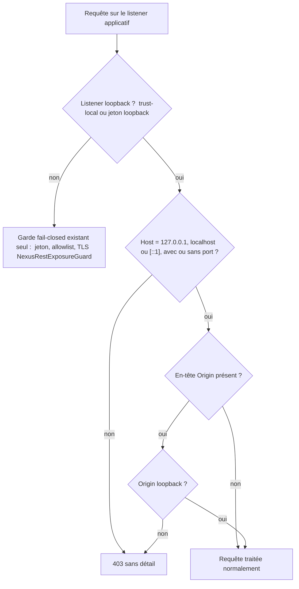
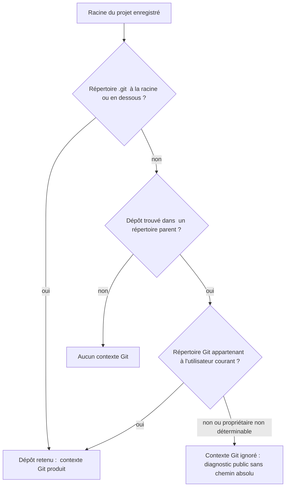

# Design

## Context

`NexusApplication` est la façade unique que CLI, REST et MCP appellent. Ses lectures indexées (`search`, `searchAcrossProjects`, `context`, `contextAcrossProjects`, `findSymbols`, `findUsages`, `inspect`) appliquent chacune à la main la séquence d'ADR-0052 : vérifier READY, prendre le verrou partagé, ouvrir une session de lecture, revalider READY. Ses fabriques (`create`, `createLongLived`) et `NexusApplicationFactory` déclarent `throws SQLException`, que `NexusCli`, `NexusMcpServer` et `NexusApiApplicationService` reprennent ou attrapent.

La configuration `NEXUS_*` est lue dans le cœur par douze classes (`NexusPaths`, `SecurityPolicy`, `ContextMaterializationLimits`, `ContextDiscoveryLimits`, `IndexingCapacityGate`, `ProjectIndexingService`, `JdtLanguageServerCodeIntelligenceProvider`, la classe JDT `ProcessBuilder`, `ProjectScanLimits`, `ScipIndexLimits`, `SemanticSearchConfiguration`, `ProjectFileLimits`). `ProjectScanLimits` et `ContextDiscoveryLimits` exposent déjà une fabrique `from(Map<String, String>)`.

Côté REST, `NexusRestExposureGuard` valide la posture au démarrage ; en trust-local, il ne demande ni jeton ni allowlist de racines, et aucun filtre ne contrôle l'en-tête `Host` ni l'en-tête `Origin`. Côté Git, `LocalGitContextSourceProvider`, `PersistentGitContextSourceProvider` et `GitRecencyCandidateEnricher` construisent le dépôt par `FileRepositoryBuilder.findGitDir(projectRoot)`, qui remonte sans limite.

## Goals / Non-Goals

**Goals:**
- Un seul chemin de code pour la lecture cohérente, mono-projet et fédérée.
- Aucune trace de JDBC dans le contrat public de la façade ni dans les adaptateurs.
- Une configuration effective résolue une fois, injectée, testable sans constructeur package-private.
- Refuser en mode REST loopback les requêtes dont l'hôte ou l'origine n'est pas loopback.
- Ne jamais lire un dépôt Git parent appartenant à un autre compte.

**Non-Goals:**
- Changer les noms, les bornes ou les valeurs par défaut des variables `NEXUS_*`.
- Centraliser la configuration propre à l'adaptateur REST (`NexusRestSecurity`, `NexusRestProjectRootPolicy`) : elle reste dans l'adaptateur, qui est sa propre composition root Quarkus.
- Activer CORS ou servir des clients navigateur.
- Rendre la remontée Git configurable.

## Decisions

**D1 — Gabarit de lecture cohérente (`AUD-ARC-09`).** Deux méthodes privées de la façade, une mono-projet et une fédérée, prennent la portée et une fonction de lecture recevant la session et les descripteurs revalidés. Elles portent l'ordre READY → verrou → session → READY et la libération dans `finally`. Les sept lectures, `inspect` compris, passent par elles. Alternative écartée : un décorateur générique hors de la façade, qui exposerait le verrou à d'autres appelants.

**D2 — Exception applicative à la frontière (`AUD-ARC-11`).** Les fabriques enveloppent `SQLException` dans `PersistenceException` (existante) avec la cause conservée ; `IOException` reste déclarée. Les adaptateurs ne traitent plus que `PersistenceException` et `IOException`. Les codes de sortie CLI et les réponses MCP/REST restent inchangés.

**D3 — Configuration résolue en composition root (`AUD-ARC-12`).** Un record `NexusConfiguration` est construit par `NexusApplicationFactory` à partir d'une `Map<String, String>` (l'environnement en production, une table en test), sur le modèle `from(Map)` déjà présent. Chaque classe de limites reçoit sa part par constructeur ou par `from(Map)`. Une règle du test d'architecture (introduit par `AUD-ARC-07`) interdit l'appel à `System.getenv` dans `core/src/main` hors de la composition root. Un nouvel ADR complète ADR-0003 (cœur sans framework : la composition root manuelle porte aussi la configuration).

**D4 — Stockage privé dans `security` (`AUD-ARC-14`).** `ensurePrivateStorage`, `ensurePrivateDirectory`, `ensurePrivateFile` et `hardenPrivateFile` vont dans une classe `security.PrivateStoragePolicy` ; `NexusPaths` redevient un record de résolution. `SearchQualityMetrics` et son test passent sous `core/src/test`. Le comportement des permissions POSIX/ACL ne change pas : `NexusPathsTest` le couvre déjà.

**D5 — Nom explicite pour le constructeur de processus JDT (`AUD-ARC-19`).** La classe devient `BoundedJdtProcessBuilder` et ses usages la nomment explicitement. La politique d'environnement et de racines de confiance est inchangée.

**D6 — Contrôle d'hôte et d'origine sur listener loopback (`AUD-SEC-04`).** Un filtre JAX-RS `@PreMatching` de l'adaptateur REST, actif dès que le listener applicatif est loopback (trust-local ou jeton loopback), refuse une requête dont l'en-tête `Host` ne désigne pas `127.0.0.1`, `localhost` ou `[::1]` (avec ou sans port), ou qui porte un en-tête `Origin` non loopback. Une requête sans `Origin` (clients en ligne de commande, assistants) reste acceptée. Le refus est une erreur 403 sans détail. Hors loopback, le garde fail-closed existant (jeton, allowlist, TLS) s'applique seul. Le risque navigateur et la recommandation de l'allowlist de racines en trust-local sont documentés dans `docs/developer/rest-exposure-security.md`. Alternative écartée : exiger une allowlist en trust-local, qui casserait l'usage local documenté ; elle reste une recommandation.

**D7 — Plafond de la découverte Git (`AUD-SEC-05`).** Les trois points de découverte passent par une fabrique unique. Le dépôt trouvé à la racine du projet ou en dessous est retenu ; un dépôt trouvé dans un répertoire parent n'est retenu que si son répertoire Git appartient à l'utilisateur courant, à l'image de `safe.directory` de Git. Sinon le contexte Git est ignoré et un diagnostic public, sans chemin absolu, l'indique. Un monorepo dont le projet est un sous-module de l'utilisateur garde son contexte. Un nouvel ADR complète ADR-0035 (contexte Git local borné).

## Risks / Trade-offs

- [Client local légitime envoyant un `Host` non loopback, par exemple via un alias de nom ou un proxy local] → refusé ; le diagnostic et la documentation indiquent d'utiliser `127.0.0.1` ou de passer en mode jeton hors loopback.
- [Propriétaire de fichier non déterminable (système de fichiers sans propriétaire, partage SMB)] → le dépôt parent est ignoré par défaut, avec diagnostic ; les systèmes de fichiers qualifiés d'ADR-0047 sont couverts par les tests Windows et Linux.
- [Refactoring de configuration étendu à douze classes] → livré classe par classe derrière la même suite de tests ; les valeurs par défaut et les messages d'erreur sont figés par les tests de limites existants.
- [Règle d'architecture dépendante de `AUD-ARC-07`] → si le test d'architecture n'est pas encore fusionné, la tâche 3.3 le signale et bloque la sortie du sprint plutôt que d'ajouter un contrôle parallèle.

## Vues

Vue organigramme — quelles requêtes le listener loopback accepte-t-il ou refuse-t-il (D6) ? ([Proposition] — cible, non disponible)

Le filtre JAX-RS `@PreMatching` de D6 n'existe pas au HEAD : seul `NexusRestAuthenticationFilter` est un `ContainerRequestFilter` de l'adaptateur. Hors loopback, le garde de démarrage est le seul contrôle, comme avant. Notation : organigramme, pas UML.

Exigences : `rest-transport-hardening › Un listener loopback n'accepte que des hôtes loopback`, `rest-transport-hardening › Un listener loopback refuse les origines web non loopback`, `rest-transport-hardening › Le contrôle de transport ne remplace pas le garde d'exposition`.

Vue organigramme — quel dépôt Git alimente le contexte d'un projet (D7) ? ([Proposition] — cible, non disponible)

La fabrique unique de D7 serait appelée par `LocalGitContextSourceProvider`, `PersistentGitContextSourceProvider` et `GitRecencyCandidateEnricher` ; au HEAD, chacun appelle `FileRepositoryBuilder.findGitDir(projectRoot)` lui-même. Le cas « propriétaire non déterminable → dépôt parent ignoré » vient du paragraphe Risks / Trade-offs. Notation : organigramme, pas UML.

Exigences : `git-context-discovery › La découverte Git est plafonnée à la racine du projet`, `git-context-discovery › Un dépôt écarté produit un diagnostic public`, `git-context-discovery › Les trois usages de Git appliquent la même règle`.

## Traçabilité

Tous les scénarios sont couverts par des tests écrits pendant le sprint et exécutés sous Windows ; le reactor Linux de la PR doit confirmer les tâches 4.1 et 6.2. La colonne « Tâche » renvoie aux numéros de `tasks.md` ; `TEST_CIBLE` est défini en tête de `tasks.md`. Hors scénarios de spec, AUD-ARC-09 est couvert par `core/src/test/java/com/nexus/application/NexusApplicationConsistentReadTest.java`, AUD-ARC-11 par `NexusApplicationPersistenceBoundaryTest.java` (même dossier), AUD-ARC-12 par `NexusConfigurationTest.java` (même dossier) et par `CoreArchitectureTest` (règle `getenv-composition-root`), AUD-ARC-14 par `core/src/test/java/com/nexus/security/PrivateStoragePolicyTest.java`.

| Exigence (`capacité › titre`) | Scénario | Conception ou diagramme | Tâche | Test ou preuve |
|---|---|---|---|---|
| `git-context-discovery › La découverte Git est plafonnée à la racine du projet` | Dépôt à la racine | D7 ; vue D7 | 6.1, 6.2 | `core/src/test/java/com/nexus/context/source/git/GitRepositoryLocatorTest.java` — `retainsTheProjectRootRepositoryWithoutOwnershipCheck`, `stopsAtTheFirstGitEntryInsteadOfSearchingHigher` ; `./mvnw -pl core test -Dtest='*Git*' TEST_CIBLE` |
| `git-context-discovery › La découverte Git est plafonnée à la racine du projet` | Sous-module d'un dépôt de l'utilisateur | D7 ; vue D7 | 6.1, 6.2 | `GitRepositoryLocatorTest` — `retainsAParentRepositoryOwnedByTheCurrentUser`, `checksBothTheGitLinkAndItsTargetForAParentRepository` ; `core/src/test/java/com/nexus/context/source/git/LocalGitContextSourceProviderTest.java` — `keepsTheContextOfAParentRepositoryOwnedByTheCurrentUser` |
| `git-context-discovery › La découverte Git est plafonnée à la racine du projet` | Dépôt parent d'un autre compte | D7 ; vue D7 | 6.1, 6.2 | `GitRepositoryLocatorTest` — `rejectsAParentRepositoryOfAnotherAccountBeforeReadingItsConfiguration`, `rejectsAParentRepositoryWhoseOwnerCannotBeDetermined` (propriétaire simulé par injection) |
| `git-context-discovery › Un dépôt écarté produit un diagnostic public` | Diagnostic sans chemin | D7 ; vue D7 | 6.2 | `GitRepositoryLocatorTest` — `theRejectionDiagnosticIsPublicStableAndHasNoAbsolutePathNorAccountName` ; `LocalGitContextSourceProviderTest` — `ignoresAParentRepositoryOfAnotherAccountWithAPublicDiagnosticWithoutPath` ; couverture au niveau de `GitContextResult.diagnostics`, sans test de bout en bout `explain` via REST ou MCP |
| `git-context-discovery › Les trois usages de Git appliquent la même règle` | Runtime longue durée | D7 | 6.1 | `core/src/test/java/com/nexus/context/source/git/PersistentGitContextSourceProviderTest.java` — `aLongRunningRuntimeNeverUsesAParentRepositoryOfAnotherAccount` ; `core/src/test/java/com/nexus/context/source/git/GitRecencyCandidateEnricherTest.java` — `aParentRepositoryOfAnotherAccountGivesNoRecencyAndExplainsWhyWithoutWarning` |
| `rest-transport-hardening › Un listener loopback n'accepte que des hôtes loopback` | Hôte loopback accepté | D6 ; vue D6 | 5.1, 5.2 | `adapters/rest-quarkus/src/test/java/com/nexus/api/NexusRestLoopbackTransportTrustLocalTest.java` — `loopbackHostIsServedNormally` ; `adapters/rest-quarkus/src/test/java/com/nexus/api/NexusRestLoopbackTransportTokenTest.java` — `authenticatedLoopbackRequestIsServed` ; `adapters/rest-quarkus/src/test/java/com/nexus/api/NexusRestLoopbackTransportFilterTest.java` — `acceptsLiteralLoopbackHostsWithOrWithoutPort` |
| `rest-transport-hardening › Un listener loopback n'accepte que des hôtes loopback` | Hôte non loopback refusé en trust-local | D6 ; vue D6 | 5.1, 5.2 | `NexusRestLoopbackTransportTrustLocalTest` — `foreignHostIsRefusedWithoutDetailAndRegistersNothing`, `unknownRoutesAreRefusedBeforeMatching` ; `NexusRestLoopbackTransportTokenTest` — `foreignHostIsRefusedEvenWithAValidToken`, `foreignHostIsRefusedBeforeAuthentication` |
| `rest-transport-hardening › Un listener loopback n'accepte que des hôtes loopback` | Refus sans détail | D6 ; vue D6 | 5.1 | `NexusRestLoopbackTransportTrustLocalTest` — `foreignHostIsRefusedWithoutDetailAndRegistersNothing`, `foreignOriginIsRefusedWithoutDetail` (corps 403 fixe, sans hôte) |
| `rest-transport-hardening › Un listener loopback refuse les origines web non loopback` | Client sans origine | D6 ; vue D6 | 5.1, 5.2 | `NexusRestLoopbackTransportTrustLocalTest` — `requestWithoutOriginIsServed` ; `NexusRestLoopbackTransportTokenTest` — `authenticatedRequestWithoutOriginIsServed` |
| `rest-transport-hardening › Un listener loopback refuse les origines web non loopback` | Origine distante | D6 ; vue D6 | 5.1, 5.2 | `NexusRestLoopbackTransportTrustLocalTest` — `foreignOriginIsRefusedWithoutDetail` ; `NexusRestLoopbackTransportTokenTest` — `foreignOriginIsRefusedEvenWithAValidToken` ; `NexusRestLoopbackTransportFilterTest` — `rejectsNonLoopbackOrOpaqueOrigins` |
| `rest-transport-hardening › Le contrôle de transport ne remplace pas le garde d'exposition` | Écoute réseau sans jeton | D6 ; vue D6 | 5.2 | `adapters/rest-quarkus/src/test/java/com/nexus/api/NexusRestExposureGuardTest.java` inchangé et vert ; `NexusRestLoopbackTransportFilterTest` — `filterIsInactiveWhenTheListenerIsNotLoopback` ; la validation au démarrage du mode jeton loopback n'a pas de `@QuarkusTest` dédié (un `@TestProfile` perd le pilote JDBC SQLite) |

## Écarts et points à vérifier

- [Existant vérifié] Les douze classes de D3 appellent `System.getenv` dans `core/src/main` (`git grep -n "System.getenv" -- core/src/main` : `NexusPaths`, `SecurityPolicy`, `ContextMaterializationLimits`, `ContextDiscoveryLimits`, `IndexingCapacityGate`, `ProjectIndexingService`, `JdtLanguageServerCodeIntelligenceProvider`, `index/jdt/ProcessBuilder`, `ProjectScanLimits`, `ScipIndexLimits`, `SemanticSearchConfiguration`, `ProjectFileLimits`) ; aucune autre classe n'en appelle.
- [Existant vérifié] Le test d'architecture visé par le dernier risque existe au HEAD : `core/src/test/java/com/nexus/architecture/CoreArchitectureTest.java` et sa baseline `/architecture/package-cycles.txt` (constante `CYCLE_BASELINE`, ligne 28) ; il ne contient aucune règle sur `getenv`. La condition « si le test d'architecture n'est pas encore fusionné » (section Risks / Trade-offs) est donc à réexaminer au démarrage du sprint.
- [Écart] `design.md:7` écrit que `ProjectScanLimits` et `ContextDiscoveryLimits` exposent « déjà une fabrique `from(Map<String, String>)` » : seule `ContextDiscoveryLimits.from` est `public` (`core/src/main/java/com/nexus/context/source/ContextDiscoveryLimits.java:50`) ; `ProjectScanLimits.from` est `static` sans modificateur d'accès, donc package-private (`core/src/main/java/com/nexus/index/scan/ProjectScanLimits.java:48`).
- [Existant vérifié] Aucun filtre ne contrôle `Host` ni `Origin` : le seul `ContainerRequestFilter` de l'adaptateur est `NexusRestAuthenticationFilter` (`adapters/rest-quarkus/src/main/java/com/nexus/api/NexusRestAuthenticationFilter.java:26`).
- [Question] D3 et la tâche 3.1 modifient `ProjectIndexingService`, que `sprint-05-indexation-et-ecriture-sqlite` modifie aussi (son design, section Context, y relève cinq constructeurs publics). L'ordre de fusion n'est pas décidé ici.
