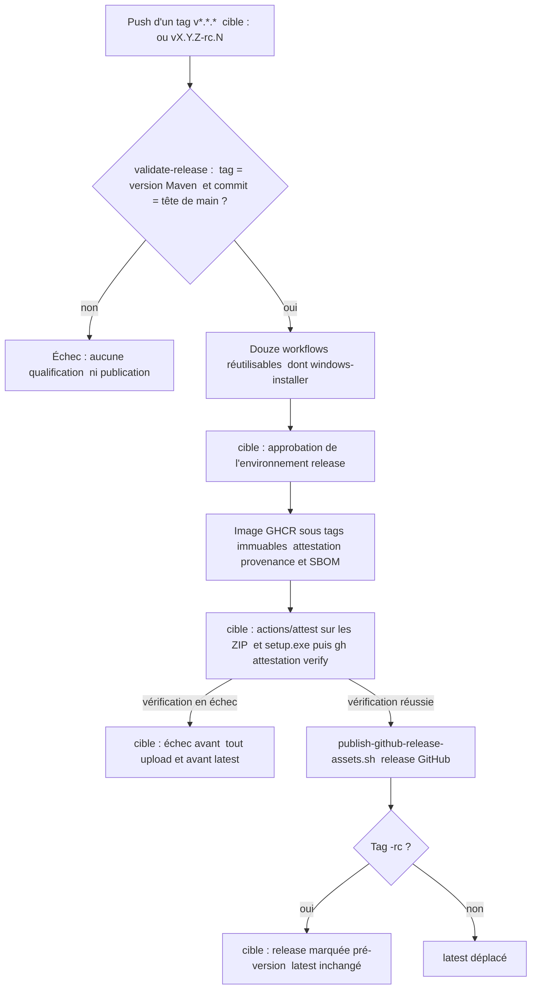

# Design

## Context

`release.yml` se déclenche sur `push` d'un tag `v*.*.*`. Le job `validate-release` lit la version dans `pom.xml` et appelle `validate-release-tag.sh`, qui exige `vX.Y.Z` égal à la version Maven et un commit égal à la tête de `main`. Douze workflows réutilisables qualifient ensuite le commit ; `windows-installer` est appelé avec `secrets: inherit`. Le job `publish` (`contents`, `packages`, `id-token`, `attestations` en écriture) pousse l'image GHCR sous des tags immuables, l'atteste (provenance et SBOM), téléverse les assets par `publish-github-release-assets.sh`, puis déplace `latest`.

Dans `windows-installer.yml`, les deux secrets PFX sont posés dans l'`env` du job ; une étape décode le PFX dans `RUNNER_TEMP` et publie son chemin dans `GITHUB_ENV`. La signature a lieu dans `build-windows-distribution.ps1` et `build-windows-installer.ps1`, via `sign-windows-artifact.ps1` ; une étape `always()` efface le fichier en fin de job. Le workflow tourne aussi sur `pull_request` vers `develop` et `main`.

État GitHub lu le 2026-10-29 : aucun environnement, un seul ruleset de branches (`~DEFAULT_BRANCH`, `refs/heads/develop`), aucun run de `Release`, aucun tag, aucune release ; `release-assets-qualification.yml` tourne et réussit.

## Goals / Non-Goals

**Goals:**
- La clé de signature n'est lisible que par les étapes qui signent, dans un run approuvé de l'environnement `release`.
- Chaque asset publié (image, ZIP, `setup.exe`) porte une attestation de provenance vérifiable.
- Un changement de version ne touche que les pom.
- Les JAR et le ZIP sont reproductibles ; l'outillage Maven est épinglé ; les licences sont contrôlées.
- Une répétition réelle de la chaîne sur un tag de pré-version, avec preuve consignée.

**Non-Goals:**
- Reproductibilité bit à bit de l'image Docker et de l'installeur Inno Setup (horodatages d'outils tiers).
- Signature de l'image par une clé gérée (les attestations GitHub suffisent ici).
- Mode dry-run du job `publish` : la répétition réelle sur pré-version le rend inutile.
- Publication vers un dépôt ou un namespace GHCR de test.

## Decisions

**D1 — Aucun héritage de secrets (`AUD-DEP-21`).** `release.yml` ne transmet plus `secrets: inherit`. Tant que les secrets PFX sont des secrets de dépôt, il passe les deux secrets nommés ; une fois D3 appliqué, il n'en passe aucun, les secrets étant résolus par l'environnement. Un contrat de `test-final-audit-contracts.sh` refuse `secrets: inherit` dans `.github/workflows/`.

**D2 — Matériel de signature limité aux étapes de signature (`AUD-SEC-06`).** Les secrets quittent l'`env` du job. Seules les deux étapes qui signent (distribution et installeur de production) les reçoivent, et seulement hors `pull_request`. Chacune décode le PFX dans un répertoire temporaire propre à l'étape, signe, puis l'efface dans un bloc `finally` ; le chemin n'est plus publié dans `GITHUB_ENV`. Les étapes de smoke et de qualification n'y ont jamais accès. Sur `pull_request`, le build produit des artefacts non signés, comme pour un fork. L'étape de nettoyage `always()` reste en défense en profondeur.

**D3 — Environnement protégé `release` (`AUD-DEP-03`).** Le mainteneur crée l'environnement `release` : un reviewer requis, politique de déploiement limitée aux tags `v*`, et y déplace les deux secrets PFX (supprimés des secrets de dépôt). Le job `publish` et le job Windows appelé avec `require_authenticode: true` déclarent `environment: release`. Un ruleset de tags `refs/tags/v*` restreint création, mise à jour et suppression au mainteneur. Les réglages sont des tâches manuelles ; leur état est vérifié en lecture par `gh api`.

**D4 — Attestation de tous les assets (`AUD-DEP-09`).** Avant `publish-github-release-assets.sh`, `actions/attest` (épinglé par SHA, même version que pour l'image) atteste par `subject-path` les ZIP et `setup.exe` Windows. Une étape suivante exécute `gh attestation verify` sur chacun et échoue sinon. `docs/developer/immutable-release-publishing.md` documente la vérification côté consommateur.

**D5 — Build reproductible (`AUD-DEP-05`).** Le pom racine fixe `project.build.outputTimestamp` ; la valeur est mise à jour avec la version à chaque release (procédure de `docs/developer/release-and-recovery.md`). La vérification compare les SHA-256 du JAR CLI et du ZIP de distribution entre deux `./mvnw clean package` successifs.

**D6 — Outillage épinglé (`AUD-DEP-06`).** `pluginManagement` épingle `maven-clean-plugin`, `maven-resources-plugin`, `maven-jar-plugin`, `maven-install-plugin` et `maven-deploy-plugin` par propriétés (suivies par Dependabot). L'enforcer ajoute `requirePluginVersions`, `requireUpperBoundDeps` et resserre `requireMavenVersion` à `[3.10.0,)`, aligné sur le wrapper. `requireUpperBoundDeps` est préféré à `dependencyConvergence`, trop bruyant avec les BOM Quarkus ; les exclusions éventuelles sont listées et justifiées dans le pom.

**D7 — Liste blanche de licences (`AUD-DEP-07`).** `license-maven-plugin` reçoit `includedLicenses` (licences permissives et faiblement réciproques compatibles avec la licence propriétaire du produit, établies à partir des notices actuelles), `licenseMerges` pour normaliser les libellés, et `failOnBlacklist=true`. Toute nouvelle licence exige une modification revue du pom.

**D8 — Version lue dans le pom (`AUD-QUA-12`).** `ci.yml` lit la version par `./mvnw help:evaluate -q -DforceStdout -Dexpression=project.version` (ou par lecture XML comme `release.yml`) et l'exporte en variable ; `validate-phase-6.ps1` la lit par `[xml]` sur `pom.xml`. Un contrat refuse une version littérale dans ces deux fichiers.

**D9 — Tags de pré-version et répétition (`AUD-DEP-02`).** `validate-release-tag.sh` accepte aussi `vX.Y.Z-rc.N`, toujours égal à la version Maven et à la tête de `main`. Pour une pré-version, la release GitHub est marquée pré-version et `latest` n'est pas déplacé ; les tags d'image version et SHA restent immuables. La répétition passe par une promotion `develop` → `main` portant une version `X.Y.Z-rc.1`, la pose du tag par le mainteneur et l'approbation de l'environnement. La preuve (identifiant de run, résultat de `gh attestation verify` sur l'image et les assets, signature Authenticode vérifiée) est consignée dans un relevé daté sous `docs/project/history/`. Un nouvel ADR complète ADR-0031 : politique de publication (environnement protégé, attestations de tous les assets, tags de pré-version).

## Risks / Trade-offs

- [Le job Windows est un workflow réutilisable : l'environnement conditionnel `require_authenticode ? release : aucun` peut ne pas être exprimable] → à défaut, une job de signature dédiée dans `release.yml`, en environnement `release`, signe et réassemble les artefacts produits sans secrets ; arbitrage tranché lors de la tâche 3.2.
- [La signature de l'installeur dépend des binaires déjà signés de la distribution] → les deux étapes de signature restent dans le même job, dans l'ordre actuel ; seul le périmètre des secrets change.
- [Une version `-rc` sur `main` entre deux releases] → assumée : `main` ne reçoit que des promotions ; la release finale suit par une nouvelle promotion `X.Y.Z`.
- [La pré-version publie dans le namespace GHCR réel] → tags distincts, immuables, jamais `latest` ; acceptable pour un projet sans consommateur de pré-version.
- [`requireUpperBoundDeps` ou la liste blanche cassent une PR Dependabot] → l'échec est voulu ; la procédure de la skill `nexus-dependency-bump` est complétée.
- [Approbation de l'environnement par le seul mainteneur] → la protection porte sur l'exécution non sollicitée (tag poussé par un autre acteur), pas sur la revue à deux.

## Vues

Vue organigramme — dans quel ordre la chaîne de release valide, approuve, atteste puis publie-t-elle (Context, D3, D4, D9) ? ([Proposition] — cible, non disponible)

Au HEAD, le job `publish` n'a pas de clé `environment:`, `actions/attest` n'est appelé que pour l'image (`.github/workflows/release.yml:354` et `:361`) et `validate-release-tag.sh` n'accepte que `vX.Y.Z` (`scripts/release/validate-release-tag.sh:8`). Les nœuds « cible » sont des [Proposition]. Notation : organigramme, pas UML.

Exigences : `release-pipeline › La publication s'exécute dans l'environnement protégé`, `release-pipeline › Chaque asset publié porte une attestation de provenance`, `release-pipeline › Un tag de pré-version publie une pré-version`.

## Traçabilité

Les scénarios couverts le sont par des contrats et des tests locaux ; les preuves qui exigent GitHub (checks de PR, `workflow_dispatch`, run de release) restent à produire. La colonne « Tâche » renvoie aux numéros de `tasks.md`. Les tâches 3.1, 3.3 et 9.3 sont manuelles (réglages GitHub du mainteneur).

| Exigence (`capacité › titre`) | Scénario | Conception ou diagramme | Tâche | Test ou preuve |
|---|---|---|---|---|
| `build-reproducibility › Les JAR et le ZIP de distribution sont reproductibles` | Deux builds successifs | D5 | 5.1 | deux `./mvnw -B -ntp clean verify -DskipTests` successifs donnent les mêmes SHA-256 pour le JAR CLI, le ZIP, le JAR principal, les JAR des adaptateurs et `bom.json` (le ZIP est assemblé en phase `verify`, pas `package`) ; contrat `outputTimestamp` dans `scripts/release/test-final-audit-contracts.sh` |
| `build-reproducibility › Les plugins du build ont une version explicite` | Plugin sans version | D6 | 6.1 | `./mvnw -B -ntp clean install` : règle `RequirePluginVersions` passée ; `bash .claude/scripts/contracts.sh` exige les épinglages par propriété en version stable et `requirePluginVersions` (bloc « Sprint 9 : maven-build ») ; build rouge sur un plugin sans version non testé |
| `build-reproducibility › Les dépendances résolues respectent les bornes supérieures` | Borne supérieure violée | D6 | 6.1, 6.2 | `./mvnw -B -ntp clean install` : règle `RequireUpperBoundDeps` passée, `jna` aligné sur 5.19.1, deux exclusions justifiées dans `pom.xml` ; contrat de présence dans `bash .claude/scripts/contracts.sh` ; build rouge sur une borne violée non testé |
| `build-reproducibility › La version minimale de Maven suit le wrapper` | Maven trop ancien | D6 | 6.1 | `./mvnw -B -ntp clean install` : règle `RequireMavenVersion` `[3.10.0,)` passée avec le wrapper ; contrat `[3.10.0,)` dans `bash .claude/scripts/contracts.sh` (bloc « Sprint 9 : maven-build ») ; build rouge avec un Maven plus ancien non testé |
| `license-compliance › Seules les licences de la liste blanche sont acceptées` | Licence hors liste | D7 | 7.1, 7.2 | `bash .claude/scripts/contracts.sh` : `failOnBlacklist=true` et une liste `includedLicenses` non vide dont chaque entrée est le libellé normalisé d'un `licenseMerge` (bloc « Sprint 9 : maven-build » de `scripts/release/test-final-audit-contracts.sh`, mutations rejetées) ; build rouge sur une licence hors liste non testé |
| `license-compliance › Seules les licences de la liste blanche sont acceptées` | Licence manquante | D7 | tâche absente | preuve manquante : aucune tâche ne vérifie le cas |
| `license-compliance › Les libellés de licence sont normalisés` | Variantes d'Apache 2.0 | D7 | 7.1 | `./mvnw -B -ntp clean install` : `aggregate-add-third-party` applique la liste blanche et les `licenseMerges` ; `target/licenses/THIRD_PARTY_NOTICES.txt` ne change que par la normalisation des libellés et `jna` 5.8.0 vers 5.19.1 |
| `release-pipeline › Les workflows appelés ne reçoivent que les secrets déclarés` | Contrat de workflow | D1 ; vue de la chaîne | 1.1, 1.2 | `bash .claude/scripts/contracts.sh` : refus de `secrets: inherit` dans `.github/workflows/` et transmission nommée des deux secrets PFX par `release.yml` (bloc « Sprint 9 : secrets-signature »), mutation rejetée ; `git grep -n "secrets: inherit" -- .github/workflows` sans résultat |
| `release-pipeline › Le matériel de signature est confiné aux étapes de signature` | Pull request | D2 | 2.1, 2.2 | `bash .claude/scripts/contracts.sh` : aucun secret au niveau du job `windows-installer`, deux secrets exactement par étape de signature sous garde `pull_request`, aucun PFX dans `GITHUB_ENV`, effacement dans un `finally` (bloc « Sprint 9 : secrets-signature ») ; check « Windows self-contained installer » de la PR à produire |
| `release-pipeline › Le matériel de signature est confiné aux étapes de signature` | Étapes de qualification d'un run de release | D2 | 2.1, 2.2 | à produire par la tâche 2.2 — `workflow_dispatch` de `windows-installer.yml` avec `require_authenticode: true` ; preuve manquante |
| `release-pipeline › La publication s'exécute dans l'environnement protégé` | Tag poussé | D3 ; vue de la chaîne | 3.2, 9.3 | `bash .claude/scripts/contracts.sh` : `publish` déclare `environment: release` et `windows-installer` l'environnement conditionnel à `require_authenticode` ; approbation réelle à produire par la tâche 9.3 |
| `release-pipeline › La publication s'exécute dans l'environnement protégé` | Réglages vérifiables | D3 | 3.1, 3.3 | à produire par les tâches 3.1 et 3.3 — `gh api repos/FTurleque/nexus-context-engine/environments` et `.../rulesets` (lecture) ; preuve manquante |
| `release-pipeline › Chaque asset publié porte une attestation de provenance` | Vérification consommateur | D4 ; vue de la chaîne | 4.1, 4.2, 9.4 | à produire par la tâche 9.4 — `gh attestation verify` sur l'image, le ZIP et le `setup.exe` ; preuve manquante |
| `release-pipeline › Chaque asset publié porte une attestation de provenance` | Attestation absente | D4 ; vue de la chaîne | 4.1 | `bash .claude/scripts/contracts.sh` : un seul SHA pour `actions/attest`, les deux `subject-path`, `gh attestation verify` sans `if` ni `continue-on-error`, ordre attestation < vérification < upload < `latest` (bloc « Sprint 9 : attest-prerelease »), mutations rejetées ; échec réel avant upload non exécuté |
| `release-pipeline › La version n'est écrite que dans les pom` | Changement de version | D8 | 8.1, 8.2 | `git grep -n "0\.2\.0" -- .github/workflows/ci.yml scripts/validate-phase-6.ps1` sans résultat ; `bash .claude/scripts/contracts.sh` refuse une version littérale du produit dans ces deux fichiers (bloc « Sprint 9 : version-from-pom »), mutation rejetée ; checks « Linux reactor Maven build » et « Windows gate » de la PR à produire |
| `release-pipeline › Un tag de pré-version publie une pré-version` | Tag de pré-version valide | D9 ; vue de la chaîne | 9.1, 9.3, 9.4 | `bash scripts/release/test-release-tag-policy.sh` (`rc.1`, `rc.12`) et `bash scripts/release/test-publish-github-release-assets.sh` (création en pré-version, reprise idempotente) ; run réel à produire par la tâche 9.3 |
| `release-pipeline › Un tag de pré-version publie une pré-version` | Tag incohérent | D9 ; vue de la chaîne | 9.1 | cas invalides de `bash scripts/release/test-release-tag-policy.sh` (version Maven différente, autre SHA que `main`, `rc.0`, `rc.01`, `RC`, `beta`, `-SNAPSHOT`) ; release existante dont l'état pré-version contredit le tag refusée en code 78 par `bash scripts/release/test-publish-github-release-assets.sh` |

## Écarts et points à vérifier

- [Existant vérifié] `secrets: inherit` figure à `.github/workflows/release.yml:62`, sur l'appel de `windows-installer.yml` ; les deux secrets PFX sont dans l'`env` du job (`.github/workflows/windows-installer.yml:55-56`) et le chemin du PFX est publié dans `GITHUB_ENV` (`:92`) ; le workflow se déclenche aussi sur `pull_request` (`:16`). `release.yml` appelle douze workflows réutilisables.
- [Existant vérifié] La version littérale `0.2.0` est présente dans `.github/workflows/ci.yml:115,117,157,206` et `scripts/validate-phase-6.ps1:121-155`. Le fichier `ci.yml` est modifié dans la copie de travail (`git status`) : les numéros de ligne sont à relire avant la tâche 8.1.
- [Existant vérifié] Le pom racine ne contient ni `outputTimestamp`, ni `requirePluginVersions`, ni `requireUpperBoundDeps`, ni `failOnBlacklist` ; `requireMavenVersion` y vaut `[3.9.0,)` (`pom.xml:262`) alors que le wrapper cible Maven 3.10.0 (`scripts/release/test-operational-doc-contracts.sh`, contrôle « Maven 3.10.0 »).
- [Question] `build-windows-distribution.ps1` et `build-windows-installer.ps1` sont modifiés par la tâche 2.2 de ce changement et par les tâches 2.2 de `sprint-10-conteneur-et-gouvernance` (inclusion de `Dockerfile.runtime.dockerignore` dans le payload) ; l'ordre de fusion n'est pas décidé ici.
- Limites : l'état GitHub cité dans Context (aucun environnement, un seul ruleset, aucun run, aucun tag) n'a pas été relu, faute d'accès aux API depuis ce contrôle.
