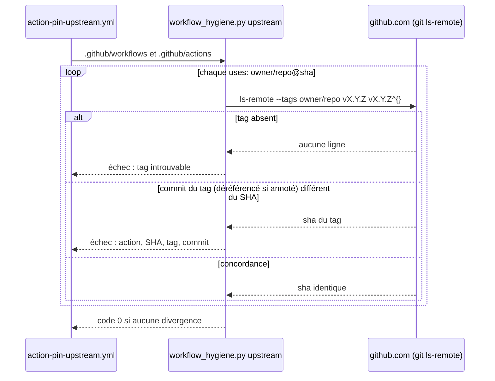

# Design

**Profil :** court (outillage), avec une vue pour le contrôle des tags amont

## Contexte

- [Existant vérifié] Planchers JaCoCo : exécutions `jacoco-check-core` (`core/pom.xml:72-168`) et `jacoco-check-rest` (`adapters/rest-quarkus/pom.xml:100-155`) ; plancher par défaut `nexus.coverage.line.minimum` 0.65 / `branch` 0.55 (`pom.xml:39-40`) pour les autres modules. La page `docs/developer/adapter-coverage-gates.md:47-87` décrit les seuils et une mesure du 30/10.
- [Existant vérifié] Le contrat Maven est une liste de motifs littéraux (`scripts/release/test-operational-doc-contracts.sh:579-600`) testée par des cas positifs et négatifs (`:621-636`).
- [Existant vérifié] `workflow_hygiene.py` est un analyseur ligne à ligne sans dépendance (`RUN`, `:28` ; `run_blocks`, `:114-128` ; `jobs_of`, `:147-173` ; `workflow_files`, `:46-54`) avec des fixtures négatives par règle (`scripts/release/fixtures/workflow-hygiene/`, exécutées par `test-tool-integrity-anchors.sh:117-130` et `test-operational-doc-contracts.sh:660-680`).
- [Existant vérifié] Les outils téléchargés sont vérifiés contre `config/tool-integrity.properties` (`.claude/rules/ci-and-scripts.md`) ; Archgate n'y figure pas.

## Objectifs / Hors objectifs

**Objectifs :** `coverage-gates` (deux exigences), `adr-rule-enforcement` (deux exigences), `powershell-script-tooling › Le contrat Maven refuse les appels indirects`, `ci-workflow-tooling` (trois exigences ajoutées).

**Hors objectifs :** règles `CLASS` des classes de bornes (sprint 1) ; analyse sémantique complète de PowerShell (le contrat reste un filtre de motifs, avec une liste d'exceptions explicite).

## Composants et responsabilités

- [Proposition] `scripts/release/coverage_floors.py` : lit les `jacoco.csv` des modules après `./mvnw clean install`, les planchers des `pom.xml` (élément, cible, compteur, minimum) et la table de mesure de la page ; échoue si un plancher est à plus de 3 points sous la mesure du build ou si un plancher n'a pas de ligne de mesure publiée. Lancé par `ci.yml` après le build Linux, et par `/nx-validate` en local.
- [Proposition] Job `archgate` dans `.github/workflows/ci.yml` : télécharge la version fixée, vérifie l'ancre, lance `archgate check`.
- [Proposition] `scripts/release/workflow_hygiene.py` : nouvelle vérification `forms` (refus des formes non lues) appelée avant `inputs` et `timeouts` ; `workflow_files` accepte `.github/actions/*/action.yml`.
- [Proposition] Commande `upstream` de `workflow_hygiene.py` (réseau, `git ls-remote --tags https://github.com/<owner>/<repo> <tag> <tag>^{}`) et workflow planifié `.github/workflows/action-pin-upstream.yml` (hebdomadaire et sur les PR Dependabot `github-actions`), `timeout-minutes`, actions épinglées.

## Modèle de domaine et invariants

Non applicable : aucun modèle de domaine ; invariant des contrôles : une forme non lue est un échec, jamais un succès silencieux (fail-closed).

## Traitements et interactions

Vue UML de séquence (cible) — contrôle des tags amont ; couvre `ci-workflow-tooling › Le SHA épinglé correspond au tag amont annoncé`.

Lecture : le contrôle local (`pins`) reste hors réseau dans `contracts.sh` ; seul ce workflow a besoin du réseau, ce qui respecte la contrainte notée dans `test-tool-integrity-anchors.sh:111-113`.

## États et transitions

Non applicable : contrôles sans état.

## Contrats d'interface

- `python3 scripts/release/workflow_hygiene.py <pins|inputs|timeouts|runners|forms|upstream> <chemins…>` : code 0 si conforme, 1 avec un message par écart (`fichier:ligne: …`).
- `python3 scripts/release/coverage_floors.py` : code 0 ou 1, un message par cible.

## Persistance et intégrité

- [Proposition] Ancre `archgate.version` et `archgate.sha256.<plateforme>` dans `config/tool-integrity.properties`, contrôlée par `test-tool-integrity-anchors.sh`.
- [Question] Mode d'installation épinglé d'Archgate en CI : l'outil ne s'installe pas par un gestionnaire de paquets (installateur `cli.archgate.dev`). Si l'installateur n'accepte pas une version fixée, le job télécharge l'asset de release de la version fixée et vérifie son SHA-256 ; la tâche 2.1 le confirme avant d'écrire le job.

## Transactions, concurrence et idempotence

Non applicable : contrôles en lecture seule.

## Sécurité et isolation

- Le contrôle des tags amont n'a besoin que de lecture publique ; `permissions: contents: read`.
- Le binaire Archgate n'est exécuté qu'après vérification de l'empreinte.

## Erreurs et reprise

Un réseau indisponible fait échouer le workflow `action-pin-upstream.yml` ; il n'est pas requis sur `develop`, donc il signale sans bloquer les PR non Dependabot.

## Observabilité

Non applicable : messages des contrôles seulement.

## Performance et mesure

Non applicable : contrôles de quelques secondes ; le job Archgate est borné par `timeout-minutes`.

## Compatibilité, migration et retour arrière

- Remonter les planchers peut rendre rouge une PR qui baisse la couverture : c'est l'effet recherché. La mesure de référence est relevée sur le HEAD de la PR (build Linux du reactor).
- Retour arrière : retirer l'étape du workflow ; aucun format persisté.

## Décisions

- [Décision] Fail-closed sur les formes YAML non lues plutôt qu'un parseur YAML épinglé : garde le contrôle sans dépendance.
- [Décision] Exceptions du contrat Maven par liste explicite (fichier et motif), comme les cas « comment » et « message » existants (`:635-636`).
- [Proposition] Écart maximal de 3 points, repris de la règle déjà écrite dans `docs/developer/adapter-coverage-gates.md:73`.
- Aucun ADR : ces décisions complètent des contrôles existants.

## Risques / Compromis

- [Risque] Le contrat d'écart échoue à chaque hausse de couverture non répercutée → [Question] de la proposition (échec ou avertissement).
- [Risque] Des règles Archgate échouent dès leur première exécution en CI → la tâche 2.2 les exécute d'abord en local et corrige ou consigne chaque violation avant d'activer le job.
- [Risque] Faux positifs du contrat Maven sur des chaînes `mvn` légitimes → liste d'exceptions et cas négatifs.

## Stratégie de vérification

`bash .claude/scripts/contracts.sh` (fixtures positives et négatives), `./mvnw clean install` puis `python3 scripts/release/coverage_floors.py`, run de `ci.yml` sur la PR (jobs couverture et Archgate), run manuel (`workflow_dispatch`) de `action-pin-upstream.yml`, `openspec validate sprint-12-durcir-les-gates-ajoutes --strict`.

## Traçabilité

| Exigence (`capacité › titre`) | Scénario | Conception ou diagramme | Tâche | Test ou preuve |
|---|---|---|---|---|
| `coverage-gates › Un plancher de couverture suit la mesure de référence` | Plancher trop bas | Composants (`coverage_floors.py`) | 1.2 | test non écrit |
| `coverage-gates › Un plancher de couverture suit la mesure de référence` | Plancher dans l'écart admis | Composants | 1.1, 1.2 | test non écrit |
| `coverage-gates › La page de couverture publie la mesure de référence des planchers` | Plancher sans mesure publiée | Composants | 1.2, 1.3 | test non écrit |
| `adr-rule-enforcement › Les règles des ADR s'exécutent en CI` | Violation d'une règle | Composants (job `archgate`) | 2.2, 2.3 | test non écrit |
| `adr-rule-enforcement › Les règles des ADR s'exécutent en CI` | Aucune violation | Composants | 2.3 | test non écrit |
| `adr-rule-enforcement › La version d'Archgate exécutée en CI est épinglée et vérifiée` | Empreinte divergente | Persistance et intégrité | 2.1 | test non écrit |
| `powershell-script-tooling › Le contrat Maven refuse les appels indirects` | Commande dans une variable | Décisions | 3.1 | test non écrit |
| `powershell-script-tooling › Le contrat Maven refuse les appels indirects` | Passage par cmd | Décisions | 3.1 | test non écrit |
| `powershell-script-tooling › Le contrat Maven refuse les appels indirects` | Invoke-Expression | Décisions | 3.1 | test non écrit |
| `powershell-script-tooling › Le contrat Maven refuse les appels indirects` | Message qui cite le wrapper | Décisions | 3.1 | test non écrit |
| `ci-workflow-tooling › Le contrôle d'hygiène refuse les formes YAML qu'il ne sait pas lire` | Job en flow mapping | Composants (`forms`) | 4.1 | test non écrit |
| `ci-workflow-tooling › Le contrôle d'hygiène refuse les formes YAML qu'il ne sait pas lire` | Clé citée | Composants | 4.1 | test non écrit |
| `ci-workflow-tooling › Le contrôle d'hygiène refuse les formes YAML qu'il ne sait pas lire` | run suivi d'un scalaire simple | Composants | 4.1 | test non écrit |
| `ci-workflow-tooling › Le contrôle d'hygiène couvre les scripts d'actions et les actions composites` | github-script | Composants | 4.2 | test non écrit |
| `ci-workflow-tooling › Le contrôle d'hygiène couvre les scripts d'actions et les actions composites` | Action composite | Composants | 4.2 | test non écrit |
| `ci-workflow-tooling › Le SHA épinglé correspond au tag amont annoncé` | SHA changé sans le commentaire | Séquence des tags amont | 5.1, 5.2 | test non écrit |
| `ci-workflow-tooling › Le SHA épinglé correspond au tag amont annoncé` | Tag annoté | Séquence des tags amont | 5.1 | test non écrit |

## Questions ouvertes

- [Question] Mode d'installation épinglé d'Archgate (voir « Persistance et intégrité ») : tranché par la tâche 2.1, sans effet sur les specs.
