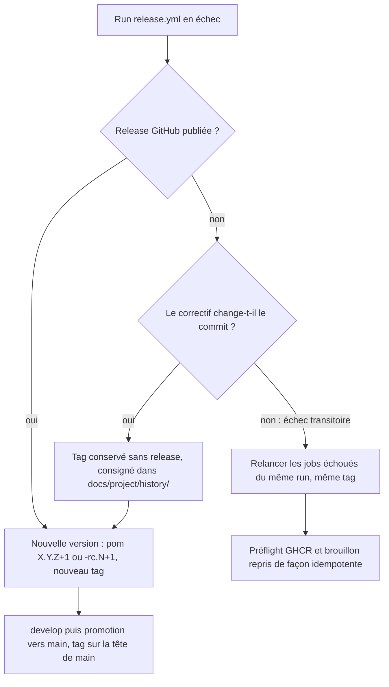

# Design

**Profil :** court

## Contexte

- [Existant vérifié] `scripts/verify-scale-budgets.py:96-101` : pour chaque palier, `ceiling = population_safety_ceiling[symbols]` (`:50-55`), puis, pour 1M seulement, `ceiling = max(ceiling, int(sqlite[500_000]['populationMs'] * 2.6))` (`:60-62`, `:98-100`). Le palier 500k est lui-même plafonné à 20 000 ms (`:53`), donc le plafond de 1M plafonne à 52 000 ms.
- [Existant vérifié] Hors PR (`workflow_call` de release, `workflow_dispatch`), le gate vérifie le rapport général, un seul peuplement à 1M, sans base comparable (`docs/developer/scale-regression-benchmark.md:128`) : la comparaison relative (`scripts/verify-scale-budgets.py:102-112`) ne s'applique pas.
- [Existant vérifié] Seize rapports relevés le 11/11 : 1M entre 25 046 et 40 755 ms, rapport 1M/500k entre 2,36 et 2,47 ; la courbe dédiée elle-même varie de 25,0 à 39,4 s selon le run, sur des runners de même libellé dont le modèle de processeur n'est pas publié (`docs/project/history/population-1m-runners-2026-11-11.md:9`, `:36`, `:39`).
- [Existant vérifié] `scripts/release/publish-github-release-assets.sh` crée un brouillon (`:72-77`), téléverse et revérifie chaque asset (`:132-140`), publie (`:145`) puis relit `isDraft` et `isPrerelease` (`:146-155`). Les codes de sortie utilisés sont 64, 65, 66, 69, 70 et 73 à 78. Une release déjà publiée est vérifiée sans mutation (`:62`, `:127-130`).
- [Existant vérifié] `.github/workflows/release.yml:426-450` appelle ce script, puis `:452` déplace `latest` dans une étape suivante du même job : un échec du script empêche le déplacement.
- [Existant vérifié] Le ruleset « Protect tags » (relevé du 11/11, `findings.json`, `AUD-DEP-37`) réunit `creation`, `update`, `deletion` et `non_fast_forward` sous un même contournement admin `always`. L'ADR `SEC-0068` (statut `Proposed`, décision 2) prévoit qu'un ruleset de tags « réserve création, mise à jour et suppression au mainteneur ».
- [Existant vérifié] Documentation GitHub : une release immuable verrouille son tag et ses assets à la publication ; titre, notes, état pré-version et état `latest` restent modifiables ; le réglage ne s'applique qu'aux releases publiées après son activation ; `GET /repos/{owner}/{repo}/immutable-releases` répond 200 si le réglage est actif, 404 sinon, avec la permission d'administration en lecture ; l'objet release expose le champ `immutable`.

## Objectifs / Hors objectifs

**Objectifs :**
- `scale-benchmark-gate` › Le peuplement 1M est borné par un plafond absolu.
- `scale-benchmark-gate` › La page du benchmark énonce les plafonds de population appliqués.
- `release-pipeline` › Les releases publiées sont immuables.
- `release-pipeline` › Un tag de version ne se déplace ni ne se supprime.
- `release-pipeline` › Une release échouée reprend sans recréer son tag.

**Hors objectifs :**
- Réduire la variance des runners ou changer le nombre d'échantillons du rapport général.
- Contrôler les réglages GitHub depuis un workflow avant la publication (voir « Décisions »).

## Composants et responsabilités

- `scripts/verify-scale-budgets.py` reste la seule source des plafonds. [Proposition] Un dictionnaire `population_hard_ceiling = {1_000_000: <valeur>}` borne le plafond calculé : `ceiling = min(hard, max(40 000, int(p500k × 2,6)))`. Les deux bornes restent visibles dans le message d'assertion.
- `scripts/release/test-operational-doc-contracts.sh` relit la valeur dans le script et la cherche dans la page du benchmark.
- `scripts/release/publish-github-release-assets.sh` ajoute un contrôle final en lecture (`gh api repos/{owner}/{repo}/releases/tags/<tag> --jq .immutable`), sans nouvelle permission : la lecture d'une release ne demande que `contents: read`.
- Réglages GitHub (hors dépôt) : le réglage `immutable-releases` et deux rulesets de cible `tag`, appliqués par le mainteneur.

## Modèle de domaine et invariants

- Invariant de charge : plafond 1M ≤ plafond absolu, quel que soit le palier 500k.
- Invariant de release : un tag `v*` créé désigne le même commit pour toujours ; une release publiée après l'activation du réglage garde ses assets.

## Traitements et interactions

Vue organigramme (cible) — reprise d'un run de release échoué ; couvre `release-pipeline` › « Une release échouée reprend sans recréer son tag » et « Un tag de version ne se déplace ni ne se supprime ».

Notation : organigramme, pas UML. Le tag en échec n'est jamais supprimé : le ruleset l'interdit et `scripts/release/validate-release-tag.sh` impose que le tag égale la version Maven, d'où une nouvelle version des pom. [Décision] Une version finale en échec est reprise par `X.Y.(Z+1)`, précédée de `X.Y.(Z+1)-rc.1` si le correctif touche la chaîne de release ; une pré-version en échec par `-rc.(N+1)`.

## États et transitions

Non applicable : les états d'une release (brouillon, publiée) sont déjà gérés par `scripts/release/publish-github-release-assets.sh` ; ce changement ajoute une lecture, pas un état.

## Contrats d'interface

- [Proposition] Nouveau code de sortie `79` de `scripts/release/publish-github-release-assets.sh` : release publiée dont `immutable` ne vaut pas `true`, message `GitHub Release <tag> is published but not immutable; enable immutable releases before publishing.`
- Commandes de vérification du mainteneur (lecture) :
  - `gh api repos/FTurleque/nexus-context-engine/immutable-releases` → 200, `enabled: true` ;
  - `gh api repos/FTurleque/nexus-context-engine/rulesets --jq '.[] | select(.target=="tag") | {id, name, enforcement}'`, puis pour chaque id `gh api repos/FTurleque/nexus-context-engine/rulesets/<id> --jq '{name, enforcement, include: .conditions.ref_name.include, rules: [.rules[].type], bypass: .bypass_actors}'` ;
  - `gh api repos/FTurleque/nexus-context-engine/releases/tags/<tag> --jq .immutable` après chaque release.
- [Proposition] Commandes d'écriture du mainteneur : `gh api -X PUT repos/FTurleque/nexus-context-engine/immutable-releases` ; création d'un ruleset « Immutable version tags » (`target: tag`, `include: ["refs/tags/v*"]`, règles `update`, `deletion`, `non_fast_forward`, `bypass_actors: []`) puis retrait de ces trois règles du ruleset 26777159, qui garde `creation` et son contournement admin. L'ordre (nouveau ruleset avant retrait) évite toute fenêtre sans protection.

## Persistance et intégrité

Non applicable : aucune donnée NEXUS ni migration SQLite ; les rapports de benchmark ne changent pas de format.

## Transactions, concurrence et idempotence

- Relancer les jobs échoués d'un run reprend le préflight GHCR et le brouillon de façon idempotente (`docs/developer/immutable-release-publishing.md:52-61`, `:107-113`) ; le contrôle `immutable` est une lecture, rejouable.
- Une release déjà publiée et immuable passe le contrôle à la reprise ; une release publiée avant l'activation (cas de `v0.2.0`) le fait échouer, ce qui est voulu.

## Sécurité et isolation

- Sans acteur de contournement sur `update` et `deletion`, déplacer un tag demande de modifier le ruleset lui-même : geste visible dans le journal d'audit du dépôt, au lieu d'un push silencieux.
- Les releases immuables empêchent le remplacement d'un asset ; les attestations `actions/attest` en permettent déjà la détection (`docs/developer/immutable-release-publishing.md:63-105`).
- Aucun secret nouveau : le contrôle du script lit avec le `GH_TOKEN` déjà fourni au job.

## Erreurs et reprise

- Gate de charge : une `AssertionError` `population-safety` signale le palier, la population et les deux plafonds. Relancer le job relance une mesure ; la procédure de reprise limite la relance au même commit.
- Publication : le code 79 arrive après la publication, que le script ne peut pas annuler ; la release reste publiée et `latest` inchangé. Reprise : activer le réglage, puis publier une nouvelle version, car le tag d'une release publiée n'est pas réutilisable.

## Observabilité

Le gate imprime déjà les valeurs relatives (`scripts/verify-scale-budgets.py:113-118`) ; le message d'assertion de 1M porte les deux plafonds. Le script de publication imprime le résultat du contrôle `immutable`.

## Performance et mesure

- [Existant vérifié] Mesures de référence : `docs/project/history/population-1m-runners-2026-11-11.md:15-32`.
- [Question] Valeur du plafond absolu, bornée par 40 755 ms (plus grande mesure admise) et 52 000 ms (plafond effectif actuel). [Proposition] 48 906 ms = 40 755 × 1,20, facteur relatif du gate (`scripts/verify-scale-budgets.py:105`). Avec cette valeur, les seize rapports relevés passent et le ralentissement uniforme cité par le constat (1M à 51,7 s, `findings.json`, `AUD-TST-18`) est refusé.
- Aucune nouvelle mesure n'est nécessaire pour la mise en œuvre : la règle se teste sur des rapports synthétiques.

## Compatibilité, migration et retour arrière

- Le gate devient plus strict : un run de release sur un runner plus lent que tous ceux relevés peut échouer. Retour arrière : relever la valeur du plafond absolu dans le script et la page, par PR, avec un relevé de mesure dans `docs/project/history/`.
- Réglages GitHub : désactiver `immutable-releases` (`gh api -X DELETE …/immutable-releases`) ou rendre ses règles au ruleset 26777159 ; les releases publiées entre-temps restent immuables.
- `v0.2.0` reste non immuable (voir la [Question] de la proposition).

## Décisions

- [Décision] Plafond absolu de 1M en plus du rapport 2,6, plutôt qu'une comparaison avec la dernière release mesurée : le modèle de processeur des runners n'est pas publié et la même courbe varie de 25,0 à 39,4 s entre runs de même libellé (`docs/project/history/population-1m-runners-2026-11-11.md:9`, `:36`) ; « même type de runner » n'est pas vérifiable, et la base dépendrait de la rétention des artefacts d'un run antérieur.
- [Décision] Deux rulesets de tags plutôt qu'un contournement en mode `pull_request` : la règle `creation` du ruleset actuel exige un acteur de contournement utilisable par un push de tag (voir proposition, [Écart]).
- [Décision] Contrôle automatisé dans le script de publication plutôt qu'un préflight du réglage dans `release.yml` : `GET …/immutable-releases` exige la permission d'administration, que le `GITHUB_TOKEN` ne peut pas recevoir ; un jeton personnel dédié contredirait `SEC-0068` (aucun secret dans l'environnement `release`). Le champ `immutable` de la release est lisible avec `contents: read`.
- [Décision] La procédure de reprise est verrouillée par `scripts/release/test-operational-doc-contracts.sh`, comme les autres faits de release.
- Pas de nouvel ADR : `SEC-0068` (statut `Proposed`) est complété — décision 2 : création réservée au mainteneur, mise à jour et suppression interdites à tous ; releases immuables (skill `nexus-adr`).

## Risques / Compromis

- [Risque] Le contrôle `immutable` échoue après publication, sans retour arrière possible → le réglage est activé et relu (tâche 2.1) avant toute release ; le code 79 signale une dérive, il ne la répare pas.
- [Risque] La relance d'un job de gate de charge retente une mesure jusqu'à ce qu'elle passe → la procédure la réserve au même commit et le plafond absolu borne ce que la relance peut admettre.
- [Risque] Un runner plus lent que les seize relevés fait échouer une release → relevé et relèvement documenté du plafond (voir « Compatibilité »).
- [Risque] Le mode de contournement disponible pour la règle `creation` d'un ruleset de tags n'est pas relu ici → la tâche 2.2 vérifie à la prochaine release qu'un tag `v*` reste créable par le mainteneur.
- [Risque] Éprouver l'interdiction de suppression par un vrai push supprimerait le tag si le ruleset était mal réglé → la preuve est la lecture `gh api` des règles effectives, jamais un essai sur un tag réel.

## Stratégie de vérification

- `python -m unittest discover -s scripts/tests -p test_scale_budgets.py` : nouveaux cas 20 000/52 000 refusé, 16 810/40 755 admis, cas existants inchangés.
- `bash scripts/release/test-publish-github-release-assets.sh` : faux `gh` qui rend `immutable` à `false` (code 79) et à `true` (code 0).
- `bash .claude/scripts/contracts.sh` : contrats de la page du benchmark et de la procédure de reprise, avec mutations locales qui doivent échouer.
- Lectures `gh api` des tâches 2.1, 2.2 et 2.5, consignées dans un relevé daté.
- Check `Hermetic scale benchmark` mesuré sur la PR (le script est dans `WATCHED_PATHS`).
- `openspec validate sprint-14-plafond-charge-et-release-immuable --strict`.

## Traçabilité

| Exigence (`capacité › titre`) | Scénario | Conception ou diagramme | Tâche | Test ou preuve |
|---|---|---|---|---|
| `scale-benchmark-gate › Le peuplement 1M est borné par un plafond absolu` | Ralentissement uniforme hors PR | Composants et responsabilités | 1.1 | test non écrit (`scripts/tests/test_scale_budgets.py`) |
| `scale-benchmark-gate › Le peuplement 1M est borné par un plafond absolu` | Run de release v0.2.0 | Performance et mesure | 1.1 | test existant à conserver (`test_slow_runner_million_symbol_population_follows_same_report_scaling`) |
| `scale-benchmark-gate › Le peuplement 1M est borné par un plafond absolu` | Croissance plus que proportionnelle | Composants et responsabilités | 1.1 | test existant à conserver (`test_super_linear_million_symbol_slowdown_still_fails`) |
| `scale-benchmark-gate › La page du benchmark énonce les plafonds de population appliqués` | Valeur divergente | Composants et responsabilités | 1.2 | test non écrit (`scripts/release/test-operational-doc-contracts.sh`) |
| `scale-benchmark-gate › La page du benchmark énonce les plafonds de population appliqués` | Affirmation périmée | — | 1.2 | test non écrit |
| `release-pipeline › Les releases publiées sont immuables` | Lecture du réglage | Contrats d'interface | 2.1 | preuve manquante (tâche mainteneur) |
| `release-pipeline › Les releases publiées sont immuables` | Release publiée non immuable | Contrats d'interface | 2.3 | test non écrit (`scripts/release/test-publish-github-release-assets.sh`) |
| `release-pipeline › Les releases publiées sont immuables` | Release immuable | Contrats d'interface | 2.3 | test non écrit |
| `release-pipeline › Un tag de version ne se déplace ni ne se supprime` | Lecture des rulesets de tags | Contrats d'interface | 2.2 | preuve manquante (tâche mainteneur) |
| `release-pipeline › Un tag de version ne se déplace ni ne se supprime` | Création d'un tag de release | Risques / Compromis | 2.2 | preuve manquante (tâche mainteneur, à la prochaine release) |
| `release-pipeline › Une release échouée reprend sans recréer son tag` | Contrat de la procédure | Organigramme de reprise | 2.4 | test non écrit |
| `release-pipeline › Une release échouée reprend sans recréer son tag` | Prescription de suppression de tag | Organigramme de reprise | 2.4 | test non écrit |
