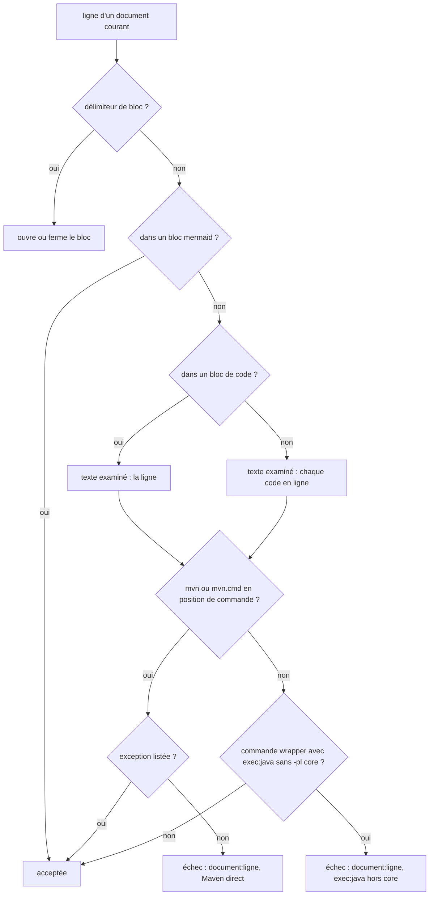

# Design

**Profil :** court (documentaire et outillage)

## Contexte

- [Existant vérifié] Le wrapper vérifié est la seule entrée Maven du dépôt : `AGENTS.md:11` prescrit `./mvnw clean install` (`.\mvnw.cmd clean install` sous Windows) ; `.claude/hooks/guard-command.ps1:49-51` refuse `mvn(\.cmd)?\s` en position de commande ; `mvnw` et `mvnw.cmd` sont à la racine.
- [Existant vérifié] Le contrôle documentaire de Maven direct ne vise que `AGENTS.md` : bloc bash `scripts/release/test-operational-doc-contracts.sh:977-984`, motif `(^|[^A-Za-z0-9_./\-])mvn[[:space:]]` (`:978`), présence de `` `./mvnw clean install` `` (`:982`). Il est dans la section « Sprint 11 » (`:967`) ; le script se termine à `:1133` (`print("sprint-14-release-and-scale-contracts=PASS")` à `:1132`).
- [Existant vérifié] `current_docs` (`scripts/release/test-operational-doc-contracts.sh:377-405`) est une liste Python du premier heredoc (clos à `:728`), qui ne sert qu'à des chaînes interdites (`:409-418`). Elle n'est pas visible d'un bloc ajouté en fin de script, et ne contient pas `docs/developer/indexing-pipeline.md`, `docs/developer/agent-skills.md` ni `docs/architecture/arc42/02-contraintes.md`.
- [Existant vérifié] Relevé du 2026-11-12 (`git grep` sur `docs`, `README.md`, `AGENTS.md`, `CONTRIBUTING.md`, hors `docs/project/audits` et `docs/project/history`), simulé avec la grammaire proposée ci-dessous :

| Occurrence | Forme | Traitement |
|---|---|---|
| `docs/developer/reproduce-and-debug.md:18` | bloc `mvn -version` | à corriger |
| `docs/developer/reproduce-and-debug.md:31` | bloc `mvn clean install` | à corriger |
| `docs/developer/reproduce-and-debug.md:163` | code en ligne `mvn clean install` | à corriger |
| `docs/developer/reproduce-and-debug.md:180` | bloc `mvn -q exec:java "-Dexec.args=--help"` | à corriger, avec `-pl core` |
| `docs/developer/reproduce-and-debug.md:518` | code en ligne `mvn clean install` | à corriger |
| `docs/developer/indexing-pipeline.md:71` | bloc `mvn -q exec:java "-Dexec.args=project add …"` | à corriger, avec `-pl core` |
| `docs/developer/agent-skills.md:5` | code en ligne `mvn clean install` | à corriger |
| `docs/architecture/arc42/02-contraintes.md:24` | code en ligne `mvn clean install` (contrainte O3) | à corriger |
| `docs/developer/ci-and-supply-chain.md:500`, `:501`, `:502` | exemples de fixtures du contrat `DIRECT_MAVEN_CALL` (`& mvn @arguments`, `mvn clean install`, `Push-Location $root; mvn clean install`) | exception listée |
| `docs/developer/ci-and-supply-chain.md:505`, `:515`, `:548` ; `docs/developer/claude-code.md:38` ; `docs/developer/large-scale-baseline-runbook.md:49` | `cmd /c mvn`, `` `mvn` `` ou `` `mvn.cmd` `` seuls dans une phrase | non signalé par la grammaire |
| `docs/developer/ci-and-supply-chain.md:538` | `mvn installé` dans un diagramme Mermaid | non signalé (bloc `mermaid` ignoré) |
| ADR `docs/architecture/adr/GEN-0002-…:79`, `GEN-0031-…:16`, `:30`, `:103`, `docs/architecture/adr/archive/*` | décisions datées | hors périmètre |

- [Existant vérifié] `pom.xml:10` (`packaging pom`) et `core/pom.xml:232-235` (seul module qui configure `exec-maven-plugin` avec `mainClass` `com.nexus.cli.NexusCli`) ; version du plugin dans `pom.xml:66` et `:218-219`.
- [Écart] La page durable cite le contrôle `AGENTS.md` à `scripts/release/test-operational-doc-contracts.sh:976` et le contrôle FTS5 à `:967` (`docs/developer/ci-and-supply-chain.md:580-581`, `docs/developer/openspec-traceability.md:277-278`) ; au HEAD, ils sont à `:977` et `:968`.

## Objectifs / Hors objectifs

**Objectifs :** `operational-documentation-contracts › Les guides courants n'appellent Maven que par le wrapper`, `operational-documentation-contracts › Les commandes exec:java de la documentation visent le module core` ; corriger les huit occurrences du tableau.

**Hors objectifs :** analyser la prose libre (une phrase « lancer mvn clean install » hors code n'est pas lue) ; réécrire les ADR et relevés datés ; modifier `DIRECT_MAVEN_CALL` ou les hooks.

## Composants et responsabilités

- [Proposition] Nouveau bloc Python en fin de `scripts/release/test-operational-doc-contracts.sh` (après `:1133`), titré `# --- Sprint 15 : guides sous le wrapper Maven (AUD-QUA-30) ---`, terminé par `print("maven-wrapper-doc-contracts=PASS")`.
- [Proposition] Périmètre `maven_doc_paths()` : `README.md`, `AGENTS.md`, `CONTRIBUTING.md`, `SECURITY.md` et `docs/**/*.md`, hors `docs/architecture/adr/`, `docs/project/audits/`, `docs/project/history/`, `docs/project/rapport-supervisor/`. Un parcours par motif plutôt qu'une copie de `current_docs` : une nouvelle page est couverte sans édition du contrat.
- [Proposition] Grammaire, appliquée ligne à ligne avec suivi des blocs de code délimités par trois accents graves ou par `~~~` :
  - jeton `(?<![\w./\\-])mvn(?:\.cmd)?` : exclut `mvnw`, `.mvn/`, `./mvnw`, `.\mvnw.cmd` ;
  - position de commande : début de ligne (après une invite facultative `PS…>`, `$ ` ou `> `) ou après `&&`, `||`, `;`, `|`, `&`, `(` ;
  - dans un bloc de code non `mermaid` : jeton suivi d'un blanc ou de la fin de ligne ;
  - hors bloc : appliquée au contenu de chaque code en ligne `` `…` ``, jeton suivi d'un blanc (une commande avec arguments) ; `` `mvn` `` ou `` `mvn.cmd` `` seuls désignent l'outil et ne sont pas signalés ;
  - les blocs `mermaid` sont ignorés.
- [Proposition] `MAVEN_DOC_EXCEPTIONS` : ensemble de couples (chemin, texte exact de ligne), initialisé aux trois lignes `docs/developer/ci-and-supply-chain.md:500-502` qui citent les fixtures de `DIRECT_MAVEN_CALL`. Une exception sans ligne correspondante fait échouer le contrat (même règle que `MAVEN_CALL_EXCEPTIONS`).
- [Proposition] Contrôle `exec:java` : sur une ligne déjà en position de commande Maven (wrapper compris, jeton `(?:\.[\\/])?mvnw(?:\.cmd)?` ou `mvn`), la présence de `exec:java` exige `-pl core` (ou `--projects core`).
- [Proposition] Auto-test en mémoire, sur le modèle de `scripts/release/test-operational-doc-contracts.sh:1105-1131` : formes détectées (bloc `mvn clean install`, bloc `mvn.cmd -q package`, `cd core && mvn test`, `PS> mvn -v`, bloc indenté dans une liste, code en ligne `mvn clean install`, `.\mvnw.cmd -q exec:java …` sans `-pl core`) ; formes non signalées (`.\mvnw.cmd clean install`, `./mvnw -version`, « `mvn` hors wrapper », `mvn installé` dans un bloc `mermaid`, `mvn clean install` en prose hors code, `.mvn/wrapper/maven-wrapper.properties`, `.\mvnw.cmd -q -pl core exec:java …`).
- [Proposition] Le bloc `AGENTS.md` (`:977-984`) reste en place : le retirer décalerait les références `chemin:ligne` sans gain ; `AGENTS.md` est en outre couvert par le nouveau bloc.
- [Proposition] Remplacements dans les guides : `.\mvnw.cmd -version`, `.\mvnw.cmd clean install` (avec la forme `./mvnw` hors Windows, comme `AGENTS.md:11`), `.\mvnw.cmd -q -pl core exec:java "-Dexec.args=--help"`, `.\mvnw.cmd -q -pl core exec:java "-Dexec.args=project add …"`.

## Modèle de domaine et invariants

Non applicable : aucun modèle de domaine. Invariant : aucune commande Maven prescrite par la documentation courante ne contourne le wrapper.

## Traitements et interactions

Vue organigramme — quelle décision le contrat prend-il pour une ligne d'un document courant ; couvre `operational-documentation-contracts › Les guides courants n'appellent Maven que par le wrapper` et `› Les commandes exec:java de la documentation visent le module core`.

Lecture : la prose hors code n'est jamais examinée ; une exception listée dont la ligne a disparu fait échouer le contrat en fin de parcours.

## États et transitions

Non applicable : contrôle sans état.

## Contrats d'interface

- Messages : `documentation contract drift: <document>:<ligne>: calls Maven directly instead of ./mvnw or .\mvnw.cmd`, `documentation contract drift: <document>:<ligne>: exec:java must select the core module (-pl core)`, `documentation contract drift: obsolete Maven exception <document>: <ligne>`, `maven wrapper doc contract self-test: <échantillon> was not detected` / `was wrongly detected`.
- Exécution : `bash .claude/scripts/contracts.sh` et la CI, inchangés.

## Persistance et intégrité

Non applicable : aucun format persisté ni ancre d'intégrité.

## Transactions, concurrence et idempotence

Non applicable : contrôle en lecture seule.

## Sécurité et isolation

Le changement retire de la documentation un chemin qui contourne la vérification SHA-512 de l'archive Maven (`AUD-QUA-05`, `AUD-QUA-03`). Aucune nouvelle surface.

## Erreurs et reprise

Un faux positif se traite par une entrée de `MAVEN_DOC_EXCEPTIONS` (document, texte exact), dont l'obsolescence fait elle-même échouer le contrat.

## Observabilité

Non applicable : messages du contrat seulement.

## Performance et mesure

Non applicable : parcours de quelques centaines de pages Markdown.

## Compatibilité, migration et retour arrière

Après les corrections du groupe 1, la grammaire ne signale que les trois exceptions listées (simulation du 2026-11-12). Retour arrière : retirer le bloc ajouté ; aucun format persisté.

## Décisions

- [Décision] Rester sur une grammaire de motifs limitée au code (blocs et code en ligne), sans analyse de la prose : une commande prescrite s'écrit en code dans ces guides.
- [Décision] Ignorer les blocs `mermaid`, qui décrivent un comportement et ne prescrivent pas de commande.
- [Décision] Ne pas étendre `current_docs` mais parcourir `docs/**/*.md` avec des exclusions explicites, parce que trois pages fautives n'y figurent pas et que la liste vit dans un autre heredoc.
- [Décision] Ajouter le contrôle en fin de script (`.claude/rules/ci-and-scripts.md`) pour ne décaler aucune référence `chemin:ligne`.
- Aucun ADR : le changement complète un contrat existant.

## Risques / Compromis

- [Risque] Une commande `mvn` écrite en prose hors code passe → limite documentée dans la page durable.
- [Risque] `$output = mvn …` (affectation) n'est pas en position de commande pour la grammaire documentaire → limite documentée ; forme propre aux scripts, couverte par `DIRECT_MAVEN_CALL`.
- [Risque] Les exceptions par texte exact cassent à toute réécriture des lignes `:500-502` → échec explicite qui nomme l'exception, voulu.
- [Risque] `-pl core exec:java` sans build préalable échoue faute de classes compilées → le guide place la commande après `.\mvnw.cmd clean install` (`docs/developer/reproduce-and-debug.md` § 7) ; vérification en tâche 1.1.

## Stratégie de vérification

`bash .claude/scripts/contracts.sh` (rouge avant le groupe 1 sur les huit occurrences, vert après ; auto-test), mutations manuelles sur une copie d'un guide, exécution réelle de `.\mvnw.cmd -q -pl core exec:java "-Dexec.args=--help"` après `.\mvnw.cmd clean install`, `bash scripts/release/test-openspec-doc-contracts.sh`, `openspec validate sprint-15-guides-wrapper-maven --strict`, syntaxe du diagramme Mermaid.

## Traçabilité

| Exigence (`capacité › titre`) | Scénario | Conception ou diagramme | Tâche | Test ou preuve |
|---|---|---|---|---|
| `operational-documentation-contracts › Les guides courants n'appellent Maven que par le wrapper` | Commande Maven directe dans le guide de reproduction | Organigramme (C1, E1) | 1.1, 2.1 | test non écrit |
| `operational-documentation-contracts › Les guides courants n'appellent Maven que par le wrapper` | Commande Maven directe en code en ligne | Organigramme (C2, E1) | 1.3, 2.1 | test non écrit |
| `operational-documentation-contracts › Les guides courants n'appellent Maven que par le wrapper` | Forme de contournement | Composants (auto-test) | 2.1 | test non écrit |
| `operational-documentation-contracts › Les guides courants n'appellent Maven que par le wrapper` | Wrapper vérifié | Composants (jeton) | 2.1 | test non écrit |
| `operational-documentation-contracts › Les guides courants n'appellent Maven que par le wrapper` | Mention qui désigne Maven sans le prescrire | Organigramme (bloc mermaid), Décisions | 2.1 | test non écrit |
| `operational-documentation-contracts › Les guides courants n'appellent Maven que par le wrapper` | ADR hors contrôle | Composants (périmètre) | 2.1 | test non écrit |
| `operational-documentation-contracts › Les guides courants n'appellent Maven que par le wrapper` | Exception devenue obsolète | Composants (`MAVEN_DOC_EXCEPTIONS`), Erreurs | 2.1 | test non écrit |
| `operational-documentation-contracts › Les commandes exec:java de la documentation visent le module core` | exec:java lancé à la racine du reactor | Organigramme (E2) | 2.2 | test non écrit |
| `operational-documentation-contracts › Les commandes exec:java de la documentation visent le module core` | exec:java sur le module core | Composants | 1.1, 1.2, 2.2 | test non écrit |

## Questions ouvertes

- [Question] L'action de l'audit dit « étendre le motif à `current_docs` » ; le design parcourt `docs/**/*.md` avec exclusions (Décisions). Faut-il plutôt ajouter les trois pages manquantes à `current_docs` et y restreindre le contrôle ? Sans effet sur les scénarios, sauf le périmètre nommé dans l'exigence.
- [Question] Garder `docs/developer/ci-and-supply-chain.md:500-502` en exceptions listées (proposé) ou réécrire ces exemples de fixtures pour qu'ils ne commencent pas par `mvn` en code en ligne ? La première option garde la page fidèle à l'auto-test de `DIRECT_MAVEN_CALL`.
- [Question] La contrainte O3 de `docs/architecture/arc42/02-contraintes.md:24` doit-elle citer `./mvnw clean install` (forme de `AGENTS.md:11`) ou les deux formes `./mvnw` et `.\mvnw.cmd` ?
