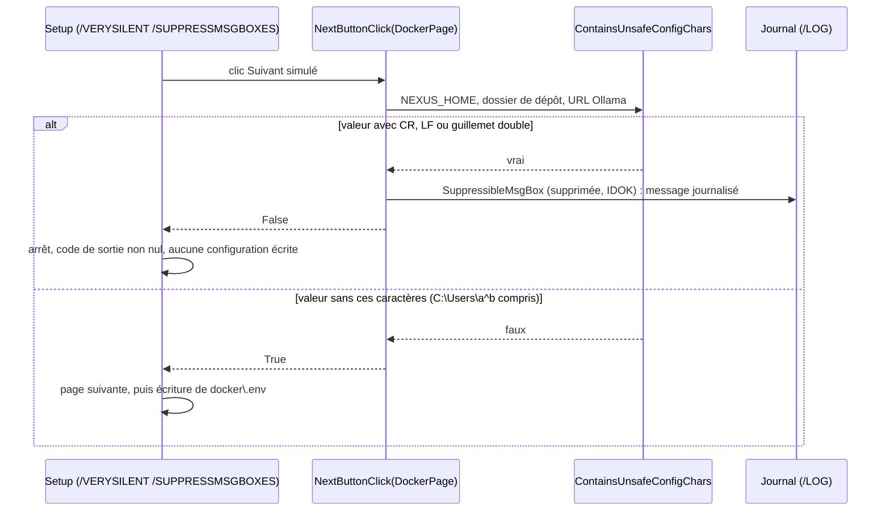

# Design

**Profil :** complet

## Contexte

- [Existant vérifié] L'installateur est un gabarit Pascal (`packaging/windows/nexus-installer.iss.template`) que `scripts/release/harden-windows-installer-source.ps1` réécrit par remplacement exact avant compilation (`Replace-ExactlyOnce`, `:8-14`, qui lève `Installer hardening anchor missing` si une ancre ne se trouve pas). Les validations de valeurs y sont ajoutées après des ancres qui recopient des blocs de `NextButtonClick`, `MsgBox` compris : `$runtimeValidation` (`:151-158`), `$remoteNative` (`:171-178`), `$dockerImageValidation` (`:190-196`), `$dockerBindValidation` (`:208-214`). Toute modification de ces `MsgBox` touche donc le gabarit et les ancres.
- [Existant vérifié] `ContainsUnsafeConfigChars` refuse `#13`, `#10`, `"` et `^` (`scripts/release/harden-windows-installer-source.ps1:113-117`). Appels : page Runtime, sur `NEXUS_HOME` et le token REST, message « … retour à la ligne, guillemet double ou accent circonflexe » (`:161-168`) ; page Docker, sur `RuntimePage.Values[0]`, `DockerPage.Values[5]` et `OllamaPage.Values[0]`, message « Les chemins et URL générés … » (`:223-230`).
- [Existant vérifié] Valeurs par défaut : `NEXUS_HOME` = `GetEnv('USERPROFILE') + '\.nexus'` (`packaging/windows/nexus-installer.iss.template:920`), dossier de dépôt Docker = `GetEnv('USERPROFILE')` (`:972`), dossier d'installation `{localappdata}\Programs\NEXUS` (`:17`). La page Runtime est sautée hors profil personnalisé (`:1008`), la page Docker affichée dès que Docker est déployé (`:1012`) ; le smoke ne déploie jamais Docker (`InstallDocker`, `:131-134`).
- [Existant vérifié] Formats écrits : `config\nexus-native.env.cmd` pose chaque valeur par `set "NOM=valeur"` (`scripts/release/harden-windows-installer-source.ps1:243-251`, `scripts/release/harden-windows-rest-auth-source.ps1:15-45`) ; les lanceurs font `setlocal DisableDelayedExpansion` avant de l'appeler (`scripts/release/build-windows-distribution.ps1:262`). `docker\.env` écrit le dossier de dépôt, l'URL Ollama et le token par `DotEnvQuoted` (`scripts/release/harden-windows-installer-source.ps1:104-111`, `:280`, `:285-286`), entre apostrophes. Les fragments TOML et JSON ne contiennent que des chemins sous `{app}` (`packaging/windows/nexus-installer.iss.template:1393-1394`, `:1424-1425`). Le registre stocke les valeurs en Unicode (`:2042-2057`).
- [Existant vérifié] Relevés locaux du 12/11/2026 (Windows 10, `cmd.exe`) : `set "V=a^b"` dans un `.cmd` rend `V=a^b` ; un lanceur de la forme de `nexus-docker-up.cmd` placé dans un dossier `ca^ret`, lancé par `cmd /D /S /C ""…\up.cmd""` (forme de `packaging/windows/nexus-installer.iss.template:69`) ou `cmd /C ""…\up.cmd""` (forme du raccourci, `:64`), lit `docker\.env` par `for /f "usebackq" … in ("%~dp0docker\.env")` et trouve `%~dp0` ; la ligne `NEXUS_REPOSITORY_BIND='C:/Users/a^b'` y est lue sans erreur. La vérification de l'audit a rejoué la ligne `set "NEXUS_HOME=…\a^b\.nexus"` en page 850 (`docs/project/audits/2026-10-17/findings.json`, entrée `AUD-QUA-29`, champ `verification`).
- [Existant vérifié] Relevé local du 12/11/2026 : `call "<dossier contenant ^>\x.cmd"` échoue avec « Le chemin d'accès spécifié est introuvable » (`CALL` double les `^`, y compris entre guillemets) ; un lanceur natif placé dans un tel dossier n'obtient donc pas `NEXUS_HOME` de `config\nexus-native.env.cmd` (`scripts/release/build-windows-distribution.ps1:263`). La forme `pushd "%~dp0config" && (call .\nexus-native.env.cmd & popd)` réussit. Défaut préexistant, distinct de `AUD-QUA-29` : voir « Questions ouvertes ».
- [Existant vérifié] `NextButtonClick` (`packaging/windows/nexus-installer.iss.template:1084-1247`) affiche ses refus par `MsgBox`, sauf le refus du dossier d'installation, par `SuppressibleMsgBox(…, mbError, MB_OK, IDOK)` (`:1092-1099`). `NotifyPortSelection` (`:611-618`), appelée depuis `NextButtonClick` seulement (`:1142`, `:1237`), et l'avis de port réservé (`:1232-1236`) sont des `MsgBox` d'information. `NextButtonClick` est aussi appelé en installation silencieuse, où un refus interrompt l'installation (documentation Inno Setup, rubrique « Event Functions ») ; `/SUPPRESSMSGBOXES` n'agit que sur `SuppressibleMsgBox`. Le smoke vérifie ce mécanisme pour le dossier d'installation : `/VERYSILENT /SUPPRESSMSGBOXES`, attente bornée à 180 s, code non nul, message dans le journal (`scripts/release/test-windows-installer.ps1:330-347`).
- [Écart] Le blocage d'une installation silencieuse Docker sur une `MsgBox` est déduit de la lecture ; il n'a pas été rejoué (`docs/project/audits/2026-10-17/etat-2026-11-12.md`, « Angles morts »).

## Objectifs / Hors objectifs

**Objectifs :**
- `installer-client-configuration` › L'assistant accepte un accent circonflexe dans les valeurs de la configuration générée.
- `installer-client-configuration` › En installation silencieuse, les messages de l'assistant n'attendent aucune réponse.

**Hors objectifs :**
- Les lanceurs natifs dans un dossier d'installation qui contient `^` (voir « Questions ouvertes »).
- Les boîtes affichées hors validation des pages (`packaging/windows/nexus-installer.iss.template:1709`, `:2170`, `:2389`, `:2502`).
- Toute autre règle de validation (image Docker, nom de conteneur, ports, adresses).

## Composants et responsabilités

- [Proposition] `ContainsUnsafeConfigChars` (`scripts/release/harden-windows-installer-source.ps1:113-117`) ne refuse plus que `#13`, `#10` et `"`. Les deux messages (`:165`, `:227`) ne mentionnent plus l'accent circonflexe.
- [Proposition] Chaque `MsgBox(…, mbError, MB_OK)` de `NextButtonClick`, l'avis de port réservé et `NotifyPortSelection` deviennent `SuppressibleMsgBox(…, <même icône>, MB_OK, IDOK)`, dans le gabarit et dans les ancres et remplacements du script de durcissement qui les recopient.
- Les écrivains de `config\nexus-native.env.cmd` et de `docker\.env`, et les lanceurs, ne changent pas.

## Modèle de domaine et invariants

Invariant : une valeur acceptée par l'assistant est écrite dans un format où chacun de ses caractères est littéral pour le lecteur prévu (`cmd.exe` entre guillemets sans expansion retardée, Compose entre apostrophes). Les caractères qui casseraient ce format (fin de ligne, guillemet double qui fermerait `set "…"`) restent refusés. `%` est déjà doublé par `CmdEnvEscape`, l'apostrophe échappée par `DotEnvQuoted`.

## Traitements et interactions

Vue UML de séquence (cible) — validation de la page Docker en installation silencieuse ; couvre `installer-client-configuration` › « L'assistant accepte un accent circonflexe dans les valeurs de la configuration générée » et « En installation silencieuse, les messages de l'assistant n'attendent aucune réponse ».

Lecture : aujourd'hui, la branche « vrai » est prise pour `C:\Users\a^b` et passe par `MsgBox`, qui attend une réponse même avec `/SUPPRESSMSGBOXES`. Après le changement, `^` suit la seconde branche, et la première ne bloque plus.

## États et transitions

Non applicable : la validation d'une page est un contrôle sans état, rejoué à chaque clic.

## Contrats d'interface

- Ligne écrite dans `docker\.env` pour un profil `C:\Users\a^b` : `NEXUS_REPOSITORY_BIND='C:/Users/a^b'` (`DockerPath` puis `DotEnvQuoted`).
- Ligne écrite dans `config\nexus-native.env.cmd` : `set "NEXUS_HOME=C:\Users\a^b\.nexus"` (valeur ASCII, laissée littérale par `CmdEnvPathValue`).
- `SuppressibleMsgBox` rend `IDOK` quand la boîte est supprimée ; les appels actuels ignorent la valeur de retour de `MsgBox`, le comportement interactif ne change pas.
- Codes de sortie de l'installateur : inchangés ; un refus en mode silencieux arrête l'installation comme aujourd'hui, sans attendre.

## Persistance et intégrité

- Registre : inchangé ; une valeur contenant `^` y est enregistrée et relue à la réinstallation (`packaging/windows/nexus-installer.iss.template:697-713`, `:2042-2057`).
- Aucune donnée NEXUS ni migration SQLite.

## Transactions, concurrence et idempotence

Non applicable : validation interactive d'une page, sans écriture.

## Sécurité et isolation

- `^` n'est actif dans `cmd.exe` qu'hors guillemets ou avec l'expansion retardée et un `!` sur la ligne. Les lignes `set "NOM=valeur"` sont entre guillemets et les lanceurs désactivent l'expansion retardée (`scripts/release/build-windows-distribution.ps1:262`, `:270`, `:278`, `:286`) : aucune valeur saisie n'est interprétée. Aucun lanceur ne recopie `NEXUS_HOME`, le token ou le dossier de dépôt hors guillemets.
- Dans `docker\.env`, les valeurs entre apostrophes sont littérales pour Compose ; `^` n'y a de toute façon aucun sens.
- Le guillemet double et les fins de ligne restent refusés : ils permettraient de sortir de `set "…"` ou d'ajouter une ligne au fichier.
- Le token REST n'apparaît pas dans les messages journalisés : aucun message de refus ne recopie une valeur, sauf le dossier de dépôt introuvable (`packaging/windows/nexus-installer.iss.template:1200`), qui est un chemin.

## Erreurs et reprise

- Refus en installation interactive : message affiché, l'assistant reste sur la page (inchangé).
- Refus en installation silencieuse avec `/SUPPRESSMSGBOXES` : message journalisé, installation arrêtée sans attente. Sans `/SUPPRESSMSGBOXES`, la boîte reste affichée, comme le prévoit Inno Setup.

## Observabilité

- Les messages supprimés sont écrits dans le journal `/LOG` d'Inno Setup, comme le refus du dossier d'installation (`scripts/release/test-windows-installer.ps1:344-346`). Aucun journal nouveau.

## Performance et mesure

Non applicable : un test de caractère de moins par valeur.

## Compatibilité, migration et retour arrière

- Une installation existante sans `^` produit des fichiers identiques octet pour octet.
- Un poste dont le profil contient `^` peut désormais installer en mode Docker ; en mode natif avec le dossier d'installation par défaut, les lanceurs restent concernés par la [Question].
- Retour arrière : réinstaller la version précédente.

## Décisions

- [Décision] Retirer `^` de `ContainsUnsafeConfigChars` plutôt que de ne valider `RuntimePage.Values[0]` que si `InstallNative()`. Raison : la seconde option ne suffit pas, car la même condition de la page Docker vérifie `DockerPage.Values[5]` (`scripts/release/harden-windows-installer-source.ps1:224`), qui vaut par défaut le profil (`packaging/windows/nexus-installer.iss.template:972`) ; un profil « a^b » resterait refusé en mode Docker. La première option corrige aussi le mode natif en profil personnalisé, où `^` est refusé sans raison, et `^` est littéral dans les deux formats écrits.
- [Décision] Pas de garde `InstallNative()` sur `NEXUS_HOME` à la page Docker : sans `^`, ce contrôle ne refuse plus que fin de ligne et guillemet double, qu'un nom de profil Windows ne peut pas contenir ; le changement reste minimal.
- [Décision] Toutes les boîtes de `NextButtonClick` et `NotifyPortSelection` passent à `SuppressibleMsgBox`, avis d'information compris : un avis de port remplacé bloquerait autant une installation silencieuse qu'un refus. Les boîtes hors validation des pages restent hors périmètre.
- [Décision] Preuve : contrat statique et rejeu PowerShell des règles Pascal depuis la source durcie, sur le modèle de `scripts/release/test-windows-config-escaping.ps1`, plus exécution par `cmd.exe` de la ligne `NEXUS_HOME` contenant `^`. La page Docker n'est pas exercée par le smoke (Docker exclu du mode smoke) : la preuve du scénario « Profil contenant un accent circonflexe en mode Docker » reste partielle, sauf vérification manuelle consignée (tâche 2.4).
- Aucun ADR : correctif local à l'installateur, sans format persistant ni contrat public nouveau.

## Risques / Compromis

- [Risque] Une ancre de durcissement non mise à jour fait échouer la compilation (`Installer hardening anchor missing`) → gabarit et ancres changent dans la même tâche 1.2, et `scripts/release/test-windows-config-escaping.ps1` charge la source durcie.
- [Risque] Un futur écrivain recopie une valeur hors guillemets dans un `.cmd` → l'invariant est écrit dans la page durable, et le test de 2.1 exécute la ligne générée.
- [Risque] Preuve Docker partielle → vérification manuelle sous Windows avec Docker Desktop, sinon écart consigné.

## Stratégie de vérification

- `pwsh -NoProfile -File scripts/release/test-windows-config-escaping.ps1` : rejeu de `ContainsUnsafeConfigChars` (`C:\Users\a^b` et `C:\Users\a^b\.nexus` acceptés ; CR, LF, `"` refusés) ; `nexus-native.env.cmd` écrit pour `NEXUS_HOME` `<temp>\a^b\.nexus` et lu par une sonde en page 850, console visible puis `CreateNoWindow` ; rejeu de `DockerPath` et `DotEnvQuoted` (`'C:/Users/a^b'`) ; contrat : aucun `MsgBox(` dans `NextButtonClick` ni `NotifyPortSelection` de la source durcie.
- `pwsh -NoProfile -File scripts/release/test-windows-installer.ps1 -Setup <setup smoke>` : contrat statique sur la source et le smoke existant (refus silencieux du dossier d'installation, toujours vert).
- Workflow `Windows installer` (`.github/workflows/windows-installer.yml`, `windows-latest`) vert sur la PR : ces tests exigent Windows.
- `bash scripts/release/test-openspec-doc-contracts.sh`, `bash .claude/scripts/contracts.sh`.
- `openspec validate sprint-15-installateur-caret --strict`.

## Traçabilité

| Exigence (`capacité › titre`) | Scénario | Conception ou diagramme | Tâche | Test ou preuve |
|---|---|---|---|---|
| `installer-client-configuration › L'assistant accepte un accent circonflexe dans les valeurs de la configuration générée` | Profil contenant un accent circonflexe en mode Docker | Séquence (branche « faux ») ; Décisions | 1.1, 2.1, 2.4 | test non écrit (prévu : rejeu de `ContainsUnsafeConfigChars`, `DockerPath` et `DotEnvQuoted` dans `scripts/release/test-windows-config-escaping.ps1` ; partiel sans vérification manuelle 2.4) |
| `installer-client-configuration › L'assistant accepte un accent circonflexe dans les valeurs de la configuration générée` | NEXUS_HOME contenant un accent circonflexe lu par un lanceur natif | Contrats d'interface ; Sécurité et isolation | 1.1, 2.1 | test non écrit (prévu : sonde `cmd.exe` en page 850 dans `scripts/release/test-windows-config-escaping.ps1`) |
| `installer-client-configuration › L'assistant accepte un accent circonflexe dans les valeurs de la configuration générée` | Guillemet double toujours refusé | Séquence (branche « vrai ») | 1.1, 2.1 | test non écrit (prévu : rejeu de `ContainsUnsafeConfigChars` sur `"`, CR, LF) |
| `installer-client-configuration › En installation silencieuse, les messages de l'assistant n'attendent aucune réponse` | Valeur refusée en installation silencieuse | Séquence (branche « vrai ») ; Erreurs et reprise | 1.2, 2.2 | test non écrit (prévu : contrat « aucun `MsgBox(` dans `NextButtonClick` ») ; existant pour le dossier d'installation : `scripts/release/test-windows-installer.ps1:330-347` |
| `installer-client-configuration › En installation silencieuse, les messages de l'assistant n'attendent aucune réponse` | Port remplacé en installation silencieuse | Composants | 1.2, 2.2 | test non écrit (prévu : contrat sur `NotifyPortSelection` et l'avis de port réservé) |
| `installer-client-configuration › En installation silencieuse, les messages de l'assistant n'attendent aucune réponse` | Refus en installation interactive | Contrats d'interface | 1.2, 2.2 | test non écrit (prévu : contrat `SuppressibleMsgBox(…, MB_OK, IDOK)` suivi de `Result := False; exit;`) |

## Questions ouvertes

- [Question] Lanceurs natifs dans un dossier d'installation qui contient `^`. `nexus.cmd`, `nexus-mcp.cmd`, `nexus-assistant-clients.cmd` et `nexus-rest.cmd` font `call "%~dp0config\nexus-native.env.cmd"` (`scripts/release/build-windows-distribution.ps1:263`, `:271`, `:279`, `:287`), qui échoue quand `%~dp0` contient `^` (relevé local du 12/11/2026, voir « Contexte ») : `NEXUS_HOME`, l'hôte, le port et le token REST et l'URL Ollama configurés ne sont pas posés, avec un message sur la sortie d'erreur. Le dossier par défaut `{localappdata}\Programs\NEXUS` est sous le profil : un profil « a^b » en mode natif est concerné, avant comme après ce changement. Options : (a) ouvrir un constat d'audit et un changement séparés ; (b) étendre ce changement, soit par `pushd "%~dp0config" && (call .\nexus-native.env.cmd & popd)` (relevé local réussi), soit par un refus de `^` dans le dossier d'installation sur le modèle d'`IsAnsiRoundTrip`. Recommandation : (a), parce que le critère du sprint (mode Docker) n'en dépend pas — `nexus-docker-up.cmd` n'utilise pas `call` — et que le correctif des lanceurs touche la distribution, hors de l'assistant.
