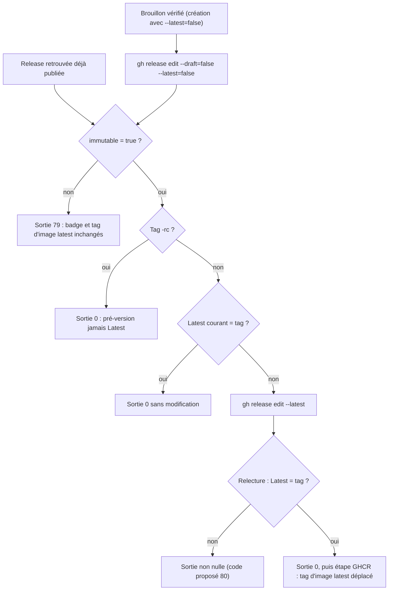

# Design

**Profil :** court

## Contexte

Les références `chemin:ligne` des puces [Existant vérifié] de ce design et de la proposition désignent le commit `244ab1d3` ; la traçabilité en fin de document cite les fichiers à leur état courant et sera recalculée à la mise en œuvre.

- [Existant vérifié] `scripts/release/publish-github-release-assets.sh` : création en brouillon (`:72-77`) avec `--prerelease --latest=false` pour un tag `-rc` (`:66-68`) et sans drapeau `--latest` pour une version finale (`:69-71`) ; téléversement et revérification octet par octet (`:103-141`) ; publication par `gh release edit "$TAG" --draft=false` (`:145`) ; relecture de `isDraft` et `isPrerelease` (`:146-155`) ; lecture de `immutable` (`:163-166`, code 70 si la lecture échoue) et sortie en 79 (`:167-170`). Une release trouvée déjà publiée est vérifiée sans mutation (`:62`, `:127-130`).
- [Existant vérifié] API GitHub, « Update a release » : `make_latest` vaut `true` par défaut pour une release nouvellement publiée ; brouillons et pré-versions ne peuvent pas être Latest. `gh release edit` n'envoie que les champs demandés : `--draft=false` seul publie donc avec `make_latest: true`. `gh release edit` accepte `--latest` (manuel `gh release edit`, option « Explicitly mark the release as "Latest" »).
- [Existant vérifié] Page GitHub « Immutable releases » : seuls le tag et les assets sont verrouillés ; l'état Latest d'une release immuable reste modifiable après publication. Poser le badge après le contrôle est donc possible.
- [Existant vérifié] La pré-version `v0.2.0-rc.2` a été publiée avec `--draft --prerelease --latest=false` (`docs/project/history/release-rehearsal-0.2.0-rc.2-2026-11-08.md`) : `gh release create` accepte `--latest=false` sur un brouillon.
- [Existant vérifié] `.github/workflows/release.yml:426-450` exécute le script ; `:452-481` déplace ensuite le tag d'image GHCR `latest` pour une version finale seulement (`:456-469`). Le job `publish` a `contents: write` (`:171-172`).
- [Existant vérifié] `scripts/release/test-final-audit-contracts.sh:383-385` impose l'ordre attestation, vérification, upload, `latest` ; `:394-395` exige la chaîne littérale `--prerelease --latest=false` dans le script.
- [Existant vérifié] Faux `gh` de `scripts/release/test-publish-github-release-assets.sh` : `--latest=false` ignoré à la création (`:103-105`), édition limitée à `--draft=false` (`:158-171`), API limitée à la lecture de `immutable` (`:18-34`) ; aucun état Latest.

## Objectifs / Hors objectifs

**Objectifs :**
- `release-pipeline` › Le badge Latest n'est posé qu'après le contrôle d'immuabilité.
- `release-pipeline` › Les releases publiées sont immuables (scénario « Release immuable » ajusté).

**Hors objectifs :**
- Modifier l'étape GHCR de `release.yml` ou sa condition de canal.
- Comparer les versions SemVer avant de poser un pointeur Latest (voir la [Question] de la proposition).

## Composants et responsabilités

- `scripts/release/publish-github-release-assets.sh` reste le seul acteur sur la release GitHub. [Proposition] Changements :
  1. version finale : `CHANNEL_ARGS=(--latest=false)` à la création ; la ligne de pré-version garde la chaîne `--prerelease --latest=false` exigée par `test-final-audit-contracts.sh:394` ;
  2. publication : `gh release edit "$TAG" --draft=false --latest=false` pour tout canal ; c'est ce drapeau qui neutralise la valeur par défaut `make_latest: true` ;
  3. après la sortie 79 éventuelle et pour une version finale seulement : lecture du tag Latest courant (`gh api "repos/{owner}/{repo}/releases/latest" --jq '.tag_name'`, une réponse 404 sans release Latest valant « aucun ») ; s'il diffère de `$TAG`, `gh release edit "$TAG" --latest` ; puis relecture obligatoire, fail-closed, qui doit rendre `$TAG`.
- `scripts/release/test-publish-github-release-assets.sh` : le faux `gh` tient un état `latest` au niveau du dépôt, sert `repos/{owner}/{repo}/releases/latest`, applique la valeur par défaut de l'API (publication d'une version finale sans `--latest=false` → Latest) et accepte `edit --latest` sur une release publiée non pré-version.
- `.github/workflows/release.yml` : inchangé ; l'étape GHCR suit le script dans le même job.

## Modèle de domaine et invariants

- Invariant : badge Latest GitHub sur `T` ⇒ `T` est une version finale publiée et `immutable: true` a été lu pour `T` par ce script.
- Invariant : le tag d'image `latest` ne bouge qu'après le badge (ordre des étapes du job `publish`).

## Traitements et interactions

Vue organigramme (cible) — fin du script de publication ; couvre `release-pipeline` › « Le badge Latest n'est posé qu'après le contrôle d'immuabilité ».

Notation : organigramme, pas UML. Cette vue remplacera, dans la page durable, la fin de la vue « Dans quel ordre la chaîne de release valide, approuve, atteste puis publie-t-elle ? » (`docs/developer/immutable-release-publishing.md:172-189`), qui ne distingue pas le badge du tag d'image.

## États et transitions

Non applicable : les états de la release (brouillon, publiée) ne changent pas ; Latest est un attribut du dépôt lu et posé, pas un nouvel état géré par le script.

## Contrats d'interface

- [Proposition] Nouveau code de sortie `80` : version finale immuable dont la relecture ne désigne pas le tag comme Latest, message `GitHub Release <tag> is immutable but could not be marked as the latest release.` (voir la [Question] de la proposition).
- Messages imprimés : `GitHub Release <tag> is now the latest release.` ou `GitHub Release <tag> is already the latest release.` ; pour une pré-version, `GitHub pre-release <tag> is never marked as the latest release.`
- Lecture de vérification du mainteneur après une release finale : `gh api repos/FTurleque/nexus-context-engine/releases/latest --jq '{tag_name, immutable}'` rend le nouveau tag et `true`.

## Persistance et intégrité

Non applicable : aucune donnée NEXUS ni migration SQLite.

## Transactions, concurrence et idempotence

- La pose du badge est idempotente : relue avant écriture, et sautée si le tag est déjà Latest ; une relance du job `publish` reprend aussi une release publiée et immuable restée hors Latest (échec entre la publication et la pose).
- Le job `publish` n'a qu'une instance par tag (`concurrency` `release-${{ github.ref }}`, `.github/workflows/release.yml:11-12`) ; deux releases finales concurrentes ne sont pas un cas du flux (un tag par SHA de `main`, GEN-0089).

## Sécurité et isolation

- Aucune permission ni secret nouveau : `GH_TOKEN` du job, `contents: write` déjà accordé.
- Le badge Latest oriente les téléchargements par défaut (`/releases/latest`) : le poser seulement sur une release immuable évite d'orienter les consommateurs vers des assets remplaçables.

## Erreurs et reprise

- Code 79 : release publiée, non immuable, hors Latest ; reprise inchangée (activer le réglage, nouvelle version, `docs/developer/release-and-recovery.md:69-81`).
- Code proposé 80 : release publiée et immuable mais hors Latest ; reprise par relance des jobs échoués du même run, qui repose le badge puis déplace le tag d'image.
- Lecture du Latest courant en échec autre que 404 : traitée comme « aucun » puis tranchée par la relecture finale, seule fail-closed.

## Observabilité

Le script imprime le résultat de la lecture `immutable` (déjà) et l'issue de la pose du badge (messages de « Contrats d'interface »).

## Performance et mesure

Non applicable : deux appels `gh` de plus au plus par release.

## Compatibilité, migration et retour arrière

- Releases existantes : `v0.2.0` garde le badge jusqu'à la prochaine version finale immuable ; aucune action rétroactive.
- Retour arrière : revenir au commit précédent du script ; aucun état persistant introduit.

## Décisions

- [Décision] Corriger le pipeline, pas la documentation. Le critère de sortie du sprint 15 exige un comportement (« aucune version finale non immuable ne reçoit le badge Latest ») ; réécrire la doc en « le tag d'image latest n'a pas bougé » rendrait la page exacte mais laisserait le défaut, et le badge oriente les consommateurs vers une release dont les assets resteraient remplaçables si le réglage était désactivé.
- [Décision] Poser le badge dans le script de publication, juste après le contrôle d'immuabilité, plutôt que dans l'étape GHCR de `release.yml` : le comportement reste testable avec le faux `gh`, le code 79 l'empêche par construction, et l'ordre badge puis tag d'image respecte « avant ou avec le déplacement GHCR » (action du constat). Un échec de l'étape GHCR après le badge laisse les deux pointeurs divergents jusqu'à la relance du job, qui est idempotente.
- [Décision] `--latest=false` sur la publication (`gh release edit --draft=false --latest=false`) et pas seulement à la création : `make_latest` agit à la publication, et sa valeur par défaut `true` s'applique à la requête qui fait sortir du brouillon.
- [Décision] Pas d'ADR : application de la décision existante de `SEC-0068` (publication immuable, `latest` déplacé en dernier), sans nouvelle option structurante (skill `nexus-adr`, `.claude/rules/documentation.md`).

## Risques / Compromis

- [Risque] `gh release edit --draft=false --latest=false` n'est pas rejoué contre l'API réelle avant la prochaine release → première pré-version ou version finale après fusion : relire `gh api …/releases/latest` (tâche 3.1) ; la création `--latest=false` d'un brouillon est, elle, déjà éprouvée par `v0.2.0-rc.2`.
- [Risque] Entre la publication et la pose du badge, la release précédente reste Latest pendant quelques secondes → voulu : aucune version non qualifiée par le contrôle n'est désignée.
- [Risque] Relance d'une version finale plus ancienne → badge et tag d'image reviennent à cette version (voir la [Question] de la proposition).

## Stratégie de vérification

- `bash scripts/release/test-publish-github-release-assets.sh` : cas « finale immuable » (Latest = tag, `edit --draft=false --latest=false` puis `edit --latest` après la lecture `immutable` dans le journal), « finale non immuable » (79, Latest inchangé), « pré-version » (Latest inchangé), « reprise hors Latest » (seul `edit --latest`), « reprise déjà Latest » (aucun `edit`), « badge non posé » (code 80) ; mutation locale : retirer `--latest=false` de la publication fait échouer le cas 79.
- `bash .claude/scripts/contracts.sh` (dont `scripts/release/test-final-audit-contracts.sh`).
- Lecture `gh api repos/FTurleque/nexus-context-engine/releases/latest` après la prochaine release finale.
- `openspec validate sprint-15-release-latest-apres-immuable --strict`.

## Traçabilité

| Exigence (`capacité › titre`) | Scénario | Conception ou diagramme | Tâche | Test ou preuve |
|---|---|---|---|---|
| `release-pipeline › Le badge Latest n'est posé qu'après le contrôle d'immuabilité` | Version finale immuable | Organigramme de fin de script | 1.1, 1.2 | test non écrit (`scripts/release/test-publish-github-release-assets.sh`) |
| `release-pipeline › Le badge Latest n'est posé qu'après le contrôle d'immuabilité` | Version finale non immuable | Organigramme de fin de script | 1.1, 1.2 | test non écrit (`scripts/release/test-publish-github-release-assets.sh`) |
| `release-pipeline › Le badge Latest n'est posé qu'après le contrôle d'immuabilité` | Pré-version | Composants et responsabilités | 1.1, 1.2 | test non écrit (`scripts/release/test-publish-github-release-assets.sh`) |
| `release-pipeline › Le badge Latest n'est posé qu'après le contrôle d'immuabilité` | Reprise d'une version finale publiée hors Latest | Transactions, concurrence et idempotence | 1.1, 1.2 | test non écrit |
| `release-pipeline › Le badge Latest n'est posé qu'après le contrôle d'immuabilité` | Reprise d'une version finale déjà Latest | Transactions, concurrence et idempotence | 1.1, 1.2 | test non écrit |
| `release-pipeline › Le badge Latest n'est posé qu'après le contrôle d'immuabilité` | Badge non posé | Contrats d'interface | 1.1, 1.2 | test non écrit |
| `release-pipeline › Les releases publiées sont immuables` | Release immuable | Composants et responsabilités | 1.2 | `scripts/release/test-publish-github-release-assets.sh:291-297` à adapter (aucun upload ; `edit --latest` seul admis) |
